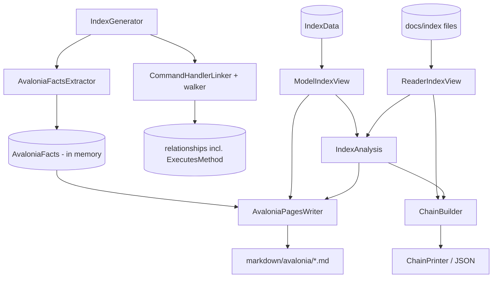

# Design Document

## Overview
Three additions to `tools/PressToShape.CodeIndex`:

1. **`chain` command.** A `ChainBuilder` walks the committed index (symbols, relationships, XAML files) and returns a tree of `ChainNode`s (label, id, location, confidence, reason, children). A printer shows it as indented text, `--json` serializes the same tree. Nothing is stored in the index.
2. **Facts for the documentation pages.** `generate` additionally extracts, from the Roslyn compilations, custom controls with their Avalonia properties and routed events, value converters, and the application class with its lifecycle overrides. These facts are kept in memory (`AvaloniaFacts`) and are only used to write Markdown. A new relationship type `ExecutesMethod` records command handlers and is stored in the relationship files (schema version 3).
3. **Pages and rules.** Six Markdown pages under `markdown/avalonia/` are generated from the index data and the facts. A path-scoped rule file `.claude/rules/code-index.md` tells agents how to explore UI code.

## Steering Document Alignment

### Technical Standards (tech.md)
- No new package. C# 14, nullable, warning-free, `dotnet format`, xUnit with in-memory input.
- The tool stays in `tools/`, `src/` is not touched (Decision Log 9).

### Project Structure (structure.md)
- New code in `Avalonia/` (facts), `Chain/` (chain building) and `Output/` (pages) under `tools/PressToShape.CodeIndex/`, tests in `tests/PressToShape.CodeIndex.Tests/`. One type per file, `internal`.
- `structure.md` gets one line for `markdown/avalonia/` (last task, approval flow).

## Code Reuse Analysis

### Existing Components to Leverage
- **`IndexReader`, `QueryService`, `XamlQueries`, `MemberMatcher`, `CliPrinter`, `CliApp`, `CliOptions`**: extended. The name resolution of `QueryService` is extracted into `NameResolver` and shared with `chain`.
- **`OperationRelationshipWalker`**: gets the command handler detection. It already knows the solution ids and writes edges.
- **`SymbolRecord.GeneratedFrom`** (spec 1): the link from a generated command property to its `[RelayCommand]` method.
- **`XamlFileRecord`, `RelationshipRecord`** (spec 2): bindings (`IsCommand`), resource references, `UsesViewModel` evidence, `UsesConverter`, `HandledBy`.
- **`MarkdownWriter`, `IndexLayout`, `IIndexFileSink`, `InMemoryFileSink`**: page output.
- **`XamlSampleData`, `XamlTestHost`, `TestCompilation`**: test fixtures (extended with more Avalonia stub types).
- **`ViewLocatorConvention`** (spec 2): the convention text for the application page.

### Integration Points
- `IndexData` gets an optional `Avalonia` facts object (not serialized). `IndexGenerator` builds it.
- `RelationshipType.ExecutesMethod` and `IndexSchema.Version = 3`.
- `CliApp`/`CliOptions`/`CliText`: the `chain` command and `--depth`.
- `.claude/rules/code-index.md`, `project-overview.md`, `README.md`.

## Architecture



### Modular Design Principles
- `IIndexView` (symbols, members, relationships, XAML files, projects) has two implementations: `ModelIndexView` over `IndexData` (pages, at generate time) and `ReaderIndexView` over `IndexReader` (chain, at query time, lazy). Everything that interprets the data (`IndexAnalysis`: tests of a symbol, services, models, commands and handlers, views of a view model) is written once against `IIndexView`, so the pages and `chain` cannot disagree.
- Facts extraction is separate from writing. Each page has its own builder class.

### Alternatives considered
1. **Chain stored in the index vs computed on demand.** Computed (decided by the owner): no size, no duplication.
2. **Shared analysis through `IIndexView` vs duplicated logic.** Shared (recommended): one place for "what is a test", "what is a model", "what is a service".
3. **Command handlers as a field of `SymbolRecord` vs a relationship.** A relationship `ExecutesMethod` (recommended): `refs` of a method then shows the command that runs it, and no model change is needed for symbols.
4. **Lambda handlers (R2.4).** Not recorded. No rule is both useful and safe: a lambda such as `() => choose(result)` calls a delegate, not a method of the solution. The handler is reported as "not statically known". R2.4 is a MAY and is not implemented.

## Components and Interfaces

### CommandHandlerLinker and walker extension (R2)
- **Generated commands:** for every property symbol with `GeneratedFrom` that points to a method, an `ExecutesMethod` edge from the property to the method, `verified`, reason `[RelayCommand]`. Built in `IndexGenerator` from the extracted symbols.
- **Direct assignments:** the walker recognizes an assignment, field initializer or property initializer whose value is `new X(...)` where X is `RelayCommand`, `RelayCommand<T>`, `AsyncRelayCommand` or `AsyncRelayCommand<T>` (full name of the original definition, `CommunityToolkit.Mvvm.Input`), the target is a property or field of the solution, and the first argument is a method group (a delegate creation of an `IMethodReferenceOperation`) resolving to a method of the solution. Edge from the target member to the method, `verified`, reason `new RelayCommand(method group)`.
- **Not followed:** lambdas, parameters, locals, conditional expressions. Nothing is recorded, and `chain` reports "not statically known" with the reason.

### AvaloniaFactsExtractor (R3, R4, R7)
- **Input:** `ProjectCompilation`, known ids, the set of class ids that have a XAML file.
- **Custom controls:** solution classes deriving from `Avalonia.Controls.Control` (base chain by full name) that are not in the XAML class set. For each, the static fields whose type is `Avalonia.StyledProperty<T>`, `AttachedProperty<T>` or `DirectProperty<TOwner,T>`: the property name (first constant string argument of the `Register*` call in the field initializer, otherwise the field name without `Property`), the property type (styled, attached, direct), the value type, the default value as written (the `defaultValue` argument syntax), and whether a CLR wrapper exists (a property `X`, or for attached properties methods `GetX`/`SetX`). Static fields of type `Avalonia.Interactivity.RoutedEvent` or `RoutedEvent<T>`: name, argument type, routing strategy as written.
- **Converters:** solution classes implementing `Avalonia.Data.Converters.IValueConverter` or `IMultiValueConverter`.
- **Application:** solution classes deriving from `Avalonia.Application`. For `Initialize` and each override: the solution classes created (`IObjectCreationOperation`, with line), grouped by the lifetime branch they are in. A lifetime branch is the `WhenTrue` part of a conditional whose condition is an `is` pattern or `is` type test against a type that implements `Avalonia.Controls.ApplicationLifetimes.IApplicationLifetime`.
- **Output:** `AvaloniaFacts(Controls, Converters, Applications)`. All items carry symbol ids and file and line, never paths of the machine.

### IIndexView and IndexAnalysis
- **`IIndexView`:** `SymbolOf(id)`, `MembersOf(typeId)`, `Relationships`, `XamlFileOf(id)`, `XamlFiles`, `Projects` (name and number of XAML files).
- **`IndexAnalysis`:**
  - `ViewModelsOf(viewClassId)` and `ViewsOf(viewModelId)`: `UsesViewModel` edges with confidence and reason.
  - `Services(typeId)`: constructor dependencies (`InjectedDependency`), with implementations (`Implements` edges) and creation sites (`Calls` edges to constructors).
  - `Models(typeId)`: types referenced from the type or its members (`References`, `Calls`, `InjectedDependency`) that are declared in a project with no XAML files and that is not the project of the type (A1). Member ids are mapped to their containing type.
  - `Commands(viewModelId)` and `HandlerOf(commandMemberId)`: `GeneratedFrom` or an `ExecutesMethod` edge, otherwise "not statically known" with the reason.
  - `TestsFor(ids)`: edges that end at the ids or their members, whose source is in a class that has a method with an attribute `Fact`, `Theory`, `Test` or `TestMethod` (A2), grouped per test class with file, line and count.

### ChainBuilder, ChainNode, ChainPrinter (R1)
- **Resolution:** `NameResolver` (extracted from `QueryService`) gives found, ambiguous or not found, as in `show`.
- **Subject:** a XAML file or view class is a view. A class with incoming `UsesViewModel` edges is a view model. A property that is a target of command bindings, has `GeneratedFrom` or an `ExecutesMethod` edge is a command. Other symbols give a message that `chain` is for views, view models and commands.
- **Tree for a view:** view and XAML file; each view model link (evidence, confidence, reason); under each view model: bindings (with the command handler for command bindings), services (with implementations and creation sites), models, resources, styles and converters of the view with their definitions, child views (one level, `--depth` for more), tests.
- **Tree for a view model:** the views that use it, then the same sections without the XAML-bound parts. The commands of the view model are listed with their handlers and the places that bind them.
- **Tree for a command:** the bindings that use it, the handler, the tests.
- **Printer:** indented text with `[verified]`/`[inferred]`, locations as `path:line`. `--json` serializes the `ChainNode` tree with `JsonIndexWriter.Options`.
- **Rules:** reads only index files (lazy `ReaderIndexView`), never compiles. Depth is bounded (default 1, maximum 5). Cycles between views are cut with a visited set.

### AvaloniaPagesWriter and page builders (R3 to R9)
- One builder per page, all deterministic and writing through `IIndexFileSink`:
  - `views.md` (the MVVM map, R8): every view with XAML file, view models, evidence, confidence, binding and command counts, test counts, plus unused view models and views without a view model.
  - `controls.md` (R3): custom controls with Avalonia properties and routed events, "none found" per empty section.
  - `converters.md` (R4): converters with XAML uses, "not used" marked.
  - `styles-and-resources.md` (R5): dictionaries and style files with counts, variants, selectors, the include graph, keys referenced but not defined, keys defined but never referenced.
  - `services.md` (R6): injected interfaces with implementations, users and creation sites; container registrations or the "created by hand in" statement.
  - `application.md` (R7): application class, overrides, lifetime branches and what is created, the view locator convention, explicit data templates, content hosts, "no navigation service found".
- XML doc summaries come from the symbol records. Undocumented items are marked.

### Rule file (R10)
- `.claude/rules/code-index.md` with `paths` frontmatter and the seven steps. A `RuleFileTests` test reads it from the repository and checks the frontmatter and that each command it names appears in `CliText.Usage`.

## Data Models

```csharp
// Not serialized: used only by the page writers.
record AvaloniaFacts(IReadOnlyList<ControlFact> Controls, IReadOnlyList<ConverterFact> Converters, IReadOnlyList<ApplicationFact> Applications);
record ControlFact(string Id, string Name, string? BaseType, string File, int Line, string? Summary,
    IReadOnlyList<AvaloniaPropertyFact> Properties, IReadOnlyList<RoutedEventFact> Events);
record AvaloniaPropertyFact(string FieldId, string Name, string PropertyType, string ValueType, string? Default, bool HasClrWrapper, int Line);
record RoutedEventFact(string FieldId, string Name, string? ArgumentType, string? Routing, int Line);
record ConverterFact(string Id, string Name, string File, int Line, string? Summary, IReadOnlyList<string> Interfaces);
record ApplicationFact(string Id, string Name, string File, IReadOnlyList<LifecycleFact> Overrides);
record LifecycleFact(string MethodId, string Name, int Line, IReadOnlyList<CreatedFact> Created, IReadOnlyList<LifetimeBranchFact> Branches);
record LifetimeBranchFact(string LifetimeType, int Line, IReadOnlyList<CreatedFact> Created);
record CreatedFact(string TypeId, string TypeName, int Line);

// Serialized by --json and printed by the CLI.
record ChainNode(string Label, string? Id, string? Location, Confidence? Confidence, string? Reason, IReadOnlyList<ChainNode> Children);
```
`RelationshipType` gets `ExecutesMethod` (appended). `IndexSchema.Version` becomes 3.

## Error Handling
1. **Unknown or ambiguous name:** the candidates or "not found", exit 1 (as `show`).
2. **Symbol that is not a view, view model or command:** a message that says what `chain` accepts, exit 1.
3. **Missing or old index:** the regenerate message (schema checks of the reader).
4. **Missing data in a chain** (no view model link, no implementation, no creation site, no handler): the node says what is missing and why ("not statically known"), never an invention.
5. **Cycles and depth:** a visited set and a depth limit, so a cycle prints once and stops.
6. **Unreadable facts at generate time** (no Avalonia types, no Application class): the sections say "none found". Nothing fails.
7. **Rule file test:** a clear message naming the missing command or the missing frontmatter.

## Testing Strategy

### Unit Testing (in-memory C# and XAML)
- `CommandHandlerTests`: generated commands, method group assignments and initializers, `AsyncRelayCommand`, generic forms, lambdas, parameters and locals (nothing recorded), non-solution methods.
- `AvaloniaFactsExtractorTests`: styled, attached and direct properties (with and without constants, defaults, wrappers), routed events, controls with and without XAML, converters, application overrides and lifetime branches.
- `IndexAnalysisTests` (over both `IIndexView` implementations, with a parity test): services, models, tests, commands and handlers.
- `ChainBuilderTests` and `ChainPrinterTests`: view, view model, command, ambiguous and unknown names, depth, cycles, `--json`.
- Page tests per page: content, "none found", marks for `inferred`, determinism, no absolute paths.
- `CliChainTests`: parsing of `--depth`, exit codes, help text.
- `RuleFileTests`.

### Integration Testing
- `XamlSampleData` is extended with commands, converters, a custom control, an application class and test classes, so that pages and `chain` run through the real generator and the real reader.

### End-to-End Testing
- Real solution: `generate`, `check`, a second `generate` (identical). Compare by hand: `chain DesktopShellView` (child views, services, tests), `chain LayersViewModel` (commands and handlers), `chain` of a hand-built command (not statically known), the six pages against the source (controls, converters, services, startup with the three lifetime branches), `dotnet build`, `dotnet test`, `dotnet format`.

## Risks and Open Points
- **Test detection by attribute name** (A2) can miss other frameworks. The rule file says so.
- **Model classification by project** (A1) is a layer rule, not semantics. The heading says so.
- **Output size of `chain`** for big views (the shell has 20 bindings). Bindings are listed compactly, and the child views stay one level deep by default.
- **Schema 3** invalidates the committed index until it is regenerated (done in the last task).
- **The rule file** changes how future agent sessions explore UI code. It is reviewed with this spec.
