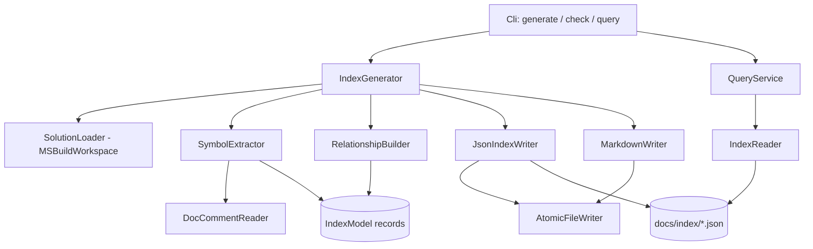

# Design Document

## Overview
A console tool, `tools/PressToShape.CodeIndex`, loads `PressToShape.sln` with Roslyn, extracts symbols, XML docs and relationships into an in-memory model, and writes JSON plus Markdown to `docs/index/`. The same tool answers queries from those files. Extraction works on a Roslyn `Compilation`, so it is testable with in-memory source. Only the solution loader touches MSBuild.

## Steering Document Alignment

### Technical Standards (tech.md)
- .NET 10, C# 14, nullable on, xUnit, `dotnet format`, warning-free build.
- New packages are approved by the owner (confirmed for this spec): `Microsoft.CodeAnalysis.CSharp`, `Microsoft.CodeAnalysis.Workspaces.MSBuild`, `Microsoft.Build.Locator`. They go into `Directory.Packages.props` (no `Version` on a `PackageReference`) and are referenced only by the tool project. `tech.md` must list them (task).
- No JSON or CLI library is added: `System.Text.Json` (in the SDK) writes and reads the JSON, and the CLI parses its few arguments by hand.

### Project Structure (structure.md)
- New top-level `tools/` folder and a test project in `tests/`. Nothing in `src/` references them. The dependency rule `Desktop/Android -> App -> Core` is unchanged. `structure.md` gets the new folders (task).
- One type per file, file-scoped namespaces, `internal` unless needed.

## Code Reuse Analysis
- **`tests/PressToShape.App.Tests/RepoPaths.cs`**: the same solution-root search pattern is reused (copied into the tool as a small `RepoRoot` helper, since the test project cannot be referenced).
- **`HeadProjectReferenceTests`**: pattern for a test that asserts project references. A similar test asserts that no `src/` project references the tool or Roslyn.
- **`tests/PressToShape.Benchmarks`**: precedent for a non-shipped console project in the solution.
- Central package management and `Directory.Build.props` apply unchanged.

### Integration Points
- `PressToShape.sln` (new `tools` folder, tool project and its test project).
- `README.md` (short section: generate, check, query).
- `.gitignore`: nothing added. `docs/index/` is committed.

## Architecture



### Modular Design Principles
- `SolutionLoader` is the only MSBuild-aware unit. Everything after it takes `Compilation` or the model.
- Writers take the model and an `IIndexFileSink` (real: atomic file writer, tests: in-memory). `check` generates into an in-memory sink and compares it with the files on disk, so it never writes.
- Queries read only the index files (R6.5) through `IndexReader`.

## Components and Interfaces

### SolutionLoader
- **Purpose:** open the `.sln`, return one `Compilation` per C# project, including source-generator output, plus load diagnostics.
- **Interfaces:** `Task<LoadResult> LoadAsync(string solutionPath, CancellationToken ct)`; `LoadResult(IReadOnlyList<ProjectCompilation>, IReadOnlyList<LoadProblem>)`.
- **Dependencies:** `Microsoft.Build.Locator` (registered once at startup, before any MSBuild type loads), `MSBuildWorkspace`.
- **Behavior:** only projects under `src/` and `tests/` are kept (R1.1), which excludes `tools/` itself. A project that fails to load or has compile errors is a `LoadProblem` (R1.7). See "Deviation from R1.7" below.

### SymbolExtractor
- **Purpose:** walk `compilation.Assembly.GlobalNamespace` (source symbols only) and build `SymbolRecord`s (R1.2 to R1.6).
- **Interfaces:** `IReadOnlyList<SymbolRecord> Extract(ProjectCompilation project)`.
- **Details:** id is `ISymbol.GetDocumentationCommentId()` (stable, signature-based, no paths). Location comes from `Location.GetLineSpan()`, converted to a repo-relative path with `/`. Symbols in source-generator output get `IsGenerated = true` and a virtual path `generated/<hint name>` (no machine path). `GeneratedFrom` is set for CommunityToolkit.Mvvm output by pairing the generated property or command with the field or method carrying `[ObservableProperty]` or `[RelayCommand]` in the same type. If no pairing is found, it is left empty.

### DocCommentReader
- **Purpose:** turn `ISymbol.GetDocumentationCommentXml(expandIncludes: true)` into `DocRecord` (summary, remarks, params, returns, exceptions as written) (R2).
- **Details:** `inheritdoc` is resolved by Roslyn's own expansion where it can, and `InheritedFrom` is set when the text came from another symbol. No text is created for undocumented symbols (`HasDocumentation = false`). Doc XML is parsed with `System.Xml.Linq`, tags are kept as plain text, `cref` becomes the member name.

### RelationshipBuilder
- **Purpose:** build `RelationshipRecord`s (R3) from symbols and, for references and calls, from `SemanticModel` walks.
- **Relationship types:** `Inherits`, `Implements`, `InjectedDependency`, `References`, `Calls`, `Registers`.
- **Details:**
  - `Inherits`/`Implements`: from `INamedTypeSymbol.BaseType` and `AllInterfaces`. Reverse lookup is done by the query layer.
  - `InjectedDependency`: each parameter of each constructor whose type is declared in this solution. Primary constructors count. Confidence `verified`.
  - `References`/`Calls`: an `IOperation` walk per method body. Targets are resolved symbols of this solution (`SymbolEqualityComparer.Default`, original definition). A call is only recorded when the operation has a resolved `TargetMethod`. Calls on `dynamic` or through reflection are not recorded as `verified`. They are dropped in this spec and not guessed (R3.5 allows not recording them).
  - Calls through an interface are recorded as `verified` against the interface method. The query layer expands to implementations and labels those results `inferred` (the runtime target is not static).
  - `Registers`: calls resolving to `Add{Singleton,Scoped,Transient}` of `Microsoft.Extensions.DependencyInjection` with a type argument from this solution. There are none today, so none are written (R3.7).
  - Every record has `Confidence` (`Verified` or `Inferred`) and an optional `Reason`.

### JsonIndexWriter / MarkdownWriter
- **Purpose:** write the files in the layout below (R4, R5).
- **Details:** sorted ordinally everywhere, indented JSON with `\n` line ends, UTF-8 without BOM, no timestamps, no absolute paths. `schemaVersion` is a constant in `IndexSchema`. Markdown is rendered from the same model (R5.2), one page per namespace, with "Relationships" and `inferred` marks.

### AtomicFileWriter
- **Purpose:** write to `<name>.tmp`, then replace (R-NFR reliability). Removes stale files under `docs/index/` that the run did not produce (R7.3), but only inside that folder.

### IndexReader and QueryService
- **Purpose:** read the files and answer queries (R6).
- **Interfaces:** `Search(term)`, `Show(id or name)`, `Implementations(interfaceId)`, `Derived(typeId)`, `References(symbolId)`, `Dependencies(typeId)`.
- **Details:** `names.tsv` (one line per named type and member: `name<TAB>id<TAB>file`) is searched for `find`, ranked exact, prefix, substring. A `show` reads only the one namespace file named in the line. Reverse lookups read the relationship files (per project, small). A schema mismatch or a missing manifest prints the regenerate command and exits non-zero (R6.4).

### Cli
- **Commands:** `generate`, `check`, `find <term>`, `show <name|id>`, `impls <interface>`, `derived <type>`, `refs <symbol>`, `deps <type>`. Flags: `--json`, `--solution <path>` (default: found from the current directory upward), `--help`.
- **Exit codes:** 0 success, 1 failure, 2 usage error. `check` exits 1 and lists differing files when the committed index is stale (R7.2).

## Output Layout (`docs/index/`)
```
manifest.json                       schemaVersion, toolVersion, projects, counts, warnings
names.tsv                           flat search list (grep friendly)
symbols/<Project>/<Namespace>.json  symbols of one namespace in one project
relationships/<Project>.json        edges whose source symbol is in that project
markdown/README.md                  overview and project list
markdown/<Project>/<Namespace>.md   one page per namespace
```
Per-namespace files keep diffs small (R4.5, Performance NFR).

## Data Models
```csharp
record SymbolRecord(string Id, string Name, string QualifiedName, string SymbolType,
    string Accessibility, IReadOnlyList<string> Modifiers, string? ContainingId,
    string Namespace, string Project, string File, int StartLine, int EndLine,
    string? Signature, IReadOnlyList<ParameterRecord> Parameters, string? TypeName,
    IReadOnlyList<AttributeRecord> Attributes, string? BaseType,
    IReadOnlyList<string> Interfaces, bool IsGenerated, string? GeneratedFrom, DocRecord Doc);

record ParameterRecord(string Name, string Type);
record AttributeRecord(string Name, IReadOnlyList<string> Arguments);
record DocRecord(bool HasDocumentation, string? Summary, string? Remarks,
    IReadOnlyDictionary<string, string> Params, string? Returns,
    IReadOnlyList<ExceptionDoc> Exceptions, string? InheritedFrom);
record RelationshipRecord(string Type, string FromId, string ToId, string? File,
    int? Line, string Confidence, string? Reason);
```
`SymbolType` values: `Namespace, Class, Interface, Record, Struct, Enum, Delegate, Method, Constructor, Property, Field, Event` (the word "type" per the naming rule, not "kind"). Roslyn's own `TypeKind` is read internally only.

## Error Handling
1. **Project does not load or compile:** recorded as a `LoadProblem` in the manifest and on stderr, the rest is processed, exit code 1 (R1.7), except as below.
2. **Android project cannot load:** see the deviation below.
3. **MSBuild not found / SDK missing:** clear message with the required SDK, exit 1, nothing written.
4. **Output folder not writable or partial run:** temp files are removed, the old index stays intact.
5. **Query on missing or old index:** message with the `generate` command, exit 1.
6. **Unknown command or argument:** usage text, exit 2.

### Deviation from R1.7 (needs your approval with this document)
The owner chose: "index Android if it loads, otherwise warn, exit code stays 0". R1.7 as approved says every project failure gives a non-zero exit code. This design follows the owner's choice only for `PressToShape.Android`: its failure is a warning in the manifest and does not change the exit code. Any other project failing still exits 1. **R1.7 should be amended on approval of this document.**

## Risks and Open Points
- **Roslyn and SDK version:** the SDK here is 10.0.404, and the local cache holds Roslyn 4.14, which may not support it. Task 1 picks the newest stable `Microsoft.CodeAnalysis` that loads this solution under SDK 10 (a spike, recorded in the task log), and pins it in `Directory.Packages.props`.
- **Restore needed:** `MSBuildWorkspace` needs a restored solution. `generate` documents "run `dotnet restore` first" in its error message and does not restore itself.
- **Reflection (`ViewLocator`) and DI:** nothing is inferred here. The XAML and View-to-ViewModel links come in spec 2.
- **DocFX:** assessed and not used. It generates conventional API pages from XML docs and metadata, but cannot give per-symbol relationships, confidence marks or the small JSON and `names.tsv` that agents need. It also adds a heavy tool dependency. It can be added later for a human-facing site without changing this index.
- **`dotnet format`:** applies to the tool code like all code. It is not part of the index.
- **Microsoft.Build (direct):** not referenced. Only `Microsoft.Build.Locator` is needed, `Workspaces.MSBuild` brings what it needs.

## Testing Strategy

### Unit Testing
Tests live in `tests/PressToShape.CodeIndex.Tests` and compile small C# snippets in memory with `CSharpCompilation` (no MSBuild, no real file system, deterministic).
- `SymbolExtractorTests`: types, members, signatures, modifiers, attributes, base types, nested types, generated members (R1).
- `DocCommentReaderTests`: documented, undocumented, `inheritdoc` (R2).
- `RelationshipBuilderTests`: inheritance, implementation, injected dependencies, references, calls, dynamic and reflection not `verified`, DI registration with a small fake `IServiceCollection` stub, no registration invented (R3).
- `JsonIndexWriterTests` / `MarkdownWriterTests`: run twice into an in-memory sink and compare bytes, no absolute paths, sorted, schema version (R4, R5).
- `QueryServiceTests`: ranking, `show`, `impls`, `derived`, `refs`, `deps`, schema mismatch (R6).
- `AtomicFileWriterTests`: temp-folder test for replace and stale-file removal, using a unique temp directory (the one documented file system exception).
- `ProjectReferenceTests`: no `src/` project references the tool or a Roslyn package (NFR).

### Integration Testing
- `SolutionLoader` is thin and not unit-tested. It is covered by a manual run of `generate` followed by `check` (must report no differences) as the final task, with the result recorded in the implementation log.

### End-to-End Testing
- Run `generate` on the real solution, then `find`, `show`, `impls` and `refs` on known types (for example `ILocalizer`) and compare with the source by hand. Record the result in the task log.
