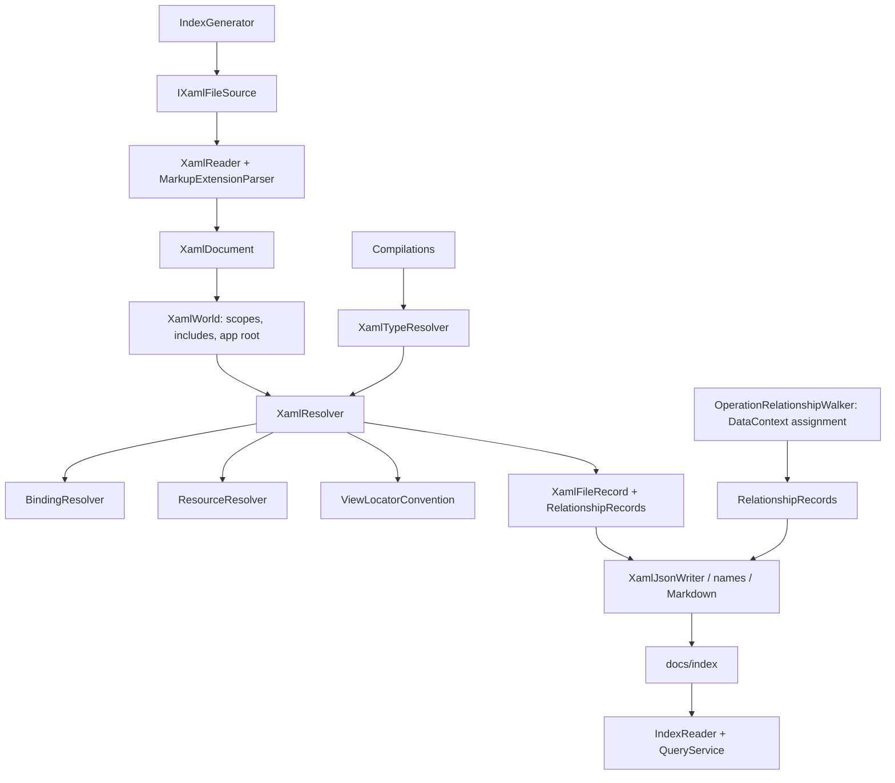

# Design Document

## Overview
The code index tool (`tools/PressToShape.CodeIndex`) gets a second source type. A new `Xaml/` part reads every `.axaml` file into a model, resolves it against the Roslyn compilations that the tool already has, and emits (a) one JSON file per XAML file, (b) searchable names, (c) new relationships in the existing per-project relationship files. The query commands learn to show and search XAML entities.

Pipeline, added to `IndexGenerator`:

1. Existing: load compilations, extract symbols, build C# relationships.
2. New: find and parse XAML files of every indexed project (`XamlReader`).
3. New: build a solution-wide `XamlWorld` (all documents, resource scopes, include graph, the application root).
4. New: per file, resolve types, bindings, resources, converters, handlers and view model links (`XamlResolver`), producing `XamlFileRecord`s and relationships.
5. Existing writers write everything. New writers write the `xaml/` files, the XAML Markdown pages and the XAML names.

## Steering Document Alignment

### Technical Standards (tech.md)
- No new package. `System.Xml.Linq` (BCL) parses the XML, and a small hand-written reader parses markup extensions (A1 of the requirements). The tool stays free of Avalonia assemblies.
- C# 14, nullable, warning-free, `dotnet format`, xUnit with in-memory input.
- Decision Log entry 9 (tools/ separation) still holds: `src/` is untouched.

### Project Structure (structure.md)
- New files live in `tools/PressToShape.CodeIndex/Xaml/` and `tests/PressToShape.CodeIndex.Tests/Xaml/`. One type per file, file-scoped namespaces, `internal` types.
- `docs/index/` gets a `xaml/` folder. `structure.md` and `README.md` are updated in the last task, and `structure.md` goes through the approval flow.

## Code Reuse Analysis

### Existing Components to Leverage
- **`SymbolExtractor` ids (`GetDocumentationCommentId`)**: XAML links point to the same ids (`T:`, `P:`, `M:`, `E:`).
- **`RelationshipRecord` and `RelationshipBuilder`/`OperationRelationshipWalker`**: the C# `DataContext` assignment detection (R4.2) is added to the walker, because it already walks all member bodies with the solution-wide known ids.
- **`SourcePaths`, `IndexLayout`, `JsonIndexWriter.SerializeLines`, `NamesTableWriter`, `MarkdownWriter`, `IIndexFileSink`, `InMemoryFileSink`, `AtomicFileWriter`**: reused for output, atomic writes and tests.
- **`IndexReader`, `QueryService`, `CliPrinter`**: extended, not replaced.
- **`LoadProblem`**: used for malformed XAML (error, R1.3).
- **`TestCompilation`**: in-memory C# for the resolver tests.

### Integration Points
- `ProjectCompilation`: gets the project directory (derived from `ProjectPath`) so that XAML files can be found.
- `IndexData`/`ProjectIndex`: get a list of `XamlFileRecord`s.
- `IndexSchema.Version`: 1 to 2. `ManifestProject` gets `XamlFileCount`.
- `names.tsv`: new symbol types `View`, `Element`, `Resource`, `Style`, `Template`.

## Architecture



### Modular Design Principles
- Parsing (`XamlReader`) knows nothing about C#. Resolution (`XamlResolver` and helpers) takes a parsed `XamlDocument` plus a `Compilation`. Both are testable with strings.
- File discovery is behind `IXamlFileSource` (disk in production, in-memory in tests).
- The XAML resolution has no ordering dependence on the C# relationship pass, except that both use the same solution-wide id set.

### Alternatives considered
1. **XAML parser:** (a) `System.Xml.Linq` plus a hand-written markup extension reader (recommended); (b) Avalonia's XamlX parser. (b) would pull Avalonia assemblies into the tool, tie it to the Avalonia version and still not resolve against Roslyn symbols. (a) is small (the markup syntax of Avalonia is simple) and is fully under test.
2. **Where `DataContext` assignments are found:** (a) in the existing walker (recommended): one pass over bodies, the same known ids; (b) a separate walker: duplicates the traversal.
3. **Entity ids:** (a) element path ids such as `X:Views/Editor/LayersView.axaml#/UserControl/DockPanel/Grid/Button[1]` (recommended): no counters, readable, stable unless siblings of the same type are inserted before the element; (b) running numbers: break on every edit. Names are searchable separately, so agents rarely depend on the path.

## Components and Interfaces

### IXamlFileSource / DiskXamlFileSource
- **Purpose:** list and read `.axaml` files of a project (A2). `IReadOnlyList<string> List(string projectDirectory)` (repo-relative, sorted, no `bin/` or `obj/`), `string Read(string path)`.
- **Dependencies:** the repo root. Production reads the disk, tests use a dictionary.

### XamlReader
- **Purpose:** parse a file into a `XamlDocument` (R1, R2).
- **Details:** `XDocument.Load` with `LoadOptions.SetLineInfo`, `DtdProcessing.Prohibit` and no `XmlResolver` (security NFR). Property elements (`UserControl.Resources`, `Style.Setters`) become `PropertyElement` nodes of their owner. Attributes are classified: markup extension (`{...}`), event candidate, or literal. Literals are dropped (R2.4). `xmlns` declarations are kept for type resolution.
- **Errors:** an `XmlException` becomes a `LoadProblem` error for that file (R1.3).

### MarkupExtensionParser
- **Purpose:** parse `{Binding Path, Mode=OneWay, Converter={StaticResource X}}` into `MarkupExtension(Name, Positional[], Named{})` with nested extensions, quoted strings and `{}` escape.
- **Details:** hand-written, no regex, bounded recursion depth, never throws on bad input (returns `null`, and the attribute is then a finding).

### XamlTypeResolver
- **Purpose:** map `prefix:Name` to a type (R1.4). `using:Ns` and `clr-namespace:Ns;assembly=A` map directly. The default namespace (`https://github.com/avaloniaui`) is read from the `XmlnsDefinition` attributes of the referenced Avalonia assemblies in the compilation (no hardcoded namespace list).
- **Result:** `ResolvedType(INamedTypeSymbol? Symbol, string Display, string? SolutionId)`. `SolutionId` is set only if the id is in the solution-wide set. Other types are recorded by name only.

### BindingResolver
- **Purpose:** resolve binding paths (R5).
- **Details:**
  - Data type scope: nearest ancestor (or self) with `x:DataType`, or a `DataTemplate` with `DataType`.
  - Path grammar handled: `A.B.C`, leading `!`, `.`; unresolved (never verified): indexers, attached properties `(x:Type.Prop)`, casts, stream `^`, method calls.
  - Each segment is looked up on the current type: properties and fields, then base types and, for interfaces, their base interfaces. The next type is the member type (collection element types are not followed).
  - `ElementName` resolves to the named element's type, `RelativeSource` with `AncestorType` to that type. Anything else is `unresolved` with a reason.
  - `ICommand` detection: the property type implements `System.Windows.Input.ICommand`.
  - The result is `BindingResolution(Status, PropertyId?, TargetTypeId?, Reason?)`.

### ResourceResolver and XamlWorld
- **Purpose:** resolve `StaticResource`/`DynamicResource` (R7), converters (R8) and includes (R6.4).
- **Details:**
  - `XamlWorld` holds all documents and the include graph. `avares://Assembly/path` maps to the project whose assembly name is `Assembly` (read from the compilation) and then to the file. Relative `Source` values resolve against the including file.
  - Lookup order for a reference at an element: element and ancestors (`Resources` property elements, nearest first), then the application document (`Application.Resources`, merged dictionaries from the last to the first), then the application's `Application.Styles` includes (their `Styles.Resources`). At one level a key defined in several theme variants (`ThemeDictionaries` Light and Dark) gives one link per variant. The nearest level wins.
  - No hit: `unresolved`, reason "not defined in this solution (may come from the Avalonia theme)" (A3).

### ViewLocatorConvention
- **Purpose:** the only source of `inferred` View to ViewModel links (R4.5).
- **Details:** (1) find a type in `Application.DataTemplates` that implements `IDataTemplate` and is declared in the solution; (2) read its `Build` method with Roslyn operations and recognize the pattern `<expr>.Replace("A", "B")` on a type name followed by `Type.GetType`. If both are found the convention is `A -> B` and the registration is the application XAML file. If not, no inferred link is created and a finding says why. The tool never assumes the convention.
- **Use:** for a `ContentControl.Content` binding (or `ItemsControl.ItemsSource` without an item template) that resolves to a property of a solution class `T`, the candidate view is the type named `T.FullName.Replace(A, B)`. If that type exists in the solution, an `inferred` link is recorded, with the reason naming the registration, the convention and the binding.

### XamlResolver (orchestration)
- **Purpose:** per `XamlDocument`, call the helpers and produce a `XamlFileRecord` plus relationships.
- **Link rules (R3, R4, R9):**
  - `x:Class` resolves to a class: `CodeBehind` relationship (file to class). Otherwise a finding.
  - `x:DataType` on the root: `UsesViewModel` (class to data type), evidence `x:DataType`, verified.
  - `Design.DataContext`/`d:DataContext`: `UsesViewModel`, evidence "design-time only", `inferred` (a design-time fact is not a runtime fact).
  - `DataContext="{Binding P}"` on an element of a solution view class: if the binding resolves to a property of solution class type: `UsesViewModel` (element's view class to that class), verified, evidence "DataContext binding" (R4.7).
  - `DataTemplate DataType`: `UsesType` from the template to the type, verified.
  - Event attribute: an attribute whose name is an event of the resolved control type (events are read from the Roslyn symbol, walking base types). It resolves to the `x:Class` method with that name when there is exactly one (`HandledBy`, verified). Otherwise `unresolved`.
  - Types of elements and resources that are solution classes: `UsesType`, verified.
  - `StyleInclude`/`ResourceInclude`/`MergedDictionaries` `Source`: `Includes`, verified, if the file is in the solution.

### OperationRelationshipWalker (extension)
- **Purpose:** R4.2. An `ISimpleAssignmentOperation` (also inside object initializers) whose target is the `DataContext` property of a type that derives from `Avalonia.Controls.Control`, and whose value has a static type that is a class of the solution (after removing conversions): `UsesViewModel` from the view class to that class, verified, evidence "DataContext assignment", file and line.

### Output and query changes
- **Writers:** `XamlJsonWriter` writes `xaml/<Project>/<path with / as .>.json` with one record per line per list (same technique as `SerializeLines`, generalized to several lists). `MarkdownWriter` adds a page per view under `markdown/<Project>/xaml/`. `NamesTableWriter` adds XAML entries.
- **Reader/Query:** `IndexReader.XamlFile(path)`. `QueryService.Show` returns a `ShowResult` with an optional `Xaml` part (for a view class: its XAML file via the `CodeBehind` edge). `References` also counts the new relationship types that point at the symbol (`BindsTo`, `ReferencesResource`, `HandledBy`, `UsesType`, `UsesConverter`, `UsesViewModel`). Hits for XAML ids are named from the id (`XamlIds.Describe`).
- **CLI:** `CliPrinter` prints the XAML parts (bindings with confidence, resources, handlers). Help text lists the new symbol types.

## Data Models

```csharp
// Ids: file "X:<repo path>", element "X:<repo path>#/Root/Child[2]", binding "<element id>@<Property>",
//      resource definition "R:<repo path>#<scope path>/<key>[@Variant]", style "S:<repo path>#<selector or key>@<line>"
record XamlFileRecord(string Id, string Project, string File, string Root, string? Class, string? ClassId,
    string? DataType, string? DataTypeId, IReadOnlyDictionary<string,string> Namespaces,
    IReadOnlyList<XamlElementRecord> Elements, IReadOnlyList<XamlBindingRecord> Bindings,
    IReadOnlyList<XamlResourceRecord> Resources, IReadOnlyList<XamlResourceRefRecord> ResourceRefs,
    IReadOnlyList<XamlStyleRecord> Styles, IReadOnlyList<XamlTemplateRecord> Templates,
    IReadOnlyList<XamlHandlerRecord> Handlers, IReadOnlyList<string> Findings);

record XamlElementRecord(string Id, string? ParentId, string Type, string? TypeId, string? Name, int Line, string? Property);
record XamlBindingRecord(string Id, string ElementId, string Property, string BindingType, string? Path,
    string? Converter, string? Mode, string? Source, string? TargetId, string? TargetTypeId,
    bool IsCommand, Confidence Confidence, string? Reason, int Line);
record XamlResourceRecord(string Id, string Key, string Type, string? TypeId, string? Variant, int Line);
record XamlResourceRefRecord(string Id, string ElementId, string Property, string Key, string RefType,
    IReadOnlyList<string> TargetIds, Confidence Confidence, string? Reason, int Line);
record XamlStyleRecord(string Id, string Selector, string? Key, IReadOnlyList<string> Setters, IReadOnlyList<string> ResourceKeys, int Line);
record XamlTemplateRecord(string Id, string TemplateType, string? Target, string? TargetId, string? Key, int Line);
record XamlHandlerRecord(string Id, string ElementId, string Event, string Handler, string? TargetId, Confidence Confidence, string? Reason, int Line);
```
`RelationshipType` gets: `UsesViewModel`, `CodeBehind`, `BindsTo`, `ReferencesResource`, `UsesConverter`, `HandledBy`, `UsesType`, `Includes`. For a relationship, `Reason` carries the evidence for verified and inferred edges alike.

## Error Handling

1. **Malformed XAML:** a `LoadProblem` error naming the file and line. Other files continue. The run fails like a C# compile error (R1.3).
2. **Unresolvable item** (binding path, resource key, handler, `x:Class`, include): never an exception. Recorded as `unresolved` with a reason, and for compiled bindings (R5.6) also listed in the file's `Findings`.
3. **Unknown or odd markup:** the attribute is skipped and a finding is added. The parser returns `null` for input it does not understand and has a depth limit against pathological nesting.
4. **ViewLocator convention not recognized:** no inferred links, one finding in the application file.
5. **DTD or external entity in XAML:** parsing is prohibited, so it is reported as malformed XAML (security NFR).
6. **Duplicate names:** both recorded, a warning finding (R2.3).
7. **Old index schema:** the query commands report the schema version and the regenerate command (as before).

## Testing Strategy

### Unit Testing (in-memory XAML text and in-memory C# compilations)
- `MarkupExtensionParserTests`: simple, positional and named arguments, nesting, quotes, escapes, `$parent[...]`, malformed input, depth limit.
- `XamlReaderTests`: hierarchy, names, property elements, line numbers, literals dropped, malformed XML, DTD and entity rejection.
- `XamlTypeResolverTests`: `using:`, `clr-namespace:`, the default namespace through `XmlnsDefinition`, solution versus package types.
- `BindingResolverTests`: nested paths, base members, interface members, generated properties, commands, `!`, indexer or cast as unresolved, `ElementName`, `RelativeSource`, no `x:DataType`, template `DataType` scope, not-found segment reasons.
- `ResourceResolverTests`: scope order, merged dictionaries, `ThemeDictionaries` variants, `avares://` includes, nearest wins, theme keys unresolved, relative includes.
- `ViewModelLinkTests`: `x:DataType`, `DataContext` binding on a child view (R4.7), C# assignment (initializer and assignment), design-time only, `ViewLocator` inferred link, convention not recognized, no link from names alone.
- `EventHandlerTests`, `ConverterTests`, `StyleTemplateTests`, `CodeBehindTests`.
- Writer tests: determinism (twice and shuffled), no absolute paths, one record per line, names entries, Markdown page.
- `QueryServiceTests` and `CliAppTests`: `find` returns XAML entries, `show` of a view, `refs` of a view model property lists bindings, inferred marks, old schema.

### Integration Testing
- `IndexGeneratorTests` with a small in-memory solution: two projects, XAML in both, includes across projects.
- The real solution: `generate`, `check`, and manual comparison of `show` for `DesktopShellView`, `LayersView` and `refs` for `LayersViewModel.AddLayerCommand` with the XAML source (last task).

### End-to-End Testing
- Run `generate` twice (byte-identical), `check`, `dotnet build`, `dotnet test`, `dotnet format --verify-no-changes`. Compare the six `DataContext` bindings of the shell and the four `ContentControl` hosts of the inspector with the output, and confirm that the `ViewLocator` links are `inferred` and everything else is `verified`.

## Risks and Open Points
- **Element path ids** change when same-type siblings are inserted before an element. Names stay stable. Accepted.
- **Avalonia binding semantics** are large. The resolver is conservative: anything it does not model is `unresolved`, never `verified`.
- **`avares://` mapping** assumes that the assembly name equals the project's compilation assembly name. This is read from the compilation, not guessed.
- **Index size:** XAML adds little (17 files, about 170 bindings). Literal values are not recorded.
- **Amendment of the requirements:** R4.7 (DataContext binding) was added to `requirements.md` during design. Approving this design approves that addition.
