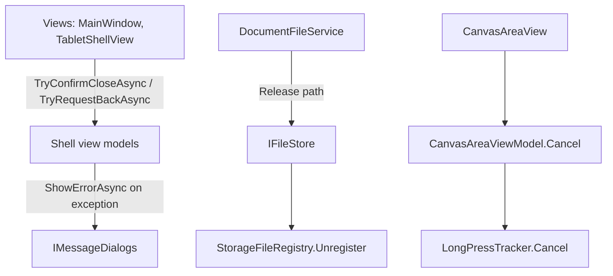

# Design Document

## Overview

Six small fixes in `PressToShape.App`, one per requirement (R1–R6). No new types of architecture. Logic goes into view models and services, views only forward events.

## Steering Document Alignment

### Technical Standards (tech.md)
MVVM with CommunityToolkit.Mvvm, `ILocalizer` for texts, xUnit and Avalonia.Headless for tests. No new packages.

### Project Structure (structure.md)
Changes stay in `ViewModels/Editor`, `ViewModels/Tablet`, `Views/*`, `Services` and `Workspace`. Nothing moves between folders.

## Code Reuse Analysis

### Existing Components to Leverage
- **`ObjectRowType` / `ObjectRowViewModel` / `LayersViewModel.DefaultName`**: add a `Text` member, an `IsText` flag and a default-name case, like Ellipse and Path.
- **`IMessageDialogs.ShowErrorAsync`**: already shows an error in a window (desktop) or in the layout (tablet). Used for R2.
- **Existing text "The operation could not be done."** (`de.po` line 928): reused as the R2 message, so no new translation is needed. The msgid "Text" also exists already (tool name) and is reused for R1.
- **`CanvasAreaViewModel.PointerPressed(... inputType ...)`** and **`LongPressTracker.Cancel()`**: reused for R3 and R6.
- **`IFileStore`** (implemented by the local store and `StorageFileStore`): gets the release call for R4, so `DocumentFileService` does not need to know the registry.

### Integration Points
- `DocumentFileService` calls the file store after each file action. `StorageFileStore` forwards to `StorageFileRegistry`.

## Architecture

## Components and Interfaces

### R1 Text row
- `ObjectRowType.Text` (new), `ObjectRowViewModel.IsText` (new, like `IsPath`).
- `LayersViewModel.AddShapes`: add `TextShape => ObjectRowType.Text` to the switch. `DefaultName`: `ObjectRowType.Text => Localizer.T(N("Text"))`.
- `LayersView.axaml`: one more `MaterialIcon Kind="FormatText"` bound to `IsText` (same size resources as the others).
- Check whether other places switch over `ObjectRowType` (the compiler does not force it because of `_ =>` arms) and fix those found by search.

### R2 Guarded back and close
- `EditorShellViewModel` keeps the `IMessageDialogs` from `FileServices` and gets `TryConfirmCloseAsync()`: calls `ConfirmCloseAsync()`, catches every exception except `OperationCanceledException`, shows `T("The operation could not be done.")` with `ShowErrorAsync` (itself in a try/catch that swallows), and returns `false` so the window stays open.
- `TabletShellViewModel.TryRequestBackAsync()`: same wrapper around `RequestBackAsync()`.
- `MainWindow.OnClosing` calls `TryConfirmCloseAsync`, `TabletShellView.OnBackRequested` calls `TryRequestBackAsync`. The existing methods stay, so existing tests and callers do not change.
- A shared private helper `GuardAsync(Func<Task<bool>>)` in `EditorShellViewModel` avoids the duplicate (the tablet shell derives from it).

### R3 Double-tap input type
- `CanvasAreaViewModel.DoubleClick` else-branch: `PointerPressed(screenX, screenY, alt, shift, inputType, suspendSnap)`.

### R4 Release of storage files
- `StorageFileRegistry.Unregister(string reference)` (new): `_files.TryRemove`, no throw for unknown or null references.
- `IFileStore.Release(string path)` (new, default interface implementation that does nothing, so the local store and test fakes need no change). `StorageFileStore` overrides it and calls `Unregister`.
- `DocumentFileService` releases a reference when it is not the session's path any more:
  - `OpenFileAsync` success: release the previous `_session.Path` (if different from the new one). Open failure: release the path that was just picked (it never became current). A path from the recent list is also released on failure, which is harmless.
  - `WriteProjectAsync` success: release the previous path if it differs. Failure: release the chosen path if it differs from the current one.
  - `NewAsync`: release the previous path.
  - `ExportSvgAsync`: release the chosen path after the write (success or failure), as it never becomes current.
  - `Release` is only called with a path that is not the current one, so R4.3 holds.
- **Gap found while designing:** R4 names only "closed or replaced" files. References that never become the current file (SVG export, failed open or save, cancelled-by-error) would still accumulate, so they are released as well. This matches R4's goal and no new requirement text is needed, but it is listed here for the approval.

### R5 Dialog windows
- `MessageDialogWindow` and `SettingsWindow`: keep the subscribed view model in a field. In `OnDataContextChanged`: first unsubscribe the old one, then subscribe the new one with a named handler method (not a lambda). On `OnClosed`, unsubscribe and clear the field.
- Handler closes the window once: it ignores a second request when the window is already closing (`_isClosing` flag is not needed, `Close()` on a closed window is the risk, so unsubscribe in `OnClosed` and the handler runs only while subscribed).

### R6 Long press and capture loss
- `CanvasAreaViewModel.Cancel()`: also calls `_longPress.Cancel()`, in both branches. The view's timer then stops on its next tick, because `IsWatchingLongPress` is false, and `Tick()` returns early, so the ring does not open. The view stays unchanged.
- `Cancel()` is also called after a normal release (where the watch is already over), so this is harmless there.

## Data Models

No new data. `ObjectRowType` gets one enum member.

## Error Handling

1. **Exception in back or close (R2):** caught in the view model, one translated error dialog, the app stays open and nothing is closed. If the dialog fails, the exception is swallowed (nothing else can be done) and the app stays open.
2. **Release of an unknown or null reference (R4):** returns without error.
3. **Resolving a released reference (R4):** `TryGet` returns `false` as before, the store throws its existing file-not-found style `IOException`.

## Testing Strategy

Failing test first for each (project rule).

### Unit Testing
- R1 `LayersViewModelTests`: a document with a `TextShape` gives a row with type `Text`, name "Text", `IsText` true; named text keeps its name; German language gives "Text"; other shapes unchanged.
- R2 `EditorShellViewModelTests` / tablet shell tests: with a fake `IMessageDialogs` and a file service whose confirm throws, `TryConfirmCloseAsync` returns `false` and shows the error once; the same for `TryRequestBackAsync`; a failing `ShowErrorAsync` still does not throw; cancel behavior unchanged.
- R3 `CanvasAreaViewModelDoubleTapTests`: with the Rectangle tool, `DoubleClick(... InputPointerType.Touch)` uses touch grab sizes / watches long press as a touch press (check through observable behavior, e.g. `IsWatchingLongPress` only for Select, so use a grab-size or press-type observable that the existing tests expose); mouse unchanged.
- R4 `StorageFileRegistryTests`: `Unregister` removes, unknown and null do nothing, `TryGet` afterwards is false. `DocumentFileServiceTests` with a fake store that records `Release`: open, save as, new, export and failure paths release the right references and never the current one.
- R6 `CanvasAreaViewModelLongPressTests`: press with pen, `Cancel()`, then `Tick()` after the delay: ring stays closed and `IsWatchingLongPress` is false.

### Integration Testing
- R5 headless tests (`[Collection(HeadlessUi.CollectionName)]`): set `DataContext` twice on each window, raise `CloseRequested` on the first view model (no close) and on the second (closes once).

### End-to-End Testing
- Manual check on the desktop: draw text, see the text row in the Layers panel. Tablet device check only if the owner wants it (R2 and R3 are touch related); not required for approval of this spec.
- Before finishing: `dotnet build`, `dotnet test`, `dotnet format --verify-no-changes`, regenerate and commit the code index.
