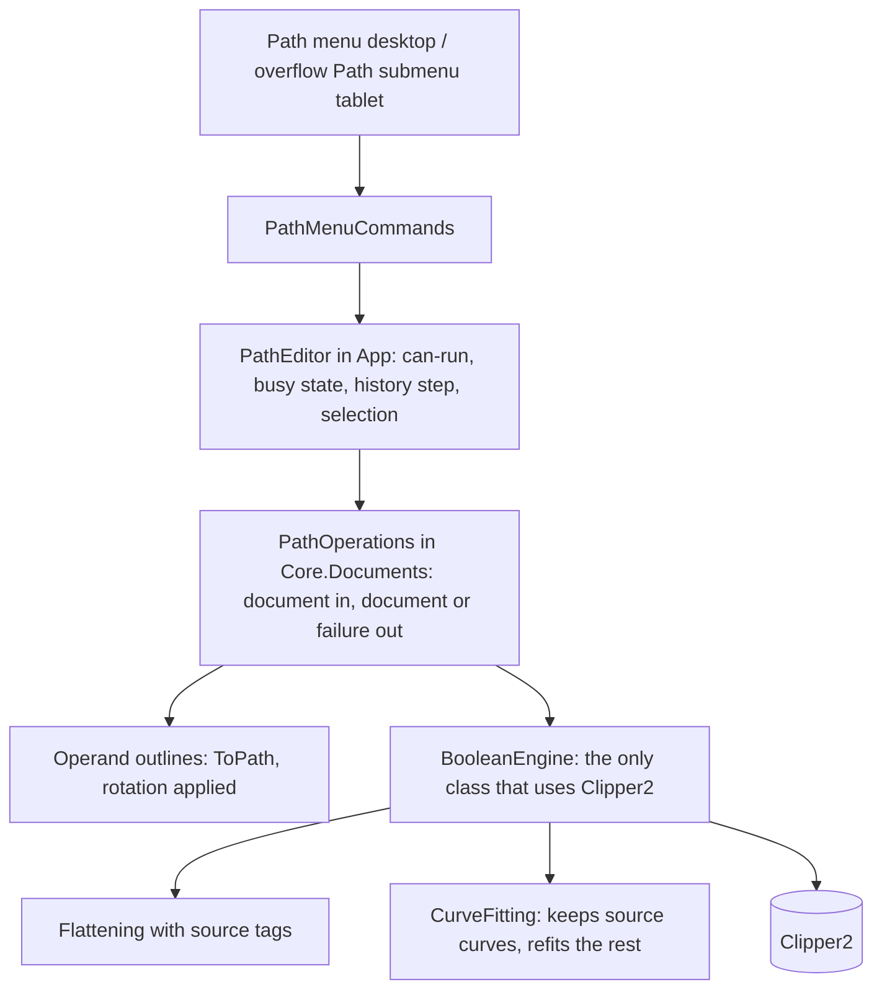

# Design Document

## Overview
Add compound paths to `PathShape` (a path with several sub-paths), a pure boolean engine in Core (Union, Difference, Intersection, Exclusion on flattened curves, with unchanged curve pieces kept), and the document commands Union, Difference, Intersection, Exclusion, Combine and Break Apart, with their menu entries on desktop and tablet.

## Decisions Taken (confirmed with the owner)
- **Storage:** `Nodes` and `IsClosed` of `PathShape` are replaced by `SubPaths`, so the compiler finds every place that reads paths.
- **Node address:** one flat node index across all sub-paths (sub-path 0 first), so `NodeRef`, `NodeHit`, `NodeTarget` and the `int` indices of `PathNodeEditing` keep their shape. Segment indices are flat in the same way.
- **Engine:** the Clipper2 NuGet package, used only inside one Core class. Curves are flattened (tolerance 0.1 px), and where a result edge is an unchanged piece of an original curve, that curve piece is kept.
- **Scope:** destructive commands only. The live composite shape and Shape Builder are separate later specs; the engine is a pure function so they can reuse it.
- **Operands:** groups and open paths are disabled for the four booleans. An empty result changes nothing and shows a message.
- **Large input:** above a size limit the work runs on a background thread with a busy indicator.
- **Tablet:** a "Path" submenu in the overflow menu.
- **Tablet status bar (R10, decided 2026-11-17):** an always-visible bar under the tool column and the canvas with the selection summary, the zoom controls (moved from the toolbar) and the "Working…" text, 48 dp high.

## Steering Document Alignment

### Technical Standards (tech.md)
- Core stays free of Avalonia. The only new package, Clipper2, is referenced by `PressToShape.Core` only (decision requires an entry in `tech.md`, see Tasks).
- Every document change goes through `EditorState.Edit` and the history, with named step types.
- The project file keeps its rule "write only what differs" (decision 19): a path with one sub-path is written exactly as today.
- Files are untrusted input (validated on load, with limits).

### Project Structure (structure.md)
- New Core code goes in `Shapes/` (model), `Geometry/` (flattening) and a new folder `PathOperations/` (engine, fitting, result types). Document-level commands go in `Documents/`, next to `GroupOperations`.
- App changes stay in `ViewModels/Editor` (commands), `ViewModels/Desktop` and `ViewModels/Tablet` (menus) and `Workspace` (node tools, canvas scene). Dependencies keep pointing one way.

## Code Reuse Analysis

### Existing Components to Leverage
- **`PathShape`, `PathNode`, `DocumentNode`, `Cubic`, `Bezier` (Split, ExtremaBounds):** the data and the curve math. `Bezier.Split` cuts the kept curve pieces.
- **`ShapeConversion.ToPath`:** turns rectangles (with rounded corners) and ellipses into paths, so they are operands without extra code.
- **`PathShape.Create` / `Rebuilt` / `ToLocal` / `FromLocal`:** box computation and the rotation-safe frame shift. Extended to sub-paths.
- **`EditablePath.AsOnScreen`:** rotation baked into nodes. Its logic moves into Core as `PathShape.WithRotationApplied()` (App calls it), because the engine needs it.
- **`ShapeTree` (Find, Remove, Replace) and `GroupOperations`:** pattern for replacing shapes at a stack position inside a layer or group.
- **`EditorState.Edit(HistoryStepType, Func<Document, Document>)` and `ObjectEditor`:** pattern for commands (can-run check, one history step, selection after).
- **`ObjectMenuCommands`, `MenuBarViewModel`, `OverflowMenuViewModel`, `MenuItemViewModel`:** pattern for a record of commands shared by both menus.
- **`IMessageDialogs.ShowErrorAsync`:** the message for an empty or failed result. **`ILocalizer`/`LocalizedViewModel`:** texts.
- **`ProjectFile.Path.cs` (`BuildPath`, `AddPathData`) and `SvgExport.PathData`:** extended for sub-paths.
- **`tests/PressToShape.Benchmarks`:** the performance check.

### Integration Points
- **Document tree:** the result replaces the operands at the stack position of the bottom operand.
- **Node tools, Pen, canvas scene, hit tests:** read sub-paths through the new model.
- **Project file and SVG export:** read and write sub-paths.

## Architecture

### Modular Design Principles
- `BooleanEngine` takes and returns plain geometry (`Outline` lists, no `Document`, no `Shape`), so a later composite or Shape Builder can call it.
- Which appearance and which position the result gets is decided in `PathOperations`, not in the engine.
- One class per concern; the engine, flattening and fitting are separate files.

## Components and Interfaces

### Compound path model (Core/Shapes)
- **`SubPath`** `(ImmutableArray<PathNode> Nodes, bool IsClosed)`: at least two nodes.
- **`DocumentSubPath`** `(IReadOnlyList<DocumentNode> Nodes, bool IsClosed)`: the same in document coordinates.
- **`PathShape`**: `SubPaths` (required, at least one, at most `MaxSubPaths`) replaces `Nodes` and `IsClosed`. `FillRule` stays on the path. The box is the tight bounds of all sub-paths and nodes are fractions of it, as today.
  - `Create(IReadOnlyList<DocumentSubPath>, FillRule)` and the existing `Create(nodes, isClosed, fillRule)` as a one-sub-path shortcut.
  - `Rebuilt(IReadOnlyList<DocumentSubPath>, FillRule)` with the same on-screen-stable frame shift as today.
  - `ToDocumentSubPaths()`, `Segments()` (flat list over all sub-paths), `NodeCount`, `Locate(flatIndex)` → `(subPath, node)`.
  - `WithRotationApplied()`: the path with the rotation baked into its nodes (moved from `EditablePath.AsOnScreen`).
  - Hit test: inside test over all sub-paths with the fill rule, outline test over all segments.
- **`PathEditing`, `PathNodeEditing`:** take the flat index and work inside the sub-path that holds it. `InsertNode` and `BendSegment` use the flat segment index. `RemoveNodes` drops a sub-path left with fewer than two nodes and returns null when none is left. `Continue(path, flatEndIndex)` returns the nodes of the open sub-path that has that end, and a new `ReplaceSubPath` writes the result back, so the Pen continues one sub-path and leaves the others.
- A path with one sub-path behaves as before (R1.4); the existing tests are updated only for the new property names.

### Engine (Core/PathOperations)
- **`PathOperationType`** `{ Union, Difference, Intersection, Exclusion }`.
- **`Outline`** `(IReadOnlyList<DocumentSubPath> SubPaths, FillRule FillRule)`: one operand in document coordinates, rotation already applied.
- **`BooleanEngine.Compute(PathOperationType, IReadOnlyList<Outline> operands, CancellationToken)`** returns `IReadOnlyList<DocumentSubPath>` (empty if the area is empty). Steps:
  1. Flatten every segment of every operand with `Flattening` at 0.1 px. Each point carries a tag (operand, segment, t) in a side table.
  2. Normalize each operand alone with `Clipper.Union` and its own fill rule, so operands with different rules fold correctly.
  3. Fold from the bottom operand up: `acc = acc OP next` (Union, Difference = acc minus next, Intersection, Exclusion = Xor). This gives A4 of the requirements: Difference cuts every upper operand out of the bottom one, Exclusion keeps areas covered an odd number of times.
  4. `CurveFitting` turns each result polygon into nodes (below).
- Clipper2 works on `PathsD` with a precision of 4 decimals in document units, far below the 0.1 px tolerance. Nothing outside this class references Clipper2 types (a Core architecture test checks this).
- **Same input, same result (R7.8):** Clipper2 is deterministic for the same input and order, and the fold order is the stacking order.

### Keeping curves (`CurveFitting`)
- A result vertex that equals a flattened source vertex keeps its tag. A vertex made by an intersection is matched to the nearest source polyline edge within the tolerance, which gives its segment and t.
- A run of consecutive result vertices that lie on one source segment with monotonic t becomes one cubic `Bezier.Split(segment, t0, t1)` piece (handles taken from the split). Straight source segments stay line segments (R7.4).
- Vertices without a source match (should be rare) are fitted with a least-squares cubic through the run, within 0.1 px, or left as lines if they are collinear.
- Result node types are derived from the handles (`NodeTypes.Derive`), as for hand-drawn paths.
- **Risk:** Clipper2 (version 1.5.4) offers a Z value per point with a callback at intersections, which would replace the matching above. The first implementation task checks this on the NuGet build (it may need the `USINGZ` build of the library); if it is not available, the matching approach is used. Either way the result is the same to the user.

### Document-level operations (Core/Documents `PathOperations`)
- `Boolean(Document, ids, PathOperationType, newId)`, `Combine(Document, ids, newId)`, `BreakApart(Document, id, newIds)`: each returns a `PathOperationResult` (the new document and the ids of the new shapes, or a failure `Empty` / `Invalid`).
- **Boolean:** checks the operands (rectangle, ellipse, closed path, visible, unlocked, not a group, at least two), finds them in `ShapeTree`, orders them by document stacking, builds outlines through `ShapeConversion.ToPath` and `WithRotationApplied`, runs the engine, then removes the operands and inserts one `PathShape` with `FillRule.EvenOdd` at the place of the bottom operand (same layer and parent, same position). Fill, stroke, opacity, name and flags come from the bottom operand. The result has no rotation. Even-odd makes holes show however they are edited later.
- **Combine:** like Boolean without the engine: the sub-paths of all operands in document coordinates, fill rule even-odd, appearance and place of the bottom operand (rectangles and ellipses converted first). Open paths are allowed.
- **Break Apart:** one `PathShape` per sub-path at the position of the compound path, in the original order, each with its appearance, each keeping the rotation of the original (the frame shift of `Rebuilt` keeps every node at its place on screen). Holes become separate filled paths.
- Break Apart results keep the fill rule of the original path.

### App commands
- **`PathMenuCommands`** (record of `ICommand`: Union, Difference, Intersection, Exclusion, Combine, BreakApart), like `ObjectMenuCommands`. Created in `EditorShellViewModel` and passed to `MenuBarViewModel` and `OverflowMenuViewModel`.
- **`PathEditor`** (like `ObjectEditor`): `CanBoolean`, `CanCombine`, `CanBreakApart` from the selection and the editor state; `Run(PathOperationType)`.
  - Below the size limit the work runs inline. Above it, it runs on a background thread (`Task.Run`) with a busy flag; while busy, all commands of this spec and other document edits are disabled. The result is applied only if the document is still the one the work started from.
  - On success: one `EditorState.Edit` step, the new shape(s) become the selection.
  - On `Empty` or `Invalid`: nothing changes, `IMessageDialogs.ShowErrorAsync` shows a translated message.
- **Size limit:** `BooleanEngine.BackgroundNodeLimit`, the total node count of the operands above which the work leaves the UI thread, is 70,000. It comes from the benchmark (task 19, release build, short job): two wavy outlines with 200 curved nodes each take 0.3 ms (requirement: under 200 ms), 10,000 nodes in total 9.5 ms, 40,000 nodes 72 ms, 200,000 nodes 1,030 ms. Linear interpolation on a log scale puts 200 ms at about 70,000 nodes.
- **Menus:** the desktop `_Path` menu items get these commands (mnemonics unchanged). The tablet overflow menu gets a "Path" submenu with the six items. Its mnemonic must not clash with `_Paste` in the same menu, so the tablet submenu uses its own header text if needed; `TranslationConsistencyTests` checks it.
- **History:** six new `HistoryStepType` values (Union, Difference, Intersection, Exclusion, Combine, BreakApart) with translated names in the history panel.
- **Node tools and canvas:** `EditablePath`, `NodeEditor`, `NodeHits`, `CanvasScene`, `ScreenPath`, `PathOutline`, `DocumentCanvasControl`, the Pen files and `PropertiesViewModel.Path` read sub-paths. `ScreenPath` holds a list of sub-paths. The canvas draws all sub-paths as one geometry with the fill rule.

### Status bar on the tablet (R10)
- **View model:** `StatusBarViewModel` moves from `ViewModels/Desktop` to `ViewModels/Editor` (namespace change only; the steering doc `structure.md` already says so) and is shared. It already has the selection summary, the zoom (`ZoomViewModel`), the language refresh and, since task 20, `IsBusy` and `BusyText`. `TabletShellViewModel` creates one with `PathEditing`, like the desktop shell does.
- **Toolbar:** `TabletToolbarViewModel` loses its `Zoom` property and constructor parameter; `TabletToolbarView.axaml` loses the zoom group. The overflow button stays last.
- **View:** a new `Views/Tablet/TabletStatusBarView` (UserControl, `x:DataType="StatusBarViewModel"`). Left: selection summary and the busy text. Right: zoom out, the zoom value with the preset list (a `DropDownButton` with a `MenuFlyout`, as in the old toolbar), zoom in, fit to window. Buttons use the `icon` class and read sizes with `DynamicResource` (48 dp through `TouchSizes`, like the toolbar buttons did). It has no hand-tool button (the tablet has the Hand tool in the tool column).
- **Layout:** `TabletShellView.axaml` `LayoutRoot` gets rows `Auto,*,Auto`: toolbar, the tool column with the canvas, the status bar. The status bar is inside `LayoutRoot`, so the keyboard margin moves it up with the rest. The panel still floats over the canvas grid only, so opening it does not change the canvas size.
- **Sizes:** `Theme.axaml` gets `StatusBarHeight` in the `TouchSizes` dictionary with the value 48 (the desktop key stays 28). The desktop bar keeps `StaticResource`; the tablet bar reads `DynamicResource StatusBarHeight` so it takes the touch value.
- **Back button:** the view-only job of "which menu is open" moves into a small helper, `Controls/OpenFlyoutTracker` (a list of open flyouts with `Track`, `TryCloseLast` and a `Closed` event), used by `TabletToolbarView` (overflow menu) and `TabletStatusBarView` (zoom list). `TabletShellView` closes a menu of the status bar first or of the toolbar, whichever is open, then the existing order (`RequestBackAsync`), and notes the close in `BackRequestGuard` for both.
- **Superseded tests:** the tests that say the tablet has no status bar and no bar under the canvas (`Shell_HasNoRulers_NoMenuBar_NoStatusBar_AndNoBarUnderTheCanvas`, the canvas height checks) and the toolbar zoom tests are changed to the new rules, and the toolbar width tests (1280 and 900 dp) run without the zoom group.
- **Desktop:** the desktop bar view stays as it is, with the busy text (task 20), and now binds the moved view model.

## Data Models

### Project file (format change, compatible)
- A path with one sub-path is written exactly as today (`nodes`, `closed`, `fillRule`), so old files load and one-sub-path files stay small.
- A path with more than one sub-path is written with `subPaths`: a list of `{ nodes, closed }`, and `nodes`/`closed` are left out. A file that has both is invalid.
- Limits on load: `MaxSubPaths` sub-paths and `MaxPathNodes` nodes in total (the current 100,000 limit now counts all sub-paths), each sub-path with at least two nodes, all numbers finite. A violation fails safely with `InvalidValue`, like today.

### SVG export
- A compound path is one `<path>` whose `d` has one `M ... [Z]` per sub-path and the `fill-rule` attribute of the path.

## Error Handling

### Error Scenarios
1. **Empty result** (intersection without overlap, difference of a covered shape)
   - **Handling:** `PathOperations` returns `Empty`; the document and selection stay as they are.
   - **User Impact:** a message says the operation left nothing.
2. **Engine failure** (non-finite numbers, Clipper2 exception)
   - **Handling:** caught in `PathEditor`, `Invalid` result, document unchanged.
   - **User Impact:** a message says the operation could not be done.
3. **Selection not allowed** (group, open path, locked, hidden, fewer than two)
   - **Handling:** commands are disabled, so the case never reaches the engine; `PathOperations` still checks and fails with `Invalid` (defense for callers other than the menu).
   - **User Impact:** disabled menu entries.
4. **Document changed during a background run**
   - **Handling:** commands and edits are disabled while busy, and the result is dropped if the document is no longer the starting one.
   - **User Impact:** none in normal use.
5. **Corrupt compound path in a file**
   - **Handling:** load fails with `InvalidValue` or `NotProjectFile`.
   - **User Impact:** the existing "file cannot be opened" message.

## Testing Strategy

### Unit Testing (`PressToShape.Core.Tests`)
- Model: create, box over all sub-paths, `Rebuilt` keeps nodes on screen for a rotated compound path, `Locate`, flat segment index, hit test with holes under both fill rules, `WithRotationApplied`.
- Node editing: move, insert, remove (sub-path dropped, path removed), types, bend, continue one sub-path; one-sub-path behavior unchanged (existing tests, renamed members).
- Engine: each operation on squares, circles, rotated and rounded shapes; hole, disjoint pieces, touching edges, empty result, three operands (difference and exclusion fold), mixed fill rules; area of the result against the exact area within tolerance; unchanged curve pieces stay one cubic and straight edges stay lines; same input twice gives equal output.
- Document operations: operand checks, stacking position and layer of the result, appearance of the bottom operand, operands removed, Combine ring (even-odd hole), Break Apart order and appearance and rotation, undo through `DocumentHistory`.
- File: round trip of compound paths, old file loads, `nodes` plus `subPaths` rejected, limits, corrupt values. SVG: `d` with several `M`, fill rule.
- Architecture test: no type of Clipper2 outside `BooleanEngine`; Core still has no Avalonia reference.

### Integration Testing (`PressToShape.App.Tests`)
- Tablet status bar (R10): headless tests that the bar shows under the canvas with the summary and the zoom controls, that the canvas ends at the top of the bar and does not change when the panel opens, that the toolbar has no zoom control and still fits at 1280 and 900 dp, that every control of the bar is at least 48 dp with an accessible name, that "Working…" shows while busy in both layouts, that the zoom list closes first on Back, and that the German texts show.
- `PathEditor`: can-run states (groups, open paths, locked, hidden, count), one history step with a name, new selection, empty-result message through a fake `IMessageDialogs`, busy state and dropped result (with a fake that completes later; the dispatcher is pumped, never blocked).
- Menus: desktop `_Path` items and the tablet submenu are enabled and disabled with the commands.
- `TranslationConsistencyTests`: new texts in `de.po`, mnemonics unique.
- Node tools on a compound path: select nodes of two sub-paths, move them, delete a node.

### End-to-End Testing
- Run the app and check by hand on desktop: union, difference, intersection and exclusion of a rectangle and an ellipse, a ring from Combine, Break Apart, undo and redo, save, load, SVG export opened in a viewer. The tablet submenu is checked by the owner on the device (the report goes in `.spec-workflow/specs/boolean-operations/`).
- Benchmark (`PressToShape.Benchmarks`): two operands with 200 nodes each (target under 200 ms) and a size ladder to find the size limit.
