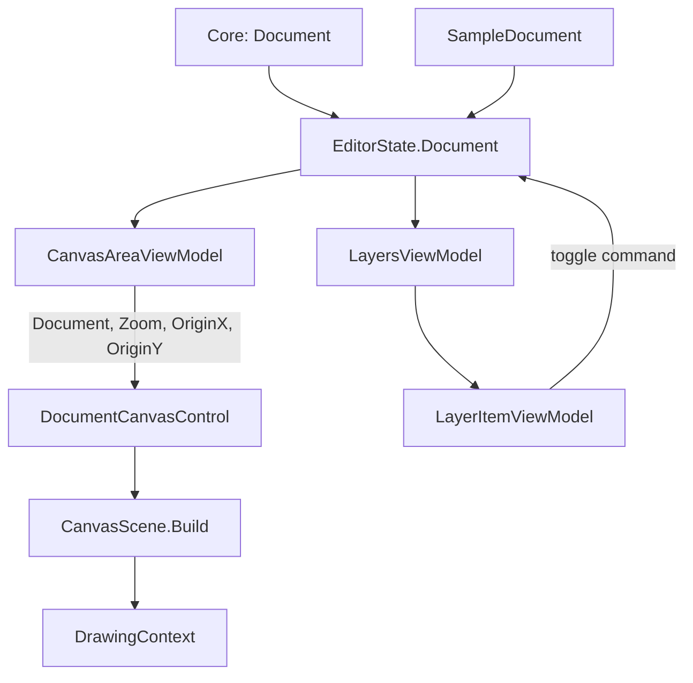

# Design Document

## Overview
`EditorState` gets the current `Document`. A pure function (`CanvasScene.Build`) turns the document, the zoom and the artboard origin into a flat list of screen-space shapes. A small custom control (`DocumentCanvasControl`) draws that list with `DrawingContext`. The Layers panel lists the document's layers and edits them through `EditorState`. Everything that can be tested without Avalonia lives in `Workspace/` and the view models. Only the thin drawing code is in `Controls/`.

## Steering Document Alignment

### Technical Standards (tech.md)
- Decides the open "canvas rendering approach" for this slice: one custom control, immediate redraw, no retained scene graph. The next specs can replace the scene builder with a cache if a measurement shows a need.
- MVVM with CommunityToolkit.Mvvm, compiled bindings, no new NuGet package. Avalonia.Headless is not added (see Testing).
- Core is not changed. App uses the existing `Document` API.

### Project Structure (structure.md)
- `Workspace/` for pure logic (`CanvasScene`, `ScreenShape`, `SampleDocument`), `Controls/` for the drawing control, `ViewModels/Editor/` and `Views/Editor/` for the shared panels. One type per file, `internal` types, tests mirror the folders.

## Code Reuse Analysis

### Existing Components to Leverage
- **`EditorState`** (`Workspace/`): already the shared state that view models observe through `PropertyChanged`. It gets the `Document`.
- **`CanvasAreaViewModel`**: already computes `OriginX`, `OriginY` and the artboard's screen size from the zoom. It stays the owner of that geometry.
- **`RulerControl`**: pattern for a custom control (`AvaloniaProperty.Register`, `AffectsRender`, `Render(DrawingContext)`). The new control follows it.
- **`ZoomLevels`, `ZoomToFit`**: unchanged. They read the artboard size, which now comes from the document.
- **`ILocalizer.T`, `LocalizedViewModel`** and `de.po`: for the sample's layer names and the new toggle texts.
- **`FakeLocalizer`** in the tests: German names in the sample tests.

### Integration Points
- **`DesktopShellViewModel`**: creates `EditorState` with the sample document. This is the only place that knows about the sample.
- **`InspectorViewModel`**: passes `EditorState` to the new `LayersViewModel`.
- **`CanvasAreaView.axaml`**: gets the new control on top of the artboard.

## Architecture

### Data flow
1. The app starts: `DesktopShellViewModel` creates `EditorState(SampleDocument.Create(localizer))`.
2. `CanvasAreaViewModel` exposes `Document`, `ZoomPercent`, `OriginX`, `OriginY`. The control binds to them. Each change invalidates the control.
3. `Render`: `CanvasScene.Build(document, zoom, originX, originY)` returns `ScreenShape`s, bottom first, hidden layers left out. The control draws each one.
4. A toggle click: `LayerItemViewModel` command → `EditorState.UpdateLayer(id, change)` → `Document` replaced → `PropertyChanged(Document)` → the canvas redraws and `LayersViewModel` syncs its items.

### Modular Design Principles
- **Drawing is dumb**: the control holds no geometry rules. Everything it needs comes from `ScreenShape`.
- **State in one place**: the document lives only in `EditorState`. View models read from it and never keep their own copy of layer data beyond display values.
- **Same pattern as before**: view models subscribe to `EditorState.PropertyChanged`, as `CanvasAreaViewModel` and `PropertiesViewModel` do.

## Components and Interfaces

### `EditorState` (changed) — R1
- `Document Document { get; set; }` as an observable property. Constructor `EditorState(Document? document = null)`. Without a document it uses `Document.Create(string.Empty)`, so the 41 existing `new EditorState()` calls in tests keep working. Core holds no default layer name, and the shell always passes the sample.
- `ArtboardWidth`, `ArtboardHeight` become read-only properties that return the document's values. Changing the document raises `PropertyChanged` for both, so `CanvasAreaViewModel` and `ZoomToFit` work unchanged.
- `void UpdateLayer(Guid layerId, Func<Layer, Layer> change)` replaces `Document` by `Document.UpdateLayer(...)`.

### `ScreenShape` and `CanvasScene` (`Workspace/`) — R2, R3, R4
- `enum ScreenShapeType { Rectangle, Ellipse }` and `readonly record struct ScreenShape(ScreenShapeType Type, double X, double Y, double Width, double Height, Color? Fill, Color? Stroke, double StrokeWidth, double Opacity)`. `Color` is the Core color. No Avalonia types.
- `static IReadOnlyList<ScreenShape> CanvasScene.Build(Document document, double zoomPercent, double originX, double originY)`:
  - Walks layers bottom first, skips hidden layers, walks shapes bottom first.
  - Position: `origin + value * zoom / 100`. Size and stroke width: `value * zoom / 100`.
  - `Stroke` is `null` when the shape has no stroke or its width is zero (so the control passes no pen).
  - Locked layers are drawn like any other (R6.5).

### `DocumentCanvasControl` (`Controls/`) — R2, R4
- Styled properties `Document`, `ZoomPercent`, `OriginX`, `OriginY`, all `AffectsRender`. It draws nothing else, has no pointer handling (`IsHitTestVisible="False"`), and no theme brushes (shape colors are data).
- `Render`: for each `ScreenShape`: `using (context.PushOpacity(opacity))` when opacity is below 1 (fill and stroke together are one group, per the assumption in the requirements), then `DrawRectangle` or `DrawEllipse` with an `ImmutableSolidColorBrush` for the fill and an `ImmutablePen` (centered stroke, `StrokeWidth` already in screen pixels) for the stroke. `Core.Color` to Avalonia color is one private conversion in the control.
- Zero-size shapes: drawn through the same calls. If a visual check shows Skia draws nothing for a zero-size shape with a stroke, the control draws a line or a dot for that case. This is the one risk and it is checked in the last task.

### `CanvasAreaViewModel` (changed) — R1, R3
- Adds `Document Document => _state.Document`. A `Document` change raises `Document` and the artboard geometry notifications, as the zoom does now. `ArtboardWidth` and `ArtboardHeight` already read from the state.

### `LayersViewModel` (changed) — R5, R6
- Constructor takes `EditorState`. `Items` lists the layers **top first** (document order reversed).
- On every `Document` change it syncs: if the layer ids are the same in the same order, it updates the existing items in place (so the list is not rebuilt while a toggle is clicked). Otherwise it rebuilds the items.
- `AddLayerCommand` stays, still disabled (non-goal). `HasLayers` is removed with the empty state.

### `LayerItemViewModel` (changed) — R5, R6
- Properties: `Guid LayerId`, `Name`, `IsVisible`, `IsLocked` (set only by the sync). Commands `ToggleVisibilityCommand` and `ToggleLockCommand` call `EditorState.UpdateLayer`.
- Removed because they are not used by the document: `IsGroup`, `Children`, `IsExpanded`, `IsSelected`, the per-item `Icon`. The view shows one layers icon for every row (open question 1, recommended answer).

### `LayersView.axaml` (changed) — R5, R6
- `TreeView` becomes a `ListBox` bound to `Items` (virtualizing, no tree needed). Each row: layers icon, name, lock toggle, visibility toggle. Icons: `EyeOutline`/`EyeOffOutline`, `LockOpenVariantOutline`/`LockOutline`, as the existing eye pattern. Tooltips and accessible names use `{loc:T 'Toggle visibility'}` (existing) and `{loc:T 'Toggle lock'}` (new). The empty-state text block is removed.

### `SampleDocument` (`Workspace/`) — R7
- `static Document Create(ILocalizer localizer)`: layers "Background" (bottom) and "Shapes", named with `localizer.T`. The drawing: two rectangles and two ellipses with different fills, one with a stroke width of 4, one with opacity 0.5, all inside the 1200 x 800 artboard, plus one partly overlapping shape so the stacking is visible.
- The whole file is the temporary part. Deleting it and the one line in `DesktopShellViewModel` removes the sample.

### `DesktopShellViewModel` (changed)
- `State = new EditorState(SampleDocument.Create(localizer))`.

## Data Models
No new persisted data. The in-memory additions are `ScreenShapeType` and `ScreenShape` (above).

## Error Handling
- **Invalid document values:** impossible, Core validates them. The scene builder trusts the document.
- **Zoom 0 or outside the range:** `EditorState.ZoomPercent` clamps through `ZoomLevels`, so the scene never gets a zero or negative zoom.
- **Toggle for a layer that no longer exists:** `UpdateLayer` throws `KeyNotFoundException`. Item view models are rebuilt on every structural change, so this cannot be triggered from the UI. It is not caught, because it would be a programming error.
- **Drawing failure:** `Render` has no try/catch. A throwing render is a bug to see, not hide.
- **Missing German texts:** the existing fallback shows the English text.

## Testing Strategy

### Unit Testing (xUnit, no UI)
- `CanvasSceneTests`: stacking order across layers and shapes, hidden layer skipped and shown again, locked layer drawn, position and size at zoom 50, 100 and 200 with an origin, stroke width scaled, no fill kept as `null`, no stroke and stroke width zero give `null` stroke, opacity and alpha passed through, zero-size shape kept, empty layer gives nothing.
- `EditorStateTests` (extended): default document, `Document` change notifies, artboard size comes from the document and notifies, zoom does not change the document, `UpdateLayer` replaces the document and keeps the old instance unchanged.
- `CanvasAreaViewModelTests` (extended): exposes the document, raises `Document` and artboard geometry on change, origin follows a new artboard size.
- `LayersViewModelTests` (rewritten): top-first order, names, in-place sync keeps the same item instances, structural change rebuilds, both toggles edit the document and the previous document is unchanged, no stale item toggles after a rebuild.
- `SampleDocumentTests`: two layers, rectangle and ellipse present, a stroke, an opacity below 1, a German catalog translates the layer names, artboard stays 1200 x 800.
- `DesktopShellViewModelTests` (extended): the shell starts with the sample.
- Existing `TranslationConsistencyTests` check `de.po` for the new and removed texts. `ThemeResourceTests` stay green because no color is added to a view.

### Integration Testing
- No automated UI test. Avalonia.Headless is not set up and adding it needs a package, so it is not part of this spec. The drawing control is small and has no logic. Recommended: keep it that way, and revisit UI tests when the tools spec adds pointer handling.

### End-to-End Testing
Manual check by running `dotnet run --project src/PressToShape.Desktop` (the last task lists the steps): the sample is visible and matches the expected positions and stacking, zoom presets scale it with the artboard and rulers, hiding a layer hides its shapes, the lock toggle changes its icon, the language switch changes the toggle tooltips and the layer names stay as they were, light and dark theme both show the shapes.

## Decisions and Trade-offs
- **Scene builder plus dumb control (chosen)** versus drawing straight from the document in `Render`. It costs one more small type and an allocation per redraw, and it makes R2 and R3 testable without a UI. Next specs can cache the list if needed.
- **`ListBox` (chosen)** versus keeping the `TreeView`. Layers are flat now and `ListBox` virtualizes. Groups come back with their own spec and can switch back.
- **Document in `EditorState` (chosen)** versus a separate document service. `EditorState` already is the shared state with change notification, so no new type or injection is needed.
- **Immediate redraw (chosen)** versus a retained scene. The simplest that works for small and medium documents. No performance number is claimed. The last task draws a stress document of 1000 shapes once by hand and the result goes into the implementation log.
- **Sample layer names are translated once at creation.** Switching the language later does not rename them, because layer names are user data (R5.3).

## Affected Files
- Changed: `Workspace/EditorState.cs`, `ViewModels/Editor/CanvasAreaViewModel.cs`, `LayersViewModel.cs`, `LayerItemViewModel.cs`, `InspectorViewModel.cs`, `ViewModels/Desktop/DesktopShellViewModel.cs`, `Views/Editor/CanvasAreaView.axaml`, `LayersView.axaml`, `Translations/de.po`, and the tests above.
- New: `Workspace/ScreenShape.cs`, `CanvasScene.cs`, `SampleDocument.cs`, `Controls/DocumentCanvasControl.cs`, and their tests.
- Translations: add "Toggle lock", "Background", "Shapes". Remove "No layers yet". All in the same change as `localization.md` requires.

## Assumptions
- The localizer already has the chosen language when the shell is created. `PressToShapeApp` initializes `LocalizationHost` first, so the sample names use the right language on start.
- The open question about the layer icon is answered as proposed (one layers icon), and the empty-state text is removed, because the requirements were approved without comments.
