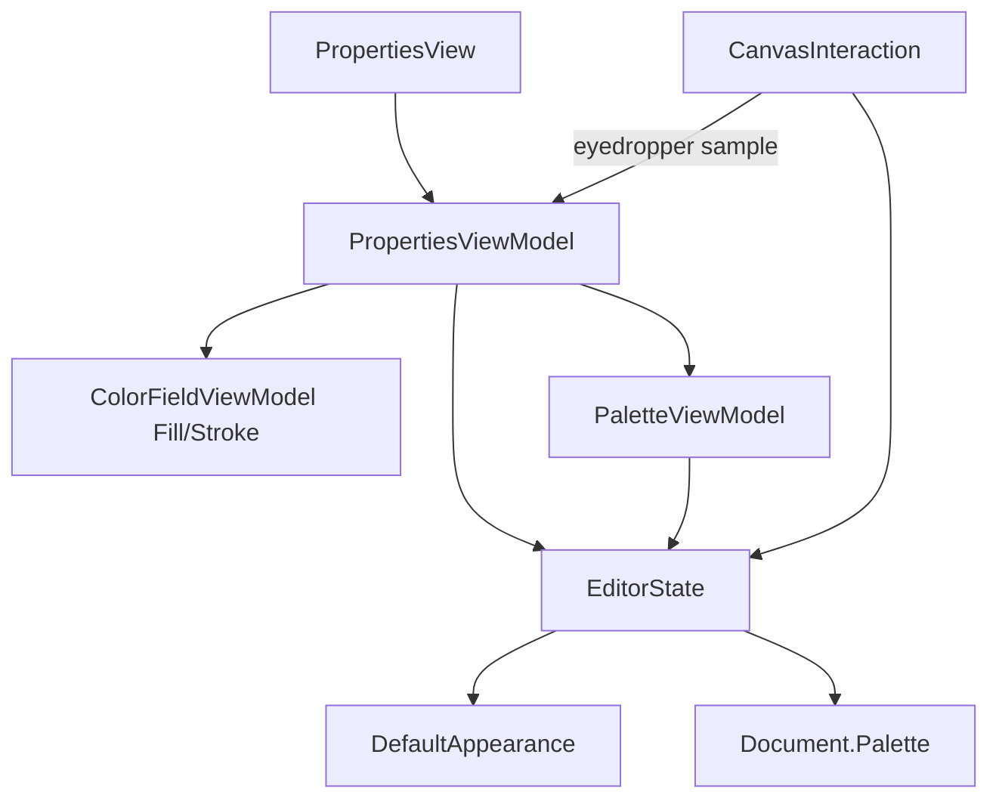

# Design Document

## Overview

Finishes the fill/stroke link of the Properties tab and adds four things: default colours for new shapes (R2), hex input and recent colours in the picker (R3), an eyedropper (R3), and a document palette (R4). Fill/stroke wiring (R1) already exists in `PropertiesViewModel`/`ColorFieldViewModel`. R1 is covered by tests and the fixes they reveal, not by a new design.

## Steering Document Alignment

### Technical Standards (tech.md)
No new packages. Avalonia `ColorView` is already used. SVG export stays valid SVG.

### Project Structure (structure.md)
Dependencies stay `Desktop/Android -> App -> Core`. The palette is document data, so it lives in Core. Defaults, recent colours and the eyedropper are editor state, so they live in `App/Workspace` and `App/ViewModels/Editor`.

## Code Reuse Analysis

### Existing Components to Leverage
- **`ColorFieldViewModel`**: the preview/commit/set-now flow. The eyedropper and swatches reuse it, so each colour change is one undo step.
- **`PropertiesViewModel.Preview`/`CommitPreview`/`SelectionEditor.Apply`**: applying a colour to the selection.
- **`EditorState.Edit`**: all document changes (palette add/remove) are history steps.
- **`ProjectFile` DTOs and `TryParseColor`/`ToText`**: palette colours use the same hex text as fill and stroke.
- **`CoreColorConverter`**: Core colour to Avalonia colour.
- **`HistoryStepNames`**: translated names for new step types.
- **`CanvasInteraction.CreateShape`** and the existing canvas hit test of the Select tool: new shapes and eyedropper sampling.

### Integration Points
- **Project file**: new optional `palette` array of colour strings, `FormatVersion` stays 1.
- **Translations**: new texts in `de.po`.

## Architecture



### Modular Design Principles
- Palette data and its edits: `Document` (Core). Palette UI logic: `PaletteViewModel`. Recent colours: `RecentColors` (pure class, testable).
- Views only forward events (flyout opened/closed, Shift key state). No logic in code-behind.

## Components and Interfaces

### Document palette (Core)
- **Purpose:** the ordered swatches saved with the document.
- **Interfaces:** `ImmutableArray<Color> Palette { get; init; }`, `Document AddSwatch(Color)`, `Document RemoveSwatchAt(int)`.
- **Behaviour:** adding a colour already in the palette returns the same document instance (no history step). `RemoveSwatchAt` throws `ArgumentOutOfRangeException` for a bad index, like the existing layer methods.
- **Reuses:** the immutable-record style of `Document`.

### Project file (Core)
- **Purpose:** save and load the palette (R4.4, R4.5).
- **Interfaces:** optional `palette` string array in the DTO. Written only when not empty. A missing array loads as an empty palette. An invalid colour text fails the load with the existing "invalid file" error, as fill does.

### History step types (Core)
- `AddSwatch`, `RemoveSwatch`, appended to `HistoryStepType`. `HistoryStepNames` adds "Add swatch" and "Remove swatch".

### Default appearance (App/Workspace)
- **Purpose:** R2.
- **Interfaces:** `EditorState.DefaultAppearance` (`Appearance`, starts as `Appearance.Default`). Not part of the document or history, so it is not saved and not undone.
- **Behaviour:** `CanvasInteraction.CreateShape` sets `Appearance = _state.DefaultAppearance`. `PropertiesViewModel` writes the default colours when nothing is selected.

### PropertiesViewModel changes
- With nothing selected, `RefreshValues` shows the defaults in `Fill`/`Stroke` and keeps them enabled. The picker preview and commit then set `DefaultAppearance` directly (no document change, no history step). Stroke width and opacity stay disabled without a selection (requirements only cover colours).
- With a selection, behaviour is unchanged and the defaults are not touched (R2.3).
- The Appearance grid's `IsEnabled="{Binding HasSelection}"` moves to the individual controls, because the colour controls must work without a selection.
- Every picked colour is added to `RecentColors` when the picker closes with a change.

### RecentColors (App/Workspace)
- **Purpose:** R3.3. Most recent first, no duplicates, at most 12.
- **Interfaces:** `IReadOnlyList<Color> Items`, `void Add(Color)`.
- Session only, not saved. (Chosen because the requirements do not ask for persistence. Persisting would need a settings change.)

### Hex input (R3.1, R3.2)
Use the hex field of Avalonia's `ColorView` (`IsHexInputVisible`), configured for `#RRGGBBAA` through its hex alpha position. Invalid text keeps the old colour in `ColorView`. Implementation task 1 verifies this against Avalonia 12 behaviour. If it cannot accept both 6 and 8 digits, a small `ColorHexParser` (Core, pure) plus a `TextBox` replaces it. This is the only open implementation detail.

### Eyedropper (R3.4-R3.6)
- **Purpose:** take a colour from a shape on the canvas.
- **Flow:** a button in the picker flyout starts a pick for the open field (`PickTarget` = Fill or Stroke) and closes the flyout. `EditorState.ColorPick` holds the target, and the canvas shows a crosshair cursor. A canvas click samples the topmost visible shape at the point, using the hit test of the Select tool. The sampled colour is that shape's fill. A shape with no fill gives its stroke. The shape's own opacity is ignored, the colour's alpha is kept. The colour then goes through `ColorFieldViewModel.BeginEdit/Update/EndEdit`, so it is one undo step and updates the defaults when nothing is selected.
- Click on empty canvas: nothing changes and the pick ends. Escape ends the pick without a change.
- While a pick is active the Select tool does not select or drag.
- **Reuses:** `CanvasCursorType` (new type `Eyedropper`), `CanvasInteraction`, `ColorFieldViewModel`.

### Eyedropper cursor (R3.7)
- A new `CanvasCursorType.Eyedropper` with the image name `eyedropper`, made from the Lucide `pipette` icon (version 0.468.0, ISC licence, same as the other cursors). The SVG is downloaded unchanged from `https://cdn.jsdelivr.net/npm/lucide-static@0.468.0/icons/pipette.svg` into `assets-src/cursors/lucide/` and listed in `CursorSet`. The images `eyedropper-32.png` and `eyedropper-64.png` are generated by `tools/PressToShape.CursorImages generate`, and `check` must pass.
- Hotspot: the tip of the pipette, in the lower left of the icon. The first guess is (6, 26) at 32 px and doubled at 64 px. The manual check in the last task confirms it. If it is off, only the number in `CursorImages` changes.
- `CanvasAreaViewModel.CursorType` returns `Eyedropper` while a pick is active and while the Eyedropper tool is active. A drag or handle cursor still wins, as today.
- **Reuses:** `CursorImages`, `CanvasCursors`, the `lucide-canvas-cursors` pipeline and its README table.

### Toolbox Eyedropper tool (R5)
- The existing `Tool.Eyedropper` (shortcut I) gets behaviour. `CanvasInteraction.PointerPressed` with this tool starts a pick (`BeginColorPick(shift ? Stroke : Fill)`) and samples at once with the same code as a flyout pick. The result goes through the `ColorPicked` event to `PropertiesViewModel`, so it is one undo step with a selection, a default change without one, and a recent colour. The tool stays active.
- No second code path for sampling or for applying a colour. The tool only chooses the target.
- The Properties tab keeps showing "This tool has no properties" for this tool (unchanged `PropertiesSections`).
- **Alternative rejected:** a separate apply path in the tool. It would repeat undo and defaults handling.

### PaletteViewModel + swatch strip (R4)
- **Purpose:** swatches shown in the Appearance section, between the stroke width and the opacity rows.
- **Interfaces:** `Swatches` (from `EditorState.Document.Palette`, refreshed on document change), `AddSwatch(Color)`, `RemoveSwatch(int)`, `Apply(Color, bool toStroke)`.
- **Behaviour:** the picker flyout has an "Add to palette" button that adds the colour shown in the picker. A swatch click calls `Apply(color, toStroke: false)`, Shift-click `toStroke: true`. The view reads Shift from the pointer event (view-only concern). Right-click opens a "Remove" menu item. `Apply` goes through `Fill.SetColor`/`Stroke.SetColor`, so it follows R1 and R2 (defaults without a selection).
- **Reuses:** `EditorState.Edit`, `ColorFieldViewModel.SetColor`.

## Data Models

```
Document      + Palette: ImmutableArray<Color>   (default: empty)
ProjectFile   + "palette": ["#RRGGBBAA", ...]    (optional)
EditorState   + DefaultAppearance: Appearance
              + ColorPick: ColorPickTarget? (None | Fill | Stroke)
RecentColors  : up to 12 Color values, most recent first
```

## Error Handling

1. **Invalid hex text:** the colour stays unchanged and the field is marked invalid. No exception.
2. **Palette colour text in the file is invalid:** load fails with the existing invalid-file error and message. The document is not partly loaded.
3. **Eyedropper click misses all shapes:** the pick ends silently.
4. **Add duplicate swatch:** nothing happens and no history step is recorded.
5. **Selection changes during a picker edit:** the existing `_previewBase` reset applies unchanged.

## Testing Strategy

### Unit Testing
- Core: `Document` palette add (including duplicate), remove, bad index. Project file round trip, file without palette, invalid colour text. SVG export with alpha fill and stroke (R1.5). Save/load of alpha (R1.4).
- App: `PropertiesViewModel` for mixed values (R1.2), None (R1.3), preview then one step (R1.1), colour edits with no selection change defaults and not the document, with a selection they leave defaults alone (R2.2, R2.3). `CanvasInteraction` draws with the defaults (R2.1). `RecentColors` order, duplicates and limit. `PaletteViewModel` add/remove/apply and Shift target. Eyedropper sampling, miss, Escape and one undo step. The Eyedropper tool: click fills, Shift-click strokes, empty canvas, tool stays active, cursor type. Cursor files: the existing `CursorImageFilesTests` check every name has both images, and `CursorImages` tests check the new name and hotspot.
- `TranslationConsistencyTests` cover the new texts.

### Integration Testing
- Save a document with a palette, reload it, check swatches and undo of an add.

### End-to-End Testing
- Headless UI test (only where bindings are not enough): swatch Shift-click targets the stroke, and the Appearance colour controls are enabled without a selection.
- Manual run: draw with changed defaults, eyedropper across shapes, palette after save and reopen.
