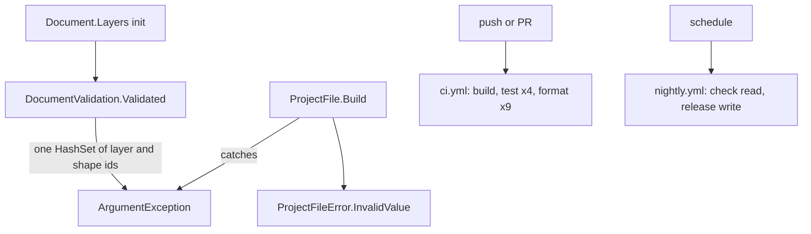

# Design Document

## Overview

Three independent fixes, one per area: a validation rule in `Core` (R1), one line of glyph math in the canvas control (R2) and two workflow files (R3, R4).

## Steering Document Alignment

### Technical Standards (tech.md)
No new packages. Workflow actions keep the versions of the nightly (`actions/checkout@v7`, `actions/setup-dotnet@v6`, .NET `10.0.x`).

### Project Structure (structure.md)
- R1: `src/PressToShape.Core/Documents/` and its tests in `tests/PressToShape.Core.Tests/`. No Avalonia.
- R2: `src/PressToShape.App/Controls/` and tests in `tests/PressToShape.App.Tests/`.
- R3, R4: `.github/workflows/`.

## Code Reuse Analysis

### Existing Components to Leverage
- **`DocumentValidation.Validated`**: already runs in the `Document.Layers` `init` accessor. All 15 places in `Core` that build a document with other layers go through it (`with { Layers = ... }` from `AddLayer`, `InsertLayer`, `MoveShapesToLayer`, `UpdateShape`, group and arrange operations, and so on). One combined id set there covers R1.1 to R1.6, so no operation needs its own check.
- **`ProjectFile.Build`**: its `Document` construction is already wrapped so that an `ArgumentException` becomes `ProjectFileError.InvalidValue` (`ProjectFile.cs:96`). R1.4 needs no change there, only a test.
- **`AvaloniaTextOutliner.Read`**: already advances the pen by `glyph.GlyphAdvance`. R2 uses the same measure, so fill, stroke and "convert text to path" agree.
- **Existing `nightly.yml`**: copy of its checkout, setup-dotnet and gettext steps, and its test commands.

### Integration Points
- `DocumentCanvasControl.Text.cs` → `DrawGlyphOutlines` only.
- GitHub Actions: a new `ci.yml` next to `nightly.yml`.

## Architecture



## Components and Interfaces

### R1 One id space (finding 3)
- `DocumentValidation.Validated` keeps its two sets (`layerIds`, `shapeIds`), so the existing messages for two layers or two shapes stay as they are. It adds a cross check: a new layer id must not be in `shapeIds`, and a new shape id must not be in `layerIds`. The layer id is added before its shapes are validated, and later layers are checked against the shapes of earlier ones. A mixed clash throws an `ArgumentException` (parameter `Layers`) with the message "Id {id} is used by a layer and by a shape.". `ValidateShapes` gets the `layerIds` set as an extra parameter.
- Guides keep their own id set (they are not layers or shapes, and R1 does not cover them).
- `Document.cs` doc comment already states the invariant. No wording change except naming guides as out of scope if the text suggests otherwise.

### R2 Glyph advance (finding 4)
- `DrawGlyphOutlines`: the pen position moves by `GlyphAdvance` of the run instead of `glyphRun.Bounds.Width`. A small internal static helper `GlyphRunAdvance.Of(GlyphRun)` (in `Controls/`, new file or next to the text drawing code) sums `GlyphInfos[i].GlyphAdvance`. It returns 0 for a run without glyphs.
- Letter spacing is part of the shaped advance (the layout was built with `text.LetterSpacing`), so R2.2 follows without extra code.
- A single-run line: the first run starts at `top.X`, so its position does not change (R2.3). Runs whose old ink width equalled the advance (no side bearing) also do not change.
- No change to fill drawing, to `AvaloniaTextOutliner`, or to the scene.

### R3 CI workflow (finding 7)
New `.github/workflows/ci.yml`:
```yaml
name: CI
on:
  push:
    branches: [master]
    paths-ignore: ["docs/**", ".spec-workflow/**", "**/*.md"]
  pull_request:
    branches: [master]
    paths-ignore: ["docs/**", ".spec-workflow/**", "**/*.md"]
permissions:
  contents: read
concurrency:
  group: ci-${{ github.ref }}
  cancel-in-progress: true
jobs:
  build:
    runs-on: ubuntu-26.04
    env: { DOTNET_NOLOGO: true, DOTNET_CLI_TELEMETRY_OPTOUT: true }
    steps:
      - actions/checkout@v7
      - actions/setup-dotnet@v6 (10.0.x)
      - install gettext
      - build the four test projects in Release, test them with --no-build
      - dotnet format <project> --verify-no-changes for each project that does not need the Android workload
```
- **Projects built and tested**: `Core.Tests`, `App.Tests`, `CodeIndex.Tests`, `CursorImages.Tests`. Building them builds `Core`, `App`, `CodeIndex`, `CursorImages`. `Desktop` is not referenced by a test project, so it is built explicitly too (a startup break would otherwise pass CI).
- **Format**: `dotnet format` on the solution loads the Android project and needs its workload (R3.9 forbids installing it), so the step runs `dotnet format <project> --verify-no-changes` for these nine projects: `src/PressToShape.Core`, `src/PressToShape.App`, `src/PressToShape.Desktop`, `tools/PressToShape.CodeIndex`, `tools/PressToShape.CursorImages`, and the four test projects. All nine are clean today (checked 2026-11-22). The `PressToShape.Benchmarks` project is not included. The Android project is not formatted in CI (accepted, listed under trade-offs).
- **Path filter side effect**: a push that only changes `docs/**` does not run CI, so a hand edit of `docs/index/` is not checked. Code changes always trigger CI.
- **Concurrency group**: `ci-${{ github.ref }}`. A PR has its own ref, so PRs and master do not cancel each other.
- `fetch-depth` stays at the default (1), `workflow_dispatch` is not added (not required).

### R4 Nightly permissions (finding 7)
- Workflow level: `permissions: contents: read`.
- `check` job: inherits `read`. It uses `gh release list`, `gh api repos/.../commits/<tag>` and `gh release view`, which read releases and commits and need no more. The token is the default `github.token`.
- `release` job: `permissions: contents: write` (needed for `gh release create`).
- Nothing else in `nightly.yml` changes (runner label `ubuntu-26.04` is valid and generally available since 2026-09-17, so it stays).

## Data Models

No data changes. No project file format change: only files that were invalid already are rejected.

## Error Handling

1. **Layer and shape share an id (R1):** `ArgumentException` from the `Layers` setter. In a file load it becomes `ProjectFileError.InvalidValue` with the message. The app shows the existing "The file contains invalid data." text.
2. **Run without glyphs (R2):** the helper returns 0 and the geometry is empty. Nothing throws.
3. **CI step fails (R3):** the job fails, the push or PR shows a red check. Nothing is retried.
4. **Check job lacks a permission (R4):** the nightly run fails visibly. Mitigation: after merging, start the nightly once with `workflow_dispatch` (owner action, see the last task).

## Testing Strategy

### Unit Testing
- **R1** (`tests/PressToShape.Core.Tests`, a new `DocumentIdUniquenessTests.cs`): a layer id equal to a shape id of the same layer, of another layer, and of a shape inside a nested group each throw `ArgumentException`; two layers or two shapes with one id still throw the old message; different ids pass; guides with the id of a shape are still allowed (they are out of scope, test documents this); the mutating methods (`AddShape`, `AddLayer`, `MoveShapesToLayer`, `DuplicateLayer` with a clashing new id) reject a clash.
- **R1.4** (`ProjectFile` tests): a hand-made file whose layer and shape share an id gives `ProjectFileError.InvalidValue`; a normal round trip is unchanged.
- **R2** (`tests/PressToShape.App.Tests`, a new `GlyphRunAdvanceTests.cs`): a `GlyphRun` built from known `GlyphInfo` advances gives their sum, including letter spacing in the advances; an empty run gives 0; the sum differs from `Bounds.Width` for a run with side bearings or offsets (the case of the finding). A headless render test of a stroked text with a fallback character, to show it does not throw.

### Integration Testing
- Existing `DocumentCanvasControlTextTests`, `GlyphOutlinesTests` and the project file tests stay green.
- The workflows are checked with a YAML parse and with `actionlint` if installed (otherwise a plain YAML check). They are exercised for real by the first push (owner action, see below).

### End-to-End Testing
- Manual: on the desktop, draw a stroked text with a symbol that the font does not have (for example an emoji) and check that the stroke sits on the letters.
- Owner action after the push: look at the first CI run, and start the nightly once by hand to confirm that the read-only `check` job still works. The tasks list this as the last, owner-run step. I do not push.

## Trade-offs

- **Format check without the Android project:** the Android project (startup code only) is not format-checked in CI. Adding it needs the workload, which the owner ruled out for CI.
- **Two sets plus a cross check in R1:** keeps the old error texts that existing tests may assert, at the cost of a few more lines than a single combined set.
