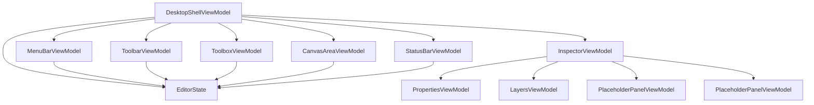

# Design Document

## Overview
The desktop shell is a composition of reusable Avalonia views, each driven by its own view model, all living in `PressToShape.App`. A shared `EditorState` object holds the cross-cutting state (active tool, zoom, selection summary). The regions follow the mockup: menu bar, toolbar, tool column, canvas area with rulers and artboard, tabbed inspector, status bar. No document exists yet, so selection-dependent controls are disabled and the Layers list is empty.

`MainWindow` hosts the new `DesktopShellView` and gets a `DesktopShellViewModel`. The existing `MainView` and `MainViewModel` (the greeting screen) stay as they are, because Android still uses them until the tablet spec replaces them.

## Steering Document Alignment

### Technical Standards (tech.md)
- Avalonia 12 compiled bindings (`x:DataType` on every view and `DataTemplate`), CommunityToolkit.Mvvm (`[ObservableProperty]` on partial properties, `[RelayCommand]`), nullable enabled, xUnit tests in `PressToShape.App.Tests`.
- New dependency: `Material.Icons.Avalonia` 3.0.2 (approved), declared in `Directory.Packages.props`, referenced from `PressToShape.App` only.

### Project Structure (structure.md)
- All code goes in `PressToShape.App`. `Core` and the heads are untouched, apart from `PressToShapeApp` choosing the new shell on desktop.
- `structure.md` currently says layout shells live in the heads. This design puts them in `PressToShape.App/Views/Desktop` instead (owner decision), and the document is updated through the approval flow as part of this spec.

## Code Reuse Analysis

### Existing Components to Leverage
- **`ViewLocator`**: unchanged. It maps `...ViewModels.<Folder>.FooViewModel` to `...Views.<Folder>.FooView` by name, so each child view model needs a view with the matching name in the matching folder.
- **`ViewModelBase`** (`ObservableObject`): base class for all new view models.
- **`PressToShapeApp`**: the desktop branch now creates `MainWindow` with a `DesktopShellViewModel`. Android branches are unchanged.
- **Fluent theme and `RequestedThemeVariant="Default"`**: already follows the system theme. The new theme dictionaries add our own named resources on top.
- **Architecture tests** (`HeadProjectReferenceTests`): keep protecting the project reference direction.

### Integration Points
- `Directory.Packages.props`, `PressToShape.App.csproj`: add the icon package.
- `App` startup: `PressToShapeApp.axaml` registers the Material icon styles and the theme resource dictionaries.
- `MainWindow.axaml`: hosts `DesktopShellView`, sets the default and minimum size.

## Architecture

### Layers and folders (all under `src/PressToShape.App`)

```
Workspace/          pure logic, no Avalonia: Tool, ToolDefinition, EditorState, ZoomLevels, RulerTicks
ViewModels/Desktop/ DesktopShellViewModel, MenuBarViewModel, MenuItemViewModel, ToolbarViewModel, StatusBarViewModel
ViewModels/Editor/  ToolboxViewModel, CanvasAreaViewModel, InspectorViewModel, PropertiesViewModel,
                    LayersViewModel, LayerItemViewModel, PlaceholderPanelViewModel
Views/Desktop/      DesktopShellView, MenuBarView, ToolbarView, StatusBarView (layout-specific)
Views/Editor/       ToolboxView, CanvasAreaView, InspectorView, PropertiesView, LayersView,
                    PlaceholderPanelView (reusable by the tablet layout)
Controls/           RulerControl, IconButton helpers
Styles/             Theme.axaml (colors and sizes, light and dark), Controls.axaml (control styles)
Services/           IAppShutdown, DesktopAppShutdown
```

The `ViewModels/Editor` and `Views/Editor` folders hold what the tablet layout is expected to reuse. `ViewModels/Desktop` and `Views/Desktop` hold what is specific to the desktop layout. This keeps to the owner's rule that layout shells live under `Views/Desktop`.

### Shared state and communication
`EditorState` is created once by `DesktopShellViewModel` and passed by constructor to every view model that needs it. It exposes:
- `ActiveTool` (a `Tool` enum value, default `Select`)
- `ZoomPercent` (double, clamped to 10–6400, default 100)
- `HasSelection` (false for now) and `SelectionSummary` text ("Nothing selected")
- `ArtboardWidth`, `ArtboardHeight` (1200 × 800 px)

View models never reference each other or any view. They observe `EditorState` through `PropertyChanged`, so the toolbar toggle, tool column, View menu and status bar always agree (Requirements 3.3, 8.6).



### Window layout
`DesktopShellView` is a `Grid` with rows `Auto` (menu), `Auto` (toolbar), `*` (middle), `Auto` (status). The middle row is a `Grid` with columns `Auto` (tool column), `*` (canvas area), `Auto` (splitter), and a resizable inspector column (default 300, min 240, max 480). A `GridSplitter` handles resizing. Window defaults are 1440 × 900 with a 900 × 600 minimum, centered on the screen. If the screen is smaller than the default, the window manager limits it.

### Modular Design Principles
- One view and one view model per region. Controls shared by several views (`RulerControl`, icon buttons, collapsible sections) are separate files.
- Pure logic (`ZoomLevels`, `RulerTicks`, tool definitions) sits in `Workspace/` without Avalonia types, so it is easy to test.
- Colors, sizes and spacing exist only in `Styles/Theme.axaml`.

## Components and Interfaces

### Workspace (pure logic)
- **`Tool`** enum: `Select, DirectSelect, Pen, Node, Text, Rectangle, Ellipse, Star, Spiral, Eyedropper, Hand, Zoom`.
- **`ToolDefinition`** record: `Tool`, display name, shortcut key (nullable), `MaterialIconKind`. `ToolDefinitions.All` is the ordered list used by the tool column, including the mockup's two-column grouping at the top.
- **`ZoomLevels`** static class: presets `10, 25, 50, 75, 100, 150, 200, 300, 400, 800, 1600, 3200, 6400`; `Clamp`, `NextIn`, `NextOut`, and `FitToViewport(viewportW, viewportH, artboardW, artboardH, margin)`.
- **`RulerTicks`** static class: `Compute(zoomPercent, originPx, lengthPx)` returns a list of ticks (position on screen, label text, type: major, medium or minor). It picks the smallest step from 1, 2, 5, 10, 20, 50, 100, 200, 500, 1000, … document pixels so that major ticks are at least about 60 screen pixels apart.
- **`EditorState`**: observable state as listed above, with `SetZoom`, `ZoomIn`, `ZoomOut`, `ZoomToFit(viewportW, viewportH)`.

### Tool shortcuts (Illustrator style, owner-selected)
V Select, A Direct select, P Pen, N Node/curve, T Text, M Rectangle, L Ellipse, I Eyedropper, H Hand, Z Zoom. Star and Spiral have no single key (they have no Illustrator default). `ToolboxViewModel.TrySelectByKey(char)` returns whether a tool was selected. The view's key handler calls it only when the focused element is not a text input, so typing in a field never changes tools (Requirement 4.4).

### DesktopShellViewModel
- **Purpose:** composition root for the desktop layout. Creates `EditorState` and the child view models.
- **Dependencies:** `IAppShutdown` (injected so Quit can be tested). `PressToShapeApp` passes `DesktopAppShutdown`.

### MenuBarViewModel and MenuItemViewModel
- **`MenuItemViewModel`:** `Header`, `Gesture` (display text), `Command` (nullable), `IsEnabled` (true only if there is a command), `Children`, `IsSeparator`. A separator is rendered with the Avalonia convention of header "-".
- **`MenuBarViewModel`:** builds the top-level menus from a declarative list. Working commands: Quit, View zoom items, Window tab-switch items. Everything else has no command, so it is disabled.
- **Proposed menu contents** (for your review):
  - **File:** New, Open, Open Recent, Save, Save As, Export as SVG, Document Settings, Quit
  - **Edit:** Undo, Redo, Cut, Copy, Paste, Paste in Place, Duplicate, Delete, Select All, Deselect, Preferences
  - **Object:** Transform (Rotate 90° CW, Rotate 90° CCW, Flip Horizontal, Flip Vertical), Arrange (Bring to Front, Bring Forward, Send Backward, Send to Back), Group, Ungroup, Lock, Unlock All, Hide, Show All, Clipping Mask (Make, Release)
  - **Path:** Convert Object to Path, Stroke to Path, Combine, Break Apart, Union, Difference, Intersection, Exclusion, Reverse Direction, Simplify
  - **Text:** Convert Text to Path, Font, Character Panel
  - **View:** Zoom In, Zoom Out, Fit Artboard in Window, Actual Size (100%), Show Rulers, Show Grid, Snap to Grid, Snap to Objects
  - **Window:** Properties, Layers, Assets, History
  - **Help:** Keyboard Shortcuts, About PressToShape
- **Gestures:** Ctrl-based standards (Ctrl+N, O, S, Shift+S, Q, Z, Shift+Z, X, C, V, D, A, G). Zoom: Ctrl+Plus, Ctrl+Minus, Ctrl+0 (fit), Ctrl+1 (100%). Zoom and Quit gestures are real key bindings. The labels of unimplemented items are display text only.

### ToolbarViewModel (groups from the mockup, left to right)
1. File: New, Open, Save (disabled).
2. History: Undo, Redo (disabled).
3. Tools: Select and Node toggles, bound to `ActiveTool`.
4. Horizontal alignment: Align Left, Center, Right (disabled).
5. Transform fields: X, Y, W, H text boxes with a "px" suffix, and a proportion-lock toggle. All disabled and empty with no selection.
6. Two transform buttons, my reading of the mockup's circular icons: Rotate 90° and Flip Horizontal (disabled).
7. Vertical alignment: Align Top, Middle, Bottom (disabled).
8. Distribute and Export/Place (disabled), my reading of the last two icons.

The groups 6 and 8 are my interpretation of small icons. The tooltips will make the intent visible so you can correct them in review.

### ToolboxViewModel / ToolboxView
- Shows `ToolDefinitions.All` in a two-column wrap grid for the first eight tools (select pair, pen pair, text and rectangle, ellipse and star) and a single column for the rest, then the fill and stroke swatches with swap and reset buttons (disabled).
- `SelectToolCommand(Tool)` sets `EditorState.ActiveTool`. Each button shows the accent background when active.
- Tooltip: "Name (Key)".

### CanvasAreaViewModel / CanvasAreaView
- Layout: a `Grid` with a ruler corner, a horizontal `RulerControl`, a vertical `RulerControl`, and a viewport `Panel`. The viewport holds the canvas background and one centered artboard rectangle.
- The view reports its viewport size to the view model (`ViewportWidth`, `ViewportHeight`) from a size-changed handler in code-behind. This is a view-only concern.
- Derived values: `ArtboardScreenWidth/Height = artboard size × zoom / 100`, and `OriginX/OriginY` (artboard top-left inside the viewport, `max(0, (viewport − artboard) / 2)` so the artboard stays centered and the ruler zero lines up with it).
- Pan, scrolling and drawing are not part of this spec. At high zoom the artboard may exceed the viewport and is simply clipped.

### RulerControl
- Custom `Control` with properties `Orientation`, `ZoomPercent`, `OriginPx`. It overrides `Render`, calls `RulerTicks.Compute`, and draws ticks and labels with theme brushes. Vertical labels are rotated.
- This is a small, self-contained drawing control. It does not decide the canvas rendering approach, which stays open in `tech.md`.

### InspectorViewModel / InspectorView
- `SelectedTab` (enum `Properties, Layers, Assets, History`) bound to a `TabControl` or a segmented header styled like the mockup.
- Children: `PropertiesViewModel`, `LayersViewModel`, and two `PlaceholderPanelViewModel` instances ("No assets yet" and "No history yet").
- The Window menu items set `SelectedTab`.

### PropertiesViewModel / PropertiesView
- Section view models hold `IsExpanded`: Transform, Appearance, Path (collapsed by default), Align & Distribute, Quick Actions.
- Controls follow the mockup: X and Y, W and H, proportion lock and a reset button, a rotation field; fill and stroke swatches with drop-down buttons, stroke width, four stroke-style buttons, an opacity slider with a percent field; seven align and distribute buttons; Group, Ungroup and Mask buttons.
- All controls are disabled while `EditorState.HasSelection` is false. A "Nothing selected" hint is shown at the top. The scroll viewer handles overflow.
- Section headers use the `CollapsibleSection` control (see Implementation Notes): the whole header row toggles the section, with a chevron on the right.

### LayersViewModel / LayerItemViewModel / LayersView
- `LayersViewModel.Items` is an `ObservableCollection<LayerItemViewModel>`, empty at startup. `HasLayers` drives the empty-state message. `AddLayerCommand` exists with `CanExecute` returning false for now.
- `LayerItemViewModel`: `Name`, `Icon`, `IsGroup`, `IsExpanded`, `IsVisible`, `IsSelected`, `Children`. `ToggleVisibilityCommand` flips `IsVisible`.
- The item template (arrow, icon, name, eye toggle, highlighted selection) is built and covered by unit tests of the view model. It is exercised visually when a later spec supplies layers.

### StatusBarViewModel / StatusBarView
- Left: `SelectionSummary` ("Nothing selected"), and a path-length text that is hidden with no selection.
- Right: pan-tool shortcut button (activates the Hand tool), zoom out, zoom drop-down with the preset list and the current value, zoom in, fit-to-window.
- Fit-to-window uses the viewport size from `CanvasAreaViewModel`, through `EditorState.ZoomToFit`.

### Services
- **`IAppShutdown`** (`void Shutdown()`): lets the menu's Quit command stay free of Avalonia types. `DesktopAppShutdown` implements it with `IClassicDesktopStyleApplicationLifetime.Shutdown()`.

### Theming
- `Styles/Theme.axaml` is a `ResourceDictionary` with `ThemeDictionaries` for `Light` and `Dark`. Names (examples): `AppAccentBrush`, `PanelBackgroundBrush`, `ToolbarBackgroundBrush`, `CanvasBackgroundBrush`, `ArtboardFillBrush`, `BorderSubtleBrush`, `TextPrimaryBrush`, `TextSecondaryBrush`, `ControlHoverBrush`, `ControlPressedBrush`, and sizes such as `ToolButtonSize`, `PanelSpacing`, `RulerSize`.
- Starting values, approximated from the mockup and easy to change in this one file: dark accent `#6E4FD6`, dark panels around `#25252B`, dark canvas around `#1A1A1F`; light theme uses a lighter gray scale with the same accent family.
- `FluentTheme` accent colors are set to the same purple, so built-in controls match.
- A unit test fails if any `.axaml` file other than `Styles/Theme.axaml` contains a hex color literal (Requirement 9.3).

### Icons
- `PressToShapeApp.axaml` registers the Material icon styles. Views use the `MaterialIcon` control with `Kind` set to a `MaterialIconKind` value. Candidate icons (verified by name against the package, final names confirmed when building): `CursorDefault`, `CursorDefaultOutline`, `Pen`, `VectorBezier`/`VectorCurve`, `FormatText`, `SquareRoundedOutline`, `EllipseOutline`, `StarOutline`, `Cyclone` (the package has no spiral icon), `Eyedropper`, `HandBackLeftOutline`, `Magnify`, `FileOutline`, `FolderOpenOutline`, `ContentSaveOutline`, `Undo`, `Redo`, `AlignHorizontalLeft/Center/Right`, `AlignVerticalTop/Center/Bottom`, `LinkVariant`, `EyeOutline`, `EyeOffOutline`, `ChevronDown/Right/Up`, `Plus`, `DotsHorizontal`, `Group`, `Ungroup`, `FitToScreen`.
- `MaterialIconKind` is an enum from the UI-neutral `Material.Icons` package, so view models may use it without referencing Avalonia types.

## Data Models

```
Tool (enum): Select, DirectSelect, Pen, Node, Text, Rectangle, Ellipse, Star, Spiral, Eyedropper, Hand, Zoom
ToolDefinition: Tool Tool, string Name, char? ShortcutKey, MaterialIconKind Icon
RulerTick: double ScreenPosition, string? Label, TickType Type (Major, Medium, Minor)
InspectorTab (enum): Properties, Layers, Assets, History
LayerItemViewModel: string Name, MaterialIconKind IconKind, bool IsGroup, bool IsExpanded,
                    bool IsVisible, bool IsSelected, ObservableCollection of LayerItemViewModel Children
```

## Error Handling

### Error Scenarios
1. **Zoom outside 10–6400%:** clamped in `EditorState`. The status bar shows the clamped value.
2. **Viewport size of zero (window minimized or not laid out yet):** fit-to-window does nothing, and ruler computation returns no ticks, instead of dividing by zero.
3. **Click on a disabled control:** nothing happens and no exception is thrown.
4. **Unknown shortcut key:** `TrySelectByKey` returns false and the key is not handled.
5. **Icon package failure at startup** (for example a missing style): the app shows icon-less buttons with tooltips and still works. This is checked by the manual run and a small unit test over the icon names used.

## Testing Strategy

### Unit Testing (xUnit, `PressToShape.App.Tests`)
- `ZoomLevelsTests`: clamp, next in and out from each preset and from non-preset values, fit calculation including zero sizes.
- `RulerTicksTests`: step choice at several zoom levels, major tick labels, origin offset, empty result for zero length.
- `EditorStateTests`: default tool and zoom, zoom clamping, property-change notifications.
- `ToolboxViewModelTests`: tool order, selection changes the active tool, shortcut mapping (including star and spiral having none).
- `MenuBarViewModelTests`: menu names and order, only Quit, zoom and Window items enabled, Quit calls a fake `IAppShutdown`.
- `InspectorViewModelTests`, `LayersViewModelTests`, `LayerItemViewModelTests`: default tab, empty state, visibility toggle, add-layer disabled.
- `StatusBarViewModelTests`: default texts, zoom commands update the displayed value.
- `ThemeResourceTests`: no hex colors outside `Theme.axaml`, and both theme variants define the same resource names.
- A shared test helper locates the repository root (extracted from `HeadProjectReferenceTests`).

### Integration Testing
- `dotnet build` and `dotnet test` for the whole solution, and `dotnet build` of the Android project.

### End-to-End Testing
- Manual, on Linux: run the Desktop app, compare with the mockup, check tool selection, tool keys, zoom in all routes, splitter resizing, section collapse, tab switching, Quit, and a light and dark system theme. Windows is verified later by the owner, since it is not available here.
- Headless UI tests (Avalonia.Headless) are not added. They stay a later option.

## Risks and Early Checks
- **Avalonia 12 API differences** (menu styling from view models, `GridSplitter`, `ControlTheme`): the first task builds a small spike (icon package registered, one themed button, one data-driven menu) before the rest is built.
- **Single-key shortcuts and text fields:** handled by the focus check described above, verified manually.
- **Mockup detail:** parts of the picture are small, so a few icons and the exact spacing are interpretations. They are flagged above for review.

## Implementation Notes
Differences between this design and what was built, found while implementing and verifying. The requirements are unchanged.
- **`CollapsibleSection` instead of `Expander`:** the stock Fluent `Expander` only collapsed from its chevron, not from a click on the header text. `Controls/CollapsibleSection.cs` (template in `Styles/Controls.axaml`) makes the whole header row a toggle. The controls inside each section are disabled without a selection, but the headers stay enabled.
- **Submenus are always enabled:** a menu or submenu can always be opened. Only leaf items without a command are disabled. Top-level entries use the Fluent top-level menu theme, so they show no submenu arrow.
- **Zoom drop-down entries:** each preset is a `ZoomPresetViewModel` that carries its own command, because a flyout has no parent lookup.
- **Toolbar buttons:** the toolbar is data-driven from `ToolbarButtonViewModel` groups. A button without a command is disabled.
- **Tool column grouping:** `ToolboxViewModel` exposes `PairedTools` (first eight, two-column grid) and `SingleTools` (the rest).
- **Window shortcuts:** `DesktopShellViewModel` has `ZoomIn`, `ZoomOut`, `ActualSize`, `FitArtboard` and `Quit` commands for the key bindings. The menu items use the same state and callbacks.
- **Artboard placement:** the artboard is positioned with `Canvas.Left` and `Canvas.Top` from `OriginX` and `OriginY`, because view models must not use Avalonia types such as `Thickness`.
- **Spiral icon:** the Material icon package has no spiral, so the tool uses `Cyclone`.
- **Naming:** `Kind` is avoided in our own names (`TickType`, `Icon`), per the project rule. `MaterialIconKind` is an external name and stays.
- **Startup view:** at 100% zoom the default 1200 x 800 artboard is larger than the canvas viewport on a 1440 x 900 window, so no canvas margin is visible at startup.
