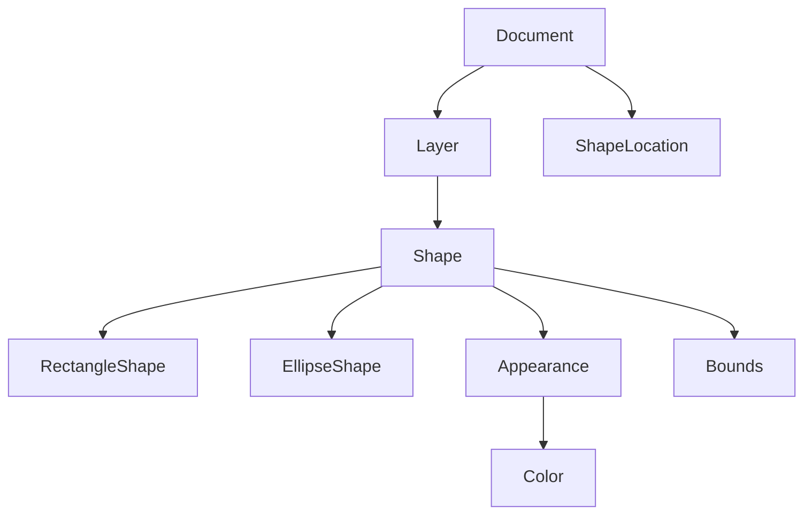

# Design Document

## Overview
An immutable document model in `PressToShape.Core`: `Document` → `Layer` → `Shape` (`RectangleShape`, `EllipseShape`), with `Appearance` and `Color`. All edits are methods on `Document` that return a new `Document`. Unchanged parts are shared between versions. There is no UI, no events and no I/O.

## Steering Document Alignment

### Technical Standards (tech.md)
- Core stays free of Avalonia. The existing `CoreArchitectureTests` check this and stay green.
- Immutable records match `csharp.md` ("prefer records for immutable data") and keep both undo options open (commands or snapshots), as the "Undo/redo mechanism" decision is still open.
- No new NuGet package. `System.Collections.Immutable` is part of the .NET 10 base library.
- This spec settles the "document and geometry model" decision for rectangles and ellipses only.

### Project Structure (structure.md)
- Code is grouped by feature inside Core (`Documents/`, `Shapes/`, `Geometry/`), one type per file, namespaces match folders.
- Tests mirror the folders in `tests/PressToShape.Core.Tests/`, one `[TypeName]Tests.cs` per type.
- Public types have XML doc comments. Helpers are `internal`.

## Code Reuse Analysis
`PressToShape.Core` has no code yet, so there is nothing to extend.

### Existing Components to Leverage
- **`CoreArchitectureTests`**: keeps checking that Core references no Avalonia assembly and no other solution project.
- **Test setup in `PressToShape.Core.Tests`** (xUnit, warnings as errors): new tests follow `Method_Scenario_Expected`.

### Integration Points
- **`PressToShape.App`** (later specs): will hold a `Document` in editor state and call its edit methods. Nothing in `App` changes in this spec.
- **`EditorState` artboard size** (1200 x 800): the Core default matches it. Connecting them is a later spec.

## Architecture

Records with `init` properties that validate their value. A `with` expression runs the same setters, so invalid values are rejected on creation and on change. `Document` offers the edit methods, so callers do not rebuild nested arrays by hand.

### Modular Design Principles
- **Single file responsibility**: one type per file.
- **Validation in one place**: an `internal static class Guard` holds the checks (finite, non-negative, range) and the messages, so every type reports errors the same way.
- **Edits on `Document` only**: `Layer` and `Shape` are plain data. Only `Document` knows how to find things by id and rebuild the tree.



## Components and Interfaces

### `Color` (`Shapes/Color.cs`) — R4.5
- **Purpose:** `readonly record struct Color(byte R, byte G, byte B, byte A)`.
- **Interfaces:** `Color.FromRgb(byte r, byte g, byte b)` (alpha 255), constructor with alpha.
- **Dependencies:** none.

### `Appearance` (`Shapes/Appearance.cs`) — R4
- **Purpose:** fill, stroke, stroke width, opacity.
- **Interfaces:** `Color? Fill`, `Color? Stroke` (`null` = none), `double StrokeWidth` (init validates: finite, ≥ 0), `double Opacity` (init validates: finite, 0 to 1), `static Appearance Default`.
- **Default:** fill `#4A90D9`, stroke `#1F2933`, width 1, opacity 1.

### `Bounds` (`Geometry/Bounds.cs`) — R5.3
- **Purpose:** `readonly record struct Bounds(double X, double Y, double Width, double Height)`. A plain result type for bounds. No Avalonia `Rect` in Core.

### `Shape` (`Shapes/Shape.cs`) — R3, R5
- **Purpose:** abstract record with `Guid Id`, `double X`, `double Y`, `double Width`, `double Height`, `Appearance Appearance`.
- **Id:** `init` property that defaults to `Guid.NewGuid()`. An empty `Guid` is rejected. Tests set the id explicitly, so they stay deterministic.
- **Validation:** `X`, `Y` finite. `Width`, `Height` finite and ≥ 0 (zero allowed).
- **Interfaces:** `Bounds Bounds { get; }` and `abstract bool Contains(double x, double y)`.
- **Constructor:** `protected` and non-public inheritance only inside Core (a private-protected constructor), so only the two shape types exist.

### `RectangleShape`, `EllipseShape` (`Shapes/`) — R3, R5.4
- **Purpose:** sealed records deriving from `Shape`.
- **`RectangleShape.Contains`:** `x` in `[X, X+Width]` and `y` in `[Y, Y+Height]` (edges included).
- **`EllipseShape.Contains`:** center `(X+Width/2, Y+Height/2)`, radii `Width/2`, `Height/2`. A point is inside if `(dx/rx)² + (dy/ry)² ≤ 1`. If a radius is zero, the point must have `d == 0` on that axis and be within the other radius, so a zero-size ellipse is a point or a line segment and never divides by zero.

### `Layer` (`Documents/Layer.cs`) — R2, R3
- **Purpose:** sealed record with `Guid Id` (defaults to `Guid.NewGuid()`), `string Name` (not null), `bool IsVisible = true`, `bool IsLocked = false`, `ImmutableArray<Shape> Shapes` (bottom first, empty by default).
- **Note:** record equality compares `Shapes` by reference, not by content. Tests compare by checking contents. This is accepted, because nothing needs deep equality yet.

### `ShapeLocation` (`Documents/ShapeLocation.cs`) — R5.1
- **Purpose:** `sealed record ShapeLocation(Layer Layer, Shape Shape)`, the result of a lookup.

### `Document` (`Documents/Document.cs`) — R1, R2, R3, R5
- **Purpose:** sealed record with `double ArtboardWidth`, `double ArtboardHeight` (finite, > 0) and `ImmutableArray<Layer> Layers` (bottom first, never empty).
- **Creation:** `static Document Create(string firstLayerName)`: 1200 x 800, one visible, unlocked layer.
- **Edit methods** (all return a new `Document`):
  - `WithArtboardSize(double width, double height)`
  - `AddLayer(Layer layer)` (placed on top)
  - `RemoveLayer(Guid layerId)`
  - `UpdateLayer(Guid layerId, Func<Layer, Layer> change)` for name, visibility and lock
  - `AddShape(Guid layerId, Shape shape)` (placed on top of the layer)
  - `UpdateShape(Guid shapeId, Func<Shape, Shape> change)`
  - `RemoveShape(Guid shapeId)`
- **Queries:**
  - `ShapeLocation? FindShape(Guid shapeId)` returns `null` if not found (R5.2).
  - `IReadOnlyList<Shape> HitTest(double x, double y)`: topmost first. Layers are walked from top to bottom, shapes within a layer from top to bottom. Hidden layers are skipped. Locked layers are included (non-goal).
- **Copying:** `ImmutableArray.SetItem`/`Insert`/`RemoveAt` copy the layer array. Only the changed layer gets a new shape array.

## Data Models

```
Color        : R, G, B, A (byte)
Appearance   : Fill (Color?), Stroke (Color?), StrokeWidth (double >= 0), Opacity (double 0..1)
Shape        : Id (Guid), X, Y, Width (>= 0), Height (>= 0), Appearance
  RectangleShape
  EllipseShape
Layer        : Id (Guid), Name (string), IsVisible, IsLocked, Shapes (ImmutableArray<Shape>)
Document     : ArtboardWidth (> 0), ArtboardHeight (> 0), Layers (ImmutableArray<Layer>, >= 1)
```

## Error Handling

Errors in edit methods are programming errors, not user input, so they throw. The UI validates user input before it calls Core. Later file loading catches these exceptions and reports a corrupt file.

| Scenario | Exception |
|---|---|
| Artboard size, geometry or appearance value invalid (R1.2, R3.4, R4.3, R4.4) | `ArgumentOutOfRangeException`, with the parameter name |
| Null layer name, shape or callback | `ArgumentNullException` |
| Empty `Guid` as id | `ArgumentException` |
| Adding a layer or shape whose id already exists in the document (R3.6) | `ArgumentException` |
| Removing the last layer (R2.6) | `InvalidOperationException` |
| Layer or shape id not found in an edit method | `KeyNotFoundException` |
| `UpdateShape` or `UpdateLayer` callback returns an object with a different id (R3.6) | `InvalidOperationException` |

`FindShape` never throws for a missing id (R5.2). The original `Document` is never changed when an exception is thrown.

## Testing Strategy

### Unit Testing
xUnit, deterministic (explicit ids, no clock or files). One test class per type:
- `ColorTests`, `AppearanceTests`: defaults, none fill/stroke, rejected stroke width and opacity (NaN, infinity, negative, > 1), zero stroke width allowed.
- `RectangleShapeTests`, `EllipseShapeTests`: bounds, rejected values, zero size allowed, `Contains` inside, on the edge, outside, and zero-size ellipse.
- `LayerTests`: defaults (visible, unlocked), null name rejected.
- `DocumentTests`: creation defaults, artboard validation, layer order, last layer cannot be removed, removing a layer removes its shapes, shape order, duplicate ids, `with`-style edits keep the original unchanged (compare before and after), `UpdateShape` with changed id rejected, `FindShape` found and not found.
- `DocumentHitTestTests`: topmost first, hidden layer skipped, locked layer included, miss returns an empty list.
- `CoreArchitectureTests` (existing) stays green.

### Integration Testing
Not applicable: no other project uses the model in this spec.

### End-to-End Testing
Not applicable: no UI. The later `canvas-rendering` and `shape-tools-and-selection` specs show the model in the running app.

## Decisions and Trade-offs
- **Subclasses versus a type tag:** two sealed record subclasses (chosen) instead of one `Shape` with a type field. Per-type behavior (`Contains`) stays next to its data. Later shape types (path) add a subclass. Cost: consumers use pattern matching.
- **`ImmutableArray` versus `ImmutableList`:** `ImmutableArray` (chosen) is cheaper to read and enumerate, which matters for rendering. Edits copy the array, which is fine for small to medium documents. Switch to `ImmutableList` only if a measurement shows a problem.
- **Edit methods on `Document` versus a separate editor type:** methods on `Document` (chosen) keep it small. A command layer can wrap them in the undo/redo spec.
- **`Guid` ids:** chosen as assumed in the requirements.

## Assumptions
- Default colors and the "caller passes the layer name" rule are taken as proposed in the requirements, which were approved.
- The requirement text "visible shapes" in R5.4 means shapes of visible layers, because shapes have no visibility attribute of their own.
