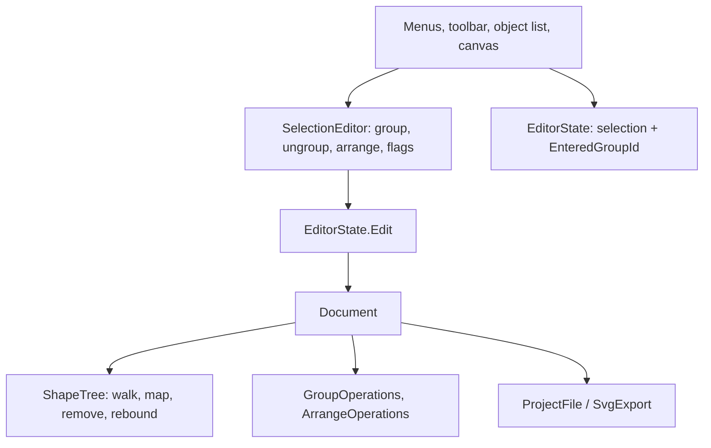

# Design Document

## Overview
Add a nested `GroupShape` to Core, per-object flags (name, hidden, locked), tree-aware document operations (group, ungroup, arrange, flags), the canvas rules for entering groups, and an object list panel. Requirements: `requirements.md` (R1 to R8).

Decision taken with the owner while designing: **a group's box is derived, not stored, and has no rotation of its own** (it replaces Open question 1 of the requirements). A group's box is the union of its members' `RotatedBounds`, always upright. Move, resize, rotate and typed values act on the leaf shapes below the group, with the same math as a multi-selection today. Consequences:
- No nested transforms in hit testing, rendering or SVG. Children keep absolute document coordinates, so ungroup changes nothing visually (R2.3) and the SVG `<g>` needs no `transform` (R7.5 is met by construction).
- The Rotation field shows 0 for a group after a turn, as for a multi-selection today.
- Resizing a group that has a rotated leaf is uniform only (the existing rule in `SelectionTransforms`).
- R3.8 changes meaning: for a group, "rotation" is always 0. R3.6 holds through the uniform-scale rule.

## Steering Document Alignment

### Technical Standards (tech.md)
- All edits go through `EditorState.Edit` and `DocumentHistory` snapshots, so each command is one undo step with an immutable `Document`.
- Core has no Avalonia types. Project file stays JSON, version bumped.

### Project Structure (structure.md)
- Model, tree operations, file I/O, SVG in `PressToShape.Core`. Selection rules, editor commands and the list view model in `PressToShape.App` (`Workspace/`, `ViewModels/Editor/`, `Views/Editor/`). No new project, no new package.
- Files stay under about 400 lines. `Document.cs` is at 370, so the tree logic goes in new files and `Document` only delegates.

## Code Reuse Analysis

### Existing Components to Leverage
- **`Shape` (record, `with`, `Id`)**: `GroupShape` derives from it, so `Layer.Shapes`, `SelectionQueries`, `ShapeClipboard` and `Document.Validated` keep working on the base type.
- **`Document.UpdateShapes / RemoveShapes / AddShapes / FindShape / HitTest`**: become recursive. Signatures stay, so callers (`SelectionEditor`, `CanvasInteraction`) change little.
- **`SelectionTransforms`** (resize, rotate, move): used unchanged, fed with the leaves of the selection.
- **`SelectionEditor.Apply / ApplyTransform / Nudge`**: switch from "selected shapes" to "leaves of the selected shapes".
- **`EditorState.Edit(HistoryStepType, ...)`**, **`HistoryStepNames`**: new step types and translated names.
- **`LayersViewModel` / `LayerItemViewModel`**: pattern for updating rows in place when only flags or names change. `LayersView.axaml` row layout (icon, name, lock toggle, visibility toggle) is the model for object rows.
- **`InspectorViewModel`, `TabletPanelViewModel`, `PanelButtonViewModel`**: the Objects tab is added next to Layers on both layouts.
- **`MenuBarViewModel`** already has the disabled Group, Ungroup, Arrange, Lock, Hide items with their texts, and `de.po` has them. They get commands.
- **`ProjectFile` DTOs, `SvgExport.WriteLayer`**: extended for groups and flags.

### Integration Points
- **`CanvasInteraction`**: click, shift-click, rubber-band and double-click use the new target resolution.
- **`CanvasScene`**: flattens groups, skips hidden objects, marks objects outside the entered group as dimmed.
- **`SelectionOverlay` / `SelectionGeometry.FrameOf`**: frame of a group selection is non-single (see below).

## Architecture



### Modular Design Principles
- `ShapeTree` is the only place that walks nested shapes. Operations files hold one concern each.
- App code asks `SelectionQueries` about the tree. Views never walk the document.

## Components and Interfaces

### Core

**`Shape` (changed)** adds three init properties, valid for every shape and group:
- `Name` (`string`, never null, empty means "default text"), `IsVisible` (default true), `IsLocked` (default false).

**`GroupShape : Shape` (new, `Shapes/GroupShape.cs`)**
- `Children` (`ImmutableArray<Shape>`, bottom first, at least one, no nulls). Its init accessor sets the inherited `X`, `Y`, `Width`, `Height` to the union of the children's `RotatedBounds` and `Rotation` to 0. `Appearance` stays at its default and is not used.
- `Contains` tests the children (visible ones, so a hidden member is not hit).
- Nobody sets a group's own `X`, `Y`, `Width`, `Height` or `Rotation`. `Document` rejects such a group in `Validated` (box must equal the derived box), so a bad `with` fails loudly. Edits of a group happen only through its leaves (see `ShapeTree.Rebound`).

**`ShapeTree` (new, `Documents/ShapeTree.cs`, internal)**
- `Leaves(shape)`: all non-group shapes below (or the shape itself).
- `Find(layers, id)` returns layer, shape, parent group chain.
- `MapLeaves(shape, replacements)` and `Rebound(group)`: replace leaves and recompute every ancestor's box in one pass.
- `Remove(layers, ids)`: removes shapes; a group whose last child is removed is removed too (cascade), and boxes are recomputed.
- `Reidentify(shape, newId)` and `Translate(shape, dx, dy)`: copies with fresh ids for the whole subtree (needs an id source) and moved leaves, for paste and duplicate.
- `EffectiveState(location)`: visible and locked, combined along the parent chain and the layer.

**`Document` (changed)** keeps its API and gains:
- `FindShape` returns `ShapeLocation(Layer, Shape, Parent)`, with `Parent` the closest enclosing `GroupShape` or null. New members `IsEffectivelyVisible` and `IsEffectivelyLocked`.
- `UpdateShapes`, `RemoveShapes`, `FindShape`, `HitTest` recurse. `HitTest` returns leaves, topmost first, skipping effectively hidden ones. The caller maps a leaf to the group it wants (`SelectionQueries`).
- `Validated` also checks: unique ids over the whole tree, group box equals derived box, no empty group, no cycles (impossible with immutable values, but a depth guard stops a pathological input).
- `AddShapes(Guid containerId, ...)` accepts a layer id or a group id.
- `Group(IReadOnlyList<Guid> ids, Guid groupId)`, `Ungroup(IReadOnlySet<Guid> groupIds)`, `Arrange(IReadOnlySet<Guid> ids, ArrangeType type)` (new `ArrangeType`: `ToFront`, `Forward`, `Backward`, `ToBack`), `WithFlags(...)` / `SetAll(visible: true)` / `SetAll(unlocked)`. Implemented in `Documents/GroupOperations.cs` and `Documents/ArrangeOperations.cs`, called from thin `Document` methods.

**Group semantics (R1, R2)**
- Valid when at least two ids, all with the same parent (the same layer's top level, or the same group). Otherwise `InvalidOperationException`; the app disables the command first, so this is a safeguard.
- The new group takes the stack position of the topmost member and the members keep their order.
- Ungroup replaces each group by its children in place. Flags of the group (hidden, locked, name) are dropped; the children keep their own flags.

**Arrange (R4)**: works on siblings. Ids are grouped by parent, each parent's list is reordered with a stable algorithm (to front: selected move to the end in their order; forward: each selected moves one step past the next unselected sibling, from the top down; and the mirror cases). Returns the same instance when nothing changes, so the app records no step (R4.5).

**File I/O**
- `ProjectFile`: shape DTO gets `type: "group"` with `children`, plus optional `name`, `visible`, `locked`. File version goes up by one. Missing flag fields mean visible, unlocked, no name, so older files load as before (R7.2). A group's box is not saved; it is derived on load.
- Load rejects with a `ProjectFileError` (new `InvalidStructure` if none fits): depth above 64, an empty group, a duplicate id. Depth is checked with an explicit counter, not with recursion on untrusted data without a limit.
- `SvgExport`: a group is `<g>` with its children in order. A hidden object (own flag) is skipped, which also skips its whole subtree. A shape's name becomes `inkscape:label` only for groups and layers (shapes keep their markup). Locked objects are exported normally.

### App, Workspace

**`SelectionQueries` (changed)** works on the tree and takes `enteredGroupId` (null at top level):
- `IsSelectable(document, id)`: exists, effectively visible and unlocked, layer visible and unlocked.
- `TargetFor(document, hitLeaf, enteredGroupId)`: the node to select for a hit. At top level it is the outermost group above the leaf (or the leaf). Inside an entered group it is the child of that group that holds the leaf, and null if the leaf is not inside the entered group.
- `Selectable(document, enteredGroupId)`: the direct children of the entered group, or the top-level shapes of visible, unlocked layers, that are effectively visible and unlocked. Used by select all and by `ShapesTouching` (so R3.7 holds: groups, not members).
- `SelectedLeaves(document, ids)`: leaves below the selected nodes, in document order, effectively unlocked. This is what transforms and appearance edits use.

**`EditorState` (changed)**
- New `EnteredGroupId` (`Guid?`) with `EnterGroup(id)` and `LeaveGroup()`. It is cleared when the group no longer exists, is hidden or locked, or is not a group (R3.9), checked in `OnDocumentChanged`. Leaving the group selects it.
- `SetSelection` and `SelectableIds` use the tree rules. Selected ids must share one parent. If they do not, the call keeps the ids of the first parent found (the rule matters only for the object list; canvas input always produces siblings).

**`SelectionEditor` (changed)**
- New commands (each one `_state.Edit` with a new `HistoryStepType`): `Group()`, `Ungroup()`, `Arrange(ArrangeType)`, `SetLocked(bool)`, `SetHidden(bool)`, `ShowAll()`, `UnlockAll()`, `Rename(id, name)`. With `CanGroup`, `CanUngroup`, `CanArrange(type)` for the enabled state. `CanArrange` is computed from the same function that arranges, so "no change" disables the command.
- `Apply` and `ApplyTransform` pass leaves. Group replacements are built once through `ShapeTree.MapLeaves`, so a typed X of a group moves all leaves in one document pass.
- Copy and cut copy the selected nodes as they are. Paste and duplicate go through `ShapeTree.Reidentify` and `Translate`, with the existing injectable `idSource`. Duplicate adds the copies on top of the parent of each original (layer or group).
- After Group the selection is the new group; after Ungroup the members (R2.1, R2.2).

**`SelectionGeometry.FrameOf`**: a selection that contains a group is a non-single frame (upright, from the union of leaves). A single plain shape keeps today's rotated frame. This reuses the existing multi-selection rule, so uniform scale for rotated leaves needs no new code.

**`CanvasInteraction` (changed)**
- Press: handle hit test as today, then `document.HitTest`, map the first selectable leaf with `TargetFor`, select that node. Shift toggles it.
- Double-click on a group (desktop) or double-tap (tablet): `EnterGroup(group)` and select the child under the pointer. Double-click on empty space or Escape: `LeaveGroup()` one level. A click on empty space outside the entered group's box leaves it.
- Move, resize, rotate drags use `SelectedLeaves` as start shapes, and `FrameOf` of the selected nodes.
- `PickColorAt` (eyedropper) uses the first hit leaf, unchanged.

**`CanvasScene` (changed)**: `Build(document, zoom, originX, originY, enteredGroupId)` walks the tree, leaves out effectively hidden objects, and sets `IsDimmed` on a `ScreenShape` when a group is entered and the leaf is not below it. `DocumentCanvasControl` draws a dimmed shape with the opacity from the theme resource `EnteredGroupDimOpacity` (new, `Styles/Theme.axaml`) and draws a dashed outline around the entered group, using a theme brush.

**`HistoryStepType` and `HistoryStepNames`**: `GroupShapes`, `UngroupShapes`, `BringToFront`, `BringForward`, `SendBackward`, `SendToBack`, `LockShapes`, `UnlockShapes`, `HideShapes`, `ShowShapes`, `UnlockAll`, `ShowAll`, `RenameShape`. Names are translated with `Localizer.N`.

### App, view models and views

**`ObjectsViewModel : LocalizedViewModel` (new, `ViewModels/Editor/`)** with **`ObjectRowViewModel`** (new): a flat `ObservableCollection<ObjectRowViewModel>` that the view shows in a virtualizing `ListBox`. A row has `Id`, `Depth`, `Name` (the stored name, or the translated default "Rectangle", "Ellipse", "Group" when empty), `IsGroup`, `IsExpanded`, `IsVisible`, `IsLocked`, `IsSelected` and commands `ToggleVisible`, `ToggleLocked`, `ToggleExpanded`. Layers appear as header rows (name, expander, no toggles; layer flags stay in the Layers tab). Rows are listed top first.
- The list is rebuilt from the document only when the structure (ids, order, depth) changes. When only flags, names or selection change, rows are updated in place, as `LayersViewModel` does. Expanded state is a `HashSet<Guid>` that survives undo and redo where the id still exists (R6.7). Selection that sits in a collapsed group expands its ancestors (R6.2).
- Row click selects the object: it sets `EnteredGroupId` to the row's parent group (or none) and calls `SetSelection`. Ctrl or Shift extends the selection if the row has the same parent, otherwise it replaces it.
- **R5.9, my reading:** a locked object cannot be put into the canvas selection (the model rule in `SelectableIds` stays). Its row can be tapped and its toggles work, so the user can unlock it. The row only gets the panel highlight, not canvas selection. If the owner meant real selection, the Properties panel would then show a locked object; the design does not do that.
- Rename: double-click or long press on the name opens an inline `TextBox`; Enter or loss of focus commits through `SelectionEditor.Rename`, Escape cancels. An empty or whitespace name stores an empty string.
- Reorder (R6.6): drag a row onto another row of the same parent. The drop calls a new `SelectionEditor.MoveBefore(id, targetId)` (uses `ArrangeOperations`, one step `ReorderShape` named like the arrange steps). Drops on another parent are ignored. On touch the drag starts after a long press, using the same `LongPressTracker`.
- Accessible names on rows and toggles; the row height and the toggle size use `RowHeight` and `RowIconSize` from the theme, with the touch values from `TouchSizes` (R6.9).

**`ObjectsView.axaml` (new, `Views/Editor/`)**: header, `ListBox` with an `ItemTemplate` (indent by `Depth`, expander, icon by type, name or inline editor, lock and visibility toggles). Texts through `{loc:T}`. Icons from `Material.Icons.Avalonia`.

**Inspector and panels**: `InspectorTab.Objects` is inserted after `Layers`. `InspectorViewModel.Objects` is new. The desktop tab strip gets one tab. On the tablet `TabletPanelViewModel` maps `Objects` to `Inspector.Objects` and `TabletToolbarViewModel` gets a `PanelButtonViewModel` with a list icon.

**Commands and menus**
- `EditorShellViewModel` gets `[RelayCommand]`s `Group`, `Ungroup`, `BringToFront`, `BringForward`, `SendBackward`, `SendToBack`, `Lock`, `UnlockAll`, `Hide`, `ShowAll`, with `CanExecute` from `SelectionEditor` and notification from `HasSelection`, `Document` and the selection.
- `MenuBarViewModel` passes them through a new `ObjectMenuCommands` record (like `EditMenuCommands`). Group and Ungroup already show Ctrl+G and Ctrl+Shift+G. Added shortcuts: Home, End, Page Up, Page Down for arrange; Ctrl+2 lock, Ctrl+Alt+2 unlock all, Ctrl+3 hide, Ctrl+Alt+3 show all. **Before wiring, check each against the existing key handling in `CanvasAreaView.axaml.cs` and the number field, which take Home, End and arrow keys while a text field has focus** (R8.4 open question).
- Tablet: the overflow menu gets an "Object" section with the same commands (no shortcuts). The selection-dependent enable state is the same.
- New texts go into `de.po`; the existing Group, Ungroup, Arrange, Lock, Hide texts are already there. Mnemonic uniqueness is covered by `TranslationConsistencyTests`.

## Data Models

```
Shape (abstract record)
  Id: Guid, X, Y, Width, Height, Rotation, Appearance
  + Name: string        // "" = default text
  + IsVisible: bool     // default true
  + IsLocked: bool      // default false
GroupShape : Shape
  Children: ImmutableArray<Shape>   // bottom first, 1..n, nested allowed
  // X, Y, Width, Height derived, Rotation = 0, Appearance default (unused)
ShapeLocation(Layer Layer, Shape Shape, GroupShape? Parent)
ArrangeType { ToFront, Forward, Backward, ToBack }

Project file shape DTO
  type: "rectangle" | "ellipse" | "group"
  id, x, y, width, height, rotation, appearance   // not for group: box fields omitted
  name?: string, visible?: bool, locked?: bool
  children?: [shape DTO]                          // only for group
```

## Error Handling

1. **Group on an invalid selection** (different parents, fewer than two): the command is disabled; if reached anyway `Document.Group` throws `InvalidOperationException` and the app does not catch it silently, so a bug shows up in tests.
2. **Entered group disappears** (undo, delete, ungroup, hide, lock): `EditorState.OnDocumentChanged` clears `EnteredGroupId`; the canvas shows everything normally.
3. **Hostile or damaged file** (too deep, empty group, duplicate id, unknown type): `ProjectFileResult.Failure` with an error and a message; the app shows the existing load error dialog. No exception escapes.
4. **Rename to empty or only spaces**: stored as an empty string and shown as the default text.
5. **Arrange or lock that changes nothing**: no history step, command disabled.
6. **Cascade delete**: removing all members of a group removes the group. The selection leaves the removed ids through the existing `OnDocumentChanged` rule.

## Testing Strategy

### Unit Testing (xUnit, names `Method_Scenario_Expected`)
- `GroupShape`: derived box (rotated children, nested groups), empty children rejected, `with` changes of the box rejected by `Document`.
- `Document`: Group and Ungroup (position, order, nesting, different parents), Arrange (the four types, several selected, different parents, no-op returns the same instance, never leaves the parent), recursive `FindShape`, `UpdateShapes`, `RemoveShapes` (cascade, rebounding), `HitTest` with hidden objects, effective flags through groups and layers, Show All and Unlock All over nested objects.
- `ProjectFile`: round trip with groups and flags; an old file; depth limit; empty group; duplicate id.
- `SvgExport`: `<g>` nesting and order, hidden skipped, a rotated leaf stays at its place.
- `SelectionQueries`: `TargetFor` with and without an entered group, rubber-band returns groups, locked and hidden excluded.
- `SelectionEditor`: group and ungroup selection, arrange and selection kept, paste and duplicate give fresh ids for the whole subtree, nudge and typed values move the leaves, one step per command, and the step names.
- `EditorState`: `EnteredGroupId` cleared on undo, delete, hide and lock.
- `ObjectsViewModel`: row order and depth, default and stored names, in-place updates, expand state kept over undo, selection sync, R5.9 behavior, rename, reorder within a parent.
- `CanvasScene`: hidden leaves left out, dimming.
- `TranslationConsistencyTests` covers new texts.

### Integration Testing
- Headless UI test (`[Collection(HeadlessUi.CollectionName)]`): double-click enters a group, Escape leaves it, the object list shows the selection and a toggle hides an object. Pump the dispatcher, never block it.

### End-to-End Testing (manual, desktop and tablet)
- Draw three rectangles, group two, move, rotate and resize the group, ungroup, undo and redo each. Enter the group, edit a member, leave. Save, load, export SVG and open it in an SVG viewer. On the tablet check double-tap, the Objects panel and the toolbar button. Notes go in the implementation log.

## Assumptions and Open questions (for the reviewer)
1. **Derived group box, no own rotation** (decided with the owner, see Overview).
2. **R5.9 reading**: a locked object is "selected" in the object list only as a highlighted row, not in the canvas selection. If the owner wants the Properties panel to show a locked object, that needs a different design.
3. **Shortcuts** for arrange, lock and hide are proposals until the clash check in the first command task.
4. **Tablet double-tap** to enter a group must be checked against `TouchGestureTracker`, which already knows two-finger gestures and long press; if double-tap clashes with pan or tool taps, the design falls back to an "Enter group" entry in the overflow menu.
5. **Project file version** bump: the exact number follows the current one in `ProjectFile`; older readers fail on the new version by design.
6. Hidden members still count for the group's box. A group of one visible and one hidden shape keeps the full box.
