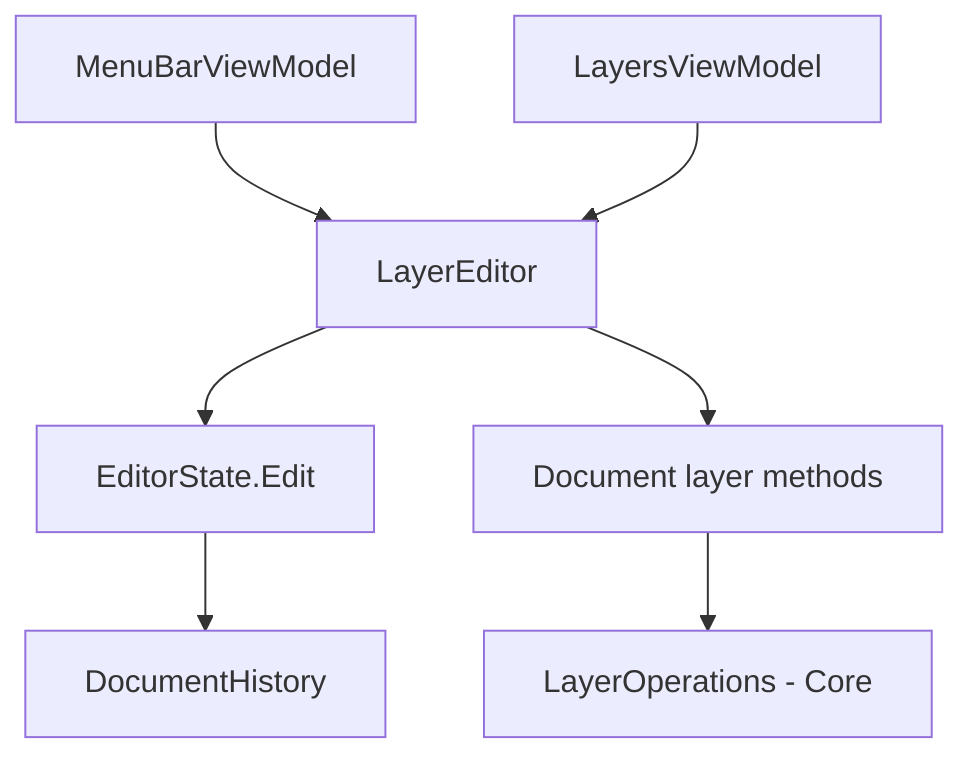

# Design Document

## Overview
Layer commands are pure functions on the immutable `Document` in Core (`LayerOperations`, reached through new `Document` methods). A new `LayerEditor` in `App/Workspace` wraps them as history steps, selection and active-layer handling, with `Can...` properties, like `ObjectEditor` does for groups and arrange. `LayersViewModel` and the desktop menu call `LayerEditor`. No new package, no change to the file format: a document already stores an ordered list of layers.

## Steering Document Alignment

### Technical Standards (tech.md)
- Core stays UI-free and immutable. Every change returns a new document and shares unchanged layers.
- Every document change goes through `EditorState.Edit`, so each command is one history step and a command that changes nothing records nothing.
- View models extend `LocalizedViewModel`, get an `ILocalizer` through the constructor, and never use `LocalizationHost`.

### Project Structure (structure.md)
- Core: `Documents/LayerOperations.cs` (one type per file), `History/HistoryStepType.cs`.
- App: `Workspace/LayerEditor.cs`, `Workspace/HistoryStepNames.cs`, `ViewModels/Editor/LayersViewModel.cs`, `ViewModels/Editor/ObjectRowViewModel.cs`, `ViewModels/Desktop/MenuBarViewModel.cs` and `ObjectMenuCommands` (or a new `LayerMenuCommands`, see Components), `Views/Editor/LayersView.axaml(.cs)`, `Translations/de.po`.
- Code index in `docs/index/` is regenerated after the change.

## Code Reuse Analysis

### Existing Components to Leverage
- **`Document.AddLayer`, `RemoveLayer`, `UpdateLayer`**: add (extended with an index), delete (already refuses the last layer) and rename.
- **`ShapeTree.Reidentify`**: copies a shape and everything below it with new ids. Used by duplicate layer. It is the same helper that Duplicate for shapes uses.
- **`Document.RemoveShapes` / `AddShapes`**: move objects to a layer: remove them (an emptied group goes with it) and add them to the top of the target layer. One pass each.
- **`ObjectEditor` / `FlagOperations` / `ArrangeOperations`**: the pattern to follow (static operations, editor class with `Can...`).
- **`EditorState.Edit`, `SetSelection`, `ActiveLayerId`, `LeaveAllGroups`**: history, selection and active layer.
- **`ObjectRowViewModel.BeginRename/CommitRename/CancelRename`** and the drag code of `LayersView.axaml.cs`: rename and drag stay as they are, extended to layer rows.
- **`DocumentValidation`**: already enforces unique ids and at least one layer, so a bad operation cannot produce an invalid document.

### Integration Points
- **Project file / SVG export**: unchanged. Both iterate `Document.Layers` in order (R9 is covered by tests, not by new code).
- **History panel**: new `HistoryStepType` values get names in `HistoryStepNames` and `de.po`.

## Architecture

### Modular Design Principles
- `LayerOperations` is pure and has no knowledge of selection or active layer.
- `LayerEditor` decides what happens to selection, entered group and active layer, and names new layers.
- Views only forward pointer input (drop on a layer row) to `LayersViewModel`.

## Components and Interfaces

### `Document` (new methods, Core)
- `InsertLayer(int index, Layer layer)`: `AddLayer` stays and means "at the top".
- `MoveLayerAbove(Guid layerId, Guid targetId)`: the layer directly above the target. Returns `this` if it is there already. Same name pattern as `MoveAbove` for shapes.
- Move Up and Move Down use `MoveLayerAbove`, with the target computed by the editor (Move Down puts the layer above the layer two places below, or at the bottom: see `LayerOperations`, which also offers `MoveLayerToIndex` for that case).
- `MoveLayerToIndex(Guid layerId, int index)`: the primitive behind `MoveLayerAbove`, Move Up and Move Down.
- `DuplicateLayer(Guid layerId, Guid newLayerId, string name, Func<Guid> newShapeId)`: copy directly above the original.
- `MergeLayerDown(Guid layerId)`: upper layer's shapes appended to the lower layer, upper layer removed. Throws if the layer is the bottom one.
- `MoveShapesToLayer(IReadOnlySet<Guid> ids, Guid layerId)`: shapes (top-level or nested) become top-level shapes at the top of the layer, keeping their relative document order (bottom layer first, then stack order).
- `RenameLayer` is `UpdateLayer(id, l => l with { Name = ... })`, no new method.

### `LayerEditor` (App/Workspace)
- **Purpose:** the commands of R1 to R7 as history steps.
- **Interfaces:** `CanAdd`, `CanDelete`, `CanDuplicate`, `CanMerge`, `CanMoveUp`, `CanMoveDown`, `CanMoveSelectionUp`, `CanMoveSelectionDown`, and `Add()`, `Delete()`, `Duplicate()`, `MergeDown()`, `MoveUp()`, `MoveDown()`, `MoveAbove(layerId, targetId)`, `Rename(layerId, name)`, `MoveSelectionToLayer(layerId)`, `MoveSelectionUp()`, `MoveSelectionDown()`. All of them act on `ActiveLayerId`, except the ones that name a layer.
- **Dependencies:** `EditorState`, `ILocalizer` (for default names), optional `Func<Guid>` for ids (tests pass their own, as `ObjectEditor` does).
- **Naming (A1):** `T("Layer {0}")` with the lowest number not in use by another layer name; a duplicate uses `T("{0} copy")`. The format texts are `.po` entries; formatting uses the localizer culture.

### `LayersViewModel` and `ObjectRowViewModel`
- `AddLayerCommand` is wired to `LayerEditor.Add`; new commands `DuplicateLayerCommand`, `DeleteLayerCommand`, `MoveLayerUpCommand`, `MoveLayerDownCommand`, `MergeLayerDownCommand`. Their `CanExecute` re-evaluates when the document or `ActiveLayerId` changes.
- `ObjectRowViewModel.CanRename` is true for layer rows; `LayersViewModel.Rename` calls `LayerEditor.Rename` for a layer row and `ObjectEditor.Rename` for any other row. An empty name keeps the old name (R3.3), unlike objects where empty removes the name, so a layer always has a name.
- Drop handling: dropping a layer row on a layer row calls `LayerEditor.MoveAbove` (R4.3). Dropping an object row on a layer row calls `MoveSelectionToLayer`: if the dragged row is in the selection, the whole selection moves, otherwise only the dragged object (R7.1). `CanReorder` is extended to answer for both cases.

### Menu bar
- The existing structure has no Layer menu. Recommendation: a new top-level **Layer** menu between Object and Path with Add, Duplicate, Delete, Merge Down, Move Up, Move Down, and a submenu "Move Selection" (To Layer Above, To Layer Below). Mnemonics: `_Layer`, `_Add Layer`, `D_uplicate Layer`, `_Delete Layer`, `_Merge Down`, `Move _Up`, `Move _Down`, `Move _Selection`. They are unique within the menu and `TranslationConsistencyTests` checks them. This answers A6; the owner can still ask for entries in Object instead.
- Commands are exposed like `ObjectMenuCommands`: a small `LayerMenuCommands` class holding `RelayCommand`s that wrap `LayerEditor`, so the menu stays declarative.

## Data Models
No change to `Layer`, `Document` or the project file DTOs.

New `HistoryStepType` values: `AddLayer`, `DeleteLayer`, `RenameLayer`, `ReorderLayer`, `DuplicateLayer`, `MergeLayers`, `MoveToLayer`. Names: "Add layer", "Delete layer", "Rename layer", "Reorder layer", "Duplicate layer", "Merge layers", "Move to layer".

## Behavior details

| Command | Document change | Selection and active layer |
|---|---|---|
| Add | `InsertLayer` above the active layer | selection and entered group cleared, new layer active |
| Delete | `RemoveLayer` | active becomes the layer below, else the layer above (R2.3); selection loses shapes of the layer through `OnDocumentChanged`; entered group left |
| Rename | `UpdateLayer` with the name | unchanged; no step if the name is the same (R3.5) |
| Move up/down, drop | `MoveLayerAbove` | unchanged |
| Duplicate | `DuplicateLayer` above the original | selection cleared, copy active |
| Merge down | `MergeLayerDown` | lower layer active, selection kept as far as selectable |
| Move selection | `MoveShapesToLayer` | selection ids stay, entered group left if the moved shapes were in it |

Move up on the top layer and move down on the bottom layer are disabled. "Move selection above/below" moves the selection to the layer next to the layer that holds it. It is disabled unless the whole selection lies in one layer (D1 below).

## Error Handling

### Error Scenarios
1. **Delete last layer, merge bottom layer, move beyond the ends:** the command is disabled. If called anyway, `LayerEditor` does nothing and records no step. Core throws `InvalidOperationException` as it does today for `RemoveLayer`.
2. **Move to a locked or hidden layer (R7.4):** `CanMoveSelection...` is false for it, and a drop on such a row is ignored, so the document stays unchanged.
3. **Unknown layer or shape id:** Core throws `KeyNotFoundException`; the editor checks first and ignores stale ids (a row may outlive an undo).
4. **Move would empty a group:** `RemoveShapes` removes it with its last child (existing behavior).
5. **Id collision on duplicate:** ids come from `Guid.NewGuid`; `DocumentValidation` still guards.

## Open points and deviations (for the reviewer)
- **D1:** Move Selection Up/Down is disabled when the selection spans several layers. A drop on a layer row has no such limit.
- **D2 (conflict with R1.4 and R2.5, needs a decision):** `EditorState` does not store the active layer in history. After Undo of Add or Duplicate, and after Redo of Delete, the active layer falls back to the layer `OnDocumentChanged` picks (today the top layer), not to "the previous active layer". Recommendation: change `OnDocumentChanged` to fall back to the layer at the position of the vanished one (nearest below, else above), which is the previous active layer for Add and Duplicate in nearly all cases, and keep the active layer out of history. The alternative, storing the active layer in every history step, touches `DocumentHistory` and every step record. If you want the strict reading of R1.4, say so and the design is changed before the tasks are written.
- **D3:** The ring context menu is not changed (decided).
- **D4:** A layer name has no length limit and may be a duplicate of another layer's name. Only the default names (A1) avoid duplicates.

## Testing Strategy

### Unit Testing (Core.Tests)
- `LayerOperations`: insert at index, move above (up, down, same place, bottom, unknown id), duplicate (new ids for layer and every nested shape, same look, nested groups), merge down (order, id and flags of the lower layer, bottom throws), move shapes to layer (order, from groups, empty group removed, unknown id), immutability of the original document.
- Save and load round trip with several layers in non-default order.

### Unit Testing (App.Tests)
- `LayerEditor`: every command's `Can...` states and effect on document, selection, active layer, entered group, and exactly one history step per command (and none for a no-op); undo and redo; default names in English and German.
- `LayersViewModel`: commands' `CanExecute` changes with the document and active layer; rename of a layer row (confirm, empty, Escape, same name); reorder and drop-on-layer cases, including a locked target.
- `MenuBarViewModel`: Layer menu entries, enabled states, mnemonics (`TranslationConsistencyTests`).
- Headless UI test for the Layers panel: buttons enabled and disabled, drop of an object row on a layer row (class carries `[Collection(HeadlessUi.CollectionName)]`).

### Manual check
- Desktop: run the app, use each button and menu entry, undo and redo through the history panel.
- Tablet: touch targets and a drag on a real device (see `device-report.md` for the usual route over `adb`).
