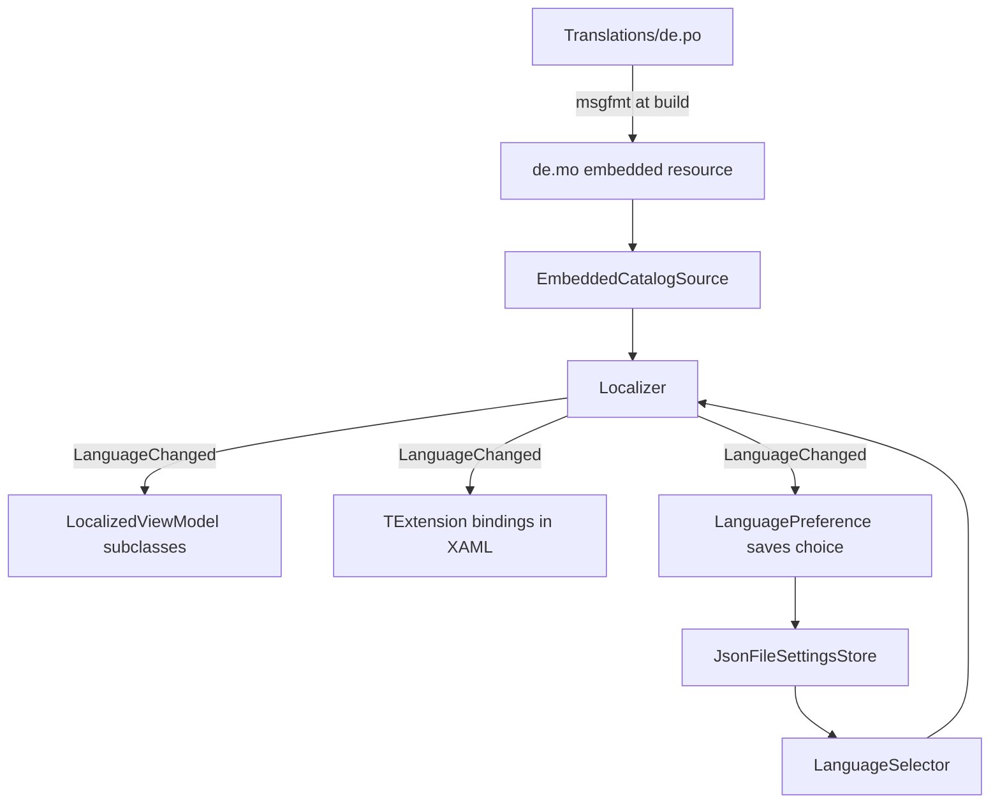

# Design Document

## Overview
Translations live in gettext `.po` files that the build compiles to `.mo` and embeds in `PressToShape.App`. A small `Localizer` service holds the current language and translates texts through an `ITranslationCatalog` (an adapter around GetText.NET). View models receive the localizer by injection and expose translated properties that refresh on a language change. XAML uses one markup extension, `{loc:T 'English text'}`, that updates live. The language choice is stored in a small JSON settings file. English source text is the message id, so English needs no catalog.

## Steering Document Alignment

### Technical Standards (tech.md)
- .NET 10, C# 14, nullable enabled, MVVM with CommunityToolkit.Mvvm, compiled bindings, xUnit. New dependency: `GetText.NET` 10.0.1 (MIT), declared in `Directory.Packages.props`, referenced only from `PressToShape.App`. New data storage: one JSON settings file (`tech.md` is updated for it).
- No Avalonia types in view models. Only the markup extension and the application class touch Avalonia.

### Project Structure (structure.md)
- All code in `PressToShape.App`: new folders `Localization/`, `Settings/` and `Translations/`. The heads and `Core` are untouched. `structure.md` is updated for the new folders.

## Code Reuse Analysis

### Existing Components to Leverage
- **`ViewModelBase`**: extended by a new `LocalizedViewModel` for view models with translated text.
- **`MenuBarViewModel`, `ToolbarViewModel`, `ToolboxViewModel`, `StatusBarViewModel`, `DesktopShellViewModel`**: take an `ILocalizer` and produce translated text.
- **`StatusBarViewModel.FormatZoom`**: becomes culture-aware.
- **`RepoPaths`, the existing architecture tests, `ThemeResourceTests`**: the same test style is used for translation checks.
- **`PressToShapeApp.Initialize`**: creates the localizer before the XAML is loaded.

### Integration Points
- `PressToShape.App.csproj`: new MSBuild target that compiles `Translations/*.po` and embeds the `.mo` files.
- `Directory.Packages.props`: `GetText.NET` version.
- `README.md`, `.claude/rules/`, `tech.md`, `structure.md`: documentation of the workflow and the new rule.

## Architecture



### Message ids and contexts
- The message id is the full English text, as in standard gettext. `T("Select")` returns the English text in English and the German translation in German.
- A message context (gettext `msgctxt`) disambiguates equal texts: `TC("menu", "Open")` versus `TC("toolbar", "Open")`. Contexts are only used when two places need different translations.
- Menu headers keep their Alt-key underscore in the message id (`_File`), so translators place the mnemonic themselves.
- Texts in data tables (tool names, toolbar button names, menu items) are written through a marker `Localizer.N("Select")`, which returns its argument and tells the extraction test that this text is translatable. The view model translates it later with `T`.

### Language choice at startup
`LanguageSelector.Choose(savedCode, systemUiCulture)`: use `savedCode` if it is a supported language, else `de` if the system UI culture's two-letter name is `de`, else `en`.

### Languages
`SupportedLanguages.All` is a list of `LanguageInfo(Code, DisplayName)`: English (`en`), Deutsch (`de`). Adding a language means adding a `.po` file and one entry here (Requirement 8.4). Display names are not translated.

### Modular Design Principles
- One type per file, in `Localization/` and `Settings/`.
- Catalog lookup, language selection, persistence and the markup extension are separate and testable on their own.
- View models depend on `ILocalizer` only.

## Components and Interfaces

### Localization (pure logic, no Avalonia)
- **`ITranslationCatalog`**: `string? Translate(string text)` and `string? Translate(string context, string text)`. Returns null when there is no translation.
- **`GettextCatalog`**: implements it over `GetText.Catalog` (created from an embedded `.mo` stream and the language's `CultureInfo`), using `TranslationExists` and `GetString` / `GetParticularString`. An empty translation counts as missing.
- **`ICatalogSource`**: `ITranslationCatalog? Load(string languageCode)`. **`EmbeddedCatalogSource`** reads the embedded resource `PressToShape.App.Translations.<code>.mo`, and returns null (and logs to the debug trace) if it is absent or unreadable.
- **`ILocalizer`**: `string T(string text)`, `string TC(string context, string text)`, `CultureInfo Culture`, `string LanguageCode`, `IReadOnlyList<LanguageInfo> Languages`, `void SetLanguage(string code)`, `event EventHandler? LanguageChanged`. `N(string)` is a static marker on `Localizer`.
- **`Localizer`**: implements it. `SetLanguage` ignores unknown codes and the current code, loads the catalog (English means no catalog), updates `Culture`, and raises `LanguageChanged`. `T` returns the translation, or the English text when there is none.
- **`LanguageSelector`** and **`SupportedLanguages`** as above.
- **`LanguagePreference`**: wires the localizer to the settings store: reads the saved code at startup, saves on `LanguageChanged`.
- **`LocalizationHost`**: a static holder of the one application `ILocalizer`, set once at startup. It exists only because XAML markup extensions cannot receive injected services. View models never use it.

### Settings (pure logic)
- **`AppSettings`**: a class with `Language` (nullable string) and `[JsonExtensionData]` for unknown entries, so other settings survive a round trip.
- **`ISettingsStore`**: `AppSettings Load()` and `void Save(AppSettings settings)`.
- **`JsonFileSettingsStore`**: `System.Text.Json`. `Load` returns defaults when the file is missing, unreadable or not valid JSON. `Save` writes a temporary file next to the target and replaces the target, and swallows IO errors (debug trace only). The default path is `Environment.GetFolderPath(SpecialFolder.ApplicationData)` plus `PressToShape/settings.json`, and the constructor takes a path so tests use a temp folder.

### View models
- **`LocalizedViewModel`**: base class (extends `ViewModelBase`) that holds the `ILocalizer`, subscribes to `LanguageChanged`, and raises `PropertyChanged` for all properties (`string.Empty`) so every translated property refreshes. These view models live as long as the app, so the subscription needs no unsubscribe. Short-lived view models (for example future layer items) must not extend it.
- **`MenuItemViewModel`**: extends `LocalizedViewModel`. `Header` is computed from a message id (or a fixed display name for the language items), plus `IsCheckable` and `IsChecked` for the Language items.
- **`MenuBarViewModel`**: adds the View > Language submenu with one item per supported language. Selecting one calls `SetLanguage`, and `IsChecked` is true for the current language.
- **`ToolbarButtonViewModel`, `ToolItemViewModel`**: extend `LocalizedViewModel`; `Name` and `ToolTip` are translated. `ToolDefinition.Name` stays the English message id.
- **`StatusBarViewModel`**: `SelectionSummary` is `T("Nothing selected")` while there is no selection. `ZoomText` uses `FormatZoom(percent, localizer.Culture)`.
- **`EditorState`**: its default `SelectionSummary` becomes an empty string. The status bar supplies the translated "Nothing selected" text.
- **`DesktopShellViewModel`**: takes an `ILocalizer` in its constructor and passes it on.

### Avalonia side
- **`TExtension`** (`Localization/TExtension.cs`): the markup extension `{loc:T 'Text'}` with an optional `Context`. It returns a one-way binding that re-evaluates when `LanguageChanged` fires. The exact binding mechanism (an observable turned into a binding, or an indexer binding on a small source object with an escaped key) is verified in the first task, because Avalonia 12 details matter here. The behavior is fixed: updates live, works for `Text`, `Header`, `ToolTip.Tip` and `AutomationProperties.Name`.
- **Views**: every literal user-visible string in the `.axaml` files is replaced by `{loc:T ...}`, including `AutomationProperties.Name` values.
- **`MenuBarView`**: the menu item theme additionally binds `IsChecked` and a radio toggle for checkable items. Checkable is a bool in the view model, and the view maps it to Avalonia's toggle type.
- **`PressToShapeApp.Initialize`**: builds the localizer (embedded catalog source, JSON settings store, `CultureInfo.CurrentUICulture`), sets `LocalizationHost`, wires `LanguagePreference`, and then loads the XAML. The desktop branch passes the localizer to `DesktopShellViewModel`. The Android branches still show the greeting `MainView`, which has no translated text.

### Build
In `PressToShape.App.csproj`:
- `Translations/*.po` are collected as items. A target runs before compilation: it checks for `msgfmt` (`msgfmt --version`), fails with a clear message if it is missing, then compiles each `.po` to `obj/.../translations/<code>.mo` with `msgfmt --check` and adds the result as an `EmbeddedResource` with the logical name `PressToShape.App.Translations.<code>.mo`.
- The error message reads: "msgfmt was not found. Install the gettext tools: sudo apt install gettext (Debian, Ubuntu), or install gettext for Windows and add it to PATH. See README.md."
- `.mo` files are build output in `obj/` and are already ignored by git.
- The target uses inputs and outputs, so it only recompiles when a `.po` changes.

### Translation checks (tests, no msgfmt needed)
A small test helper parses a `.po` file (message context, id and string, multi-line entries, comments, `fuzzy` flag). A second helper finds all translatable texts in the sources: `T("...")`, `TC("...", "...")`, `N("...")` in `.cs` files and `{loc:T '...'}` in `.axaml` files. The tests then check:
- every source text has a non-empty, non-fuzzy German translation in `de.po`
- every `de.po` entry (except the header) is used in the sources
- German menu mnemonics are unique per menu level, by building `MenuBarViewModel` with a fake catalog made from the parsed `de.po`
- placeholders and shortcut hints (parenthesized key such as `(N)`) in the English text are kept in the German text

## Data Models

```
LanguageInfo: string Code, string DisplayName
AppSettings: string? Language, Dictionary of string to JsonElement (extension data)
settings.json example: { "Language": "de" }
```

## Error Handling

### Error Scenarios
1. **Catalog resource missing or unreadable:** `EmbeddedCatalogSource` returns null, so the app shows English. Nothing crashes.
2. **Settings file missing, unreadable, or invalid:** `Load` returns defaults. The saved language is ignored.
3. **Settings file cannot be written:** `Save` swallows the error. The language stays changed for this session.
4. **Saved language is unknown:** `LanguageSelector` ignores it and falls back to the system language rule.
5. **Missing or empty German translation:** the English text is shown. A test fails during development.
6. **`msgfmt` missing at build time:** the build fails with the install instructions.

## Testing Strategy

### Unit Testing (xUnit, `PressToShape.App.Tests`)
- `LanguageSelectorTests`: saved choice, German and non-German system cultures, unknown saved code.
- `LocalizerTests`: English passthrough, German lookup with a fake catalog, missing translation fallback, context lookup, unknown language ignored, `LanguageChanged` raised once, culture updated.
- `SettingsStoreTests`: round trip, missing file, corrupt file, unknown entries preserved, failed write does not throw, existing file not corrupted by a failed write, path built from the special folder.
- `LanguagePreferenceTests`: restore at startup, save on change.
- View model tests: with a fake German catalog, menu headers, tool names, toolbar names, status texts and the zoom text change on `SetLanguage`; Language items show the checked state and switching works through the menu command; the zoom text uses a decimal comma in German.
- Translation consistency tests as described above.

### Integration Testing
- `dotnet build` of the whole solution, including Android, on a machine with gettext, and a build on a machine without `msgfmt` shows the clear error (checked once by temporarily hiding `msgfmt` from `PATH`).

### End-to-End Testing
- Manual, on Linux: start with the system language German, then English; switch in the View menu and see every region change; restart and check the saved choice; delete or corrupt `settings.json` and start; check the German UI for clipped text.

## Risks and Early Checks
- **Avalonia 12 binding mechanism for the markup extension** and **MSBuild embedding of generated resources**: the first task is a small spike for both, together with loading a one-entry `.mo` through GetText.NET.
- **German text length:** German labels are often longer. Fixed widths (the inspector tabs, toolbar fields) are checked visually, and widths are loosened where text is clipped.
- **Mnemonic clashes:** German menu items need unique Alt keys per level. The test catches clashes.
