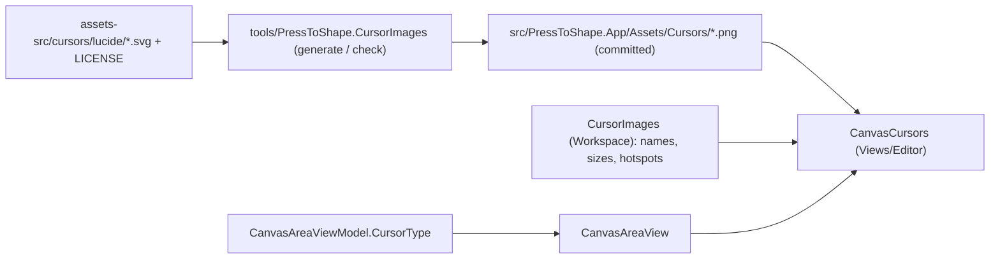

# Design Document

## Overview
All canvas cursors except the plain arrow become pre-drawn PNG images made from ten Lucide icons. A new developer tool, `tools/PressToShape.CursorImages`, renders the bundled Lucide SVG files to PNGs at 32 px and 64 px. The PNGs are committed as Avalonia resources. At runtime `CanvasCursors` loads the image that fits the screen scale and wraps it in a `Cursor`. The choice of cursor type (`CanvasCursorType`, `CanvasAreaViewModel.CursorType`) stays as it is, except that the Zoom tool shows a zoom-out cursor while Alt is held (R3.7).

## Steering Document Alignment

### Technical Standards (tech.md)
- Material.Icons stays the icon set for tool, toolbar and panel icons. Decision 6 rejected the `Lucide.Avalonia` package because it targets Avalonia 11. This design does not use that package. It bundles Lucide SVG files as artwork only, so the decision still stands. `tech.md` gets a new decision-log entry (R8), through the approval flow.
- The new tool follows the "developer tool, not shipped" pattern of decision 9 (`tools/PressToShape.CodeIndex`). Its package is not referenced by `src/`.
- One new package is needed for the tool only: **SkiaSharp 3.119.4** with **SkiaSharp.NativeAssets.Linux 3.119.4**. This is the version Avalonia 12.1.6 already pulls in for the app, so the tool draws with the same Skia. The owner is asked to confirm this at approval (project rule: no new packages without asking).

### Project Structure (structure.md)
- Pure logic goes in `Workspace/` (no Avalonia). Loading images goes in `Views/Editor/CanvasCursors.cs`. Both exist already (`CanvasCursorType` and `CanvasCursors`).
- The tool goes under `tools/`, its tests under `tests/`. `structure.md` gets the two new folders (`tools/PressToShape.CursorImages/`, `assets-src/`).
- Dependency direction is unchanged: `Desktop/Android -> App -> Core`. The tool depends on nothing in `src/`.

## Code Reuse Analysis

### Existing Components to Leverage
- **`CanvasCursorType`** (`Workspace/`): the enum stays as it is. The view model's choice logic is not touched (R6.1).
- **`CanvasCursors`** (`Views/Editor/`): keeps its cache, its `For(type)` entry point and its fallback to standard cursors. Only `FromIcon` (Material drawing) is replaced by an image loader.
- **`CanvasAreaView`**: already sets `Viewport.Cursor` on a data-context change and on `CursorType` changes. It passes the screen scale to `CanvasCursors.For`.
- **`AvaloniaResource Include="Assets\**"`** in `PressToShape.App.csproj`: already includes everything under `Assets/`. No project change is needed for the PNGs.
- **`RepoPaths`** (`tests/PressToShape.App.Tests`) and the source-reading style of `AppArchitectureTests`: reused for the "every image exists" test.
- **`tools/PressToShape.CodeIndex`**: model for the tool layout (console app, `generate` and `check` commands, exit code 1 when out of date).

### Integration Points
- **Avalonia assets**: images are read with `AssetLoader.Open(new Uri("avares://PressToShape.App/Assets/Cursors/<name>-<size>.png"))`.
- **`TopLevel.RenderScaling`**: gives the screen scale of the window that shows the canvas.
- **Code index** (`docs/index/`): regenerated after the C# changes, as the rules require.

## Architecture

### Modular Design Principles
- **Single file responsibility:** `CursorImages` knows names, sizes and hotspots (pure). `CanvasCursors` loads and caches (Avalonia). The tool renders (Skia). No file does two of these.
- **One source of truth per fact:** which icon a cursor uses lives in the tool (`CursorSet`). Which hotspot a cursor has lives in `CursorImages`, in the app. The file name ties them together (`CursorImages.FileName(type, size)` equals the tool's output name), and a test checks that every name has both images.

### Cursor set

| `CanvasCursorType` | Image name | Lucide icon (0.468.0) | Hotspot at 32 px |
|---|---|---|---|
| `Crosshair` | `crosshair` | `crosshair` | 16, 16 |
| `OpenHand` | `open-hand` | `hand` | 16, 16 |
| `ClosedHand` | `closed-hand` | `grab` | 16, 16 |
| `Magnifier` | `magnifier` | `zoom-in` | 15, 15 (lens center) |
| `MagnifierMinus` (new) | `magnifier-minus` | `zoom-out` | 15, 15 (lens center) |
| `ResizeNorthSouth` | `resize-north-south` | `move-vertical` | 16, 16 |
| `ResizeWestEast` | `resize-west-east` | `move-horizontal` | 16, 16 |
| `ResizeNorthWestSouthEast` | `resize-north-west-south-east` | `move-diagonal-2` | 16, 16 |
| `ResizeNorthEastSouthWest` | `resize-north-east-south-west` | `move-diagonal` | 16, 16 |
| `Rotate` | `rotate` | `rotate-cw` | 16, 16 |
| `Arrow` | none (OS cursor) | - | - |

The icon names match the preview sheet. `move-diagonal-2` points north-west to south-east and `move-diagonal` points north-east to south-west, as the preview showed. At 64 px the hotspot is doubled: (30, 30) for the magnifier and (32, 32) for the others.

### Image rendering (tool)
- The image canvas is `size` px square and shows a 32 x 32 unit area around the 24 x 24 Lucide icon (a 4 unit margin on each side), so the dark outline is not cut off at the edges. Scale is `size / 32`: one unit is one pixel at 32 px, so the drawn shape is 24 px wide at 100% screen scale and 48 px in the 64 px image.
- **Revision after the manual check:** the first version showed a 28 unit area (a drawn shape of about 27 px at 32 px). The owner found that a little too big and chose about 24 px. The image files stay 32 and 64 px, so R2 does not change. The magnifier hotspot stays (15, 15) at 32 px, now exactly the lens center (11 + 4 margin units).
- Each icon is drawn twice with round caps and joins: first a black stroke 4.6 units wide, then a white stroke 2 units wide, on a transparent background, with antialiasing. This is the look of the approved preview.
- The sources are SVG files with `path`, `circle` and `line` elements only. The tool reads exactly those and fails with a clear message on any other element, so a Lucide update cannot silently draw wrong.
- Colors are in the tool only. They are the cursor outline and fill, not a UI theme color, so the `Theme.axaml` rule does not apply (no view hardcodes a color).

### Runtime flow
1. `CanvasAreaView` takes `TopLevel.GetTopLevel(this)?.RenderScaling ?? 1.0` and calls `CanvasCursors.For(type, scale)`.
2. `CursorImages.SizeFor(scale)` returns 32 for a scale below 1.5 and 64 from 1.5 up (R2.1 to R2.3).
3. `CanvasCursors` looks up `(type, size)` in its cache. On a miss it opens the PNG, builds `new Cursor(bitmap, hotspot)`, and keeps the bitmap alive in a list (as today). A scale change takes effect with the next `For` call (R2.4): the cache key contains the size.
4. `Arrow` returns `new Cursor(StandardCursorType.Arrow)`.

## Components and Interfaces

### `CursorImages` (new, `Workspace/CursorImages.cs`)
- **Purpose:** the pure facts about the cursor images.
- **Interfaces:** `static int SizeFor(double scale)`, `static string FileName(CanvasCursorType type, int size)` (null for `Arrow`), `static (int X, int Y) Hotspot(CanvasCursorType type, int size)`, `static IReadOnlyList<int> Sizes` (32, 64).
- **Dependencies:** none (no Avalonia).
- **Reuses:** `CanvasCursorType`.

### `CanvasCursors` (changed, `Views/Editor/CanvasCursors.cs`)
- **Purpose:** turn a cursor type and a scale into a `Cursor`.
- **Interfaces:** `Cursor For(CanvasCursorType type, double scale)`. The old `For(type)` is removed, since both callers are in `CanvasAreaView`.
- **Dependencies:** `CursorImages`, `AssetLoader`, `Bitmap`.
- **Reuses:** the cache, the bitmap list and the fallback table of the current class. The `using Material.Icons` and the drawing code are removed.

### `CanvasAreaView` (changed)
- Passes the scale at both existing call sites. It still holds no logic.
- Forwards the Alt state to the view model (R3.7): `KeyDown` and `KeyUp` of the left and right Alt key, listened for on the window the view is in (added when the view is attached, removed when it is detached, so it works while the canvas does not have the focus), and the Alt modifier of every pointer event. When the window loses the focus while Alt is held, the next pointer event corrects the state.

### `CanvasAreaViewModel` (changed, `ViewModels/Editor/`)
- **Purpose:** know whether Alt is held, so the Zoom tool can show the zoom-out cursor.
- **Interfaces:** `bool IsAltHeld { get; set; }` (an observable property that raises `PropertyChanged` for `CursorType` when it changes). `PointerPressed`, `PointerMoved` and `PointerReleased` already receive `alt`: they set `IsAltHeld` from it. `CursorType` returns `CanvasCursorType.MagnifierMinus` for the Zoom tool while `IsAltHeld` is true, and `Magnifier` otherwise. All other tools and handles ignore Alt.
- **Reuses:** the existing `alt` parameters and the existing `CursorType` notification pattern.

### `CanvasCursorType` (changed, `Workspace/`)
- Adds `MagnifierMinus`. `CursorImages` gets its file name (`magnifier-minus`) and hotspot (15, 15 at 32 px), and `CanvasCursors` gets its fallback (`Cross`, like the plus magnifier).

### `tools/PressToShape.CursorImages` (new)
- **Purpose:** render and check the PNGs.
- **Interfaces:** `generate` writes all images. `check` renders in memory and compares pixels with the committed images, exit code 1 on a difference or a missing file (like the CodeIndex `check`). Default paths are found from the repository root, no absolute paths.
- **Files:** `Program.cs` (commands), `CursorSet.cs` (name to icon table), `SvgIcon.cs` (reads the three element types), `CursorRenderer.cs` (Skia drawing), `README.md` is not needed: the command is documented in `assets-src/cursors/README.md`.
- **Dependencies:** SkiaSharp, SkiaSharp.NativeAssets.Linux.

### Artwork folders
- `assets-src/cursors/lucide/*.svg`: the ten SVG files, unchanged from `lucide-static` 0.468.0.
- `assets-src/cursors/lucide/LICENSE`: Lucide's ISC licence text.
- `assets-src/cursors/README.md`: Lucide version, source URL, the table above and the commands `generate` and `check`.
- `src/PressToShape.App/Assets/Cursors/<name>-32.png` and `<name>-64.png`: 20 generated files.

## Data Models
No document or settings data changes. The only new data is the table above, kept as code in `CursorSet` (tool) and `CursorImages` (app).

## Error Handling

### Error Scenarios
1. **Image missing from the resources, or cannot be decoded** (R5.1)
   - **Handling:** `CanvasCursors` catches `IOException`, `ArgumentException`, `InvalidOperationException`, `NotSupportedException` and `FormatException` for that one cursor and returns the standard cursor from the existing fallback table. Other cursors are not affected (R5.2).
   - **User Impact:** a standard cursor appears for that handle or tool. Nothing stops.
2. **The platform rejects the bitmap cursor**
   - **Handling:** same catch as above.
   - **User Impact:** same.
3. **Tool: SVG missing, unsupported element, or output not writable**
   - **Handling:** the tool prints a message with the file name and exits with 1. It writes each PNG to a temporary file next to the target and then moves it over the target, so a failed run leaves no half-written image.
   - **User Impact:** developer only.
4. **Tool: `check` finds a changed or missing image**
   - **Handling:** it lists the files and exits with 1.
   - **User Impact:** developer only.

## Alternatives Considered
- **Hotspots in a manifest file read by both tool and app:** rejected. A second file format for nine pairs of numbers is more code than the table in `CursorImages`, and the app should not read files at startup.
- **Render at runtime from the SVGs:** rejected by the owner. It is the approach behind the jagged cursors.
- **Platform cursor files (`.cur`, Xcursor):** rejected. Avalonia accepts a bitmap and does the platform part, so PNG is enough.
- **A third image size for 150% screens:** deferred (assumption in the requirements).

## Testing Strategy

### Unit Testing
- `CursorImagesTests` (new, `tests/PressToShape.App.Tests`): `SizeFor` at 1.0, 1.25, 1.49, 1.5, 2.0 and 3.0; `FileName` is unique per type and null for `Arrow`; `Hotspot` at 64 px is exactly double the hotspot at 32 px; every `CanvasCursorType` except `Arrow` has a name (R2, R4, R7.3).
- Image presence test (same file): for each type and size, the PNG exists under `src/PressToShape.App/Assets/Cursors` and its header reports the size in its name. Read with `RepoPaths`, as `AppArchitectureTests` reads sources, with no PNG decoder needed (R7.3).
- `tests/PressToShape.CursorImages.Tests` (new project, same setup as the CodeIndex tests): the SVG reader accepts the ten bundled files and rejects an unsupported element; rendering the same icon twice gives the same pixels; `check` passes on freshly generated images in a temporary folder and fails when one is missing (R7.2).
- The existing `CanvasAreaViewModelTests` for `CursorType` stay as they are and prove R6.1. New tests (R3.7): with the Zoom tool, `IsAltHeld` true gives `MagnifierMinus` and false gives `Magnifier`; `CursorType` raises `PropertyChanged` when `IsAltHeld` changes and not when it is set to the same value; other tools and a hovered handle ignore Alt; a pointer move, press or release with `alt` set updates `IsAltHeld`; switching to the Zoom tool while Alt is held shows the minus at once.

### Integration Testing
- None automated. `CanvasCursors` needs a platform to create a cursor, and Avalonia.Headless is not set up. The fallback path (R5) is covered by keeping the catch narrow and checked by hand: temporarily rename an image and run the app.

### End-to-End Testing
- Manual, by the owner on Linux (and Windows if available): run the app and check each cursor against R3 on a light and a dark canvas background. At a scaled screen (200%), check that the cursor is sharp and the same size. Screenshots may not show the pointer here.

## Risks and Open Questions
- **R7.2 says "identical".** Skia output can differ between operating systems or Skia versions. The design compares pixels exactly, run by a developer on the same SkiaSharp version. A different machine might need a regenerate. If this proves fragile, `check` can allow a small per-pixel tolerance. Decide at approval whether exact comparison is acceptable.
- **Cursor scale on each platform is unverified.** The design assumes the image is shown at its pixel size, so a 64 px image on a 200% screen looks 32 units wide. If a backend scales it again, the size choice or the hotspot may need adjusting after the manual check.
- **New package:** SkiaSharp 3.119.4 and SkiaSharp.NativeAssets.Linux 3.119.4 (tool only), pending the owner's confirmation. On Windows the tool uses SkiaSharp's own Windows native assets.
