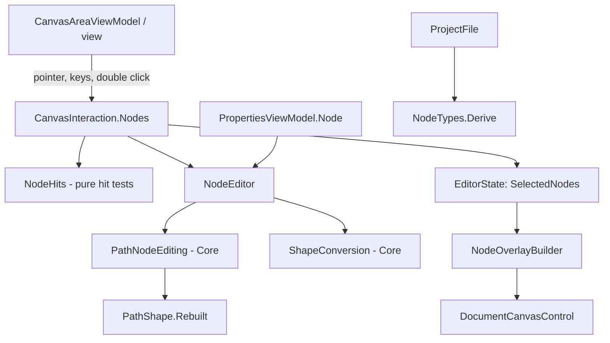

# Design Document

## Overview
Give `PathNode` a stored type (corner, smooth, symmetric), add the node editing rules to Core (`PathNodeEditing`, `ShapeConversion`), keep the selection of nodes in `EditorState`, and let `CanvasInteraction` drive the Direct Select and Node / Curve tools with the same pattern as the Select tool's drags (preview while dragging, one step at the end). A `NodeEditor` class (like `SelectionEditor`) does the edits that need no mouse, so the properties, the keys and the Delete button share one implementation.

## Refinements of the approved requirements
- **How the type is written (refines assumption A1).** A1 said the file stores a type only when it is not a corner, and a missing type is derived from the handles. That would turn a corner node whose handles happen to lie on one line into a symmetric node after a save and load. The file therefore **omits the type exactly when it equals the type derived from the node's own handles** (`NodeTypes.Derive`), and writes it in every other case. Old files have no types and get the derived type, as R1.7 says. The result is the same for the owner, but nothing is lost.
- **No separate "Convert to path" step.** R12.1 lists it as an example. The conversion and the first edit are one step named after the edit (R10.2).
- **Types are rules for editing, not invariants of the model.** A resize by `with { Width }` scales the handles non-uniformly, so a symmetric node may stop being equally long. The line through the anchor stays straight. The next handle edit enforces the stored type again. The model does not throw for a node that does not match its type.

## Steering Document Alignment

### Technical Standards (tech.md)
- Core stays free of Avalonia: node types, handle rules, bending, conversion and file I/O are in Core. The pointer logic and the node selection are pure logic in `Workspace`.
- No new packages.

### Project Structure (structure.md)
- One type per file. Core by feature (`Shapes/`), App by role. Types `internal` unless Core needs them public.
- Files stay under about 400 lines: the node tools go into their own partial files of `CanvasInteraction`.

## Code Reuse Analysis

### Existing Components to Leverage
- **`PathShape`** (`Rebuilt`, `ToDocumentNodes`, `Segments`, the rotation rules) and **`PathEditing`** (insert, remove, continue) from the previous spec.
- **`Bezier`** (`Point`, `Split`, `NearestParameter`) for segment hits and bending.
- **`CanvasInteraction`** drag pattern: `BeginDrag`, `Show` (preview on top of the start document), `EndDrag` with `Commit(type)`. `CanvasInteraction.PenEdit.cs` for the hit tests on the screen position of a rotated path (`AsOnScreen` moves into a shared helper).
- **`SelectionEditor`** as the model for `NodeEditor`. **`SelectionGeometry.GrabSize` and `TouchGrabSize`**, **`DoubleClicked`**, **`SelectionQueries`**, **`EditorState`** selection code and its partial files.
- **`DocumentCanvasControl.DrawPenOverlay`** for how nodes and handles are drawn, **`PropertiesViewModel`** and **`NumberFieldViewModel`** for the Node section, **`PropertiesSections`**, **`HistoryStepNames`**, **`de.po`**.

### Integration Points
- **Document**: `UpdateShapes` replaces shapes by id, also by a shape of another type (rectangle to path), so the conversion needs no new document operation.
- **History**: new step types, one per edit kind.
- **Project file**: an optional `type` entry per node.

## Architecture



### Modular Design Principles
- All geometry rules are in Core and testable without a UI. `NodeHits` is pure and takes the on-screen nodes, so it is tested without a document.
- The tools do not edit shapes themselves: they call `PathNodeEditing` through `NodeEditor` or through a drag helper, so the rules exist once.

## Components and Interfaces

### Core

**`Shapes/NodeType` (public enum)**: `Corner` (default), `Smooth`, `Symmetric`.

**`Shapes/PathNode` and `DocumentNode`**: a new last optional parameter and property `Type` (default `Corner`), validated with `Enum.IsDefined`. `PathShape.Create` and `ToDocumentNodes` carry it. Equality includes it.

**`Shapes/NodeTypes` (public static)**
- `Derive(...)` returns the type from the handles of one node: fewer than two handles gives corner, two handles on one line (cross product within a tolerance) on opposite sides (dot product below zero) give symmetric if equally long (relative tolerance 1e-6) and smooth otherwise, anything else gives corner.
- `Satisfies(node)`: whether the handles match the stored type (corner always, smooth and symmetric by the same tests, a node with at most one handle always).

**`Shapes/PathNodeEditing` (public static).** Every method takes a `PathShape` and positions in the **frame of the shape before its rotation** (document units), and returns a new `PathShape` built with `Rebuilt`, so every node that was not moved keeps its place on the screen (R3.3). `PathShape` gets `ToLocal(x, y)` and `ToLocalDelta(dx, dy)` to turn screen positions into that frame.
- `MoveNodes(path, indices, dx, dy)`: the anchors move with their handles.
- `MoveHandle(path, index, side, x, y, breakLink)`: the handle goes to the position. Corner (or `breakLink`, which also sets the type to corner): only that handle. Smooth: the other handle, if it exists, goes to the opposite direction and keeps its length. Symmetric: the other handle mirrors it. A handle at the anchor (distance below 1e-6) is removed and the node becomes a corner.
- `SetNodeType(path, indices, type)`: corner changes only the type. Smooth and symmetric follow R5.3 and R5.4: if a handle exists its direction wins (the out handle first), the other handle is created or turned to the opposite side, with its own length for smooth and the same length for symmetric. A node without handles gets handles on the line between its neighbors (the direction from the previous to the next node), each a third of the distance to the neighbor on its side. An end node of an open path only gets the handle toward its one neighbor.
- `BendSegment(path, segmentIndex, t, dx, dy)`: moves the point at `t` of the cubic by the delta, by changing only the two handle points: `P1 += D·w1·s` and `P2 += D·w2·s` with `w1 = 1 − t`, `w2 = t` and `s = 1 / (3·t·(1−t)·((1−t)² + t²))`, which makes the point at `t` move exactly by `D`. `t` is clamped to 0.15 to 0.85 for the weights, so the pull near an end stays gentle (near an end the point follows the pointer only approximately). A straight segment becomes a curve this way. Afterwards every node that no longer satisfies its type becomes a corner (R6.5).
- `StraightenSegment(path, segmentIndex)` removes the two handles of the segment. A node that lost a handle becomes a corner. `CurveSegment(path, segmentIndex)` gives a straight segment handles one third from each end, and leaves a curved segment alone. Nodes that no longer satisfy their type become corners.
- `RemoveNodes(path, indices)`: removes the nodes, neighbors connect, `null` if fewer than two remain.
- `NodePosition(path, index)`: the on-screen position (rotation applied) for the X and Y fields, and `MoveNodeTo` through `MoveNodes`.

**`Shapes/ShapeConversion` (public static)**: `ToPath(Shape)` returns a `PathShape` with the same id, name, flags, box, rotation and appearance, or `null` for a path, a group or an unknown type. A rectangle gives four corner nodes (closed). An ellipse gives four symmetric nodes at the top, right, bottom and left with handles of 0.2761 of the width or height (the usual circle approximation). The result draws exactly as the original.

**`PathEditing` and `PenDrawing` (types)**: `InsertNode` sets the new node to smooth on a curve and to corner on a line (R1.5), `PenDrawing.Drag` makes the node symmetric and a click a corner (R1.4).

**Persistence**: `NodeDto` gets an optional `type` (`corner`, `smooth`, `symmetric`). The writer omits it when it equals `NodeTypes.Derive` of the node, the reader derives it when missing and fails with `InvalidValue` for an unknown text (R1.8). The version stays 2: an older version ignores the entry.

### App: state and logic

**`EditorState` (new partial file `EditorState.Nodes.cs`)**: `SelectedNodes` (`ImmutableHashSet<NodeRef>`, `NodeRef(Guid ShapeId, int Index)`), `SetNodeSelection`, `ToggleNode`, `ClearNodeSelection`. It is cleared when the shape selection or the tool changes and on `ReplaceDocument` (R2.5). When the document changes (undo, redo) the references that no longer fit (shape gone, not a path of enough nodes) are dropped.

**`Workspace/EditablePath` (internal static)**: `For(shape)` returns the `PathShape` of a path, the conversion of a rectangle or ellipse (not stored), or `null`. `AsOnScreen(path)` (moved out of `CanvasInteraction.PenEdit.cs`) gives the path with its rotation baked in, for hit tests.

**`Workspace/NodeHits` (internal static, pure)**: from the on-screen paths, the node selection, the position, the tolerance and whether segments count, it returns `NodeHit` (type `None`, `Node`, `Handle`, `Segment`, shape id, node index, handle side, curve parameter). Priority: handles of selected nodes, then nodes, then (Node tool only) segments. Handles are only hit when visible by R2.2.

**`Workspace/NodeEditor` (internal)**: like `SelectionEditor`, works on `EditorState`: `SetType(type)`, `StraightenSelectedSegment()`, `CurveSelectedSegment()`, `DeleteSelected()`, `Nudge(dx, dy)`, `SetPosition(x, y)`, with `CanX` properties for the buttons. Each call converts rectangles and ellipses on first use, applies the `PathNodeEditing` method for each affected path, and makes **one** step (`_state.Edit`). A delete that removes a whole path also removes the shape and clears the selection.

**`CanvasInteraction.Nodes.cs` and `CanvasInteraction.NodeDrags.cs` (partial)**
- `PointerPressed` for `Tool.DirectSelect` and `Tool.Node`: first `NodeHits` on the selected editable shapes. A handle starts `DragType.MovingHandle`, a node selects (click, or Shift toggles) and starts `MovingNodes`, a segment (Node tool) starts `Bending`. Otherwise a click picks a shape (Direct Select and Node: the topmost selectable **leaf**, groups are not entered, R9), and a press on empty space starts the existing marquee: with a shape selected it selects the nodes of its editable paths inside the box, with none it selects shapes. Dragging a shape does not move it (A6).
- Drags work on the **start** shapes (like `Show` for the Select tool): every move recomputes the result from the press state, `Show` previews it, and the release commits one step (`MovePathPoints`, `MovePathHandle`, `BendSegment`). Shift limits a node move to one axis. Positions are converted with `ToLocal` and `ToLocalDelta`, so a rotated path moves with the pointer (R3.6).
- A rectangle or ellipse is converted inside the first drag step (`ShapeConversion.ToPath` of the start shape), so conversion and edit are one step (R10.2).
- `DoubleClicked`: with the Node tool on a node, a corner becomes smooth and a smooth or symmetric node becomes a corner (R5.5), through `NodeEditor.SetType`.
- `DeleteSelection`: with a node tool and selected nodes it calls `NodeEditor.DeleteSelected` (R7), otherwise it deletes shapes as today. The tablet Delete button already calls this method.
- Nudging: `CanvasAreaViewModel.KeyPressed` sends the arrow keys to `NodeEditor.Nudge` when a node tool is active and nodes are selected (repeated presses extend one step, as `SelectionEditor.Nudge`).
- Hover: `NodeHoverTarget(x, y)` for the cursor.

**Overlay**: `Workspace/NodeOverlayBuilder` (pure) builds `ScreenNodeOverlay` (nodes in screen pixels with a selected flag and the visible handle points: the handles of selected nodes, and the neighbors' handles toward them, R2.2) from the document, the selection, the node selection, the tool, the zoom and the origin. `CanvasAreaViewModel.NodeOverlay` exposes it, with notifications on the selection, node selection, tool, zoom and pan. `DocumentCanvasControl` draws it with the same nodes, handle lines and dots as the Pen overlay (selected nodes filled with the selection brush), sizes from `HandleSize`.

**Cursor**: `CanvasCursorType` is not extended: hovering over something that can be grabbed shows `OpenHand`, and while a node drag runs `ClosedHand` (existing cursors, R11.3).

### App: properties and tools
- `PropertiesSection.Node`. `PropertiesSections.For`: Direct Select gets `Transform | Appearance | Path | Node | Align | QuickActions`, Node / Curve gets `Appearance | Path | Node`.
- `PropertiesViewModel.Node.cs` (partial): `ShowNode`, `NodeX` and `NodeY` (`NumberFieldViewModel`, enabled for exactly one node, on-screen position, R8), the buttons Corner, Smooth, Symmetric with the set state (R5.1, Node tool only), and Straight segment and Curved segment (enabled for two neighboring selected nodes). They call `NodeEditor`.
- `PropertiesView.axaml` gets the Node section with the `Button.choice` style of the previous spec. `ToolbarViewModel`'s existing `IsNodeToolActive` and the shortcuts A and N need no change.
- New `HistoryStepType` values (appended): `MovePathPoints`, `MovePathHandle`, `ChangeNodeType`, `BendSegment`, `ChangeSegment`, `DeletePathPoints`, with translated names. New texts in `de.po`.

## Data Models

```
NodeType: Corner | Smooth | Symmetric                 (public enum)
PathNode / DocumentNode: + Type: NodeType = Corner
NodeRef(ShapeId: Guid, Index: int)                    (App)
NodeHit(Type: None|Node|Handle|Segment, ShapeId, Index, Side: In|Out, T: double)
ScreenNodeOverlay: Nodes[(X, Y, IsSelected, In?, Out?)]
File node: { "x", "y", "inX"?, ..., "type"?: "corner"|"smooth"|"symmetric" }   type omitted when equal to the derived type
```

## Error Handling
1. **Unknown type in a file**: `InvalidValue` as for other values.
2. **Stale node references** after undo or a delete: dropped when the document changes, so no index is out of range.
3. **Zero-size boxes and zero-length handles**: handles shorter than 1e-6 are removed, so no NaN from normalizing a direction. A smooth or symmetric conversion of a node whose neighbors coincide creates no handle.
4. **Locked or hidden paths**: not shown and not editable (R2.6). Rectangles and ellipses that are locked are not converted (R10.4).
5. **Drag interrupted** (a second finger, tool change): `Abort` puts the start document back, as for the Select tool drags, and nothing is recorded.

## Testing Strategy

### Unit testing (Core.Tests)
- `NodeTypes.Derive` and `Satisfies` for each case and the tolerances. `PathNode` and `DocumentNode` with a type (validation, equality), `PathShape.Create` and `Rebuilt` carry types.
- `PathNodeEditing`: move nodes (anchors and handles together, unmoved nodes stay on screen for rotations 0, 30, 90), handle moves for each type and with `breakLink`, a handle onto the anchor, type changes (with handles, without, end nodes, closed paths), bending (the point at `t` follows for t from 0.15 to 0.85, a line becomes a curve, types fall back to corner), straighten and curve segment, remove nodes (several, below two nodes).
- `ShapeConversion`: rectangle and ellipse look the same as before (compare `Contains` on a grid of points and the bounds), rotation and appearance are kept, other shapes give null.
- `ProjectFile` and `SvgExport`: round trip of every type, a type omitted when derived, old files without types, unknown types, a corner with collinear handles surviving a round trip. `PathEditing.InsertNode` and `PenDrawing` types.

### Unit testing (App.Tests)
- `NodeHits` priorities and tolerances (mouse and touch, rotated paths). `EditorState` node selection (cleared on selection, tool, document change, pruned after undo).
- `CanvasInteraction` with both tools: click, Shift-click, rubber band, drag nodes with undo and one step, drag handles by type and with Alt, bending, axis limit, double click, Delete, group leaf picking, rectangle and ellipse conversion in one step, locked paths, `Abort`.
- `NodeEditor` (type, segments, delete, nudge, position), `PropertiesViewModel` Node section, `PropertiesSections` (covers every tool), `NodeOverlayBuilder`, history names, `TranslationConsistencyTests`, the cursor choice.
- Headless tests that the control draws the node overlay and the Node section appears.

### Integration and manual checks
- Desktop (mouse) and tablet (touch) check as in the device report of the previous spec: drag nodes and handles, convert, bend, delete, a rotated path, a rectangle becoming a path, a path inside a group. The SVG of an edited path is rendered in two viewers.

## Open questions
- **O1**: the cursor for grabbable things is the open and closed hand (existing images). A dedicated node cursor would need new artwork. Acceptable?
- **O2**: near the ends of a segment the bend follows the pointer only approximately (clamped weights). A stricter rule makes the handles jump far for small moves.
- **O3**: the stored type is not re-enforced on a resize, only on the next handle edit (see the refinements above).
