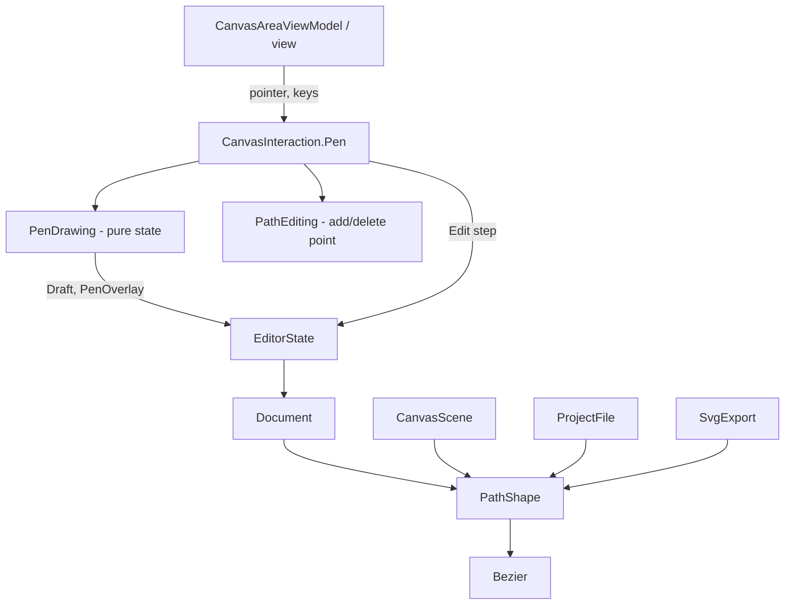

# Design Document

## Overview
Add `PathShape` to Core (nodes with optional bezier handles, open or closed, a fill rule), draw it on the canvas, save, load and export it, and make the Pen tool create, continue and edit it. The Pen's drawing logic is pure and lives in `Workspace`, in the same way as the rectangle drawing in `CanvasInteraction`.

## Deviation from the approved requirements (confirmed with the owner)
The requirements say points are stored "in local units". During design it turned out that resize, scale and the numeric fields all do `shape with { Width = ..., Height = ... }` (`SelectionTransforms.cs`, `ScaleAbout`). The owner chose to **store points as fractions of the box** instead: x and y are 0..1 of the box width and height (handle points may lie outside). This satisfies R1.1 and R1.4 without changing any resize code, and a box side of zero keeps its points. R1 is unchanged in meaning, the wording "local units" is replaced by "fractions of the box".

## Steering Document Alignment

### Technical Standards (tech.md)
- Core stays UI-free: the path model, bezier math, hit test, file I/O and SVG export are in Core, the Pen logic is in `Workspace` without Avalonia types.
- The tech.md open decision "path representation, bezier math" is settled here: nodes with handles, cubic beziers. It will be added to the decision log when the spec is done.
- No new NuGet packages.

### Project Structure (structure.md)
- One type per file, Core grouped by feature (`Geometry/`, `Shapes/`), App by role. Types are `internal` unless another project needs them (Core types are `public`, as `RectangleShape`).

## Code Reuse Analysis

### Existing Components to Leverage
- **`Shape` (record, `with`)**: `PathShape` derives from it and keeps the box and rotation. `Contains` already turns the point back by the rotation and calls `ContainsLocal`, so only `ContainsLocal` is new. `RotatedBounds`, `MovedCopy`, `ShapeTree.Translate`, `Reidentify`, arrange, groups, lock and hide work unchanged.
- **`SelectionTransforms`** (resize, rotate, numeric fields, flip): unchanged, because of the fractions.
- **`CanvasInteraction`** (partial class, `BeginDrag`, `_state.Edit`, `Preview`, `Select`) and **`EditorState.Draft`**: drawing state and history steps follow the Rectangle tool.
- **`CanvasScene.BuildShape`, `ScreenShape`, `DocumentCanvasControl`**: extended with a path type.
- **`ProjectFile`, `ProjectFileDtos`, `SvgExport`**: a new `path` type next to `rectangle` and `ellipse`.
- **`PropertiesSections`** (`Tool.Pen` already has `Appearance | Path`) and `PropertiesViewModel`: a new Path section view.
- **`LayersViewModel`** (`ObjectRowType`, `DefaultName`), `HistoryStepType`, `HistoryStepNames`, `de.po`.
- **`DoubleTapDetector`, `TouchGrabSize`, `SelectionGeometry.GrabSize`**: hit sizes of points.

### Integration Points
- **Document**: `AddShape`, and the shape replace operation used by `SelectionEditor` for edits (same id, new content).
- **History**: new step types, one undo step per drawing, point add or delete, and property change.
- **Project file**: a new shape type, readable only by this version (old files are unaffected).

## Architecture



### Modular Design Principles
- `Bezier` is the only place with curve math. Bounds, hit test, flattening for display, export and point insertion use it.
- `PenDrawing` holds the gesture state and has no document access. `CanvasInteraction.Pen.cs` connects it to the document (like the draw drag in `CanvasInteraction.cs`).
- Files stay under about 400 lines: the Pen code goes into its own partial file.

## Components and Interfaces

### Core

**`Geometry/Bezier` (public static)**
- `Point(p0, p1, p2, p3, t)`, `Split(..., t)` returning two cubics, `ExtremaBounds(p0..p3)` (tight box of one cubic, solves the derivative roots), `Flatten(p0..p3, tolerance)` returning points, `NearestParameter(point)` for the segment click.
- A line is a cubic with handles on its end points, so every segment uses the same code.

**`Shapes/PathNode` (public readonly record struct)**
- `X, Y` (anchor, fraction of the box), `InX, InY, OutX, OutY` (handle points as fractions, `double?`). A node without a handle has `null`. All values finite, validated on creation.
- A segment between node i and i+1 is a line when node i has no out handle and node i+1 has no in handle, else a cubic (a missing handle sits on its anchor).

**`Shapes/FillRule` (public enum)**: `NonZero`, `EvenOdd`.

**`Shapes/PathShape` (public sealed record : Shape)**
- `Nodes` (`ImmutableArray<PathNode>`, at least two, validated like `GroupShape.Children`), `IsClosed` (default false), `FillRule` (default `NonZero`).
- `static PathShape Create(IReadOnlyList<DocumentNode> nodes, bool isClosed, FillRule rule, ...)` takes nodes in document coordinates, computes the **tight bounds** (anchors and bezier extrema), sets X, Y, Width, Height and stores the nodes as fractions. For a side of size 0 the fraction of every node on that side is 0 (all points share that coordinate, because a cubic has constant x only if all four x values are equal).
- `IReadOnlyList<DocumentNode> ToDocumentNodes()` is the way back (before rotation, in the shape's own frame).
- `PathShape Rebuilt(IReadOnlyList<DocumentNode> nodes, ...)` re-normalizes after an edit and keeps the picture in place when rotated: compute the new tight box from the nodes, take its center `c'`, rotate `c'` about the old center by the old rotation to `v`, and shift all nodes so the new box center is `v`. The visual position of every node is then equal to before (R1.6).
- `ContainsLocal`: flatten to a polyline in the box frame. Closed or filled: point in polygon with the fill rule (an open path is treated as closed for fill, as SVG does). A path with a stroke or no fill also hits within `max(StrokeWidth / 2, 4)` document units of the polyline. The hit test has no zoom, so the margin is in document units (see open question O1).

**`Shapes/PathEditing` (public static)** (R4)
- `InsertNode(path, segmentIndex, t)` splits the cubic with `Bezier.Split` so the curve does not change.
- `RemoveNode(path, index)` returns the path without the node (neighbors connect), or `null` when fewer than two nodes would remain (the caller deletes the shape).
- `Continue(path, atStart)` returns the document nodes ordered so that the end to continue is last.

### Persistence
- `ProjectFileDtos`: `ShapeDto` gets optional `nodes` (list of `NodeDto` with `x, y` and optional `inX, inY, outX, outY`), `closed` (written only when true) and `fillRule` (written only for even-odd). The type string is `path`.
- `ProjectFile.BuildPlainShape`: path case with validation (at least 2 and at most 100,000 nodes, finite numbers). The shared checks of x, y, width, height and appearance stay the same. `ToDto` writes the path.
- `SvgExport.WriteShape`: `<path d="M x y C ... L ... Z">` with absolute document coordinates, `fill-rule="evenodd"` when needed, and the shared appearance, opacity and `rotate(...)` code that is already there. Open paths are not closed by `Z`, so no stroke is drawn on the closing line.

### App: drawing
- **`ScreenShape`** gets a nullable `PathData` (nodes in screen pixels relative to the box's top left, closed flag, fill rule), and `ScreenShapeType.Path`. `CanvasScene.BuildShape` fills it. `DocumentCanvasControl` builds an Avalonia `StreamGeometry` from it and draws it with the same rotation transform it uses for rectangles.
- **`Workspace/PenDrawing` (internal, pure)**: state of an unfinished path: node list in document coordinates, a press in progress (dragging a handle), the pointer position, the hover state of the first point. `Press(x, y)`, `Drag(x, y)`, `Release()`, `Hover(x, y)`, `Finish(close)`, `Discard()`. Methods return what changed. A press within `MinimumDragPixels` of the last node finishes the path as open instead of adding a node, so a double click or double tap ends it without an extra point and with no need for a double-click event (R3.5).
- **`EditorState`**: `PenOverlay? PenOverlay` (nodes, handles, hover marker, preview segment points) next to `Draft`. The draft is the `PathShape` of the nodes so far plus the preview segment to the pointer. For a continued path, `PenContinuedId` hides the original in `CanvasScene` while the draft is shown (otherwise a translucent shape would be drawn twice).
- **`CanvasInteraction.Pen.cs` (partial)**: `PointerPressed` for `Tool.Pen`, hover on `PointerMoved` while the Pen is active (this needs a call that does not require a drag, see below), Enter and Escape through `CanvasKey`, and finishing when the tool changes. On finish: `Edit(HistoryStepType.DrawPath, doc => doc.AddShape(layer, path))` and `Select`. A continue replaces the shape with the same id and uses `ContinuePath`. The Pen checks the active layer like `CanDrawInActiveLayer`.
- **Pen on the selected path** (R4): a press within the grab size of an anchor either starts a continue (end point of an open path), deletes the node (`PathEditing.RemoveNode`, step `DeletePathNode`), or, within the grab size of a segment, inserts a node (`PathEditing.InsertNode`, step `AddPathNode`). Grab sizes: `SelectionGeometry.GrabSize` and `TouchGrabSize`.
- **`CanvasKey`** gets `Enter`. `CanvasAreaView` maps `Key.Enter` and `Key.Return`. `CanvasAreaViewModel` forwards the pointer-move events without a button down to the Pen only when it is active.

### App: properties and list
- **`Views/Editor/PathSectionView` + `ViewModels/Editor/PathSectionViewModel`** (or members of `PropertiesViewModel`, as the existing sections are done; the existing pattern is followed): an "Open / Closed" toggle and a fill rule choice. Changes go through `SelectionEditor.Edit(HistoryStepType.ChangePath, shape => ...)` which applies only to `PathShape`s in the selection (R5.3).
- **`LayersViewModel`**: `ObjectRowType.Path`, icon `MaterialIconKind.VectorCurve`, default name `T("Path")`.
- **Texts** (all in `de.po`): "Path", "Closed", "Fill rule", "Non-zero", "Even-odd", "Draw path", "Add path point", "Delete path point", "Change path".

## Data Models

```
PathNode  (readonly record struct)
- X, Y: double                       anchor, fraction of the box
- InX, InY, OutX, OutY: double?      handle points, fraction of the box, null = none

PathShape : Shape
- Nodes: ImmutableArray<PathNode>    >= 2
- IsClosed: bool
- FillRule: FillRule                 NonZero | EvenOdd
(+ X, Y, Width, Height, Rotation, Appearance, Name, flags from Shape)

File (shape dto)
{ "type": "path", "x":.., "y":.., "width":.., "height":.., "nodes":[{"x":0,"y":0,"outX":.5,"outY":0}, ...],
  "closed": true, "fillRule": "evenodd", "rotation":.., ... }
```

## Error Handling

1. **Invalid nodes on creation (fewer than two, non-finite)**: `ArgumentException` like the other shapes. The Pen never calls it with fewer than two nodes.
2. **Invalid file content** (bad counts, NaN, missing `nodes`): `ProjectFileError.InvalidValue` or `NotProjectFile`, as for other shapes. The user sees the existing load error message.
3. **Zero-size box**: fractions are 0 on that side, resize works through `with`.
4. **Layer hidden or locked, path locked**: the Pen creates or edits nothing (R3.8, R4.5).
5. **Draw interrupted** (tool change, a second finger, Escape): a tool change finishes the path if it has two nodes, Escape discards it, a second finger calls `Abort` and discards it, nothing is recorded in the history in the last two cases.

## Testing Strategy

### Unit testing (Core.Tests)
- `Bezier`: points, split (the pieces equal the original), extrema bounds for a curve with an overshoot, flattening.
- `PathShape`: `Create` bounds (including an S-curve whose extremum lies outside the anchors), zero-width and zero-height paths, fewer than two nodes, `Rebuilt` keeps the screen position for several rotations, `with { Width }` scales the picture, hit test (inside with both fill rules, on the stroke, miss, rotated).
- `PathEditing`: insert keeps the curve (sample points), remove, remove to fewer than two returns null, continue order.
- `ProjectFile`: round trip, invalid files. `SvgExport`: `d` text for line, curve and closed paths, `fill-rule`, rotation.

### Unit testing (App.Tests)
- `PenDrawing` and `CanvasInteraction` with the Pen: click, drag, preview, close at the first point, finish on Enter, near-double press, Escape, tool change, locked layer, one undo step, continue, add and delete a point, touch grab size.
- `CanvasScene` path data and `ScreenShape` mapping, `PropertiesSections` (already covers every tool), `LayersViewModel` row type and default name, Path section view model, `TranslationConsistencyTests`.

### Integration and manual checks
- A headless test that the canvas control draws a path without exceptions (open, closed, rotated).
- Manual: draw, close, continue, add and delete points on the desktop, then on the tablet over adb (stylus and touch); open the exported SVG in a browser and in Inkscape (R7.4). The result goes into the spec's device report like the other specs.

## Open questions
- **O1**: the hit margin for thin strokes is in document units (4), so it gets smaller on screen when zoomed out. A zoom-aware margin needs a parameter on `Document.HitTest` and is left out of this spec. Acceptable? (Requirement assumption A1.)
- **O2**: the Pen's hover call. `PointerMoved` ignores calls without a drag today. The design adds the hover handling inside the existing `PointerMoved` for the Pen tool, rather than a new method, to keep the view code unchanged.
