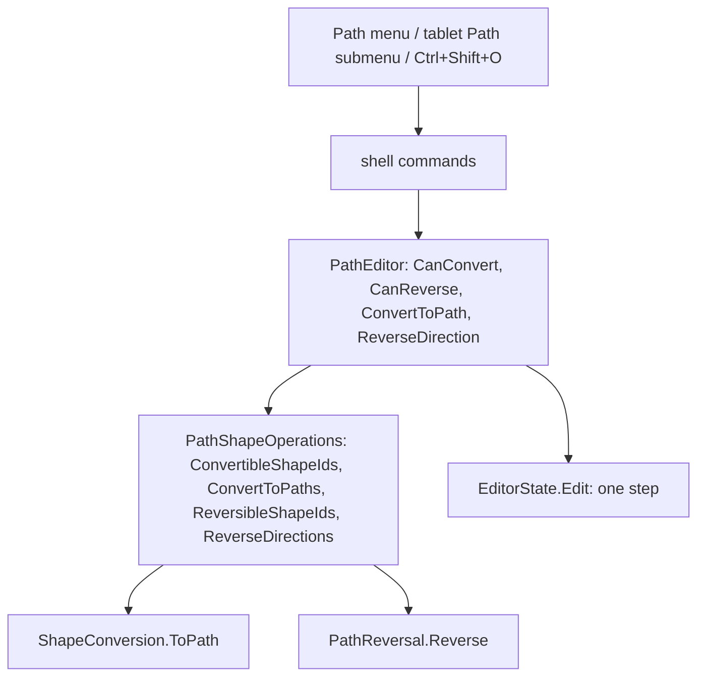

# Design Document

## Overview
Two document operations in Core (convert selected rectangles and ellipses to paths, reverse selected paths), two new history steps, two `PathEditor` commands in the App, and their menu items on desktop (with `Ctrl+Shift+O` for Convert) and in the tablet "Path" submenu. Then the docs.

## Steering Document Alignment

### Technical Standards (tech.md)
- Document changes go through `EditorState.Edit` and the history. Core stays free of Avalonia. No new package. No file format change (a converted shape is an ordinary path).

### Project Structure (structure.md)
- Core: `Shapes/PathReversal.cs` and additions to `Documents/PathShapeOperations.cs`. App: `Workspace/PathEditor.cs`, `ViewModels/Editor` (shell commands, `PathMenuCommands`), menus in `ViewModels/Desktop` and `ViewModels/Tablet`. Docs in `docs/`.

## Code Reuse Analysis

### Existing Components to Leverage
- **`ShapeConversion.ToPath`**: the conversion itself. It keeps id, name, flags, box, rotation and appearance, and handles rounded corners.
- **`PathShape.ToDocumentSubPaths` / `Rebuilt(subPaths, fillRule)`**: reading a path in document coordinates and writing it back with every node staying at the same place on screen (also when rotated).
- **`Document.UpdateShapes(IReadOnlyDictionary<Guid, Shape>)`**: replaces shapes anywhere in the tree by id, in place, in one pass, and rebuilds the groups around them. The converted path and the reversed path keep their ids, so this is the right call.
- **`ShapeTree.Leaves` / `Document.FindShape`** (effective visible and locked state, including groups and layer): finding the leaves of the selection and skipping locked and hidden ones, as `PathShapeOperations.IsUsable` does.
- **`PathEditor`**, its `CanStart` rule (not busy, no drag) and the shell's relay commands with `NotifyObjectCommands`: the new commands follow them.
- **`PathMenuCommands`**, `MenuBarViewModel`, `OverflowMenuViewModel`, `MenuItemViewModel` (a gesture text becomes a hot key through the menu item, as `Ctrl+G` does for Group).

### Integration Points
- **History:** two appended `HistoryStepType` values and names.
- **Menus:** the placeholders "_Convert Object to Path" and "_Reverse Direction" get commands.

## Architecture

### Modular Design Principles
- One rule decides which shapes are affected: "the leaves of the selected shapes that are shown and not locked, and of the right type". The `Can...` check and the operation share it.
- Reversing one path is a pure function in its own class.

## Components and Interfaces

### `PathReversal` (Core/Shapes)
- `PathShape Reverse(PathShape path)`: for every sub-path, in document coordinates (the frame before rotation): an open sub-path gets its node list reversed; a closed one keeps node 0 first and reverses the rest. In both, every node's in and out handles are swapped (anchor, type and the other data stay). The result is written back with `path.Rebuilt(subPaths, path.FillRule)`, which keeps id, appearance, name, flags and rotation and keeps every node at the same place on screen. The order of the sub-paths stays. Reversing twice gives the same nodes.

### `PathShapeOperations` additions (Core/Documents)
- `IReadOnlyList<Guid> ConvertibleShapeIds(Document, IEnumerable<Guid> selectedIds)`: ids of the leaves of the selected shapes (a selected group gives its leaves at any depth, each once) that are a `RectangleShape` or `EllipseShape`, shown and not locked (layer and groups counted).
- `Document ConvertToPaths(Document, IEnumerable<Guid> selectedIds)`: builds `ShapeConversion.ToPath` for each of those and calls `UpdateShapes`. Returns the same instance if there is nothing to convert.
- `IReadOnlyList<Guid> ReversibleShapeIds(Document, IEnumerable<Guid>)` and `Document ReverseDirections(Document, IEnumerable<Guid>)`: the same for `PathShape` leaves, using `PathReversal.Reverse`.
- Unknown ids are ignored (a selection can briefly name shapes that are gone).

### `HistoryStepType` and names
- Appended: `ConvertToPath` ("Convert to path") and `ReverseDirection` ("Reverse direction"), with German texts "In Pfad umwandeln" and "Richtung umkehren". The undo selection memory list (`ReplacesSelection`) is not changed, because the selection stays.

### `PathEditor` (App/Workspace)
- `CanConvert`, `CanReverse`: `CanStart` and the matching `...ShapeIds` list is not empty (so "enabled when at least one convertible shape is selected").
- `ConvertToPath()` and `ReverseDirection()` (synchronous, they are fast): one `EditorState.Edit(step, document => PathShapeOperations...(document, selectedIds))`. The selection is not changed. Nothing else (no message, because the commands are disabled when they cannot run).

### Shell, `PathMenuCommands` and menus
- Shell: two relay commands (`ConvertShapesToPathsCommand`, `ReversePathDirectionCommand`) with `CanExecute` from `PathEditor`, notified in `NotifyObjectCommands` (selection, document, busy and drag changes).
- `PathMenuCommands` gets two trailing parameters `ICommand? ConvertToPath = null, ICommand? ReverseDirection = null`, so existing callers (tests, `Disabled`) compile unchanged and a null command gives a disabled item, as every placeholder already does.
- Desktop Path menu: `Item(N("_Convert Object to Path"), "Ctrl+Shift+O", paths.ConvertToPath)` and `Item(N("_Reverse Direction"), command: paths.ReverseDirection)`. "Stroke to Path" and "Simplify" stay placeholders.
- **Shortcut (revised during implementation):** the first design said the gesture text of the menu item becomes a hot key, as it does for `Ctrl+G` and `Ctrl+Shift+G`. Testing in the running app showed that for "Convert Object to Path" the menu gesture alone did nothing (the same keys worked for Group and Ungroup, and the menu item itself ran the command). An explicit `KeyBinding Gesture="Ctrl+Shift+O"` bound to `ConvertShapesToPathsCommand` in `DesktopShellView.axaml`, next to the file shortcuts, works in the same test. So the shortcut is that binding, and the menu item keeps the gesture text for display. The cause of the menu gesture not firing was not found; it is not needed for this spec.
- Tablet "Path" submenu order: Convert Object to Path, separator, Combine, Break Apart, separator, the four booleans, separator, Reverse Direction. The texts are the existing menu texts.

### Docs
- `docs/feature-gap.md`: the row "Convert object to path, stroke to path" is split into "Convert object to path" (Done) and "Stroke to path" (UI only); the row "Reverse direction, simplify" is split likewise ("Reverse direction" Done, "Simplify" UI only); the SVG export row says what is exported (rectangles, ellipses, paths including compound paths, groups); the date line and the intro sentence mention the change.
- Regenerate `docs/index/`.

## Data Models
None. A converted shape is a `PathShape`; the project file and SVG export already handle it.

## Error Handling

### Error Scenarios
1. **The selection changed or became invalid between enabling and running**
   - **Handling:** the operation finds no shapes and returns the same document, so `Edit` records no step.
   - **User Impact:** nothing happens (the command is disabled anyway).
2. **Locked or hidden shapes in the selection**
   - **Handling:** skipped by the shared rule.
   - **User Impact:** they stay as they are.

## Testing Strategy

### Unit Testing
- `PathReversal`: open path, closed path (node 0 stays first), compound path (each sub-path, order kept), handles swapped, node types valid, every node at the same place on screen for a rotated path, fill rule, id and appearance kept, twice gives the original.
- `PathShapeOperations`: `ConvertibleShapeIds` and `ConvertToPaths` for rectangles, rounded rectangles, ellipses, a group (leaves converted, group stays a group with the same children order), locked and hidden shapes (also through a locked group or layer), paths and unknown ids ignored, same instance when nothing changes, looks the same (hit tests of rectangle and path agree), ids and stack place kept. The same for `ReverseDirections` with paths and a group.

### Integration Testing
- `PathEditor` (fake dialogs): `CanConvert` and `CanReverse` for each selection case and while busy or dragging, one history step with the right name, selection unchanged, Undo restores.
- Menus: the desktop items are enabled and disabled with the commands and show `Ctrl+Shift+O`; a headless test checks that `DesktopShellView` has a key binding for `Ctrl+Shift+O` that runs the shell's convert command; the tablet submenu has the items in the order above; history names and `de.po` (translation tests); shell integration (the menu command is the shell's command and runs).

### End-to-End Testing
- Run the desktop app: draw a rectangle and an ellipse, Convert (menu and `Ctrl+Shift+O`), check the node tools now show nodes, Reverse an open path and check the end where the Pen continues. Check the tablet submenu on the device. Findings go into a short report in the spec folder.
