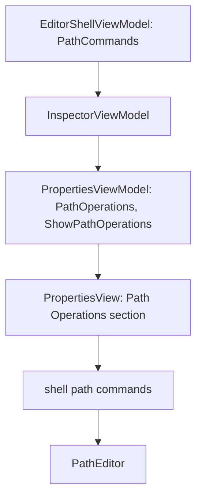

# Design Document

## Overview
A new "Path Operations" section in the Properties tab with five icon buttons (Union, Difference, Intersection, Exclusion, Combine). It is shown for the Select and Direct Select tools while two or more objects are selected, directly after "Align & Distribute". The buttons are the existing path commands of the shell, so desktop menus, tablet menu and these buttons share one decision about what can run.

## Steering Document Alignment

### Technical Standards (tech.md)
- MVVM: the view model has no Avalonia types; the section is a flag in `PropertiesSection` and a rule in `PropertiesSections`, like the other sections. Compiled bindings, translations through `{loc:T}`, sizes and colors from `Theme.axaml`.

### Project Structure (structure.md)
- Changes stay in `Workspace/` (the section rule), `ViewModels/Editor/` (properties, inspector, shell wiring) and `Views/Editor/` (the shared Properties view), which both layouts reuse. Nothing is added to `Views/Desktop` or `Views/Tablet`.

## Code Reuse Analysis

### Existing Components to Leverage
- **`PathMenuCommands`** (record of six `ICommand`s) and the shell's `UnionShapesCommand`, `DifferenceShapesCommand`, `IntersectShapesCommand`, `ExcludeShapesCommand`, `CombinePathsCommand`: the buttons bind to these. Their `CanExecute` comes from `PathEditor` (R2.3, R2.4 are met by that, including the busy state).
- **`PropertiesSection` / `PropertiesSections`**: the per-tool rule, and its test that every tool is placed.
- **`PropertiesViewModel` pattern** (`ShowAlign`, `IsAlignExpanded`, the `ActiveTool` and `SelectedCount` notifications) for visibility and the expanded state.
- **The Align row of `PropertiesView.axaml`**: icon buttons with `Classes="icon"`, `ToolTip.Tip`, `AutomationProperties.Name` and `PanelIconSize`.
- **Existing translations** "Union", "Difference", "Intersection", "Exclusion" and "Combine" (the history step names) for tooltips and accessible names. They read the same as the menu items without the underscore.

### Integration Points
- **`EditorShellViewModel`** creates `PathCommands` earlier (before the inspector) and passes it through `InspectorViewModel` to `PropertiesViewModel`.

## Architecture

### Modular Design Principles
- One decision about "can it run": `PathEditor`. The buttons only bind to the commands.
- Visibility is a pure rule: the tool's sections plus "two or more selected".

## Components and Interfaces

### `PropertiesSection.PathOperations` (value 128)
- Added to the sections of `Tool.Select` and `Tool.DirectSelect` in `PropertiesSections.For`. Other tools do not get it. The test that covers every tool is extended.

### `PropertiesViewModel`
- New optional constructor parameter `PathMenuCommands? paths = null`. Without it (tests, other callers) the commands are disabled ones (`PathMenuCommands.Disabled`, a static value made of `RelayCommand`s that cannot run), so the buttons never act on nothing.
- `PathOperations` (the `PathMenuCommands`): the buttons bind to `PathOperations.Union` and so on.
- `ShowPathOperations`: `Sections.HasFlag(PropertiesSection.PathOperations) && _state.SelectedCount >= 2`. Raised on `ActiveTool` and `SelectedCount` changes (the places that already raise `ShowAlign` and `Header`).
- `IsPathOperationsExpanded` (`[ObservableProperty]`, default `true`).

### `InspectorViewModel` and `EditorShellViewModel`
- `InspectorViewModel` gets the optional parameter `PathMenuCommands? paths = null` and hands it to `PropertiesViewModel`.
- `EditorShellViewModel` creates `PathCommands` before `Inspector` and passes it. The commands are properties generated by the toolkit, so using them before the rest of the constructor runs is fine; `PathEditing` exists before any of them can execute.

### `PropertiesView.axaml`
- After the "Align & Distribute" section: `CollapsibleSection Header="{loc:T 'Path Operations'}"`, `IsVisible="{Binding ShowPathOperations}"`, `IsExpanded="{Binding IsPathOperationsExpanded}"`, with a `StackPanel` (horizontal, like the Align row) of five icon buttons in the order of R2.1.
- Icons (Material.Icons, already referenced): `VectorUnion`, `VectorDifference`, `VectorIntersection`, `SetNone` (Exclusion, decided by the owner; it is from the "set" family), `VectorCombine`.
- Each button: `Classes="icon"`, `Command="{Binding PathOperations.X}"`, `ToolTip.Tip` and `AutomationProperties.Name` = `{loc:T 'Union'}` and so on. A button with a command that cannot run is disabled by the command (R2.3). No text label.
- The `icon` class already gets touch sizes in the tablet layout (48 dp), as the Align row does.

### Translations
- One new text, "Path Operations" → "Pfadoperationen", in `de.po`. The other texts exist.

## Data Models
None. No document, file format or history change.

## Error Handling

### Error Scenarios
1. **A button is pressed while its command cannot run** (the selection changed in between)
   - **Handling:** the command's `CanExecute` is false, so nothing runs.
   - **User Impact:** the button is disabled.
2. **A path operation leaves nothing or fails**
   - **Handling:** the existing `PathEditor` message, unchanged.
   - **User Impact:** the same message as from the menu.

## Testing Strategy

### Unit Testing
- `PropertiesSections`: Select and Direct Select have the flag, every other tool does not (extends the all-tools test).
- `PropertiesViewModel`: `ShowPathOperations` for 0, 1, 2 selected, for each tool, and after a selection or tool change (with property-changed events); `IsPathOperationsExpanded` default; without commands the buttons' commands cannot run; with a command record they are the same instances.
- `TranslationConsistencyTests`: the new text is in `de.po`.

### Integration Testing
- Shell: with two rectangles selected and the Select tool, `Inspector.Properties.PathOperations.Union` is the shell's command, can run, and running it makes one "Union" history step; with a group selected it cannot run.
- Headless view tests (`Views/Editor/PropertiesView`): the section is under "Align & Distribute", has five buttons with the right accessible names in order, is hidden for one selected object and for the Pen tool, buttons are disabled for an open path, and with the touch sizes every button is at least 48 dp.

### End-to-End Testing
- Run the desktop app: select two shapes, use each button, check the result and the history step names. Check on the tablet (floating panel): the section and a button. Findings go into a short report in the spec folder.
