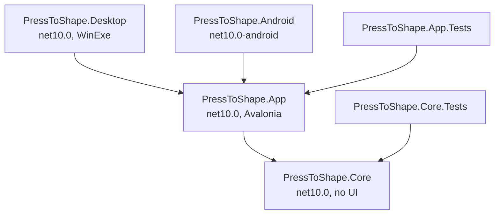

# Design Document

## Overview
Split the single template project into a layered solution: `Core` (no UI), `App` (shared Avalonia UI), and two platform heads (`Desktop`, `Android`), plus two xUnit test projects. The existing template code is relocated and keeps its behavior. The only code additions are the minimum needed for Android to display the shared UI (a `MainView` user control) and the new tests.

## Steering Document Alignment

### Technical Standards (tech.md)
- .NET 10, C# 14, nullable enabled, Avalonia 12.1.6, CommunityToolkit.Mvvm 8.4.2, xUnit. No new runtime packages except `Avalonia.Android` and the Android splash-screen package for the Android head, which are required for an Android project.
- Reflection-based `ViewLocator` is kept as is (known limitation recorded in `tech.md`).

### Project Structure (structure.md)
- Implements the target layout and the `Desktop/Android → App → Core` direction. Project names are the approved ones. Types are `internal` unless another project needs them.

## Code Reuse Analysis
All existing code is reused by moving it (`git mv`). Nothing is rewritten except the changes listed below.

### File mapping

| Current | New | Change |
|---|---|---|
| `PressToShape.csproj` | removed | replaced by four `src/` projects |
| `App.axaml`, `App.axaml.cs` | `src/PressToShape.App/PressToShapeApp.axaml(.cs)` | class renamed `App` → `PressToShapeApp` (namespace clash with `PressToShape.App`); also handles Android lifetimes |
| `ViewLocator.cs` | `src/PressToShape.App/ViewLocator.cs` | namespace only |
| `ViewModels/ViewModelBase.cs`, `MainViewModel.cs` | `src/PressToShape.App/ViewModels/` | namespace only |
| `Views/MainWindow.axaml(.cs)` | `src/PressToShape.App/Views/` | now only hosts `MainView` |
| (new) `MainView.axaml(.cs)` | `src/PressToShape.App/Views/` | holds the greeting `TextBox` moved out of `MainWindow` |
| `Assets/avalonia-logo.ico` | `src/PressToShape.App/Assets/` | none |
| `Program.cs` | `src/PressToShape.Desktop/Program.cs` | namespace, `Configure<PressToShapeApp>()` |
| `app.manifest` | `src/PressToShape.Desktop/app.manifest` | none |
| `Models/` (empty) | `src/PressToShape.Core/` | folder dropped. Core is organized by feature later |
| `PressToShape.sln` | `PressToShape.sln` | rewritten with six projects in `src` and `tests` solution folders |

### Integration Points
- `docs/mockup/`, `scripts/`, `.spec-workflow/`, `.claude/`, `.mcp.json` are untouched, except `.claude/rules/` path updates (Requirement 7).
- `.gitignore` already ignores `bin/` and `obj/`, so it covers the new project folders.

## Architecture

### Shared build configuration
- **`Directory.Build.props` (root):** `Nullable=enable`, `LangVersion=latest`, `ImplicitUsings` left off (as in the template), `ManagePackageVersionsCentrally` is set in the packages file instead.
- **`Directory.Packages.props` (root):** central versions for Avalonia 12.1.6 (`Avalonia`, `Avalonia.Desktop`, `Avalonia.Themes.Fluent`, `Avalonia.Fonts.Inter`, `Avalonia.Android`), `AvaloniaUI.DiagnosticsSupport` 2.2.3, `CommunityToolkit.Mvvm` 8.4.2, the Android splash-screen package (version from the Avalonia template), and the xUnit test packages (`xunit`, `xunit.runner.visualstudio`, `Microsoft.NET.Test.Sdk`, versions chosen at implementation time).
- **Warnings as errors:** `src/PressToShape.Core/PressToShape.Core.csproj` and `tests/Directory.Build.props` set `TreatWarningsAsErrors=true`. `tests/Directory.Build.props` imports the root file explicitly so its settings still apply. App, Desktop and Android do not set it.

### Modular Design Principles
- **Single file responsibility:** one type per file, as in `structure.md`.
- **Component isolation:** heads contain startup code only. All shared UI is in `App`.
- **Dependency management:** references are written once in each `.csproj` and checked by tests.

### Android and desktop lifetimes
Avalonia starts desktop with a window (`IClassicDesktopStyleApplicationLifetime`) and Android with a single view. `PressToShapeApp.OnFrameworkInitializationCompleted` therefore handles three lifetimes, following the official Avalonia cross-platform template:
- desktop → `MainWindow` (hosts `MainView`)
- `IActivityApplicationLifetime` → `MainViewFactory = () => new MainView`
- `ISingleViewApplicationLifetime` → `MainView`

Each is given a new `MainViewModel` as `DataContext`.

## Components and Interfaces

### PressToShape.Core
- **Purpose:** UI-independent home for the document model, geometry, commands, history and file I/O. Empty apart from a marker for now.
- **Interfaces:** none yet. A single `internal` or public placeholder type is only added if needed so the project and its test can compile and be discovered (decided at implementation, kept minimal).
- **Dependencies:** none (no Avalonia, no solution projects).
- **Project settings:** `net10.0`, class library, `TreatWarningsAsErrors`.

### PressToShape.App
- **Purpose:** shared Avalonia UI: application class, view models, views, view locator, assets.
- **Interfaces:** public `PressToShapeApp` (used by heads); other types `internal`, with `InternalsVisibleTo` for `PressToShape.App.Tests`.
- **Dependencies:** `PressToShape.Core`, `Avalonia`, `Avalonia.Themes.Fluent`, `Avalonia.Fonts.Inter`, `CommunityToolkit.Mvvm`, `AvaloniaUI.DiagnosticsSupport` (Debug only, as today).
- **Namespaces:** `PressToShape.App`, `PressToShape.App.ViewModels`, `PressToShape.App.Views`.
- **ViewLocator note:** `PressToShape.App.ViewModels.MainViewModel` still maps to `PressToShape.App.Views.MainView` by name replacement, and `Type.GetType` finds it because both are in the App assembly.

### PressToShape.Desktop
- **Purpose:** Linux and Windows startup.
- **Contents:** `Program.cs` (unchanged apart from `Configure<PressToShapeApp>()`), `app.manifest`.
- **Dependencies:** `PressToShape.App`, `Avalonia.Desktop`. `.WithDeveloperTools()` stays under `#if DEBUG`, as today.
- **Project settings:** `net10.0`, `OutputType=WinExe`, `ApplicationManifest=app.manifest`.

### PressToShape.Android
- **Purpose:** Android startup.
- **Contents (from the Avalonia template):** `MainActivity.cs` (`AvaloniaMainActivity`), `Application.cs` (`AvaloniaAndroidApplication<PressToShapeApp>`, `.WithInterFont()`), `Properties/AndroidManifest.xml`, `Icon.png`, `Resources/` for the splash screen and theme.
- **Dependencies:** `PressToShape.App`, `Avalonia.Android`, `Xamarin.AndroidX.Core.SplashScreen`.
- **Project settings:** `net10.0-android`, `OutputType=Exe`, `SupportedOSPlatformVersion=23` (the template default, per the open question in the requirements), `ApplicationId` set to a placeholder to confirm with the owner.
- **Permissions:** the template manifest declares `INTERNET`. This is removed, because the product has no network access (`tech.md`). Debug builds add what the tooling needs automatically.

### Test projects
- **PressToShape.Core.Tests:** xUnit, references `PressToShape.Core` only. Contains a discovery test and the Core half of the architecture test.
- **PressToShape.App.Tests:** xUnit, references `PressToShape.App` only. Contains the `MainViewModel` greeting test and the App half of the architecture test.
- **Avalonia.Headless is not added** (Requirement 6.5).

### Architecture test (reflection on assembly references)
- **Core test:** the references of the Core assembly (`Assembly.GetReferencedAssemblies()`) must contain no name starting with `Avalonia` and none starting with `PressToShape.`.
- **App test:** the references of the App assembly must include `PressToShape.Core` and must not include `PressToShape.Desktop` or `PressToShape.Android`.
- **Gap:** an assembly-reference test run from `App.Tests` cannot see the Desktop or Android assemblies. `Desktop → Android` or `Android → Desktop` references (Requirement 2.3) are therefore not caught by it. A reference from App to a head is already impossible, because it would be a circular project reference. See the open question below.

## Data Models
None. No domain or persistence types are introduced.

## Error Handling

### Error Scenarios
1. **Android workload missing:** restore or build of `PressToShape.Android` fails, which breaks a full solution build.
   - **Handling:** the prerequisite is documented in the README (Requirement 4.4). The desktop and test projects can still be built individually with `dotnet build <project>`.
   - **User impact:** a clear message in the docs, and the failing project named in the build output.
2. **View not found:** `ViewLocator` returns the existing "Not Found: …" text block.
   - **Handling:** unchanged from the template.
3. **Wrong project reference added later:** the architecture tests fail.
   - **Handling:** the developer fixes the reference or, if the structure should change, asks for a steering update.

## Testing Strategy

### Unit Testing
- `MainViewModelTests`: the default `Greeting` value is unchanged.
- A trivial Core test that proves xUnit discovery works.

### Integration Testing
- `dotnet build` of the whole solution, where the Android workload is installed.
- `dotnet test` of the whole solution.
- Architecture tests as described above.

### End-to-End Testing
- Manual: `dotnet run --project src/PressToShape.Desktop` shows the same window and greeting as before.
- Android: build only. It is not run on an emulator or device (Requirement 4.3).

## Implementation Order (for the tasks phase)
1. Root `Directory.Build.props` and `Directory.Packages.props`.
2. Core project, then App project (move files, rename class, add `MainView`).
3. Desktop project, then confirm the desktop app builds and runs.
4. Test projects and tests.
5. Android project (workload must be installed first).
6. Rewrite `PressToShape.sln`, delete the old root project and files.
7. Update `.claude/rules/` paths and add a README.

## Resolved Questions
- **Head-to-head reference check:** added as a `.csproj`-based test (`HeadProjectReferenceTests`), which also checks that App references only Core.
- **Android `ApplicationId`:** `de.limeonfire.presstoshape`.
- **Android build needs JDK 21.** JDK 25 is rejected by the Android tooling.
