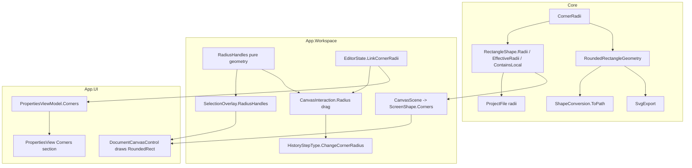

# Design Document

## Overview
A rectangle gets four stored corner radii (`CornerRadii`). The radius that is used everywhere (the effective radius) is the stored value limited to half of the shorter side. The model, the outline geometry, the hit test, the conversion to a path, the file and the SVG export live in `PressToShape.Core`. The App adds the drawing, one section in the Properties panel and four radius handles with their drag logic in `Workspace`.

Rectangles are only ever built in four places (the Rectangle tool, the file loader, `ShapeConversion`, tests). Every resize, move, copy and group operation uses `with`, so a new `Radii` property travels along without changes there. This was checked by searching for `new RectangleShape`.

## Steering Document Alignment

### Technical Standards (tech.md)
- Shapes stay immutable records changed with `with`, validated in the property (decision 18 style).
- The file gets an optional field that is written only when it is not the default, and older files load the same (decision 19 style). The format version stays 2. A file with radii opened by an older build draws square corners, which is acceptable for a hobby project and is noted here.
- Dragging uses `EditorState.Preview` and `Commit`, so one drag is one history step.

### Project Structure (structure.md)
- Core has no Avalonia. Radius geometry and drag mathematics are pure and tested without UI. The App only draws and binds.
- New view model state goes into `Workspace/EditorState` and `ViewModels/Editor/PropertiesViewModel`, new controls are not needed.

## Code Reuse Analysis

### Existing Components to Leverage
- **`Guard` (Core)**: `FiniteNonNegative` for every radius.
- **`ShapeConversion.ToPath`** and **`EditablePath`**: Direct Select and Node already show a rectangle as its converted path. If `ToPath` handles radii, the node tools show the rounded outline without more work.
- **`SelectionGeometry`** (frame, `HitHandle`, `GrabSize`, `TouchGrabSize`): the pattern for hit-testing handles in document units, with a touch grab size.
- **`SelectionOverlay.Build`** and `ScreenHandle`: the pattern for handles in screen pixels. Drawn in `DocumentCanvasControl.DrawOverlay` with `SelectionHandleSize` from the theme.
- **`EditorState.Preview` / `Commit`**, **`CanvasInteraction.Abort`** (puts the document back to the press), and **`BeginDrag` / `EndDrag`**: the drag lifecycle of resize and node drags.
- **`SelectionEditor.Apply`**: applies a change to every selected shape as one step, for the Properties fields.
- **`NumberFieldViewModel`**: the number text box with `SetValue(value, mixed)`, commit and revert (invalid text brings the old value back, R3.7).
- **`HistoryStepType` and `HistoryStepNames`**: one new step type with a translated name.
- **`PropertiesSection` / `PropertiesSections`**: which tool shows which section.
- **`CanvasScene.BuildShape` and `ScreenShape`**: the drawing description the control replays.

### Integration Points
- **Project file** (`ProjectFile`, `ProjectFileDtos`): one optional `radii` array.
- **SVG export** (`SvgExport`): `<rect rx ry>` or `<path>`.
- **Localization**: new texts in `de.po`, checked by `TranslationConsistencyTests`.
- **Code index**: regenerate `docs/index/` after the code change (`code-index.md`).

## Architecture



### Modular Design Principles
- One new Core file per concern: `CornerRadii`, `RoundedRectangleGeometry`.
- The radius drag is its own partial file `CanvasInteraction.Radius.cs`, like `CanvasInteraction.Nodes.cs`.
- The handle geometry is a pure static class (`RadiusHandles`), like `SelectionGeometry`.
- The Properties part is its own partial file `PropertiesViewModel.Corners.cs`, like `.Path.cs` and `.Node.cs`.

## Decisions and Trade-offs

1. **Stored versus effective radius (decided with the owner).** `Radii` keeps what was entered. `EffectiveRadii` limits it to half of the shorter side on every use. Reason: resizing goes through the base `Shape.Width` and `Height` setters, which cannot trim a subclass property. Entry points that set a radius (fields, handles) limit at entry, so the stored value is never above the limit at that moment (R1.2).
2. **Arc geometry in one place.** `RoundedRectangleGeometry` gives, for a box and the effective radii, the four corners with the start point and the end point of each arc. `ShapeConversion` turns an arc into a cubic with the circle constant `0.5523` (already used for the ellipse), and `SvgExport` writes an `A` command for it. Both use the same points, so the path and the SVG outline are the same shape. Alternative: write the outline twice. Rejected: it can drift.
3. **Drawing with `RoundedRect`, not with a path.** The control draws a rectangle with a non-zero effective radius using Avalonia's `RoundedRect` with four corner radii, and keeps `DrawRectangle(bounds)` for radius 0. So rectangles without radii draw exactly as before (Reliability). Alternative: always convert to a path. Rejected: it changes the existing drawing path for every rectangle.
4. **Handle position on the diagonal (decided with the owner).** The handle of a corner sits at an inset `d` from the corner on both sides, inside the rectangle, in the rectangle's own (rotated) frame. `d` runs in a straight line from 24 screen px at radius 0 to half of the shorter side at the largest radius (changed during implementation from `max(radius, 24 px)`: that form made the radius jump from 0 to 24 px when a handle was pressed). A drag maps the pointer back with the mean of its two insets. Shapes with a screen side under 64 px show no handles (R4.11), so `d` (at most 24 px plus the radius, limited to the half side) stays inside.
5. **Which handle wins (R4.9).** Radius handles are tested before the resize handles in both tools. Their touch grab size is smaller than the 44 px of a resize handle (36 px) so that the corner resize handle stays reachable beside it on a tablet. This is checked on the real tablet (see Testing).
6. **Link toggle** is `EditorState.LinkCornerRadii` (default `true`), not saved. The Properties panel toggles it, the touch drag reads it.
7. **Properties section shown for Select and Direct Select**, next to the Transform section, because these are the tools that show the radius handles (R3 does not name tools). The Rectangle and Node tools do not show it.

## Components and Interfaces

### Core

#### `CornerRadii` (new, `Shapes/CornerRadii.cs`)
- **Purpose:** four radii as a value.
- **Interface:** `readonly record struct CornerRadii(double TopLeft, double TopRight, double BottomRight, double BottomLeft)`; `static CornerRadii Zero`; `static CornerRadii Uniform(double)`; `bool IsZero`; `bool IsUniform`; `double this[Corner]`; `CornerRadii With(Corner, double)`; `CornerRadii Limited(double width, double height)` (each value to `[0, min(w,h)/2]`); `static CornerRadii FromArray(...)` is not needed (the file code reads four values).
- **Validation:** `Guard.FiniteNonNegative` in the `RectangleShape.Radii` setter, not in the struct, so the struct stays cheap.
- **Also:** `enum Corner { TopLeft, TopRight, BottomRight, BottomLeft }`.

#### `RectangleShape` (changed)
- `CornerRadii Radii { get; init; }`, validated, default `Zero`.
- `CornerRadii EffectiveRadii => Radii.Limited(Width, Height)`.
- `ContainsLocal`: inside the box, and if a corner square of an effective radius `r > 0` contains the point, then the distance to that corner's arc center is at most `r`.

#### `RoundedRectangleGeometry` (new, `Shapes/RoundedRectangleGeometry.cs`, internal)
- **Interface:** `IReadOnlyList<RoundedCorner> Corners(double x, double y, double width, double height, CornerRadii effective)` where a `RoundedCorner` has `Radius`, `Start`, `End` and the corner point. A radius 0 corner has `Start == End == corner point`.
- **Used by:** `ShapeConversion.FromRectangle` and `SvgExport.WriteShape`.

#### `ShapeConversion` (changed)
- A rectangle with all effective radii 0 gives the same four corner nodes as now (R5.3). Otherwise a corner with radius greater than 0 gives two corner-type nodes with handles of `0.5523 * r` along the tangents, in clockwise order from the top left. Node count is `4 + number of rounded corners`.

#### `ProjectFile` and DTO (changed)
- `ShapeDto.Radii` : `double[]?` named `radii`, `WhenWritingNull`, written only for a rectangle with non-zero radii: `[topLeft, topRight, bottomRight, bottomLeft]`.
- Load: missing is zero. A length other than 4, a value that is not finite or is negative is `ProjectFileError.InvalidValue` with the existing wording style. A value above the limit loads as it is (R6.4).

#### `SvgExport` (changed)
- Zero radii: unchanged `<rect>` (R6.7).
- All four effective radii equal and greater than 0: `<rect ... rx="r" ry="r">`.
- Otherwise: `<path d="...">` with `M`, `L` and `A r r 0 0 1 x y` commands from `RoundedRectangleGeometry`, plus the same attributes as any shape. Rotation, fill and opacity are written by the code after the `switch`, as now.

#### History
- `HistoryStepType.ChangeCornerRadius`, name `"Change corner radius"` in `HistoryStepNames`.

### App.Workspace

#### `ScreenShape` and `CanvasScene.BuildShape` (changed)
- `ScreenShape` gets `CornerRadii? Corners = null`, the effective radii times the zoom. `null` for radius 0 and for every other type, so existing `ScreenShape` tests stay valid.

#### `RadiusHandles` (new, pure, `Workspace/RadiusHandles.cs`)
- `const double MinInset = 24` (screen px), `const double MinSide = 64` (R4.11), `const double GrabSize = 14`, `const double TouchGrabSize = 36`.
- `bool IsShown(RectangleShape, double zoomPercent)`: the shorter side times the zoom is at least `MinSide`.
- `(double X, double Y) Position(RectangleShape, Corner, double zoomPercent)`: the document position, rotation applied, as described in decision 4.
- `Corner? Hit(RectangleShape, double x, double y, double zoomPercent, double grabSize)`: nearest handle inside the grab area, tie order top left, top right, bottom right, bottom left.
- `double RadiusAt(RectangleShape, Corner, double x, double y, double grabOffset)`: the radius for a pointer position, limited to `[0, min(w,h)/2]`.
- A constant in code and not in `Theme.axaml`: the same as `SelectionOverlay.HandleSize` and `SelectionGeometry.GrabSize`, which are pixel constants for hit areas. Deviation from "sizes live only in Theme.axaml" is recorded here for that reason. The drawn size of a handle follows `SelectionHandleSize` from the theme.

#### `SelectionOverlay` (changed)
- New `IReadOnlyList<ScreenHandle> RadiusHandles` (default empty), built for `Tool.Select` and `Tool.DirectSelect` when `SelectionQueries.SelectedSelectable` is exactly one `RectangleShape` that is unlocked, visible and passes `RadiusHandles.IsShown`. `HandleType` is not reused: the new list uses `ScreenRadiusHandle(Corner, ScreenPoint, double Size)` so the existing handle code is not widened.
- `DirectSelect` currently builds no handles at all. The change keeps `Box`, `Handles` and `RotateLink` Select-only and adds only the radius handles for Direct Select.

#### `CanvasInteraction.Radius.cs` (new partial) and changes in `CanvasInteraction.cs`
- `DragType.RoundingCorners`; fields for the corner, the start radii, the grab offset, whether the drag is for one corner or all.
- `PressWithSelectTool` and `PressWithNodeTool` (only when the active tool is Direct Select) call `TryBeginRadiusDrag(x, y, inputType)` first. It succeeds when exactly one editable rectangle is selected, the handles are shown and `RadiusHandles.Hit` finds one. It then starts the drag with `BeginDrag` and remembers `_startDocument`.
- Move: radius from `RadiusAt`, new `Radii` as in R4.2 to R4.4 (all four set, or `With(corner, value)`), shown with `Show`. One-corner decision: Shift (mouse and pen), or the link toggle off (touch).
- Release: `EndDrag` commits with `ChangeCornerRadius`. Escape and `Abort` use the existing path: `Abort` already restores the press document for the listed drag types, `RoundingCorners` is added to that list. Nothing changes when the pointer did not move (`Show` keeps the same document).
- The node-tool code path `NodeCountOf` in `EditorState.Nodes.cs` returns 4 for a rectangle. It changes to `ShapeConversion.ToPath(...).Nodes.Length` through `EditablePath.For`, because a rounded rectangle has more nodes (R5.1). Node indices of a rectangle that was not yet converted stay consistent because `ToPath` is deterministic.

#### `EditorState` (changed)
- `bool LinkCornerRadii` observable property, default `true`.

### App.ViewModels / Views

#### `PropertiesViewModel.Corners.cs` (new partial)
- `NumberFieldViewModel LinkedRadius, TopLeftRadius, TopRightRadius, BottomRightRadius, BottomLeftRadius`, range `0..MaxCoordinate`. The apply action sets the radii on the single selected rectangle through `SelectionEditor.Apply(ChangeCornerRadius, ...)`, limits the value to half of the shorter side first (R1.2, R3.6), and then refreshes the fields.
- Linked field and (link toggle on) a corner field: all four set. Link toggle off and a corner field: one set.
- `bool HasRectangleSelected` (exactly one selected leaf that is a `RectangleShape`, no group), `bool ShowCorners` (`Sections` has `Corners` and `HasRectangleSelected`), `bool AreCornersEnabled` (not locked), `bool LinkCorners` (two-way with `EditorState.LinkCornerRadii`).
- `RefreshCornerValues()` is called from `RefreshValues` (the document changed, also while a handle is dragged, so the fields follow, R4.5). It shows the effective radii; the linked field shows `SetValue(value, mixed: true)` when the four differ (R3.5).
- `CommitPendingEdits` includes the five fields.

#### `PropertiesSection.Corners` (new flag) and `PropertiesSections`
- Added to `Select` and `DirectSelect`. The `PropertiesSectionsTests` that covers every `Tool` is extended.

#### `PropertiesView.axaml` (changed)
- A `CollapsibleSection` "Corners" after Transform, same field style as X/Y/W/H: one row with the linked field and a `ToggleButton` (Lucide-style link icon already used for "Keep proportions"), and a 2x2 grid for the four corner fields. Texts via `{loc:T}`, with `AutomationProperties.Name` on every field and the toggle, `IsEnabled` bound to `AreCornersEnabled`. Touch sizes come from the existing `touch` styles, no new sizes.

#### `DocumentCanvasControl` (changed)
- `DrawShape`: a rectangle with `Corners` draws with `RoundedRect`. The rotation transform of the shape already wraps `DrawShape`.
- `DrawOverlay`: draws the radius handles as small circles in the selection color (distinct from the square resize handles), size from `SelectionHandleSize`.
- The selection outline of a rounded rectangle (R2.1 "selection outline") stays the bounding box outline of the existing overlay. Open question below.

## Data Models

```
CornerRadii (struct)
- TopLeft, TopRight, BottomRight, BottomLeft : double (>= 0, finite when stored in a RectangleShape)

RectangleShape (record, existing)
+ Radii : CornerRadii            // as entered, default Zero
+ EffectiveRadii : CornerRadii   // Radii limited to min(Width, Height) / 2, computed

ScreenShape (record struct, existing)
+ Corners : CornerRadii?         // effective radii in screen px, null when zero

File: shape of type "rectangle"
+ "radii": [tl, tr, br, bl]      // optional, only when not all zero
```

## Error Handling

1. **Invalid radius in a file** (negative, not a number, wrong array length): `ProjectFileError.InvalidValue`, same dialog as other invalid values. No crash.
2. **Invalid text in a radius field:** `NumberFieldViewModel` reverts to the previous value without calling the apply action (R3.7).
3. **Radius above the limit entered or dragged:** limited, no error (R1.2, R3.6).
4. **Rectangle with width or height 0:** the limit is 0, so the effective radius is 0, and `ContainsLocal` and the drawing behave as for a flat rectangle today. No handles (R4.11).
5. **Drag cancelled or a second finger arrives:** `Abort` restores the press document.
6. **Locked or hidden rectangle:** no handles and disabled fields.

## Testing Strategy

### Unit Testing (Core.Tests)
- `CornerRadii`: `Limited`, `Uniform`, `With`, `IsUniform`.
- `RectangleShape`: setter validation (negative, NaN, infinity throw), `EffectiveRadii` after a `with { Width = ... }` resize and back (R1.3, R1.4), `ContainsLocal` in a cut-off corner, on the arc, with rotation (R2.3).
- `ShapeConversion`: radius 0 equals the old nodes (R5.3); one rounded corner gives 5 nodes; all rounded gives 8 nodes; sampled points of the path lie on the arc.
- `ProjectFile`: round trip, old file without `radii`, invalid values, value above the limit (R6.1 to R6.4).
- `SvgExport`: `rx ry` for equal radii, `path` with `A` for unequal, unchanged `rect` for zero (R6.5 to R6.8).

### Unit Testing (App.Tests)
- `RadiusHandles`: `IsShown` threshold, `Position` with and without rotation and zoom, `Hit` priority, `RadiusAt` limits and grab offset.
- `SelectionOverlay`: handles for Select and Direct Select, none for other tools, none for several shapes, a path, a locked or hidden rectangle, or a small rectangle.
- `CanvasInteraction`: drag with and without Shift (mouse), touch with the toggle on and off, one step per drag, Escape and `Abort`, handle wins over the corner resize handle (R4.9), selection and size unchanged (R4.10).
- `EditorState` / `NodeCountOf`: node counts of a rounded rectangle.
- `PropertiesViewModel` corners: linked and per-corner entry, mixed display, limiting, invalid text, locked, group or several shapes selected, one history step each.
- `PropertiesSectionsTests`, `TranslationConsistencyTests` (new texts in `de.po`), `HistoryStepNames` coverage.
- `CanvasScene`: `Corners` scaled by zoom, null for radius 0.

### Integration / Headless UI
- One headless test of `PropertiesView` for the Corners section (binding exists, visible only for one rectangle). One headless drawing test is not added: rendering of `RoundedRect` is Avalonia's.

### End-to-End
- Manual run on the desktop (drag a handle, Shift, undo, rotate, save and load, export SVG and open it in a browser or Inkscape).
- Device check on the tablet over `adb`: handle size, the finger priority of decision 5 and the link toggle. Added to `device-report.md` after the check, as for earlier specs.

## Assumptions and Open Questions
- **Open:** the selection outline of a rounded rectangle. The design keeps the rectangle's bounding outline (the same box and resize handles as for any shape). R2.1 says "the selection outline" is drawn rounded. Choose one: (a) bounding box outline, which matches the resize handles and is simplest; (b) the rounded outline. This design assumes (a) and the requirement is read as "the shape outline on the canvas", which is the drawn fill and stroke. If the owner wants (b), a `ScreenPolygon` with arcs is needed in `SelectionOverlay.Outlines`.
- The 24 px, 64 px, 14 px and 36 px values are starting values to be tuned on the desktop and the tablet.
- The format version stays 2 (see Steering Document Alignment).
