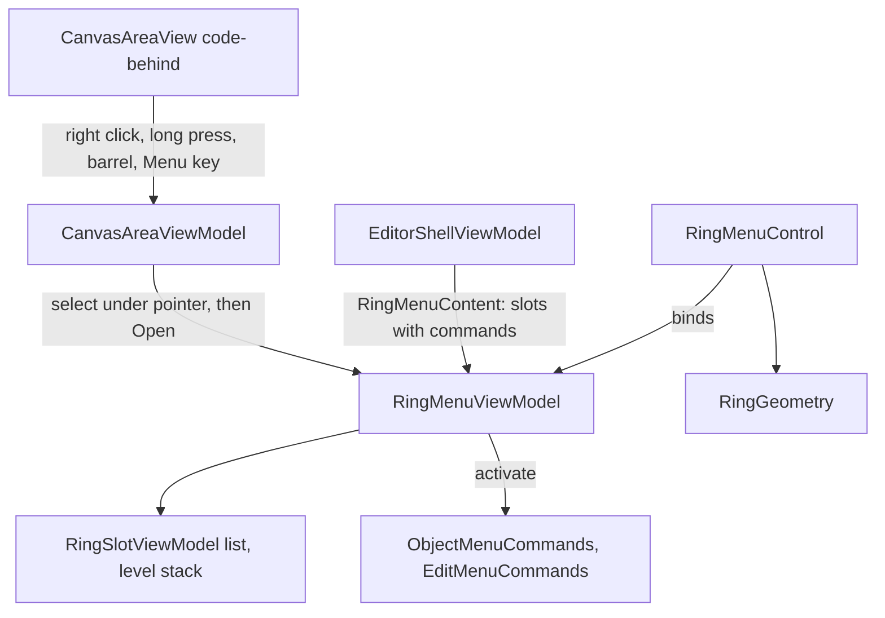

# Design Document

## Overview
A ring context menu drawn as pie wedges (owner's choice) inside the canvas area, shared by the desktop and tablet layouts. Pure logic (wedge angles, hit testing, placement, slot tree, navigation) has no Avalonia types and is unit tested. One control draws it. `CanvasAreaViewModel` decides when it opens. `EditorShellViewModel` supplies the slots, which only wrap commands that already exist. Requirement IDs (R1 to R9) refer to `requirements.md`.

## Steering Document Alignment

### Technical Standards (tech.md, rules)
- MVVM with CommunityToolkit.Mvvm: `[ObservableProperty]` partial properties, `[RelayCommand]`, `LocalizedViewModel` for translated text (R9).
- Compiled bindings with `x:DataType`. Colors and sizes only in `Styles/Theme.axaml`, touch values in the `TouchSizes` dictionary (R8).
- Translation: `Localizer.N("English")` for the slot names in the data table, `ILocalizer.T` when shown. New texts in `de.po`.
- No new NuGet package. Icons are `MaterialIconKind` values, as in `ToolDefinition`.

### Project Structure (structure.md)
- `Workspace/`: pure logic (`RingGeometry`, `RingSlotDefinition`).
- `ViewModels/Editor/`: `RingMenuViewModel`, `RingSlotViewModel`, `RingMenuContent`.
- `Controls/`: `RingMenuControl`.
- `Views/Editor/CanvasAreaView.axaml(.cs)`: hosts the overlay and forwards input. No new view model that needs `ViewLocator`.

## Code Reuse Analysis

### Existing Components to Leverage
- **`LongPressTracker`**: decides the long press (500 ms, 10 dp slop). The view model feeds it the time from its `TimeProvider`, so tests need no real time. `ToolGroupButton` shows the timer pattern (`DispatcherTimer` in the view, 50 ms tick).
- **`CanvasInteraction.SelectableTargetAt` and `EditorState.SelectOnly`**: hit test and selection for R2. Group and entered-group rules come with them.
- **`CanvasInteraction.Abort` / `CanvasAreaViewModel.AbortAction`**: undo the drag that the press of a long press started.
- **`ObjectMenuCommands`, `EditMenuCommands`**: the commands behind the slots. Group, Ungroup, Lock, Hide, the four arrange commands, Duplicate, Delete, Paste, Select All.
- **`ToolDefinition`** (name by `Localizer.N`, icon `MaterialIconKind`, shortcut) as the model for a data-table entry.
- **`ToolItemViewModel`** as the model for a slot view model (`LocalizedViewModel`, `Name`, `Icon`, a command).
- **`DocumentCanvasControl`** as the model for a control that gets its brushes as styled properties from `DynamicResource`.
- **`TouchSizes`, `Theme.axaml`** for sizes. **`ManualTimeProvider`, `FakeLocalizer`, `HeadlessUi`** in the tests.

### Integration Points
- **`CanvasAreaView.axaml.cs`** pointer handlers: right button and barrel button are handled before the existing return for "not left or middle". Touch and pen presses feed the long-press tracker.
- **`CanvasKey`** gets a `ContextMenu` value for the Menu key and Shift+F10.
- **`EditorShellViewModel`** builds the content, as it builds `ObjectCommands` now.

## Architecture



- `CanvasAreaViewModel` owns `Ring` (a `RingMenuViewModel`), so the view binds it from its own data context. The shell gives it the content with `Canvas.Ring.Content = ...` after it has built its commands.
- While the ring is open, an overlay panel covers the viewport (transparent, hit testable) and the viewport input does not run. A press on the overlay outside the ring closes it (R1.7, R6.1). This needs no check in each pointer method of the canvas view model.
- Position is stored raw (where the user pressed). The control clamps it into the canvas area when it lays out (R1.6). The radii come from the theme in the control, so the view model needs no sizes.

### Modular Design Principles
- `RingGeometry` knows angles and points only. `RingMenuViewModel` knows levels and slots only. `RingMenuControl` draws and forwards input only. `RingMenuContent` is the only place that lists the slots.

## Components and Interfaces

### `RingGeometry` (Workspace, static, pure)
- **Purpose:** wedge math for N slots. Slot 0 is centered at the top, slots follow clockwise, each wedge is 360/N degrees.
- **Interfaces:** `(double Start, double Sweep) WedgeAngles(int index, int count)`, `RingHit HitTest(double dx, double dy, int count, double innerRadius, double outerRadius)` returning slot index, `Center` or `Outside`, `(double X, double Y) ClampCenter(double x, double y, double outerRadius, double width, double height)`, `(double X, double Y) SlotCenter(int index, int count, double innerRadius, double outerRadius)` for the icon.
- **Reuses:** nothing. Tested on its own.

### `RingSlotDefinition` (Workspace, record)
- **Purpose:** one entry of the data table: English name (`Localizer.N`), `MaterialIconKind`, and either an `ICommand` or a list of child definitions. `Back` is not a definition: the view model adds the center action itself.
- **Interfaces:** `Command(string name, MaterialIconKind icon, ICommand command)`, `Submenu(string name, MaterialIconKind icon, IReadOnlyList<RingSlotDefinition> children)`.

### `RingSlotViewModel` (ViewModels/Editor, `LocalizedViewModel`)
- **Purpose:** translated `Name`, `Icon`, `IsAvailable`, `HasChildren`, `Children`.
- **Behavior:** `IsAvailable` is `command.CanExecute(null)`, refreshed on `CanExecuteChanged`. A submenu slot is available when at least one child is.
- **Reuses:** `ToolItemViewModel` pattern.

### `RingMenuViewModel` (ViewModels/Editor)
- **Purpose:** state of the ring: `IsOpen`, `CenterX`, `CenterY`, `Slots` (the current level), `HoveredIndex`, `FocusedIndex`, `CenterText`, `CanGoBack`.
- **Interfaces:** `Open(RingMenuMode mode, double x, double y)` (mode: `Selection` or `EmptyCanvas`), `Close()`, `Activate(int index)`, `ActivateCenter()` (back in a submenu, close at the top), `Back()`, `Hover(int?)`, `MoveFocus(int step)`, `Func<RingMenuMode, IReadOnlyList<RingSlotDefinition>> Content`.
- **Behavior:**
  - `Activate` on an unavailable slot does nothing (R3.3). On a command slot it closes the ring first, then runs the command, so a command that changes the selection never meets an open ring. On a submenu slot it pushes the level (R5.1).
  - `Back()` pops a level, or closes at the top (R5.5, R6.2).
  - `CenterText` is the translated name of the hovered or focused slot, empty otherwise (R7.4).
  - A language change raises the name properties again, also while open (R9.1).
  - `Close()` clears the level stack.
- **Reuses:** `LocalizedViewModel`, `[ObservableProperty]`.

### `RingMenuContent` (ViewModels/Editor, internal static)
- **Purpose:** builds the fixed slot tables of R3 and R4 and the arrange submenu of R5.3 from `ObjectMenuCommands` and `EditMenuCommands`.
- **Selection:** Group, Ungroup, Duplicate, Delete, Lock, Hide, Arrange (7 slots, this order).
- **Empty canvas:** Paste, Select All.
- **Arrange:** Bring to Front, Bring Forward, Send Backward, Send to Back.
- **Icons:** chosen from `MaterialIconKind` when implementing (for example group, ungroup, copy, delete, lock, eye-off, layers and arrows). Not a design decision.
- **Why a static table:** the content is fixed now. Later customization (settings dialog) replaces the table by data, and the view model does not change.

### `CanvasAreaViewModel` changes
- `Ring` property, created in the constructor.
- `OpenContextMenu(double screenX, double screenY)`:
  1. returns without effect if the tool is not Select, a drag or pan is in progress, or a color pick is active (R1.4, R1.5);
  2. applies R2: no change if the point hits a selected object, `SelectOnly` if it hits another selectable object, clear the selection on empty canvas;
  3. opens the ring in mode `Selection` or `EmptyCanvas`.
- Long press: `PointerPressed` of touch and pen starts the tracker (touch through `ApplyTouch` for a single finger, pen through the pointer path). `Tick()` is called by the view's timer. When it fires, the press action is aborted (`AbortAction`), the double-tap detector is reset, and `OpenContextMenu` runs at the press point. The release after it is swallowed with `ConsumeFired`. A second finger, a move over the slop, or a release before the delay ends the watching (existing tracker rules).
- `KeyPressed(CanvasKey.ContextMenu)` opens the ring at the center of the selection frame, or of the viewport when nothing is selected (R7.1).
- Closing: the view model subscribes to the selection and document changes of `EditorState` and calls `Ring.Close()` (R2.5, R6.4).

### `RingMenuControl` (Controls)
- **Purpose:** draws the wedges, icons and center disc from the view model, and turns pointer and key input into view model calls.
- **How:** a `Panel` that builds its children when the slots change: a `Path` per wedge (geometry from `RingGeometry`), a `MaterialIcon` at the wedge middle, an `Ellipse` and a `TextBlock` for the center. Wedge state is shown by classes (`unavailable`, `hovered`, `focused`) styled in `Controls.axaml`. Hit testing is done once for the whole control with `RingGeometry.HitTest`, not per wedge, so the gaps between wedges select nothing and the touch behavior is the same as the mouse.
- **Input:** pointer moved sets `Hover`, a press on a wedge or the center activates it (on release for touch, so a finger can slide), a press on `Outside` closes. Keys: arrows `MoveFocus`, Enter and Space activate, Escape `Back`, Tab is swallowed (R7.2).
- **Styled properties:** `InnerRadius`, `OuterRadius`, `IconSize`, and the brushes, all from `DynamicResource` in the XAML (R8.2).
- **Automation:** each wedge is exposed with its translated name and its enabled state (R7.3).

### Theme additions (`Styles/Theme.axaml`)
- Sizes: `RingOuterRadius`, `RingInnerRadius`, `RingIconSize`, with larger touch values in `TouchSizes`.
- Brushes: wedge fill, hovered, focused, unavailable, outline, center fill, center text. Light and dark.

## Data Models

```
RingMenuMode            Selection | EmptyCanvas
RingHit                 Slot(index) | Center | Outside
RingSlotDefinition      Name: string (English, Localizer.N)
                        Icon: MaterialIconKind
                        Command: ICommand?            // exactly one of Command and Children is set
                        Children: IReadOnlyList<RingSlotDefinition>?
RingMenuViewModel state IsOpen, CenterX, CenterY,
                        level stack of IReadOnlyList<RingSlotDefinition>,
                        HoveredIndex?, FocusedIndex?
```

Nothing is stored in the document, the settings or the file. The history is not touched by the ring itself (R6, Reliability).

## Error Handling

1. **Ring larger than the canvas area** (very small window). `ClampCenter` centers it. Outer parts are cut off by the clip. The Escape key and a press outside still close it.
2. **A command becomes unavailable while open.** `CanExecuteChanged` updates `IsAvailable`; `Activate` checks it again.
3. **Selection or document changes while open.** The ring closes (R2.5, R6.4).
4. **Long press on a moving finger.** The tracker already drops it. A drag that started is never aborted unless the long press fired.
5. **Barrel button not reported.** Nothing happens. Long press still works.
6. **Content not set** (tests or a layout that never sets it). `Open` does nothing.

## Testing Strategy

### Unit Testing
- `RingGeometryTests`: wedge angles for 2, 4 and 7 slots, hit test (inside wedge, on a boundary, center, outside, the gap radius), clamp at each edge and for a ring larger than the area, slot center.
- `RingMenuViewModelTests`: open and close, activate runs the command once and closes first, unavailable slot does nothing, submenu push and back, Escape at each level, focus wraps, `CenterText`, language change refreshes names while open, `CanExecuteChanged` updates availability.
- `RingMenuContentTests`: slot order and count for both modes, arrange children, names are translated and present in `de.po` (the consistency test covers the catalog).
- `CanvasAreaViewModelRingTests`: right-click on selected, unselected and empty; other tool does nothing; no open during a drag; long press with `ManualTimeProvider` (fires once after the delay, not after a move, aborts the started drag and leaves the document unchanged, swallows the release and the double-tap); selection change closes; Menu key placement.
- `EditorShellViewModelTests`: the slots run the same commands as the menu (group, ungroup, delete, arrange) with the same history entry names.

### Integration Testing
- Headless UI test class with `[Collection(HeadlessUi.CollectionName)]`: the ring shows 7 wedges for a selection and 2 on empty canvas, a click on a wedge runs its command, Escape in the arrange submenu goes back, a press outside closes it, the touch layout uses the larger sizes. The dispatcher is pumped, never blocked.

### End-to-End Testing
- Desktop (manual run, per the project's notes): right-click on a rectangle, group two objects, arrange, undo.
- Tablet over adb (`device-report.md`): long press with a finger and a pen, the barrel button, a ring near each edge, no conflict with double-tap, drawing and pinch.

## Alternatives Considered
- **Round buttons instead of wedges:** rejected by the owner. Wedges give larger targets but cover more drawing; mitigated by a theme-controlled outer radius.
- **Avalonia `Popup`:** rejected by the owner in favor of the overlay (clipping to the canvas, same behavior on Android, headless tests).
- **Ring state in the shell view model:** the view of the canvas would then need the shell as data context. Keeping it on `CanvasAreaViewModel` fits `ViewLocator` and the one-view-one-view-model rule.
