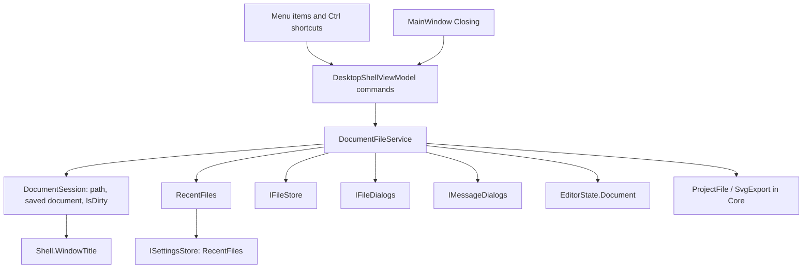

# Design Document

## Overview
Core gets two pure converters: the project file (`Document` ⇄ UTF-8 JSON bytes, with strict validation and error codes) and the SVG export (`Document` → UTF-8 bytes). App gets one orchestration class, `DocumentFileService`, that runs the file actions (New, Open, Open Recent, Save, Save As, Export, "may we discard changes?") against small interfaces for the file system, the file dialogs and the message dialogs. `DocumentSession` tracks the current file and the unsaved state, `RecentFiles` keeps the recent list in `settings.json`. The menu, the keyboard shortcuts, the window title and the window's close handler call the service. Everything with logic is testable without Avalonia, using fakes.

## Steering Document Alignment

### Technical Standards (tech.md)
- Native format is JSON, separate from SVG, versioned, validated on load, never trusted (`tech.md` data storage and security). `System.Text.Json` and `System.Xml` are part of .NET: no new package.
- Safe saving: temporary file in the same folder, then replace. This is the pattern `JsonFileSettingsStore` already uses.
- Core holds file formats and has no UI, no `ILocalizer` and no file system access beyond bytes. App holds dialogs, files, settings and texts.

### Project Structure (structure.md)
- Core: `IO/` folder (`PressToShape.Core.IO`). App: `Workspace/` (pure logic), `Services/` (file, dialog and message interfaces plus their Avalonia/OS implementations), `Views/` (dialog window), `ViewModels/`.

## Code Reuse Analysis

### Existing Components to Leverage
- **`Document` and its validated `init` setters (Core)**: loading builds a `Document` through them, so every invalid value is rejected by the model's own rules (R1.5). No second set of rules.
- **`JsonFileSettingsStore` and `AppSettings` / `ISettingsStore`**: the recent list is stored in `settings.json` through them. The `Load`, change, `Save` pattern from `LanguagePreference` keeps unknown entries.
- **`IAppShutdown` / `DesktopAppShutdown`**: Quit goes through closing the main window, so there is one place that asks about unsaved changes.
- **`MenuBarViewModel`, `MenuItemViewModel`**: the File menu already has the items, texts and gesture hints. They get commands. `MenuItemViewModel` gets one more factory for a changing submenu.
- **`DesktopShellViewModel`**: already owns `State` and the other view models, and `FitToWindow`. It gets the file commands and the window title.
- **`DesktopShellView.axaml` `KeyBindings`**: existing pattern for window-level shortcuts (zoom, Ctrl+Q).
- **`EditorState.OnDocumentChanged`**: when a loaded document replaces the current one, it already clears the selection and resets the active layer to the topmost layer (R4.2).
- **`FakeLocalizer` and the temp-folder pattern of `SettingsStoreTests`**: for the new tests.

### Integration Points
- **`PressToShapeApp`**: creates the Avalonia implementations (needs the main window as the owner of dialogs) and gives them to `DesktopShellViewModel`.
- **`MainWindow`**: binds `Title` to the shell and asks before closing.

## Architecture



### Data flow
- **Save:** `Core ProjectFile.Write(State.Document)` → bytes → `IFileStore.WriteAtomic(path)` (off the UI thread). On success `Session.MarkSaved(path, document)` and `Recent.Add(path)`. On failure an error message is shown and `Session` is unchanged. The saved document is the instance that was written, so edits made while writing keep the document marked as changed.
- **Open:** (ask about unsaved changes) → `IFileDialogs.PickOpen` → `IFileStore.ReadAllBytes(path, ProjectFile.MaxBytes)` → `ProjectFile.Read(bytes)` (off the UI thread) → on success `State.Document = doc`, `Session.Reset(path, doc)`, `Recent.Add(path)`, fit to window. On failure an error message; nothing changes.
- **New:** ask → `State.Document = Document.Create(T("Layer 1"))`, `Session.Reset(null, doc)`, fit.
- **Export:** `IFileDialogs.PickSvgExport(suggestedName)` → `SvgExport.ToUtf8(State.Document)` → `WriteAtomic`. `Session` and `Recent` are untouched.
- **Ask about unsaved changes:** `Session.IsDirty` false → continue. Otherwise `IMessageDialogs.AskUnsavedChanges(name)` → Save (continue only if `SaveAsync` returned success), DontSave (continue), Cancel (stop).
- **Close and Quit:** Quit asks the window to close. `MainWindow.Closing` cancels the close, awaits `Shell.ConfirmCloseAsync()` and, if allowed, closes again with a flag that skips the second question.

### Modular Design Principles
- Core converters are static, pure and take and return bytes. Texts for errors are codes in Core and translated in App.
- Only `LocalFileStore`, `AvaloniaFileDialogs` and `AvaloniaMessageDialogs` touch the OS or Avalonia. All three are thin and sit behind interfaces.

## Components and Interfaces

### Core: `ProjectFile` (`Core/IO/ProjectFile.cs`) — R1
- `public const int FormatVersion = 1;` `public const long MaxBytes = 64 * 1024 * 1024;`
- `public static byte[] Write(Document document)`: UTF-8 JSON, indented, no BOM. Shape of the file:
  ```json
  { "format": "PressToShape", "version": 1,
    "artboard": { "width": 1200, "height": 800 },
    "layers": [ { "id": "…", "name": "Layer 1", "visible": true, "locked": false,
      "shapes": [ { "type": "rectangle", "id": "…", "x": 10, "y": 20, "width": 100, "height": 50,
        "fill": "#4a90d9ff", "stroke": "#1f2933ff", "strokeWidth": 1, "opacity": 1 } ] } ] }
  ```
  `fill` and `stroke` are `null` for none. Layers are bottom first, shapes bottom first, as in the model.
- `public static ProjectFileResult Read(ReadOnlySpan<byte> utf8)`: checks the size (R1.6), parses with `System.Text.Json` (max depth 16, no comments, no trailing commas, numbers read with the invariant culture), checks the format name and version, builds `Document` through the validated setters, and maps every failure to a `ProjectFileResult` with an error code. It never throws for bad content. Unknown entries on known objects are ignored (R1.7).
- `ProjectFileResult` (record): `Document? Document`, `ProjectFileError? Error`, `string? Detail` (an English, technical hint for logs, never shown as is), `bool Succeeded`.
- `ProjectFileError` enum: `NotProjectFile` (not JSON, wrong shape, wrong format name, missing entry), `NewerVersion`, `TooLarge`, `UnknownShapeType`, `InvalidValue`.
- Colors: `#rrggbbaa` text through a private converter. Ids: GUID text. A DTO layer (private classes with nullable members) separates the file shape from the model, so the model is not tied to `System.Text.Json` attributes.

### Core: `SvgExport` (`Core/IO/SvgExport.cs`) — R9
- `public static byte[] ToUtf8(Document document)`: written with `XmlWriter` (UTF-8, no BOM, indented, `CheckCharacters` on). Root `svg` with `xmlns`, `xmlns:inkscape`, `version="1.1"`, `width`, `height`, `viewBox`. One `g` per visible layer, with `id="layer-N"`, `inkscape:groupmode="layer"`, `inkscape:label`. Shapes as `rect` or `ellipse`, with `fill`, `fill-opacity`, `stroke`, `stroke-width`, `stroke-opacity`, `opacity` as in R9.4 to R9.6.
- Numbers: `ToString("0.###############", CultureInfo.InvariantCulture)`: dot, no exponent.
- Names: characters that XML cannot hold at all (control characters, lone surrogates) are replaced by U+FFFD before writing, so `XmlWriter` cannot throw. `<`, `&` and quotes are escaped by the writer.

### App: `IFileStore` and `LocalFileStore` (`Services/`) — R2
- `byte[] ReadAllBytes(string path, long maxBytes)`: throws `InvalidDataException` before reading if the file is larger.
- `void WriteAllBytesAtomic(string path, byte[] bytes)`: creates the folder if needed, writes `path + "." + guid + ".tmp"`, flushes, then `File.Move(..., overwrite: true)`; always deletes the temporary file on failure. Same pattern as `JsonFileSettingsStore.Save`, but exceptions are not swallowed here: the caller shows an error.
- `bool Exists(string path)`.

### App: `IFileDialogs` and `AvaloniaFileDialogs` (`Services/`) — R3, R4, R10
- `Task<string?> PickProjectToOpenAsync()`, `Task<string?> PickProjectToSaveAsync(string suggestedFileName)`, `Task<string?> PickSvgToExportAsync(string suggestedFileName)`. Each returns a local path or `null` on cancel. The `.p2s` or `.svg` ending is added by `DocumentFileService` if missing (R3.3, R10.2), not by the dialog code.
- The Avalonia implementation uses `TopLevel.StorageProvider` of the main window (`Func<TopLevel?>` injected), `FilePickerFileType` with pattern `*.p2s` or `*.svg`, and `TryGetLocalPath()`. Texts are translated through `ILocalizer`. No new package.

### App: `IMessageDialogs`, `AvaloniaMessageDialogs`, `MessageDialogWindow` — R6, R11
- `Task<UnsavedChoice> AskUnsavedChangesAsync(string documentName)` with `enum UnsavedChoice { Save, DontSave, Cancel }`, and `Task ShowErrorAsync(string message)`.
- One small modal `MessageDialogWindow` (XAML, theme brushes, no hardcoded colors) with a `MessageDialogViewModel` (title, message, buttons with a result). Closing the window with the close button or Escape counts as Cancel. Buttons are keyboard operable, the first button is the default.

### App: `DocumentSession` (`Workspace/`) — R6, R7
- `string? Path`, `string DisplayName` (file name, or empty), `bool IsDirty` (`!ReferenceEquals(state.Document, savedDocument)`), `void Reset(string? path, Document document)`, `void MarkSaved(string path, Document savedDocument)`. Raises `PropertyChanged` for `Path`, `DisplayName` and `IsDirty` (the latter also when `EditorState.Document` changes).
- A new session starts with the start document as "saved", so an untouched start is not dirty. A document that has been changed and never saved is dirty (R6.1).

### App: `RecentFiles` (`Workspace/`) — R8
- `IReadOnlyList<string> Paths`, `void Add(string path)` (moves to the top, de-duplicates by ordinal comparison, keeps 10), `void Remove(string path)`, `event Changed`. Loads once from `ISettingsStore`, and on every change does `Load`, set, `Save`, so other entries survive.
- `AppSettings.RecentFiles` is a `JsonElement?`: a damaged value (wrong type, empty or non-string items) cannot break the whole settings file, and is turned into an empty or cleaned list (R8.7). Written as a JSON array of strings.

### App: `DocumentFileService` (`Workspace/`) — R3 to R6, R8, R10, R11
- Constructor: `EditorState`, `DocumentSession`, `RecentFiles`, `IFileStore`, `IFileDialogs`, `IMessageDialogs`, `ILocalizer`, `Action fitToWindow`.
- `Task NewAsync()`, `Task OpenAsync()`, `Task OpenRecentAsync(string path)`, `Task<bool> SaveAsync()`, `Task<bool> SaveAsAsync()`, `Task ExportSvgAsync()`, `Task<bool> ConfirmDiscardAsync()`.
- File reads, parsing, serialization and writes run through `Task.Run`, so the UI thread stays free. State changes happen back on the calling (UI) context, which `await` returns to.
- Error texts: file name plus a translated reason, for example "Could not open “{0}”. {1}" with reasons "The file was not found.", "This is not a PressToShape file.", "The file was made by a newer version of PressToShape.", "The file is too large.", "The file contains invalid data.", "The file could not be read.", "Could not save “{0}”. {1}" with reason "The file could not be written. Check the folder and the free space." and "Could not export “{0}”. {1}".

### App: menu, shortcuts, title, close — R3 to R8, R11
- `MenuItemViewModel`: new factory `FixedItem(localizer, text, command, toolTip)` (untranslated text, optional tooltip) and a submenu factory that takes an `ObservableCollection<MenuItemViewModel>`, so Open Recent can change. `MenuBarView.axaml` binds `ToolTip.Tip` to a new `ToolTip` property.
- `MenuBarViewModel` gets a `FileCommands` parameter (New, Open, Save, Save As, Export as `ICommand`, and `OpenRecent(path)`), and rebuilds the Open Recent children from `RecentFiles` on every change: one entry per path (file name, folder as tooltip), or the disabled "(No recent files)" item when the list is empty.
- `DesktopShellViewModel`: `AsyncRelayCommand` properties `NewCommand`, `OpenCommand`, `SaveCommand`, `SaveAsCommand`, `ExportSvgCommand` (no concurrent runs), `string WindowTitle` (refreshed on `DocumentSession` changes and on language change), `Task<bool> ConfirmCloseAsync()`. `Quit` calls `IAppShutdown.Shutdown()`.
- `DesktopShellView.axaml`: `KeyBinding`s for Ctrl+N, Ctrl+O, Ctrl+S, Ctrl+Shift+S, Ctrl+Shift+E.
- `DesktopAppShutdown.Shutdown()` closes the main window instead of calling `desktop.Shutdown()`, so the `Closing` handler asks first. The other shutdown path (OS shutdown) is not intercepted.
- `MainWindow`: `Title="{Binding WindowTitle}"`, and a `Closing` handler (cancel, await `ConfirmCloseAsync`, close again with a one-time flag). The handler is the only code-behind and holds no rules.

### App wiring (`PressToShapeApp`)
- Creates `LocalFileStore`, `AvaloniaFileDialogs` and `AvaloniaMessageDialogs` (both take a `Func<Window?>` for the main window), and passes them to the `DesktopShellViewModel` constructor together with the settings store. The shell creates `DocumentSession`, `RecentFiles` and `DocumentFileService`.

## Data Models

```
ProjectFileResult: Document?, ProjectFileError?, Detail
UnsavedChoice: Save | DontSave | Cancel
AppSettings (new member): RecentFiles: JsonElement?   // array of path strings
```
The JSON file format is shown under `ProjectFile`. Version 1 is the first version. Future versions that only add entries stay readable by this reader (R1.7). Changes that do more raise the version, and this reader then reports `NewerVersion` (R1.4).

## Error Handling
1. **Corrupt, wrong or too large file:** `ProjectFileError` code or `InvalidDataException`; message with file name and reason; document unchanged (R1.5, R1.6, R4.3).
2. **File missing (Open Recent):** message; the entry is removed from the list. Other failures keep the entry (open question 1, decided: damaged files stay).
3. **Write fails:** the temporary file is removed, the old file is untouched, message shown, `Session` unchanged (R2.2). A failing `Save` as part of the unsaved question cancels the original action (R6.3).
4. **Dialog cancel:** nothing happens (R3.4, R4.4, R10.4).
5. **Settings file unreadable or unwritable:** the recent list works in memory for the session, no error is shown (as for the language setting).
6. **Dialog or picker throws:** caught in `DocumentFileService`, shown as an error message, action stops.
7. **Edits during a save:** documents are immutable, the saved instance is what was written, so the document correctly stays dirty if it changed meanwhile.

## Testing Strategy

### Unit Testing
- **Core `ProjectFileTests`:** round trip for rectangle, ellipse, two layers, hidden and locked layers, `null` fill and stroke, alpha, zero-size shapes, negative coordinates, large and tiny numbers, unicode and control characters in names, ids and order kept; the written JSON contains format name and version; invariant numbers (run under a German culture); rejection matrix: empty input, not JSON, JSON array, wrong format name, missing `layers`, empty layers, newer version, unknown shape type, negative width, NaN-like text, duplicate ids, bad color text, bad GUID, too deep nesting, too large input; unknown extra entries ignored; the reader never throws.
- **Core `SvgExportTests`:** parse the result with `XDocument`: root attributes, no background rectangle, group per visible layer in order, hidden layer left out, locked layer exported, `rect` and `ellipse` attributes, fill and stroke rules including alpha and none, zero stroke width, opacity, numbers with a dot (German culture), no exponent, names with `<`, `&`, quotes and control characters, empty document, no `script` or `href`.
- **App tests with fakes (`FakeFileStore`, `FakeFileDialogs`, `FakeMessageDialogs`, `FakeLocalizer`, in-memory settings store):** `DocumentSessionTests`, `RecentFilesTests` (order, de-dup, limit 10, remove, persistence, other settings kept, damaged value), `DocumentFileServiceTests` (every flow in the data-flow list: Save with and without a file, Save As cancel, extension added, write failure keeps the old file and dirty state, Open success and each error, Open Recent missing and damaged, New, Export leaves session and recent alone, the unsaved question with all three answers and a failing or cancelled save), `MenuBarViewModelTests` (Open Recent rebuild and empty item, File commands), `DesktopShellViewModelTests` (window title with name, untitled, asterisk, language change, `ConfirmCloseAsync`).
- **`LocalFileStoreTests`** with a temp folder like `SettingsStoreTests`: atomic write replaces, failed write leaves the old file and no `.tmp`, size limit.
- **`TranslationConsistencyTests`** cover the new texts. The Avalonia dialog classes are covered by the manual run.

### Integration Testing
- A service-level test saves a document through `DocumentFileService` with a real `LocalFileStore` in a temp folder, then opens it into a second `EditorState` and compares the documents.

### End-to-End Testing
- Manual run with screenshots and `xdotool` (as in the earlier specs): draw, Save As (dialog), title and asterisk, edit, New with the question (each answer), Open, Open Recent, Export as SVG and open the SVG in a browser or Inkscape if installed (else `xmllint`/a parse check), a damaged file, a read-only folder. Performance: save and load a document with 10,000 shapes and report the time, since no unit test measures time.
