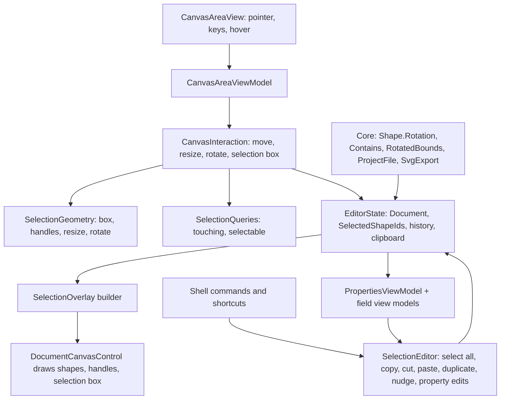

# Design Document

## Overview
The work has four layers, built bottom-up.

1. **Core:** shapes get a `Rotation`. Hit testing, bounds, the project file and the SVG export understand it. The history can extend its last step, and gets new step types.
2. **Selection model and geometry (App, `Workspace/`):** `EditorState` holds a set of selected shape ids. Pure classes compute the selection box and handles, resize, rotate and move the selected shapes, find shapes in a selection box, and run the clipboard and nudging. `CanvasInteraction` gains handle drags and the selection box drag.
3. **Canvas:** a `SelectionOverlay` model (outlines, box, handles, selection box) replaces the single selection rectangle. The canvas control draws rotated shapes and the overlay. The canvas view model adds hover for the handle cursors.
4. **Properties tab and shell:** a real `PropertiesViewModel` reads the selected shapes into field view models (numbers, colors) and writes edits back through the same editing methods. The Edit menu, shortcuts and the status bar follow the selection. The toolbar loses its X, Y, W, H group.

## Steering Document Alignment

### Technical Standards (tech.md)
- Same stack. One new package, `Avalonia.Controls.ColorPicker`, approved by the owner, pinned to the Avalonia version, referenced by App only.
- All document changes still go through `EditorState.Edit`, or `Preview` and `Commit` for drags (the architecture test stays valid).

### Project Structure (structure.md)
- Core: `Shapes/`, `History/`, `IO/`. App: `Workspace/` for logic, `ViewModels/Editor/` for the Properties fields, `Views/Editor/` for views and converters, `Controls/` for the canvas control. One type per file, `internal` types in App.

## Code Reuse Analysis

### Existing Components to Leverage
- **`EditorState` (`Edit`, `Preview`, `Commit`, history, `IsDragInProgress`)**: every manipulation is a drag (preview, one commit) or a plain edit.
- **`CanvasInteraction`**: draw and move already follow the "preview, then one step" pattern. Resize, rotate and the selection box are more drag types in the same class.
- **`CanvasMapping`, `ViewGeometry`, `CanvasScene`**: the same screen to document mapping for handles and overlay.
- **`Document.UpdateShape`, `AddShape`, `RemoveShape`, `FindShape`, `HitTest`**: the edit primitives.
- **`LayersViewModel` and `HistoryViewModel`**: the pattern of a view model that rebuilds from state and guards against feedback.
- **`ProjectFile` DTOs, `SvgExport`, `DocumentHistory`**: extended, not replaced.
- **`CanvasCursors`**: the icon-rendered cursors, extended with resize and rotate cursors.
- **`LocalizedViewModel`, `ILocalizer.Culture`**: number parsing and formatting by app language.
- **`PropertiesView.axaml`, `CollapsibleSection`**: the layout of the Properties tab stays, its placeholder controls get bindings.

### Integration Points
- **`StatusBarViewModel`**: selection text from the selection count.
- **`MenuBarViewModel`, `DesktopShellViewModel`, `DesktopShellView.axaml`**: Edit menu items (Cut, Copy, Paste, Paste in Place, Duplicate, Select All, Deselect, Delete) and their shortcuts.
- **`ToolbarViewModel`, `ToolbarView.axaml`**: remove the X, Y, W, H fields and the toggle.

## Architecture



### Data flow
1. **Select:** the Select tool press asks `SelectionQueries` what is under the pointer, then changes `State.SelectedShapeIds`. Selecting creates no step.
2. **Manipulate:** with a selection, a press first tests the handles (in document units: size in pixels divided by the zoom), then shapes, then empty space (selection box). A handle or move drag calls `SelectionGeometry` with the start document and the pointer, and gives the result to `State.Preview`. The end calls `State.Commit` with the step type.
3. **Edit by field or key:** `SelectionEditor` applies a pure change to the selected shapes through `State.Edit`, which records one step. Nudges use `Edit` with the extend flag.
4. **Draw overlay:** `SelectionOverlay.Build` turns the state into screen shapes: one outline polygon per shape, the box polygon, handles, and the selection box. The canvas control draws what it gets.
5. **Properties:** `PropertiesViewModel` listens to the document and the selection, builds a `SelectionValues` snapshot (values with a mixed flag), and pushes it into the field view models. A field commit calls `SelectionEditor`.

### Decisions to confirm at review
- **The selection becomes a set and its rules change.** `SelectedShapeId` (one id) is replaced by `SelectedShapeIds`. `HasSelection` becomes read-only and `SelectionSummary` is removed (the status bar computes its text from the count). A new rule, from R1.4: locking or hiding a layer removes its shapes from the selection (before, the selection stayed). Existing tests that set these properties are updated.
- **Rotation lives on the shape, not in a transform stack.** A shape keeps its box and one angle about the box center. Resizing a rotated shape works in its own turned frame. A group of shapes containing a rotated shape can only scale uniformly (R5.5), because a rotated rectangle cannot be stretched without skew.
- **Handle cursors use the four standard resize cursors**, the nearest to the handle's turned direction, and one rendered rotate cursor.
- **Nudge merging is tied to the document:** a nudge extends the previous step only if the document is still exactly the result of that previous nudge and the selection is the same. Any other edit in between starts a new step.
- **Color editing uses `ColorView` in our own flyout**, not the `ColorPicker` control, so the flyout's opened and closed events can start and end one undo step. The package is the same.
- **Clipboard is inside the app** (an immutable list of shapes in `EditorState`). Nothing is put on the system clipboard.
- **Text boxes keep their keys.** Delete, Backspace, arrows, Ctrl+C, Ctrl+V and Ctrl+A act in a focused text box, since the canvas key handlers live on the canvas panel and the shortcuts on the shell only fire if the text box does not handle the key.

### Modular Design Principles
- Geometry is pure static code on plain numbers and Core shapes. It never touches Avalonia or the state, so it is tested directly.
- `SelectionEditor` is the only code that changes shapes for fields and keys. Drag code changes them through `CanvasInteraction`.

## Components and Interfaces

### Core: `Shape` (changed) — R7
- `double Rotation { get; init; }`, degrees, finite (`Guard.Finite`), normalized to `[0, 360)` in the setter.
- `Point` helpers kept simple: `double CenterX`, `double CenterY`.
- `public bool Contains(x, y)` becomes concrete: it turns the point by `-Rotation` around the center and calls a new `protected abstract bool ContainsLocal(x, y)` (the old geometry code moves there in `RectangleShape` and `EllipseShape`). `Document.HitTest` is unchanged.
- `Bounds RotatedBounds`: the axis-aligned bounds of the turned box (from its four corners). `Bounds` stays the unturned box.

### Core: `ProjectFile` and `SvgExport` (changed) — R7.3, R7.4
- `ShapeDto.Rotation` (`double?`, name `rotation`). Written only if not 0. Read as 0 when missing. Format version stays 1.
- `SvgExport`: for a shape with a rotation, `transform="rotate(a cx cy)"` on the `rect` or `ellipse`, numbers with the existing writer.

### Core: `HistoryStepType` and `DocumentHistory` (changed) — R13
- New step types: `ResizeShapes`, `RotateShapes`, `NudgeShapes`, `PasteShapes`, `CutShapes`, `DuplicateShapes`, `ResetTransform`, `ChangePosition`, `ChangeSize`, `ChangeRotation`, `ChangeFill`, `ChangeStroke`, `ChangeStrokeWidth`, `ChangeOpacity`.
- `bool RecordOrExtend(HistoryStepType type, Document after)`: if the last step has the same type and nothing can be redone, the last step's result is replaced by `after`; otherwise it records. `false` if `after` is the current instance.

### App: `EditorState` (changed) — R1, R9, R13
- `ImmutableArray<Guid> SelectedShapeIds` (observable, private set), `Guid? SelectedShapeId` (the id if exactly one is selected), `int SelectedCount`, `bool HasSelection` (derived).
- `SelectOnly(Guid)`, `Select(Guid?)` (kept for single use), `SetSelection(IEnumerable<Guid>)`, `ToggleSelected(Guid)`, `ClearSelection()`. All filter ids through "exists in the document, layer visible and not locked".
- `OnDocumentChanged` rebuilds the selection with the same filter (one pass over the document).
- `Edit(type, change, extend: false)` passes the flag to `RecordOrExtend`.
- `ShapeClipboard Clipboard` (items, paste count).
- `Rect? SelectionBox` (document units, for the drag that is in progress).
- `SelectionSummary` is removed.

### App: `SelectionQueries` (`Workspace/`, new) — R1.6, R2
- `IsSelectable(Document, Guid)`, `Selectable(Document) -> IReadOnlyList<Shape>` (document order), `ShapesTouching(Document, Rect)` (shapes whose `RotatedBounds` overlap the rectangle, selectable only), `SelectedShapes(Document, ids)` in document order.

### App: `SelectionGeometry` (`Workspace/`, new) — R3, R5, R6, R10
- `SelectionFrame`: record (center, width, height, rotation, isSingle) from the selected shapes: one shape gives its own box and rotation, several give the upright union of their `RotatedBounds`.
- `HandleType` enum: `TopLeft, Top, TopRight, Right, BottomRight, Bottom, BottomLeft, Left, Rotate`.
- `HandlePositions(frame, zoom)`: handle centers in document units (the rotate handle 24 screen pixels beyond the top edge, converted by the zoom).
- `HitHandle(frame, point, zoom)`: the handle under a document point, with a grab size of 10 screen pixels, or none.
- `Resize(startShapes, frame, handle, pointer, keepProportions, fromCenter)` returns the new shapes: for one shape in its turned frame, for a group in the upright frame with each shape mapped through the same scale; groups with rotated shapes use one uniform scale. Dragging past the opposite edge flips. Sizes never go below 0.
- `Rotate(startShapes, frame, startPointer, pointer, snap)`: angle delta from the pointer angles around the frame center, snapped to 15 degrees with `snap` (for a single shape the snap applies to the final angle). Shapes turn around the frame center and their own rotation changes by the delta.
- `Move(startShapes, dx, dy)`.
- `SetX/SetY/SetSize/SetRotation(...)`: the same math for the Properties fields.
- All functions are pure and return new shapes (`with` expressions).

### App: `SelectionOverlay` (`Workspace/`, new) — R3
- `SelectionOverlay.Build(document, selectedIds, tool, zoom, originX, originY, selectionBox)` returns a record with `IReadOnlyList<ScreenPolygon> Outlines`, `ScreenPolygon? Box`, `IReadOnlyList<ScreenHandle> Handles` (type, center, size), the rotate handle's link line, and `ScreenRect? SelectionBox`. Handles and the box exist only for the Select tool and a non-empty selection. Replaces `CanvasScene.SelectionOutline` and `ScreenRect` for the selection.

### App: `CanvasScene` and `ScreenShape` (changed) — R7.5
- `ScreenShape` gets `RotationDegrees`. `BuildShape` fills it. The control turns the drawing around the shape's center.

### App: `CanvasInteraction` (changed) — R2, R4, R5, R6
- New drag types: `Marquee`, `ResizingHandle`, `RotatingHandle`; `Moving` works on all selected shapes.
- `PointerPressed(x, y, shift)`, `PointerMoved(x, y, shift, alt)`, `PointerReleased(x, y, shift, alt)` (modifiers default to false so existing callers keep working).
- Press with the Select tool: handle hit, then shape hit (Shift toggles, an unselected shape becomes the only selection), then empty space (selection box; a click without movement clears the selection unless Shift is held).
- Marquee release: `SelectionQueries.ShapesTouching`, added to the selection with Shift.
- Resize and rotate preview through `SelectionGeometry`, commit as `ResizeShapes` and `RotateShapes`. Move commits as `MoveShape`.
- `HoverHandle(x, y)`: the handle under the pointer without a drag, for the cursor.
- `DeleteSelection` deletes all selected shapes (one step).

### App: `SelectionEditor` (`Workspace/`, new) — R2.5, R2.6, R8, R9, R10, R11
- `SelectAll()`, `Deselect()`, `Nudge(dx, dy)` (extends the previous step under the rule above), `Copy()`, `Cut()`, `Paste(inPlace)`, `Duplicate()`, `CanCopy/CanPaste/CanDuplicate`.
- `Apply(type, Func<Shape, Shape>)` for property edits on all selected shapes, and `ApplyTransform(type, Func<IReadOnlyList<Shape>, SelectionFrame, IReadOnlyList<Shape>>)` for the Transform fields.
- `Func<Guid>` id source (default `Guid.NewGuid`) so tests are deterministic.

### App: `ShapeClipboard` (`Workspace/`, new) — R9
- Immutable shapes in document order, `Set(shapes)`, `NextPasteOffset()` (increments), `Clear`, `IsEmpty`. A new `Set` resets the offset counter.

### App: `CanvasAreaViewModel` (changed) — R3, R2
- `SelectionOverlay Overlay` replaces `SelectionOutline`. Raised when the document, the selection, the view or the tool changes.
- `PointerHover(screenX, screenY)` sets `HoverHandle`. `CursorType` gets `ResizeNorthSouth`, `ResizeWestEast`, `ResizeNorthWestSouthEast`, `ResizeNorthEastSouthWest` and `Rotate`, chosen from the hovered or dragged handle and the shape's rotation.
- `KeyPressed(key, shift)` for arrows and Escape, forwarding to `SelectionEditor`.

### App: `DocumentCanvasControl` and `CanvasAreaView` (changed) — R3, R7.5
- The control draws rotated shapes, then the overlay (outlines, box, link line, handles, selection box) with `SelectionBrush` and the new `SelectionHandleFillBrush`.
- The view forwards modifiers with each pointer event, hover moves, and the arrow and Escape keys.

### App: `PropertiesViewModel` (rewritten) and field view models — R10, R11, R12
- `PropertiesViewModel(EditorState, SelectionEditor, ILocalizer)`: `HasSelection`, `Header` ("Nothing selected", "1 selected", "N selected"), `X`, `Y`, `Width`, `Height`, `Rotation` (`NumberFieldViewModel`), `KeepProportions`, `ResetTransformCommand`, `Fill` and `Stroke` (`ColorFieldViewModel`), `StrokeWidth`, `OpacityPercent` (`NumberFieldViewModel`), the existing section expansion flags. It rebuilds `SelectionValues` when the document or the selection changes and refreshes the fields that are not being edited.
- `SelectionValues` (`Workspace/`): from the selected shapes: the frame (X, Y, W, H, rotation) and `Mixed<T>` values for fill, stroke, stroke width and opacity.
- `NumberFieldViewModel`: `Text`, `IsEnabled`, `IsMixed`, `Commit()`, `Revert()`; parses with the app culture and the dot, checks min and max, formats with at most 3 decimals; calls a delegate with the parsed value; refuses and reverts invalid text and equal values.
- `ColorFieldViewModel`: `HasColor`, `IsMixed`, `Color`, `BeginEdit()`, `Update(color)` (preview), `EndEdit()` (commit one step), `SetNone()`.
- The view binds `TextBox.Text` two-way with commit on Enter and lost focus (view-only key handling to call `Commit` or `Revert`).

### App: Properties view, converter, theme — R11
- `PropertiesView.axaml`: bound fields, swatch buttons with a `Flyout` that holds a `ColorView` (alpha on), "none" toggles, opacity slider and percent field. A `CoreColorConverter` maps the Core color to the Avalonia color and back. Flyout `Opened` and `Closed` call `BeginEdit` and `EndEdit`.
- Theme: new `SelectionHandleFillBrush` in the light and dark dictionaries.

### App: shell, menu, toolbar, status bar — R2, R9, R14
- `DesktopShellViewModel`: commands for Select All, Deselect, Copy, Cut, Paste, Paste in Place, Duplicate and Delete, with `CanExecute` from the editor and notifications on selection and clipboard changes. `MenuBarViewModel` wires the Edit items, `DesktopShellView.axaml` the key bindings (Ctrl+A, Ctrl+Shift+A, Ctrl+C, Ctrl+X, Ctrl+V, Ctrl+Shift+V, Ctrl+D).
- `StatusBarViewModel`: selection text from `SelectedCount`.
- `ToolbarViewModel` and `ToolbarView.axaml`: the X, Y, W, H group and its toggle are removed, with their unused `de.po` texts.

## Data Models

```
Shape (Core): + Rotation: double            // degrees, [0, 360), around the box center
Project file shape: + "rotation": number    // optional, version stays 1
SelectionFrame: Center, Width, Height, Rotation, IsSingle
HandleType: TopLeft | Top | TopRight | Right | BottomRight | Bottom | BottomLeft | Left | Rotate
SelectionOverlay: Outlines, Box, Handles, RotateLink, SelectionBox      // screen space
SelectionValues: Frame, Fill: Mixed<Color?>, Stroke: Mixed<Color?>, StrokeWidth: Mixed<double>, Opacity: Mixed<double>
```

## Error Handling
1. **Invalid field text or out-of-range number:** the field reverts, no change, no step.
2. **Empty or hidden target for Paste (active layer locked or hidden), empty clipboard, nothing selected:** the commands are disabled, so nothing runs.
3. **Selection changes under an open edit** (undo while a field has focus): the fields refresh from the new selection.
4. **Resize to nothing:** sizes clamp at 0 and never go negative or non-finite. Non-finite pointer values are ignored.
5. **Color flyout closed without a change:** no step.
6. **Package restore fails** (no network): stop and tell the owner, do not work around it.

## Testing Strategy

### Unit Testing
- **Core:** `ShapeRotationTests` (normalization, finite check, `Contains` for rectangles and ellipses at several angles, `RotatedBounds`), `ProjectFile` tests (rotation round trip, missing means 0, written only when not 0, out-of-range numbers normalize), `SvgExport` tests (transform attribute, numbers), `DocumentHistory` tests (`RecordOrExtend`: extends, new type records, after undo records, same instance), `HistoryStepNames` coverage.
- **`SelectionGeometryTests`:** frame for one and several shapes, handle positions at several zooms and rotations, `HitHandle` with the grab size, resize for every handle without and with rotation, with Shift and Alt, flips, minimum size, group scaling, group with a rotated shape (uniform only), rotate with snapping and for groups, move, the field setters, and random sequences that keep every number finite and sizes at least 0.
- **`SelectionQueriesTests`, `SelectionEditorTests`:** touching, selectable rules, select all, deselect, nudge (one step per key, merging rules, no merge after another edit or another selection), copy, cut, paste (offsets, new ids, layer, order, in place, repeated), duplicate, property edits (one step, mixed, no step for equal values), disabled conditions.
- **`SelectionOverlayTests`:** outlines, box and handles in screen space at several zooms, origins and rotations, only for the Select tool, empty without selection.
- **`EditorStateTests` and `CanvasInteractionTests` (extended and updated):** the selection set and its repair (hidden and locked layers, undo, delete), marquee, shift toggling, move of several shapes, resize and rotate drags as one step each, live preview, cancel and tool change, hover handle, cursor types.
- **`PropertiesViewModelTests`, `NumberFieldViewModelTests`, `ColorFieldViewModelTests`:** values for one and several shapes, mixed states, parsing with a comma and a dot, German and English culture, ranges, revert, commit creating one step, equal values creating none, refresh from drags and undo, color edit as one step, the none toggle, keep proportions, reset transform, disabled without a selection.
- **Menu, toolbar, status bar, shell tests:** the Edit items and their enabled state, shortcuts exist, the status text, the toolbar without the removed group. **`TranslationConsistencyTests`** cover the texts.

### Integration Testing
- A shell-level test selects several shapes by selection box, resizes through the handle API, rotates, edits the fill through the Properties view model, nudges, copies and pastes, undoes everything step by step, and checks the document, the selection, the fields and the History rows each time.

### End-to-End Testing
- Manual run on the right screen (see the notes): draw shapes, select by click, Shift+click, box, Ctrl+A; drag handles (screenshots of the handles at 50% and 400% zoom, rotated), resize with Shift and Alt, rotate with Shift, nudge with the arrows, copy and paste, duplicate, edit every Properties field, open the color picker and drag in it, undo and redo through the History tab, a 1000-shape document with a select-all and a handle drag. Cursors cannot be seen in screenshots (reported as such).
