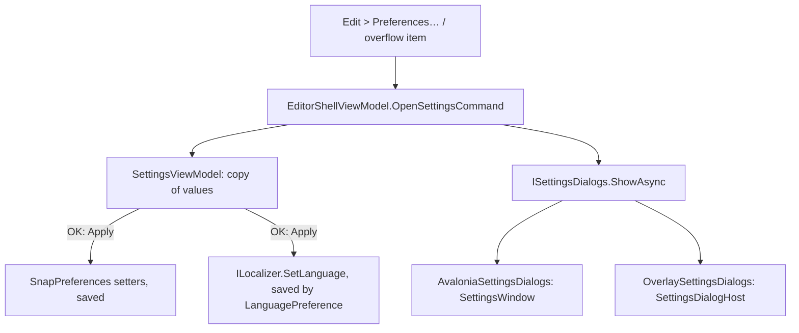

# Design Document

## Overview
One view model, `SettingsViewModel`, holds a copy of the settings, the category list, the current page and OK, Cancel and Restore defaults. It has no Avalonia types. Two thin presenters show it: a modal `Window` on the desktop, and an overlay inside the tablet layout (like `MessageDialogHost`). The pages are the same views on both. Only the navigation differs: the desktop shows the list and the page side by side, the tablet shows one at a time.

## Steering Document Alignment

### Technical Standards (tech.md)
MVVM with CommunityToolkit.Mvvm, `LocalizedViewModel` for translated properties, texts through `ILocalizer` and `{loc:T}`, colors and sizes only from `Styles/Theme.axaml`, no new NuGet package.

### Project Structure (structure.md)
- Logic in `ViewModels/Editor/` (reusable by both layouts): `SettingsViewModel`, `SettingsCategoryViewModel`.
- Views in `Views/Editor/`: `SettingsView` (desktop: list and page), `SettingsPageViews`. Windows and tablet-only views in `Views/Desktop/` and `Views/Tablet/`.
- Services in `Services/`: the interface and the two presenters.
- Dependency direction is unchanged. No Core change.

## Code Reuse Analysis

### Existing Components to Leverage
- **`SnapPreferences`**: the source and target of the Canvas and Snapping values. Its setters already save, validate and raise `Changed`, so the menus and status bars follow without more code (R7.2). Its `MinSpacing`, `MaxSpacing`, `IsValidSpacing` give the limits (R5.2).
- **`ILocalizer`**: `Languages`, `LanguageCode`, `SetLanguage` for the General page. `LanguagePreference` already saves a language change, so OK only calls `SetLanguage`.
- **`LanguageSelector.Choose`**: the default language for Restore defaults (R7.4).
- **`NumberFieldViewModel`**: its culture-aware parsing is reused for the spacing text (see "Grid spacing field").
- **`MessageDialogHost`, `MessageDialogWindow`, `OverlayMessageDialogs`, `AvaloniaMessageDialogs`**: the model for the overlay and the modal window. Their pattern (one turn at a time, `Dismiss`, owner window from a `Func<Window?>`) is copied, not extended, because the content is different.
- **The existing disabled `Pre_ferences…` item of the Edit menu** (`MenuBarViewModel`): it gets the command. Its mnemonic and translation already exist.
- **`MenuItemViewModel`, `OverflowMenuViewModel`**: the new tablet entry.
- **`TouchSizes` and the style class `touch`**: touch-sized rows on the tablet.

### Integration Points
- **`FileServices`**: carries the other dialog services into `EditorShellViewModel`. It gets one more member, `Settings` (`ISettingsDialogs`). Alternative: a new constructor parameter on both shells. Chosen: the record, because both shells and `AppLayout` already pass it and the member is created in the same place as the message dialogs. The name `FileServices` is then slightly too narrow. Renaming is not part of this change.
- **`EditorShellViewModel`**: gets `OpenSettingsCommand` (async). It builds a `SettingsViewModel` from `State.Snapping` and the localizer and passes it to `ISettingsDialogs.ShowAsync`.
- **`AppLayout`**: creates `AvaloniaSettingsDialogs` (desktop) or `OverlaySettingsDialogs` (Android), next to the message dialogs.
- **`TabletShellViewModel` / `TabletShellView`**: owns a `SettingsDialogHost`, shows it as a full-screen overlay, and routes the Back request to it before the message dialog host.

## Architecture



- The view model creates the copy from the live values when it is constructed (R1.5). It never writes to `SnapPreferences` or the localizer before `Apply` (R4.2, R7.1).
- `ISettingsDialogs.ShowAsync(SettingsViewModel)` returns when the dialog is closed. The view model raises `CloseRequested` with `true` (OK) or `false` (Cancel). A dialog closed in any other way (window close button, Escape, Android Back on the list) counts as Cancel. The command calls `Apply` only when the result is OK.
- "One window at a time" (R1.4): the command ignores a call while `_settingsOpen` is true. The desktop window is modal, so the flag matters only for the tablet and for a double click.

## Components and Interfaces

### SettingsViewModel (`ViewModels/Editor/SettingsViewModel.cs`)
- **Purpose:** the copy, the validation and the apply logic.
- **Interfaces:**
  - `IReadOnlyList<SettingsCategoryViewModel> Categories` (General, Canvas, Snapping), `SettingsCategoryViewModel SelectedCategory`.
  - General: `IReadOnlyList<LanguageInfo> Languages`, `LanguageInfo SelectedLanguage`.
  - Canvas: `bool ShowRulers`, `bool ShowGrid`, `string GridSpacingText`, `string? GridSpacingError`.
  - Snapping: `bool SnapToGrid`, `bool SnapToObjects`, `bool SmartGuides`, `bool ShowGuides`.
  - `bool CanApply` (no error, R5.2), `bool HasChanges` (R7.3).
  - `IRelayCommand OkCommand` (can run when `CanApply`), `CancelCommand`, `RestoreDefaultsCommand` (restores the selected category, R7.4).
  - Tablet navigation: `bool IsPageOpen`, `OpenCategoryCommand(category)`, `BackCommand` (page to list; on the list it cancels). Desktop ignores these; it always shows the selected category.
  - `event EventHandler<bool>? CloseRequested`.
  - `void Apply()`: writes the changed values only (R7.2, R7.3), and `SetLanguage` last, so the other values are already stored when the texts refresh.
- **Dependencies:** `SnapPreferences`, `ILocalizer`, the system UI culture (for the default language), `bool defaultShowRulers` (the layout default, as `SnapPreferences` takes it).
- **Reuses:** `LocalizedViewModel` (texts refresh on a language change after OK), `SnapPreferences.IsValidSpacing`.

### SettingsCategoryViewModel (`ViewModels/Editor/SettingsCategoryViewModel.cs`)
- **Purpose:** one row of the list: a translated title, an icon name and the page it shows. Titles are marked with `Localizer.N(...)` and translated when shown.
- **Interfaces:** `Title`, `Icon` (an existing `MaterialIconKind`, if the project already uses that for the toolbar; otherwise no icon).

### Grid spacing field
The text is parsed with the localizer culture and a dot is accepted in every language, as in `NumberFieldViewModel`. `NumberFieldViewModel` itself is not used: it applies a value on commit and brings the old value back on invalid text, but the settings window must keep the invalid text and show an error (R5.2). Its parsing is moved into one small static helper, `NumberParsing.TryParse(string, CultureInfo, out double)`, used by both. This is the only change to existing code in the Properties tab. If the move turns out to touch more than the parse method, the helper is duplicated instead and the owner is told.

### ISettingsDialogs (`Services/ISettingsDialogs.cs`)
- `Task ShowAsync(SettingsViewModel viewModel)`: shows the settings and returns when closed.
- `AvaloniaSettingsDialogs(Func<Window?> owner)`: creates `SettingsWindow`, `ShowDialog` over the owner. No owner: returns at once and the command treats it as Cancel.
- `OverlaySettingsDialogs(SettingsDialogHost host)`.

### SettingsDialogHost (`ViewModels/Tablet/SettingsDialogHost.cs`)
- Same pattern as `MessageDialogHost`: `Current` (the `SettingsViewModel` or `null`), `IsOpen`, `ShowAsync`, `Dismiss`.
- `TabletShellViewModel.OnBack` (the existing Back handling at lines 59 and 88): when `Settings.IsOpen`, call `Current.BackCommand` first (page to list, or cancel from the list), before the message dialog check.

### Views
- `SettingsView` (`Views/Editor/`): the two-column layout for the desktop (list `ListBox` 180 px wide, `ContentControl` for the page), bound to `SettingsViewModel`; with OK, Cancel and Restore defaults buttons at the bottom.
- `GeneralSettingsView`, `CanvasSettingsView`, `SnappingSettingsView` (`Views/Editor/`): the pages, selected through a `DataTemplate` on the category's page view model. `ViewLocator` maps `FooViewModel` to `FooView` by name, so each page has a small page view model (`GeneralSettingsPageViewModel`, `CanvasSettingsPageViewModel`, `SnappingSettingsPageViewModel`) that holds a reference to the `SettingsViewModel` for its values. This keeps `ViewLocator` unchanged.
- `SettingsWindow` (`Views/Desktop/`): hosts `SettingsView`. Minimum 560 x 380, resizable, `ShowInTaskbar=False`, centered on the owner. Escape cancels, Enter does OK.
- `TabletSettingsView` (`Views/Tablet/`): a header with the back button and the title, then either the list (full width, touch-sized rows) or the page. The page views are shared with the desktop.
- Colors and sizes only from `Theme.axaml`. New sizes (the list width, the page margins, the error text brush) go there, light and dark. The page views use the existing switch and text box styles.

## Data Models

```
SettingsViewModel draft (all copied at construction)
- Language: LanguageInfo            (from ILocalizer.LanguageCode)
- ShowRulers, ShowGrid: bool        (from SnapPreferences)
- GridSpacingText: string           (SnapPreferences.GridSpacing, formatted with the localizer culture)
- SnapToGrid, SnapToObjects, SmartGuides, ShowGuides: bool

Defaults (Restore defaults, per category)
- General:  language = LanguageSelector.Choose(null, systemUiCulture)
- Canvas:   ShowRulers = layout default, ShowGrid = false, spacing = SnapPreferences.DefaultSpacing
- Snapping: SnapToGrid = false, SnapToObjects = false, SmartGuides = false, ShowGuides = true
```

The defaults of the four switches are today private literals in the `SnapPreferences` constructor. To avoid a second copy, they become public constants on `SnapPreferences` (`DefaultShowGrid`, `DefaultSnapToGrid`, ...), used by the constructor and by the view model. No file format change: the settings file keeps its keys.

## Error Handling

1. **Invalid grid spacing** (empty, text, `NaN`, outside 1 to 1000): `GridSpacingError` gets a translated message that names the range; `CanApply` is false; OK is disabled. Cancel and Restore defaults still work. The page of an invalid field shows the error text under the field. The category row of the Canvas page also shows a small error marker so that an error on another page is not missed (R2.2 keeps the entered values).
2. **Settings file cannot be saved:** `SnapPreferences` and `LanguagePreference` already ignore it; the values apply to the session (Reliability).
3. **Damaged stored values:** `SnapPreferences` has already replaced them by the defaults before the window reads them.
4. **No owner window (desktop):** `ShowAsync` returns at once, the command does nothing.
5. **Language list empty or current code unknown:** `SelectedLanguage` falls back to the first entry; `Apply` does not call `SetLanguage` when the selection equals the current code.

## Testing Strategy

### Unit Testing (`tests/PressToShape.App.Tests/ViewModels/Editor/SettingsViewModelTests.cs`)
Name tests `Method_Scenario_Expected`. A fake `ISettingsStore` and `SnapPreferences.InMemory`/a store-backed `SnapPreferences`, and a fake `ILocalizer` (the existing test localizers are reused).
- Construction copies the current values (R1.5).
- Changing a value does not touch `SnapPreferences` or the language before OK (R4.2, R7.1).
- `Apply` writes all changed values and saves once per changed value (R5.4, R6.2, R7.2); no changes: no `Save` (R7.3).
- `Apply` switches the language (R4.3).
- Invalid spacing (empty, "abc", "0", "1001", `NaN`) sets the error and disables OK; a valid value clears it; a comma is accepted in the German culture and a dot in every culture (R5.2, R5.3).
- `RestoreDefaultsCommand` resets only the selected category and applies nothing (R7.4); the layout default for the rulers is used.
- `CancelCommand` raises `CloseRequested(false)`; `OkCommand` raises `true`.
- Tablet navigation: `OpenCategoryCommand` sets `IsPageOpen`, `BackCommand` returns to the list and keeps the values, `BackCommand` on the list cancels (R3).
- Unknown entries in the settings file survive an OK (R7.6).
- Existing `TranslationConsistencyTests` cover the new texts and the mnemonics (R8.1).

### Integration Testing
- `EditorShellViewModel.OpenSettingsCommand` with a fake `ISettingsDialogs`: OK applies, Cancel does not, a second call while one is open is ignored (R1.4).
- `MenuBarViewModel`: the Edit item "Preferences…" has the command; `OverflowMenuViewModel` has the new item (R1.1, R1.3).
- A menu toggle and the status bar follow a change applied through the window (R7.2), through the existing `SnapPreferences.Changed`.

### End-to-End / headless UI (`[Collection(HeadlessUi.CollectionName)]`)
- `SettingsWindow` shows the three categories and switches the page on selection (R2.1, R2.2).
- `TabletSettingsView` shows the list first, the page after a tap, the list after Back (R3.1 to R3.3). The pump is the dispatcher, no blocking waits.
- A manual run on the desktop (window placement as in the project notes) and on the tablet over `adb` after the tasks are done.
