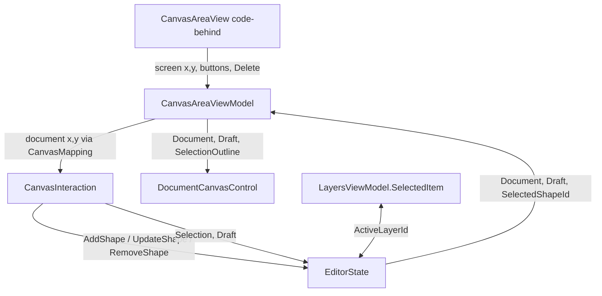

# Design Document

## Overview
Pointer input on the canvas goes through the view model to one plain class, `CanvasInteraction`, that holds the drag state and edits the document through `EditorState`. `EditorState` gets the active layer, the selected shape and a draft shape. The canvas control draws the draft shape and the selection outline in addition to the document. The Layers panel gets a selected row that is the active layer. `SampleDocument` is deleted. Core is not changed.

## Steering Document Alignment

### Technical Standards (tech.md)
- Same stack: CommunityToolkit.Mvvm, compiled bindings, no new package. No Avalonia.Headless: all rules sit in plain classes and are unit-tested. Only the event forwarding in the view's code-behind is untested by xUnit and is checked by running the app.

### Project Structure (structure.md)
- Pure logic in `Workspace/`, view models in `ViewModels/Editor/`, drawing in `Controls/`. One type per file, `internal` types, tests mirror the folders.

## Code Reuse Analysis

### Existing Components to Leverage
- **`Document`** (Core): `AddShape`, `UpdateShape`, `RemoveShape`, `FindShape`, `HitTest`. `HitTest` returns shapes topmost first, skips hidden layers and includes locked ones, so the interaction filters locked layers itself.
- **`Appearance.Default`** (Core): the look of new shapes (R3.6).
- **`CanvasScene` / `ScreenShape`**: the draft shape is converted with the same code as document shapes.
- **`EditorState`**: already has `ActiveTool`, `HasSelection`, `SelectionSummary`, `UpdateLayer`. The status bar, toolbar and Properties tab already read `HasSelection`, so they follow the selection without changes.
- **`LayersViewModel.Sync`**: updates items in place when the ids are unchanged. That keeps the selected row stable while shapes are dragged.
- **`CanvasAreaViewModel`**: owns origin and zoom, so it converts screen to document positions.
- **`ToolDefinitions`, `ToolboxViewModel`**: the Rectangle, Ellipse and Select tools exist; shortcuts are unchanged.

### Integration Points
- **`DesktopShellViewModel`**: creates the start document (`Document.Create(localizer.T("Layer 1"))`) instead of the sample.
- **`CanvasAreaView`** code-behind: forwards pointer and key events of the viewport to `CanvasAreaViewModel`.
- **`StatusBarViewModel`**: shows a translated "1 selected" when a shape is selected and the summary text is empty.

## Architecture



### Data flow
1. **Draw:** press with a shape tool → `Inter` stores the start point and, if the active layer is visible and unlocked, begins a draft. Move → `State.Draft` = a shape with the normalized rectangle between start and pointer. Release → if the screen distance is at least 2 px in x and y, `AddShape` to the active layer and select it; the draft is cleared either way.
2. **Select:** press with the Select tool → the topmost shape under the pointer in a visible, unlocked layer becomes selected; otherwise the selection is cleared.
3. **Move:** after selecting by a press on a shape, moves set the shape's X and Y to its start position plus the document distance from the press point (absolute, so no drift). Release ends the drag.
4. **Delete:** Delete key → `RemoveShape` for the selection, then the selection is cleared.
5. **Consistency:** whenever `Document` changes, `EditorState` clears the selected shape if it no longer exists, and moves the active layer to the topmost layer if its layer no longer exists (R2.3, R4.7).

### Decisions to confirm at review
- **Locked shapes are transparent to the Select tool.** A click that hits a locked shape on top of an unlocked shape selects the unlocked shape below. R4.1/R4.4 can also be read as "the topmost hit decides". The first reading is more useful and matches common editors.
- **The draft is not in the document.** A draft shape is not stored in the document, so a half-finished drag never leaves a partial document. The alternative (add a shape on press and update it while dragging) is simpler to draw but puts a throw-away shape into the document, which would become a bad undo step later.
- **Move writes the document on every pointer move.** There is no undo yet. The undo spec decides how a whole drag becomes one undo step.

### Modular Design Principles
- The control only draws. `CanvasInteraction` has no Avalonia types and no UI thread needs.
- The mapping screen ↔ document lives once in `CanvasMapping`, used by the scene and the interaction.

## Components and Interfaces

### `CanvasMapping` (`Workspace/`, new) — R1
- `static double ToDocument(double screen, double origin, double zoomPercent)` = `(screen - origin) / (zoomPercent / 100)`.
- `static double ToScreen(double value, double origin, double zoomPercent)` = `origin + value * zoomPercent / 100`.
- `CanvasScene` uses `ToScreen` for positions, so drawing and picking cannot drift apart.

### `EditorState` (changed) — R2, R4, R7
- `[ObservableProperty] Guid ActiveLayerId`. Set to the topmost layer of the document in the constructor.
- `[ObservableProperty] Guid? SelectedShapeId`. `Select(Guid? id)` sets it and sets `HasSelection`. `SelectionSummary` stays empty (the status bar provides the text).
- `[ObservableProperty] Shape? Draft`: the shape being drawn, outside the document.
- `OnDocumentChanged` additionally repairs `SelectedShapeId` and `ActiveLayerId` (flow 5).
- `Document AddShape / UpdateShape / RemoveShape` helpers are not added: the interaction calls `State.Document = State.Document.AddShape(...)`.

### `CanvasInteraction` (`Workspace/`, new) — R3, R4, R5, R6
- `CanvasInteraction(EditorState state)`.
- `void PointerPressed(double docX, double docY)`, `void PointerMoved(double docX, double docY)`, `void PointerReleased(double docX, double docY)`, `void DeleteSelection()`, `bool IsDragging`.
- Reads `state.ActiveTool`: `Rectangle` and `Ellipse` draw, `Select` selects and moves, every other tool does nothing.
- The 2 px threshold is converted to document units with `state.ZoomPercent`.
- Drawing is refused (no draft) if the active layer is hidden or locked. Ends cleanly if the tool changes during a drag (the draft is dropped).
- `PointerReleased` ends the drag in every case. `Cancel()` drops the draft and the drag; the view calls it when the pointer capture is lost.

### `ScreenRect` (`Workspace/`, new)
- `readonly record struct ScreenRect(double X, double Y, double Width, double Height)` for the selection outline.

### `CanvasScene` (changed) — R3.1, R4.5
- `static ScreenShape? BuildShape(Shape shape, double zoomPercent, double originX, double originY)` is the existing per-shape conversion made public for the draft.
- `static ScreenRect? SelectionOutline(Document document, Guid? shapeId, double zoomPercent, double originX, double originY)` returns the shape's bounds on screen, or `null` if there is no selection or the shape is gone or in a hidden layer.

### `CanvasAreaViewModel` (changed)
- `PointerPressed/Moved/Released(double screenX, double screenY)` convert with `CanvasMapping` (origin from `OriginX/OriginY`) and call `CanvasInteraction`. `Cancel()`, `DeleteSelection()`.
- `Draft` (`ScreenShape?`), `SelectionOutline` (`ScreenRect?`) for the control, and `UseCrosshair` (`true` for Rectangle and Ellipse). They are recomputed when the document, zoom, origin, draft or selection changes.

### `DocumentCanvasControl` (changed) — R3.1, R4.5
- New styled properties `Draft` (`ScreenShape?`), `SelectionOutline` (`ScreenRect?`) and `SelectionBrush` (`IBrush?`). `Render` draws the document, then the draft, then the outline: a 1 px stroke around the bounds (not scaled with the zoom).

### `CanvasAreaView` (changed)
- The viewport `Panel` is `Focusable`. Code-behind: `PointerPressed` (primary button only) focuses the panel, captures the pointer and calls the view model; `PointerMoved` and `PointerReleased` call it too (the released event releases the capture); `PointerCaptureLost` calls `Cancel()`; `KeyDown` with `Key.Delete` calls `DeleteSelection()` and marks the event handled.
- The Panel gets class `crosshair` from `UseCrosshair`, and a style sets the cursor to a cross.
- Text input never reaches this panel, so Delete in a text field acts on the field (R6.3).

### `LayersViewModel` / `LayersView` (changed) — R2.2, R2.4
- `LayerItemViewModel? SelectedItem` bound two-way to `ListBox.SelectedItem`. Setting it sets `State.ActiveLayerId`. When the state changes, the selected item follows. A guard flag prevents feedback loops. After `Sync` rebuilds the items, the active layer's row is selected again.
- The toggle buttons handle their own clicks, so a click on a toggle does not change the active layer.

### `SampleDocument` — R7
- `SampleDocument.cs` and `SampleDocumentTests.cs` are deleted. `DesktopShellViewModel` creates `Document.Create(localizer.T("Layer 1"))`.

### Theme and translations
- `Styles/Theme.axaml`: new brush `SelectionOutlineBrush` (light and dark), bound to `SelectionBrush` in XAML with `DynamicResource`.
- `de.po`: add "Layer 1" ("Ebene 1") and "1 selected" ("1 ausgewählt"). Remove "Background" and "Shapes" (the consistency tests fail on obsolete entries).

## Data Models

```
EditorState (new members)
- ActiveLayerId: Guid          // always an existing layer id
- SelectedShapeId: Guid?       // null or an existing shape id
- Draft: Shape?                // not part of the document

ScreenRect: X, Y, Width, Height   // screen pixels
```

## Error Handling
1. **Press with a drawing tool on a hidden or locked layer:** no draft, nothing is created. The cursor stays a crosshair. (A visible hint is out of scope.)
2. **Capture lost mid-drag (window deactivates, tool shortcut):** `Cancel()` drops the draft. A move in progress keeps the position it reached.
3. **Selected shape or active layer vanishes through a document change:** repaired in `OnDocumentChanged`, so no stale id exists.
4. **Shape types without a drawing:** unchanged: `CanvasScene` throws for unknown types, which cannot exist in Core.

## Testing Strategy

### Unit Testing
- `CanvasMappingTests`: round trip, zoom 50/100/300, origin offset, equal to the scene's screen positions.
- `CanvasInteractionTests` (the core of this spec): draw rectangle and ellipse in all four drag directions, threshold, hidden and locked active layer, tool stays, new shape selected, new shape on top of the active layer; select topmost, ellipse corners miss, locked and hidden skipped, empty click clears; move at zoom 100 and 200, absolute position without drift, other values unchanged; delete; Cancel; tool changed during drag.
- `EditorStateTests`: active layer at start, repair after `RemoveLayer`, selection repair after `RemoveShape`, `HasSelection` follows.
- `CanvasSceneTests`: `BuildShape`, `SelectionOutline` (none, hidden layer, zoom, origin).
- `LayersViewModelTests`: `SelectedItem` sets the active layer, follows the state, survives a shape edit without a rebuild.
- `CanvasAreaViewModelTests`: screen-to-document conversion at a non-100 zoom, `UseCrosshair`, outline and draft values.
- `DesktopShellViewModelTests` (updated): one empty layer "Layer 1"/"Ebene 1", end-to-end draw through the shell. `StatusBarViewModelTests`: "1 selected".

### Integration Testing
- A shell-level test draws a shape through `Canvas.PointerPressed/Moved/Released` and checks the document, the Layers panel and the status bar.

### End-to-End Testing
- Manual run with the app and screenshots (as in `canvas-rendering`): draw both shapes, select, move, delete, switch the active layer, lock a layer, zoom 50% and 200%. Pointer input is simulated with `xdotool`, if available, and reported honestly if not.
