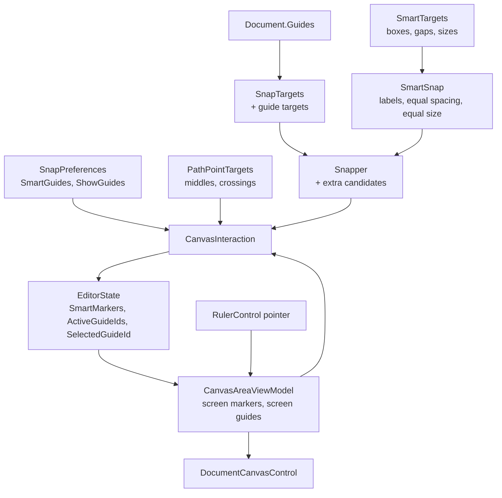

# Design Document

## Overview
Two parts on top of `snapping-and-grid`:

1. **Smart guides** (setting `SmartGuides`): pure helpers in `Workspace/` find the neighbours, gaps, sizes, segment middles and crossings once per drag. The interaction code asks them on every pointer move, feeds extra snap candidates into `Snapper`, and publishes markers through `EditorState`. The canvas control only draws them.
2. **Ruler guides** (setting `ShowGuides`): a `Guide` list in the `Document` (Core), saved in the project file as an optional entry, created and moved by dragging from a ruler or a guide, drawn by the canvas control, and used as snap targets by the existing object snapping.

Nothing about SVG export changes.

## Steering Document Alignment

### Technical Standards (tech.md)
MVVM with CommunityToolkit.Mvvm, logic outside views, no new NuGet packages, translations in `de.po`, colors only in `Styles/Theme.axaml`, the document is immutable and edited through `EditorState.Edit` and `Preview`/`Commit`.

### Project Structure (structure.md)
`Guide` and the file format are in `PressToShape.Core` (no Avalonia). Everything else is in `PressToShape.App` (`Workspace/`, `ViewModels/`, `Views/`, `Controls/`, `Styles/`, `Settings/`). Dependencies stay `Desktop/Android -> App -> Core`.

## Code Reuse Analysis

### Existing Components to Leverage
- **`SnapPreferences`, `AppSettings`**: two more settings (`SmartGuides`, `ShowGuides`) in the same style.
- **`Snapper`, `SnapTargets`, `SnapResult`, `SnapGuide`, `SnapSettings`**: extended, not replaced. Guides are new targets of `SnapTargets`. The new snaps are extra candidates that `Snapper` compares with the edge and grid snaps.
- **`CanvasInteraction` partials** (`Snapping`, `Pen`, `NodeDrags`): the places that already snap call the same helper. The snap session (`BeginSnapSession`, `ClearSnap`, `Snap`) is reused for the smart session.
- **`EditorState.Preview/Commit`, `HistoryStepNames`, `DocumentHistory`**: a guide drag is previewed and committed as one step, like a move.
- **`CanvasAreaViewModel` overlays and `NotifyOverlayChanged`**, **`CanvasMapping`**, **`CanvasCursorType`** (`ResizeNorthSouth`, `ResizeWestEast` for a guide under the pointer).
- **`Bezier.Point`, `Bezier.Flatten`, `Bezier.Split`** (Core): segment middles and crossings.
- **`PathShape.WithRotationApplied`, `Segments()`**: segments in document coordinates.
- **`MenuItemViewModel.Toggle`, `StatusBarViewModel` toggles, `ToggleButton.snap` style**: new switches.
- **`ProjectFile` with optional entries** (the palette): guides are written the same way.
- **`RulerControl`, `CanvasAreaView` pointer code**: the rulers get pointer handlers.

### Integration Points
- **Settings file**: two optional entries.
- **Project file**: one optional entry `guides`.
- **`CanvasAreaView.axaml.cs`**: pointer events of the two rulers go to the view model.

## Architecture



### Modular Design Principles
- `SmartTargets`, `SmartSnap`, `PathPointTargets`, `DistanceLabels` are pure and tested alone. They know no `EditorState`.
- `CanvasInteraction` stays the only place where pointer events become document edits and markers.
- The control draws what it is given and holds no rules.

## Components and Interfaces

### Core

#### `Guide` and `Document.Guides` (`Documents/Guide.cs`, `Document.cs`)
- `enum GuideOrientation { Horizontal, Vertical }`. `sealed record Guide { Guid Id; GuideOrientation Orientation; double Position }` (position finite, Guard). The id is not saved, a loaded guide gets a new id.
- `Document.Guides` (`ImmutableArray<Guide>`, default empty, validated: finite positions, unique ids) and `AddGuide`, `MoveGuide(id, position)`, `RemoveGuide(id)`, `FindGuide(id)`. Each returns the same document when nothing changes.
- New `HistoryStepType` values `CreateGuide`, `MoveGuide`, `DeleteGuide`.

#### Project file (`IO/ProjectFile.cs`, `ProjectFileDtos.cs`)
- `FileDto.Guides` (`List<GuideDto?>?`, written only when the document has guides, missing means none), `GuideDto { orientation: "horizontal"|"vertical", position }`.
- `FormatVersion` stays 2. `Read` skips a guide with a missing or unknown orientation or a non-finite position and still opens the file (R6.4). An older build ignores the entry (decided with the owner).

### App: settings and state

#### `SnapPreferences` and `AppSettings`
- `SmartGuides` (default false) and `ShowGuides` (default true), same pattern as the others (raw `JsonElement?` in `AppSettings`, validated, saved, `Changed`).

#### `EditorState` additions
- `SmartMarkers` (`ImmutableArray<SmartMarker>`), `ActiveGuideIds` (`ImmutableArray<Guid>`), `SelectedGuideId` (`Guid?`). A change of the shape selection clears `SelectedGuideId`, pressing a guide clears the shape selection.

### App: pure smart guide code (`Workspace/`)

#### `SmartMarker` (`SmartMarker.cs`)
- `readonly record struct SmartMarker(SmartMarkerType Type, SnapAxis Axis, double From, double To, double Cross, double Value)`. `SmartMarkerType`: `Distance`, `EqualGap`, `EqualSize`, `PathPoint`. A line along `Axis` from `From` to `To` at `Cross` (document units), `Value` is the number for the label (`NaN` without label). A `PathPoint` uses `From` as x and `Cross` as y.

#### `SmartTargets` (`SmartTargets.cs`)
- `SmartTargets.Collect(document, excludedIds)`: the boxes (`RotatedBounds`) of every visible shape and group that is not excluded (hidden layers and hidden groups left out, locked ones kept), plus per axis the sorted gaps that exist between each box and its nearest neighbour that overlaps it on the other axis, and the sorted widths and heights. Built once per drag. The gap scan is O(n²) with n boxes (1,000 objects: about a million comparisons, done once at the press).

#### `DistanceLabels` (`DistanceLabels.cs`)
- `Build(Bounds dragged, SmartTargets)` gives up to four `Distance` markers: per direction the nearest box that overlaps `dragged` on the other axis and does not overlap it on this axis. The line runs across the gap in the middle of the overlap. No marker for a gap of 0 or less.

#### `SmartSnap` (`SmartSnap.cs`)
- `EqualSpacing(Bounds dragged, SmartTargets, double tolerance)` returns candidates per axis: `SnapCandidate(Axis, Offset, SmartMarker[] Markers)`.
  - Equal to an existing gap: the gap to the nearest left or right (top or bottom) neighbour, compared with the sorted gap list by binary search. Markers: the dragged gap and every existing gap with that value that is found by the search (at most 4).
  - Centered between two: gaps `a` and `b` to both neighbours, offset `(b - a) / 2` when within tolerance. Markers: both gaps.
- `EqualSize(double width, double height, SmartTargets, double tolerance, ...)` returns the size candidates of the moving edges and the markers (a bracket on the dragged box and one on the matched box). Used for resize and drawing.
- All functions return nothing for non-finite input.

#### `PathPointTargets` (`PathPointTargets.cs`)
- `Build(document, excludedIds, centerX, centerY, radius)`: from the segments (`WithRotationApplied().Segments()`) of visible paths that are not excluded and lie within `radius` of the center (bounding box test), the middle of every segment (`Bezier.Point(segment, 0.5)`) and every crossing of two segments (each segment flattened with `Bezier.Flatten`, line pairs tested after a bounding box test). `PathPointTarget(X, Y, Type: SegmentMiddle | Crossing)`.
- `Nearest(x, y, tolerance)` returns the target within the tolerance in both axes that is nearest, a segment middle before a crossing at the same distance.
- The radius is 200 screen pixels (decided with the owner: only paths near the pointer, so big drawings stay fast). The targets are rebuilt when the pointer is more than 100 screen pixels from the center of the last build.

#### `Snapper` changes
- New optional argument `IReadOnlyList<SnapCandidate>? extras` per axis. Per axis the winner is the smallest distance among object edge/center, guide and extra candidates (a grid line only when none is in range, as before). `SnapResult` gets `Markers` (from the winning extra) and `ActiveGuideIds`.
- `SnapTarget` gets an optional `Id` (`Guid?`), `SnapTargetType` gets `Guide`. A guide target's line is not added to `SnapResult.Guides` (the guide is drawn by the control as active), its id goes to `ActiveGuideIds`. On a tie a guide wins (R9.2).
- `SnapTargets.Collect(document, excluded, includeGuides)` adds the guides of the document as targets when the caller says so (`Snap to Objects` and `Show Guides` on).

### App: interactions

#### `CanvasInteraction.SmartGuides.cs` (new partial)
- A smart session next to the snap session: `SmartTargets` collected at the press when `SmartGuides` is on, dropped with `ClearSnap`. On each move for move, resize and draw: `DistanceLabels` for the box as it will be, `EqualSpacing` candidates for moves and resizes, `EqualSize` candidates for resizes of an unrotated frame and for drawing, then `Snapper.Snap(..., extras)`. The markers of the winning candidates plus the distance labels (of the snapped box) go to `EditorState.SmartMarkers`, cleared in `EndDrag`, `Abort`, `Cancel` (R10.4).
- With keep proportions only the axis with the smaller distance applies, as for the object snaps. With Alt (from center) the size offset on the pointer is half.
- Ctrl or `SmartGuides` off: no candidate, no label.

#### Path point targets in `CanvasInteraction.Pen.cs` and `NodeDrags.cs`
- Pen presses, hover and handle drags, and node moves ask `PathPointTargets.Nearest` after `Snapper`. A point target wins over the axis snaps when it is nearer than the axis snap distance (`hypot` of the two offsets), a node target wins on a tie. The marker `PathPoint` is shown for the target that snapped. The targets are rebuilt when the pointer leaves the 100 pixel circle. Excluded: the edited paths and, for the Pen, the path being continued.

#### `CanvasInteraction.Guides.cs` (new partial)
- `TryBeginGuideDrag(x, y, inputType)` called first in `PointerPressed` (when `ShowGuides`, no color pick, the Pen not drawing, no other drag): finds a guide within 4 screen pixels (12 for touch) of the press, nearest first, selects it and starts a move drag (`DragType.MovingGuide`).
- `BeginGuideFromRuler(GuideOrientation)` starts a create drag (`DragType.CreatingGuide`) with a new guide at the pointer. `ShowGuides` is switched on first (R7.9).
- Moves update the guide in a preview document (`Document.MoveGuide`), the position is the pointer position (no snapping, R7.10).
- The end of a drag gets `overCanvas` from the view model: over the canvas it commits `CreateGuide` or `MoveGuide`, otherwise a move drag commits `DeleteGuide`, and a create drag adds nothing. Escape (`Abort`) restores the document without a step.
- `DeleteSelectedGuide()` removes the selected guide as `DeleteGuide`. `HoverGuide(x, y)` tells the view model to show the guide cursor.

### App: view models and views

#### `CanvasAreaViewModel` (partial `CanvasAreaViewModel.Guides.cs`)
- `ScreenGuides` (document guides to screen lines with `IsSelected`/`IsActive`), `ScreenMarkers` (markers converted to screen pixels with the label text formatted with the localizer culture, fixed font size in the control), `SmartGuides`, `ShowGuides` forwarded from the preferences.
- `BeginGuideDrag(orientation)`, `GuidePointerMoved(screenX, screenY)`, `GuidePointerReleased(screenX, screenY, canceled)` for the rulers: positions are relative to the viewport, `overCanvas` means inside the viewport size. `CursorType` returns `ResizeNorthSouth`/`ResizeWestEast` over a guide or while moving one.
- `DeleteSelection()` also deletes a selected guide when no shape is selected. The localizer is an optional constructor argument (number format), the shell passes it.

#### `CanvasAreaView.axaml(.cs)`
- Names for the two rulers. Pointer pressed (left button or touch) on a ruler: capture, `BeginGuideDrag`, moved and released go to the view model with `e.GetPosition(Viewport)`. Escape during the drag cancels. A ruler that is hidden gets no events.

#### `DocumentCanvasControl`
- New properties `RulerGuides` (screen lines), `SmartMarkers`, `RulerGuideBrush`, `RulerGuideSelectedBrush`, `RulerGuideActiveBrush`, `SmartGuideBrush`, `SmartGuideTextBrush`, `SmartGuideLabelBackgroundBrush`. Ruler guides are drawn across the whole control after the grid and the shapes, markers last (measure lines with end ticks, brackets, a small cross for path points, labels as `FormattedText` on a rounded background, fixed 11 pixel font so they stay readable at every zoom).

#### Switches
- `MenuBarViewModel`: "Smart Guides" and "Show Guides" in the View menu (mnemonics must stay unique in the menu), `StatusBarViewModel`: two more toggles in both status bars (`ToggleButton.snap`). `Theme.axaml`: the six brushes for light and dark.
- New texts in `de.po`: "Smart Guides", "Show Guides", "Create guide", "Move guide", "Delete guide" (history names) and the menu entries.

## Data Models

### Settings (settings.json), new entries
```
- SmartGuides: bool?   (null = default false)
- ShowGuides: bool?    (null = default true)
```

### Project file, new optional entry
```
"guides": [ { "orientation": "horizontal" | "vertical", "position": <number> } ]
```
Written only when the document has guides. Unknown orientation or a non-finite position: that guide is skipped.

### Snap types
```
SnapCandidate(Axis, Offset, Markers: SmartMarker[])
SmartMarker(Type, Axis, From, To, Cross, Value)
PathPointTarget(X, Y, Type: SegmentMiddle | Crossing)
SnapResult(OffsetX, OffsetY, Guides, Markers, ActiveGuideIds)
Guide(Id, Orientation, Position)
```

## Error Handling

### Error Scenarios
1. **Damaged settings value:** default for that value, the app starts (R1.2).
2. **Damaged guide in a file:** the guide is skipped, the file opens (R6.4). A file written by a newer format version still gives the existing error.
3. **Non-finite pointer value, zoom 0, zero-size box, no neighbours:** the helpers return no candidate, no label, no NaN reaches a shape or guide.
4. **Very many segments:** crossings are found only among segments near the pointer (radius 200 px), so the work stays bounded.
5. **Escape or an aborted drag (second finger):** the preview document is restored, markers, labels and active guides are cleared, no history step is recorded.
6. **Guide dragged outside the canvas:** a new guide is not created, an existing one is deleted (one step).

## Testing Strategy

### Unit Testing
- Core: `Guide` validation, `Document.AddGuide/MoveGuide/RemoveGuide`, project file round trip with and without guides, skipped damaged guides, old file opens, version unchanged, history step types.
- `SnapPreferencesTests` for the two settings.
- `SmartTargetsTests`, `DistanceLabelsTests`, `SmartSnapTests` (equal gap, centered, equal size, tolerance at several zooms, ties, NaN), `PathPointTargetsTests` (line, curve middle, crossings of lines and curves, radius limit, excluded paths, rotated paths, tie order), `SnapperTests` for extras and guide targets (guide wins on tie, active ids, no guide line).

### Integration Testing
- `CanvasInteraction` tests: labels and markers while moving, resizing and drawing, equal spacing and equal size snaps, Smart Guides off and Ctrl give nothing, cancel and abort clear markers and restore, one undo step; Pen and node snap to a middle and a crossing; guide create, move, delete, escape, delete key, drop outside the canvas, press priority within the hit distance, guide snapping with Snap to Objects on and off, Show Guides off.
- View model tests: screen conversion of guides and markers, label text in two cultures, cursor, ruler drag methods, switches and menu items agree.

### End-to-End Testing
- Headless: ruler pointer events create a guide, the control renders guides and markers without throwing, tablet shows guides with rulers off.
- Manual run on desktop (labels, equal spacing, equal size, path points, drag a guide out, move, delete, save and open) and on the tablet over `adb` (toggles, touch guide drag, with rulers on), with a device report.

## Decisions Confirmed During Design (owner)
- Guides are saved as an optional `guides` entry, the format version stays 2.
- Path crossings are found only among segments near the pointer (200 pixels, rebuilt after 100 pixels of movement).

## Alternatives Considered
- **Bump the project file version:** rejected by the owner (an older build would refuse files with guides, but the palette precedent is simpler).
- **Compute all gaps for every pair of objects:** rejected, the number of pairs grows with the square of the objects. Each box uses its nearest neighbour only.
- **Draw markers in a separate overlay control:** rejected, the existing control already holds the overlay drawing and the zoom and pan mapping.
