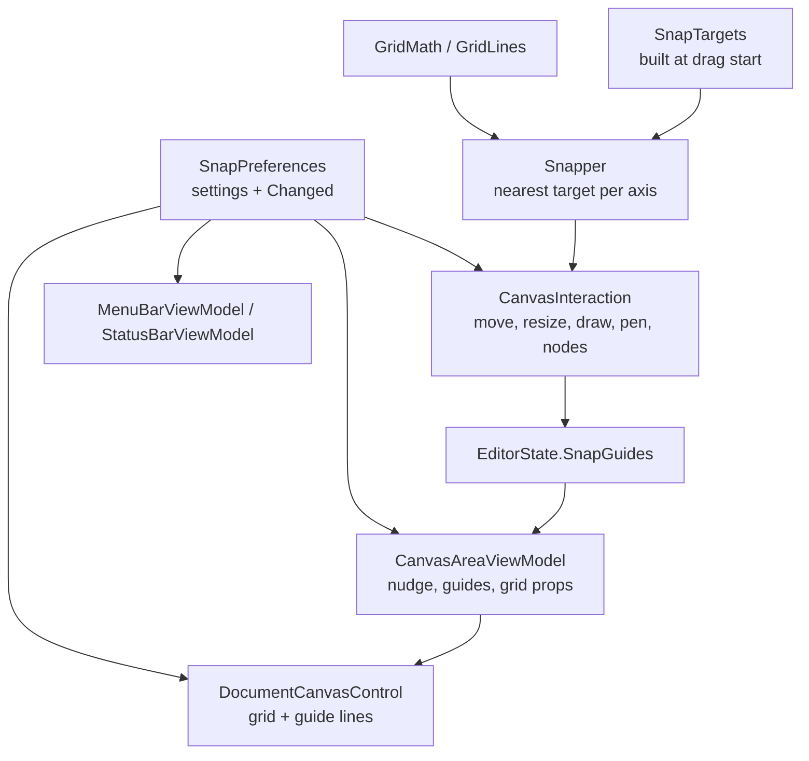

# Design Document

## Overview
A pure snapping core in `Workspace/` (grid math, target collection, nearest-target search, grid line thinning), a settings object that wraps the settings file, and thin wiring into the existing drag code of `CanvasInteraction`, the key handler of `CanvasAreaViewModel`, `DocumentCanvasControl` (grid and guide lines), the desktop View menu and both status bars. Nothing in `PressToShape.Core` changes and the document format does not change.

## Steering Document Alignment

### Technical Standards (tech.md)
MVVM with CommunityToolkit.Mvvm, logic outside views, no new NuGet packages, translations in `de.po`, colors only in `Styles/Theme.axaml`.

### Project Structure (structure.md)
Everything is in `PressToShape.App` (`Workspace/`, `Settings/`, `ViewModels/Editor/`, `Views/`, `Controls/`, `Styles/`). Dependencies stay `Desktop/Android -> App -> Core`.

## Code Reuse Analysis

### Existing Components to Leverage
- **`ISettingsStore` / `AppSettings` / `JsonFileSettingsStore`**: new nullable fields are added to `AppSettings`. `RecentFiles` is the pattern: load, change one field, save, raise `Changed`, treat the stored value as untrusted.
- **`CanvasInteraction` and its partials**: the drag code already computes every move from the state at the press (`_startShapes`, `_startDocument`). Snapping adjusts the pointer position or the delta before that computation, so the "no drift" and "one undo step" behavior is kept.
- **`Shape.RotatedBounds`, `SelectionQueries.SelectedLeaves`, `SelectionGeometry.FrameOf`, `PathShape.ToDocumentNodes`**: boxes and nodes of targets and candidates.
- **`EditorState` (`Draft`, `PenOverlay`, `IsDragInProgress`)**: `SnapGuides` is added next to them in the same style.
- **`CanvasAreaViewModel` overlays and `NotifyOverlayChanged`**: guide lines follow the pattern of `PenOverlay` (document units in the state, screen units in the view model).
- **`MenuItemViewModel.Item(... isChecked)`/`Checkable`, `ZoomViewModel`, `StatusBarViewModel`**: menu check state and status bar toggles.
- **`NumberFieldViewModel` and `NumberFieldBehavior`**: the spacing field.
- **`RulerControl`/`CanvasAreaView.ShowRulers`**: already a styled property, only the binding is missing.

### Integration Points
- **Settings file**: five new optional entries (see Data Models). Unknown entries are still kept.
- **`CanvasAreaView.axaml.cs`**: passes the Ctrl state (`suspendSnap`) with every pointer event, like it passes Shift and Alt.

## Architecture



### Modular Design Principles
- `Snapper`, `SnapTargets`, `GridMath`, `GridLines` are pure static or immutable types with no Avalonia and no `EditorState`: tested alone.
- `SnapPreferences` is the only class that touches the settings store.
- Interaction code only calls `Snapper` and publishes guides. Drawing code only draws what it is given.

## Components and Interfaces

### `SnapPreferences` (`Workspace/SnapPreferences.cs`)
- **Purpose:** the five settings with validation and persistence. `ShowGrid`, `SnapToGrid`, `SnapToObjects`, `GridSpacing` (1 to 1000, default 10), `ShowRulers` (nullable stored value, the default comes from the layout).
- **Interfaces:** the properties with setters that validate, save and raise `Changed` (`EventHandler`). `SnapPreferences(ISettingsStore store, bool defaultShowRulers, bool persist = true)`.
- **Dependencies:** `ISettingsStore`.
- **Reuses:** the `RecentFiles` pattern (load first, change one field, save, so other entries survive). A damaged value falls back to the default (R1.3). A setter with an invalid spacing keeps the old value.
- Created once in `EditorShellViewModel` from `services.Settings` and shared by `EditorState.Snapping` (a property with an in-memory default so existing tests need no store), the menu, both status bars and the canvas view model. Changing a value does not touch the document or the history (R1.5).

### `GridMath` (`Workspace/GridMath.cs`)
- `double Nearest(double value, double spacing)`, `double NextLine(double value, double spacing, int direction)` (the next line strictly beyond the value in that direction, one full spacing when the value is already on a line, with a small epsilon so floating point noise does not skip a line), `double NudgeDelta(double edge, double spacing, int direction, int steps)` for the arrow keys.
- Results are `Math.Round(index) * spacing`, never accumulated (R4.4).

### `GridLines` (`Workspace/GridLines.cs`)
- `GridLines.Build(double spacing, double zoomPercent, double visibleLeft, double visibleTop, double visibleRight, double visibleBottom)` returns the vertical and horizontal line positions in document units. It picks the smallest multiplier n from 1, 2, 5, 10, 20, 50, 100 ... whose line distance is at least 8 screen pixels, and returns only the lines in the visible range (R3.5, performance: at most about canvas size / 8 lines per axis).
- The control converts them with `CanvasMapping.ToScreen`.

### `SnapTargets` (`Workspace/SnapTargets.cs`)
- **Purpose:** the X values and Y values of every target, each with its type (box edge, box center, path node, artboard, grid), sorted arrays so a lookup is a binary search.
- `static SnapTargets Collect(Document document, IReadOnlySet<Guid> excluded, IReadOnlyList<DocumentNode>? extraNodes, IReadOnlySet<NodeRef>? skippedNodes)`.
- Walks layers (visible only), shapes (visible only), recursing into groups. For every visible shape that is not excluded it adds `RotatedBounds` edges and center, and for a path every anchor node (`ToDocumentNodes`, which already includes rotation). A group adds its own box and its children are visited too (R5.6). The artboard adds its four edges and the two center lines (R5.8). Locked shapes count, hidden ones and hidden layers do not (R5.5).
- Built once at the press of a drag, not at each move (performance requirement). Not built when Snap to Objects is off.
- Targets inside the dragged selection are left out through `excluded`: the ids of the dragged leaves and every group that contains one of them (that group's box moves with the drag). The other members of that group are not excluded and stay targets (R5.6).
- For node drags, `excluded` holds the shape ids being edited, but their anchor nodes that are not dragged are added back through the node list (R8.3). The same goes for the nodes already placed by the Pen (R7.2).

### `Snapper` (`Workspace/Snapper.cs`)
- **Purpose:** find the correction for one drag.
- `SnapResult Snap(IReadOnlyList<double> xCandidates, IReadOnlyList<double> yCandidates, SnapTargets? targets, SnapSettings settings, double zoomPercent)` where `SnapSettings` is a small record (`SnapToGrid`, `SnapToObjects`, `GridSpacing`).
- Per axis: tolerance is `8 / (zoomPercent / 100)` document units. It looks for the nearest object target for each candidate, then, only if none is in range and Snap to Grid is on, the nearest grid line of each candidate. The candidate-target pair with the smallest distance wins. The result is the offset on each axis (0 if nothing snapped) and the list of `SnapGuide` (`Axis`, `Position`, `Start`, `End` in document units) for the object targets that were hit. Grid hits give no guide (R5.3, R5.4).
- Guard: a non-finite input or `zoomPercent <= 0` returns no snap (NaN safety).
- `static IReadOnlyList<double> MoveCandidatesX(Bounds)` and similar helpers give left, center and right.

### Wiring in `CanvasInteraction`
- A new `SnapSession` field (`SnapTargets?` plus the guide list) is created in `BeginDrag` and the node and Pen starts, and dropped in `EndDrag` and `Abort`. `EditorState.SnapGuides` is cleared in `EndDrag`, `Abort` and `Cancel` (R5.4, R6.6, R8.4).
- All pointer methods get a `bool suspendSnap = false` parameter, put after `alt`. When it is true no snapping is applied and no guides are shown (R10).
- **Move (R6.1):** candidates are left, center, right and top, center, bottom of the union of `RotatedBounds` of the start leaves. The offset from `Snapper` is added to the pointer delta before `SelectionTransforms.Move`.
- **Resize (R6.2, R6.3):** only when `_startFrame.Rotation` is 0 (within 1e-9). The candidates are the moving edges of the handle (the dragged side or sides) and the snapped pointer position replaces the raw pointer in `SelectionTransforms.Resize`. With keep proportions, only the axis with the smaller snap distance is snapped and `Resize` derives the other. A rotated frame does not snap.
- **Rotate (R6.4):** unchanged.
- **Drawing (R7.1):** the press position is snapped at `BeginDrag` (so `_startX/_startY` hold the snapped value) and the pointer is snapped in `PointerMoved` and `PointerReleased` before `CreateShape`. Shift (square) and Alt (center) are applied after snapping (R7.4).
- **Pen (R7.2, R7.3):** `PenPressed` first runs the finish/close tests with the raw position and distances, as today. Only when the press adds a node is the node placed at the snapped position, so `PenDrawing.Press` gets a second pair of parameters (`nodeX`, `nodeY`) for the placement. `PenMoved` snaps the dragged handle end and the hover position. The nodes already placed are extra targets.
- **Nodes (R8):** `ShowNodeDrag` snaps the grabbed node (the one under the press, `_nodeHit`) or the handle end (`MovedHandle` target) and applies the resulting offset to all dragged nodes (R8.2). The Shift axis lock stays and is applied after snapping. Bending a segment does not snap (not in the requirements).
- **Nudge (R9):** in `CanvasAreaViewModel.OnKey`, when Snap to Grid is on, the delta is `GridMath.NudgeDelta` for the top-left corner of the selection bounds (shape selection) or of the selected nodes' bounds (node selection), with `steps = 1` and `10` for Shift. When Snap to Grid is off the old step of 1 or 10 is used. The existing `Nudge` methods and their history merging stay.

### `EditorState` additions
- `Snapping` (`SnapPreferences`), `SnapGuides` (`ImmutableArray<SnapGuide>`, `[ObservableProperty]`).

### View models
- `CanvasAreaViewModel`: exposes `ShowGrid`, `GridSpacing`, `ShowRulers` (forwarded from `Snapping`, raising `PropertyChanged` on `Snapping.Changed`) and `SnapGuidesOnScreen` (document guides converted with `CanvasMapping`).
- `MenuBarViewModel`: the three items and "Show Rulers" become checkable items (`isChecked` reading `Snapping`) with toggle commands. The Alt-key underscores and their uniqueness in the View menu are kept (`TranslationConsistencyTests`).
- `StatusBarViewModel`: `ShowGrid`, `SnapToGrid`, `SnapToObjects` as toggle commands and `GridSpacingField` (a `NumberFieldViewModel`, 1 to 1000). `Snapping.Changed` raises `PropertyChanged`, so the menu and the status bar always agree (R2.4).

### Views
- `TabletStatusBarView.axaml`: left of the zoom controls, three icon toggle buttons (grid, snap to grid, snap to objects) with tooltip and accessible name, plus a spacing flyout attached to the grid button. Sizes follow `TouchSizes`.
- `StatusBarView.axaml` (desktop): the same three toggles and the field, small size.
- `CanvasAreaView.axaml`: `ShowRulers` bound to the view model (the tablet keeps its default of hidden through the default passed to `SnapPreferences`, the `ShowRulers="False"` in `TabletShellView.axaml` is removed). `DocumentCanvasControl` gets `ShowGrid`, `GridSpacing`, `GridBrush`, `SnapGuides` and `GuideBrush` styled properties, bound there.
- `DocumentCanvasControl.Render`: the grid is drawn after the artboard and before the shapes, the guide lines last. Both use `GridLines.Build` and `AffectsRender`. Both stay out of SVG export because the export reads the document only (R3.3).

### Styles
- `Theme.axaml` (light and dark): `GridLineBrush`, `SnapGuideBrush`.

### Localization
New texts in `de.po`: the status bar tooltips and accessible names ("Show Grid", "Snap to Grid", "Snap to Objects", "Grid Spacing"), and the existing menu items are already in the file. Mnemonics in the View menu are unchanged.

## Data Models

### `AppSettings` (settings.json), new entries
```
- ShowGrid: bool?          (null = default false)
- SnapToGrid: bool?        (null = default false)
- SnapToObjects: bool?     (null = default false)
- GridSpacing: double?     (null or outside 1..1000 or not finite = default 10)
- ShowRulers: bool?        (null = layout default: true on desktop, false on tablet)
```
Nullable on purpose, so an older or damaged file never breaks loading.

### Snap types
```
SnapSettings(SnapToGrid: bool, SnapToObjects: bool, GridSpacing: double)
SnapGuide(Axis: X|Y, Position: double, From: double, To: double)   // document units
SnapResult(OffsetX: double, OffsetY: double, Guides: IReadOnlyList<SnapGuide>)
```

## Error Handling

### Error Scenarios
1. **Settings file damaged or a value invalid:** `SnapPreferences` uses the default for that value and still starts. No message.
2. **Spacing entry not a number or outside 1..1000:** the field shows the old value again (existing `NumberFieldViewModel` rejection behavior).
3. **Non-finite pointer value, zero zoom, zero-size box:** `Snapper` returns no snap, so no NaN reaches a shape.
4. **Settings cannot be saved:** the store ignores the failure, the setting applies to this session (existing store contract).
5. **Document changes during a drag (undo through the keyboard):** the session targets are dropped at `EndDrag`/`Abort`, as the drag already ends there.

## Testing Strategy

### Unit Testing
- `GridMathTests`: nearest, next line from on-line and off-line values, negative values, steps, no drift over many calls.
- `GridLinesTests`: thinning steps at several zooms, visible range only, line count bound.
- `SnapTargetsTests`: visible/hidden/locked, groups and their members, excluded ids, rotated bounds, path nodes, artboard, extra nodes.
- `SnapperTests`: tolerance at several zooms, object beats grid, per-axis independence, nearest wins, guides only for object hits, NaN and zero zoom.
- `SnapPreferencesTests`: defaults, round trip with a fake store, damaged values, unknown entries kept, `Changed` raised, invalid spacing rejected.

### Integration Testing
- `CanvasInteraction` tests with a fake `SnapPreferences`: move, resize (rotated frame does not snap), draw, Pen (close and finish win over snapping), node drag, Ctrl suspends, guides cleared on release and on cancel, one undo step each.
- `CanvasAreaViewModel` tests: grid nudge with and without Shift, no change with Snap to Grid off, merged history step.
- View model tests: menu check state and status bar toggles agree; `Snapping.Changed` raises the right properties.
- `TranslationConsistencyTests` for the new texts.

### End-to-End Testing
- A headless `DocumentCanvasControl` test: grid drawn only with ShowGrid, guide lines drawn, nothing drawn without a document.
- Manual run on desktop (drag a rectangle to a grid line and next to another shape, Ctrl suspend) and on the tablet over `adb` (status bar toggles, spacing field with the keyboard, touch drag), with a device report.

## Decisions Confirmed During Design (owner)
- Grid lines are thinned to at least 8 pixels apart, spacing range 1 to 1000.
- Shift+arrow moves 10 grid spacings.
- Rotated selection: a move snaps by the rotated bounds, a resize of a rotated frame does not snap.
- Artboard edges and center are targets under Snap to Objects.
- Arrow nudge puts the top-left corner of the selection box on the grid line.
- Ctrl (not Alt) suspends snapping.

## Alternatives Considered
- **Snapping in the view (control) layer:** rejected. Pointer maths belongs in `Workspace/` where it is testable without UI.
- **Rebuilding targets at each pointer move:** rejected for performance with large documents. Targets are built once per drag, which is safe because the non-dragged objects do not change during a drag.
- **Storing the grid in the document:** rejected by the owner (settings only).
