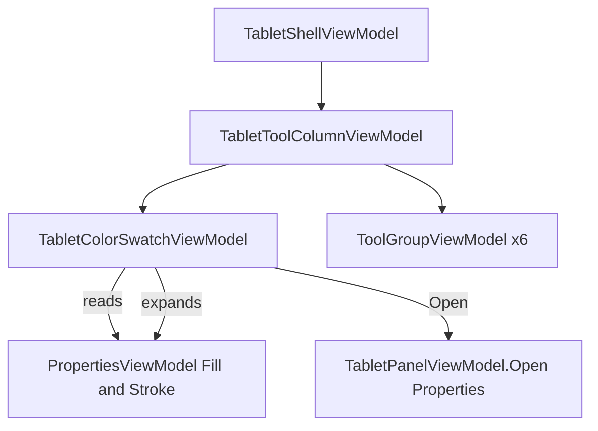

# Design Document

## Overview
In the tablet layout only, the swatch block at the bottom of the tool column (`SwatchesView`: two swatches, swap, reset) is replaced by one small swatch, `TabletColorSwatchView`. It shows the fill (middle) and the stroke (ring) that the Properties panel shows, and a tap opens the Properties panel. The tool column then needs no more width than its icons. Desktop code (`ToolboxView`, `SwatchesView`, `ToolboxViewModel` swatch commands) is not touched.

## Steering Document Alignment
### Technical Standards (tech.md)
- Compiled bindings, `LocalizedViewModel`, no Avalonia types in view models, colors from the theme, sizes from `Theme.axaml`, no new packages.
- Decision 16 (panel floats over the canvas) is kept: the swatch only opens that panel.

### Project Structure (structure.md)
- New files in `ViewModels/Tablet` and `Views/Tablet`. Nothing in `Core`, `Desktop` or `Android`.

## Code Reuse Analysis
### Existing Components to Leverage
- **`PropertiesViewModel.Fill` / `.Stroke` (`ColorFieldViewModel`)**: `HasColor`, `IsMixed`, `Color`, `IsEnabled`. They already show the selection's color or, with nothing selected, the default of the next shape, and they refresh on undo, selection and pipette. The swatch only reads them, so there is one source of truth (R4.2).
- **`CoreColorBrushConverter`** (`Views/Editor`): turns a `Core` color into a brush, used by the Properties view for its swatch.
- **`TabletPanelViewModel`, `InspectorViewModel.ShowTab`**: opening the panel.
- **`PropertiesViewModel.IsAppearanceExpanded`**: expanding the section.
- **`ToolToggleButton` is not used** (the swatch is a plain `Button`): it has no on/off state.
- **`TouchSizes`, `Controls.axaml` button rules, `TabletToolColumnView`** from the earlier specs.

### Integration Points
- `TabletToolColumnViewModel` gets the swatch view model instead of the `ToolboxViewModel` (`Swatches`); `TabletShellViewModel` creates both.

## Architecture

### Components
| Component | Purpose | Reuses |
|---|---|---|
| `ViewModels/Tablet/TabletColorSwatchViewModel` | `FillColor`, `HasFill`, `StrokeColor`, `HasStroke` (mixed counts as none), `Name` (translated, accessible name and tooltip), `OpenCommand` | `ColorFieldViewModel`, `TabletPanelViewModel`, `LocalizedViewModel` |
| `Views/Tablet/TabletColorSwatchView` | A 48 dp `Button`: a ring (stroke) around a fill square, each with a visible outline; empty when none | `CoreColorBrushConverter`, theme brushes |
| `TabletPanelViewModel.Open(InspectorTab)` (new method) | Opens the panel on a tab, or switches to it; does not toggle. `Toggle` calls it. Assets ignored | `InspectorViewModel.ShowTab` |
| `TabletToolColumnViewModel` (changed) | `ColorSwatch` replaces `Swatches` | |
| `TabletToolColumnView` (changed) | Icons and the swatch centered in a narrow column; `SwatchesView` no longer used here | |
| `Styles/Theme.axaml` | `ColorSwatchRingSize` (40) and `ColorSwatchFillSize` (22), used only by the tablet swatch; the `Swatch*` keys of the desktop block and of `TouchSizes` stay (the touch entries for `SwatchAreaWidth`, `SwatchAreaHeight`, `SwatchAreaMargin`, `SwatchSize`, `SwatchButtonSize`, `SwatchIconSize` are removed from `TouchSizes` because nothing uses them with touch any more; the desktop values stay) | |

### The swatch
- Outer ring: a `Border` of `ColorSwatchRingSize`, background and border are the stroke color when `HasStroke`; otherwise transparent with a `BorderStrongBrush` outline. Inner square: `ColorSwatchFillSize`, the fill color when `HasFill`, otherwise `ControlBackgroundBrush` with a `BorderStrongBrush` outline (so "none" is visible in both themes, R1.3, R1.6).
- The inner square has a thin `BorderStrongBrush` outline also with a color, so a white fill is visible on a light theme.
- The button's area is 48 × 48 dp (the touch `Button` rule of the theme and an explicit `MinWidth/MinHeight` from a style of the view, because a `DynamicResource` on the control itself loses against the `Button.icon` style, see `avalonia-mvvm.md`).

### Opening the colors
`OpenCommand`: `panel.Open(InspectorTab.Properties)` and `properties.IsAppearanceExpanded = true`. A tap with the panel already on Properties changes nothing visible except expanding the section (R2.2). The Properties view starts at the top and the Appearance section is the second one: at touch size its fill and stroke rows are visible without scrolling in the 800 dp landscape layout (seen on the tablet). **Scrolling the section into view is not built** (it would need new behavior in the shared Properties view; assumption 2 of the requirements). If the panel is shorter, the user scrolls.

### Width of the column
The width of the column is the widest child. Without the swatch block the widest child is a tool button (48 dp + 4 dp margins) plus the column padding (8 dp each side) and the 1 px border, about 73 dp. To reach "about 64 dp" the touch value of `ToolColumnPadding` changes from `8,8` to `4,8`, which gives about 65 dp. Tool icons, group marks and the swatch are centered with `HorizontalAlignment="Center"`.

## Data Models
None. No stored state.

## Error Handling
1. **Fill or stroke has no color, or the selection is mixed**: shown as empty with an outline.
2. **Nothing selected**: the swatch shows the default color of the next shape (what the Properties fields show); it is enabled (a tap still opens the panel). The Properties fields are what the user edits.
3. **Active tool without an Appearance section**: the panel opens and shows what it shows for that tool (R2.3).

## Testing Strategy
### Unit Testing
- `TabletColorSwatchViewModel`: shows the fill and stroke of a selected shape; the default color with nothing selected; `HasFill/HasStroke` false for none and for mixed fills; follows an undo and a new selection and a color change in the panel (notifications raised); `OpenCommand` opens the Properties panel from closed, from another tab, and keeps it open when already there; expands a collapsed Appearance section; name follows the language.
- `TabletPanelViewModel.Open`: opens, switches, does not toggle, ignores Assets; `Toggle` still works as before.
- `TabletToolColumnViewModel`: has the swatch, no `Swatches`.
- `TouchSizesTests`: the key check (every touch key has a desktop value) still passes after removing touch entries.

### Integration Testing (headless)
- Tool column: no swap/reset buttons; one swatch button of at least 48 × 48 dp; the swatch fill/ring brushes follow the colors; a tap opens the panel on Properties; the column is at most 70 dp wide at touch size and every icon, mark and the swatch are centered; marks still sit on their buttons; the tools and the swatch fit in 700 dp height.
- Shell: the canvas is wider than before by the difference (canvas width equals layout width minus the column width).
- Desktop: the tool column and the swatch block keep their measurements (existing tests).

### Device checks (owner's tablet, `adb`)
Column width, the swatch with a fill and a stroke, tap opens Properties, a color change shows in the swatch, a long press of the tools still works. Left to the owner: how the swatch looks and feels.

## Alternatives considered
- **Two stacked swatches (fill and stroke)**: clearer for editing, but taller and the picker is in the panel anyway. Not chosen by the owner.
- **Remove the color control from the column**: narrowest, but one more tap. Not chosen by the owner.
- **A color picker flyout from the swatch**: a second place to edit colors; rejected as a non-goal (one source in the panel).

## Assumptions / Open questions
1. The ring width and square size are fixed in the theme (40 and 22), chosen for a 48 dp button.
2. Changing the touch `ToolColumnPadding` also affects nothing else (only the tool columns use it); a test checks the touch dictionary stays consistent.
