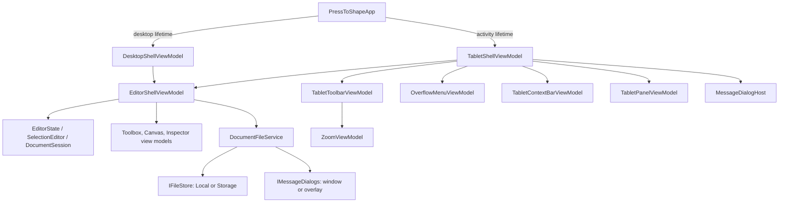

# Design Document

## Overview
The tablet layout is a second composition of the same editor, in `PressToShape.App`. Two things are shared, the rest is new:

- **Shared (reused as is):** `EditorState`, `SelectionEditor`, `DocumentSession`, `DocumentFileService`, `CanvasAreaViewModel`/`CanvasAreaView`, `ToolboxViewModel`/`ToolboxView`, `InspectorViewModel` and every panel view model and view behind it (Properties, Layers, History, Assets).
- **Extracted from the desktop shell, so both shells use one copy:** the code that creates the state, the commands (file, edit, undo, redo) and the shared view models. It moves from `DesktopShellViewModel` into a base class `EditorShellViewModel`.
- **New for the tablet:** `TabletShellViewModel`, the compact toolbar, the overflow menu, the contextual controls bar, the tabbed panel with icon tabs, touch gestures on the canvas, an in-app message dialog (Android has no windows), file access through Android's picker, and the back-button flow.

`PressToShapeApp` still picks the layout from the application lifetime: classic desktop lifetime gives the desktop shell, the Android activity lifetime gives the tablet shell. The Avalonia template leftovers (`MainView`, `MainViewModel`, the single-view branch and their test) are removed, because nothing uses them after this.

## Steering Document Alignment

### Technical Standards (tech.md)
- Avalonia 12, compiled bindings, CommunityToolkit.Mvvm, nullable enabled, xUnit. No new package.
- Touch input (an open decision in `tech.md`) is decided here for finger, stylus and mouse; pressure stays open. Android project setup is already done and now verified on a device. Both are written back into `tech.md` through the steering flow (R14.4).

### Project Structure (structure.md)
- New folders `Views/Tablet` and `ViewModels/Tablet`, as `structure.md` plans. Reusable parts stay in `Views/Editor`, `ViewModels/Editor` and `Workspace`.
- The Android head keeps only startup code. It gets one small addition that is Android-only by nature: the call that finishes the activity (see Leaving the app).
- Dependency direction is unchanged: `Android -> App -> Core`.

## Code Reuse Analysis

### Existing Components to Leverage
- **`DesktopShellViewModel`**: its body (state, session, file service, shared view models, file/edit/undo/redo commands, `FitToWindow`, `ConfirmCloseAsync`) becomes `EditorShellViewModel`. The desktop shell keeps only what is desktop-only (menu bar, toolbar, status bar, zoom and quit commands). Its public surface does not change, so `DesktopShellViewModelTests` stay valid.
- **`StatusBarViewModel`**: its zoom part (zoom text, presets, zoom in/out/fit/set) becomes `ZoomViewModel`, which the status bar and the tablet toolbar both use. Its selection text moves to `SelectionSummaryText`. The status bar forwards to them, so its bindings and tests stay.
- **`MenuItemViewModel`**: the overflow menu is built from the same items and the same message ids as the desktop menus, so no duplicate translations appear. A new `PlainHeader` property gives the header without the Alt-key underscore.
- **`ToolbarButtonViewModel`**: the undo and redo buttons.
- **`PropertiesViewModel` and its `NumberFieldViewModel`s (X, Y, Width, Height, `KeepProportions`)**: the contextual bar binds to the same instances as the Properties tab, so there is one place that applies a transform and one undo step per edit.
- **`MessageDialogViewModel`** (title, message, buttons, `CancelResult`): the in-app dialog uses it unchanged.
- **`DocumentFileService`, `DocumentSession`, `ProjectFile`, `SvgExport`**: unchanged except that the file store becomes asynchronous (see File access).
- **`CanvasInteraction`**: unchanged except the handle hit size (see Touch input).
- **`ViewLocator`**: unchanged. `FooViewModel` in `ViewModels/Tablet` resolves to `FooView` in `Views/Tablet`.
- **`Theme.axaml`, `Controls.axaml`**: extended with a touch-size dictionary and touch control styles. No color is hardcoded.

### Integration Points
- `PressToShapeApp.OnFrameworkInitializationCompleted`: the Android branch builds the tablet shell.
- `PressToShape.Android/MainActivity.cs`: the finish call.
- `TopLevel.BackRequested` (Avalonia): the back button.
- `IStorageProvider` / `IStorageFile` (Avalonia): the Android file picker and file streams.
- `TopLevel.InputPane` (Avalonia): the area the on-screen keyboard covers. The safe area (status bar, navigation bar, cutout) is already handled by Avalonia.

## Architecture



### Modular Design Principles
- One view per view model, each with one job. Shared panels are written once.
- Logic without Avalonia types (gesture tracking, zoom, summary text, dialog host, shell state) lives in view models or `Workspace` and is unit tested. Views only forward events and apply insets.
- No `if (OperatingSystem.IsAndroid())` in shared code. The platform decides through the lifetime and through the services the application class passes in.

### Shell structure (R1, R2)
Tablet shell layout, in a `Grid`: row 0 toolbar, row 1 middle, row 2 contextual bar. The middle row has columns tool column (auto), canvas (`2*`), panel (`*`, min 260, max 360 in dp). The panel keeps its size range, and the canvas takes what is left. Portrait is out of scope (owner decision). The message dialog overlay sits over the whole grid.

```
+--------------------------------------------------------------+
| TabletToolbarView: name*  undo redo   [- 100% + fit]   [...]  |
+------+----------------------------------------+--------------+
| Tool |                                        | TabletPanel  |
| col  |            CanvasAreaView              | (icon tabs,  |
|      |      (touch gestures, no rulers)       |  Properties/ |
|      |                                        |  Layers/...) |
+------+----------------------------------------+--------------+
| TabletContextBarView: 1 selected | X Y W H [lock] | dup del   |
+--------------------------------------------------------------+
```

`CanvasAreaView` shows rulers today. It gets a `ShowRulers` property (default true, the tablet sets false) so one view serves both layouts. This is the only change to its layout.

### Differences from the mockup
- No cloud icon, no back arrow, no share button (export is in the overflow menu), no rulers, no status bar. The selection summary moves to the contextual bar and the zoom to the toolbar.
- The contextual bar holds the transform fields and Duplicate/Delete, not the align and distribute icons, because those features do not exist yet.
- The panel has four tabs as on desktop (Properties, Layers, Assets, History), because that is what the desktop decided. The mockup shows three.

## Components and Interfaces

### `EditorShellViewModel` (new base, `ViewModels/Editor`)
- **Purpose:** everything that both shells need and that today sits in `DesktopShellViewModel`.
- **Interfaces:** `State`, `Editor`, `Toolbox`, `Canvas`, `Inspector`; commands `New`, `Open`, `Save`, `SaveAs`, `ExportSvg`, `Undo`, `Redo`, `Cut`, `Copy`, `Paste`, `PasteInPlace`, `Duplicate`, `Delete`, `SelectAll`, `Deselect`; `FitToWindow()`, `ConfirmCloseAsync()`, `DocumentName`, `IsDirty`, `WindowTitle`; `FileMenuCommands` and `EditMenuCommands` records (moved here from `ViewModels/Desktop`, because both shells use them).
- **Dependencies:** `IAppShutdown`, `ILocalizer`, `FileServices`.
- **Reuses:** all of the current `DesktopShellViewModel` code, moved, not rewritten.

### `ZoomViewModel` and `SelectionSummaryText` (new, `ViewModels/Editor` and `Workspace`)
- **Purpose:** zoom text, presets (10% to 6400%) and the zoom commands, and the "Nothing selected / 1 selected / N selected" text, each in one place.
- **Dependencies:** `EditorState`, `ILocalizer`, the fit callback.
- **Reuses:** the code in `StatusBarViewModel`, moved.

### `TabletShellViewModel` (`ViewModels/Tablet`)
- **Purpose:** root of the tablet layout. Builds `Toolbar`, `OverflowMenu`, `ContextBar`, `Panel` and `Dialogs` on top of `EditorShellViewModel`.
- **Interfaces:** the child properties; `RequestLeaveAsync()`: asks `ConfirmCloseAsync()` and, if it returns true, calls `IAppShutdown.Shutdown()` (R11).

### `TabletToolbarViewModel`, `OverflowMenuViewModel`, `TabletContextBarViewModel`, `TabletPanelViewModel` (`ViewModels/Tablet`)
- **Toolbar:** `DocumentName` with the unsaved marker ("* " prefix, as the desktop title does), `Undo` and `Redo` buttons, `Zoom` (`ZoomViewModel`), `OverflowMenu`.
- **Overflow menu:** a list of `MenuItemViewModel` in groups: file (New, Open, Save, Save as, Export as SVG), edit (Cut, Copy, Paste, Paste in place, Duplicate, Delete, Select all, Deselect), and a Language submenu (the same checkable items as the desktop View menu). Items without a command are disabled by the existing rule. There are no recent-file entries (open question 2).
- **Context bar:** `SelectionSummary` (from `SelectionSummaryText`), the four `NumberFieldViewModel`s and `KeepProportions` from `Inspector.Properties`, and `Duplicate`/`Delete` commands from the shell.
- **Panel:** holds `Inspector`. Its view shows icon tabs bound to `Inspector.SelectedTabIndex` and the same content view models as the desktop inspector. A separate view model exists so that `InspectorViewModel` keeps exactly one view (the project rule).

### `MessageDialogHost` and `OverlayMessageDialogs` (`ViewModels/Tablet`, `Services`)
- **Purpose:** `IMessageDialogs` for platforms without windows. `AvaloniaMessageDialogs` needs `Window.ShowDialog`, which Android does not have.
- **Interfaces:** `MessageDialogHost.Current` (`MessageDialogViewModel?`) and `Task<int?> ShowAsync(MessageDialogViewModel)`. The task completes when the dialog raises `CloseRequested`. `OverlayMessageDialogs` implements `AskUnsavedChangesAsync` and `ShowErrorAsync` on top of it, with the same text and results as the window version.
- **View:** the content of `MessageDialogWindow` moves into a `MessageDialogView` user control. The window hosts it, and the tablet overlay hosts it. No other change to the desktop dialog.
- **Rule:** one dialog at a time. A second request waits for the first.

### Touch input (R8)
- **`TouchGestureTracker`** (`Workspace`, pure logic). Input: pointer id, input type (touch, pen, mouse), position, and down/move/up/cancel. Output: what the canvas view model must do.
  - Mouse and pen: not tracked. They use the existing `PointerPressed/Moved/Released` path, so desktop and mouse-on-tablet behave as before (R8.1, R8.6).
  - First touch: starts the normal pointer path (the active tool acts, R8.1).
  - Second touch while the first is down: `Cancel` the running one-finger action (leaves the document unchanged, R8.4), then start a two-finger gesture.
  - Two-finger gesture: remembers the document point under the starting midpoint and the starting zoom. On each move, zoom = starting zoom × (distance / starting distance), clamped to the zoom range, and the pan is set so the remembered document point stays under the current midpoint. This gives pan and pinch-zoom around the fingers in one rule (R8.2, R8.3).
  - One finger lifts: the gesture ends, the remaining finger does nothing until all fingers are up (no stray stroke). A new touch after that starts again as a first touch.
- **`CanvasAreaViewModel`** gets `TouchPressed/TouchMoved/TouchReleased/TouchCancelled(id, x, y)` that call the tracker and then the existing methods and `EditorState.ZoomAround/PanBy`. The existing mouse methods stay.
- **Abort versus Cancel (found in task 14):** `CanvasInteraction.Cancel()` ends a drag but keeps what it reached: a moved, resized or rotated shape stays where it is and counts as one history step. That is right for a lost pointer capture, but a second finger must undo the action (R8.4). So `CanvasInteraction` gets `Abort()`: it drops the draft and the selection box, and for a move, resize or rotate it puts the document back to the one from the press (`EditorState.Preview` with that document), so nothing is recorded. The canvas view model calls `Abort()` when the tracker asks to cancel the one-finger action. `Cancel()` and its tests stay as they are.
- **`CanvasAreaView`** forwards `e.Pointer.Type` and `e.Pointer.Id` to the right method. Capture is per pointer (today's single `_activeButton` field applies to the mouse only). It is view-only code.
- **Handle hit size:** `SelectionGeometry.HitHandle` gets a hit-size parameter. The canvas passes a larger value when the press came from touch, taken from the touch size (R8.5). Handles are drawn larger on touch as well, so the user sees what they can hit (a size resource in `Theme.axaml`).

### Touch sizes (R9)
- `Theme.axaml` gets a second resource dictionary `TouchSizes` with the same keys as the existing size keys (tool button, field height, row height, swatch area, ...) set to at least 48 dp. `TabletShellView` applies it to its own resources through `TouchSizes.ApplyTo` (Avalonia allows a dictionary only one owner, so it cannot be merged, and its entries are copied instead), so every shared view that uses these keys through `DynamicResource` becomes touch-sized there, and the desktop is unchanged.
- The shared views that today hardcode small sizes (the swatch area, swap and reset buttons in `ToolboxView`, 20 px icon buttons, list rows) are changed to use size keys with their current values as the default. This is a mechanical change with no visible effect on desktop. It is the largest part of the shared-view work, and it is listed per view in the tasks.
- `Controls.axaml` gets `.touch` style rules only where a key is not enough (for example list item padding).

### File access on Android (R10)
Today the pickers return a local path and `DocumentFileService`, `DocumentSession` and `RecentFiles` all work with that string. Android's picker gives no path (`content://...`), so the pickers would return `null` and every pick would act like Cancel.

Design: keep the string, make it an opaque file reference.
- **`StorageFileRegistry`** (`Services`): maps a reference string to a picked file for the lifetime of the app. A picked file is seen through a small `IPickedFile` (name, read stream, write stream) with a thin adapter over Avalonia's `IStorageFile`, because `IStorageFile` cannot be implemented by other code and so could not be faked in tests. A reference has the form `storage:<id>/<file name>`, so the existing "name after the last slash" code (`DocumentSession.DisplayName`, messages) still shows the real file name.
- **`AvaloniaFileDialogs`** gets an optional registry. If the picked file has a local path, it returns the path (desktop and any local file, unchanged). Otherwise, with a registry, it registers the file and returns its reference. Without a registry it behaves as today.
- **References keep their name:** `DocumentFileService` adds `.p2s` or `.svg` to a chosen path that lacks it. It must not do that to a reference, because it would change the reference and the registry could not find the file. `StorageFileRegistry.IsReference` tells the two apart, and the service leaves references as they are (the user chose the name in the system picker).
- **Double extension (found on the device):** the save picker is given the suggested name with its extension and also a default extension. On Android that produced `name.p2s.p2s`. The save call no longer passes a default extension when the suggested name already has it (checked on desktop too, so desktop naming does not change).
- **`IFileStore` becomes asynchronous** (`ReadAllBytesAsync`, `WriteAllBytesAtomicAsync`), because stream access to a picked file is asynchronous and the rules forbid blocking on it. `LocalFileStore` keeps its code and its temporary-file replace. **`StorageFileStore`** reads and writes through the registered picked file's streams. `DocumentFileService` awaits them instead of wrapping them in `Task.Run`, and its tests and fakes change accordingly.
- **Write safety:** the file content is serialized in memory before anything is written, so a serialization error never touches the file. A picked file cannot be replaced through a temporary file (the app has no access to its folder). So the store reads the old content first, writes the new content, and if the write fails it writes the old content back. This is the best the platform allows, see Deviations.
- **Recent files:** references do not survive a restart, so Android keeps none. `RecentFiles` gets a switch that turns its `Add` and `Remove` into no-ops, and the Android services turn it off. The tablet shows no recent list (open question 2, default).
- **Settings file:** the existing `ApplicationData` folder lookup gives the app's own storage on Android. It is checked on the device (R10.6).

### Leaving the app (R11)
- `TabletShellView` (view-only code, like `MainWindow.OnClosing`) handles `TopLevel.BackRequested`: it marks the event handled and calls `TabletShellViewModel.RequestLeaveAsync()`. If there are no unsaved changes this leaves at once (R11.2).
- **Finishing the activity:** `IAppShutdown` gets a delegate-based implementation in App. `MainActivity` (Android head) gives it `Finish`. The wire-up point (a settable member on `PressToShapeApp` that the activity assigns in `OnCreate`) is to be confirmed in the first implementation task by running it on the device, because the exact Avalonia hook is not verified yet.
- The "close from the app itself" case is the overflow menu having no Quit, so only back applies. The tablet has no Quit item on purpose (Android apps do not have one).

### Android system integration (R12)
- **Keyboard (revised after the device spike, see `spike-findings.md`):** the on-screen keyboard does not resize the view, even with the adjust-resize mode. It covers the lower part of the screen and Avalonia reports the covered area through `TopLevel.InputPane` (`State` and `OccludedRect`). So `TabletShellView` listens to `InputPane` (view-only code) and adds a bottom margin equal to the covered height while the keyboard is open, so the panel and the context bar stay above it (R6.5). `MainActivity` is not changed for this. It already declares `ConfigurationChanges` for orientation and screen size, so rotation does not recreate the activity and the document is kept (R12.2).
- **Safe area (revised after the device spike):** Avalonia already keeps the content out from under the status bar and the navigation bar. `TabletShellView` does **not** apply `InsetsManager.SafeAreaPadding` itself, because that would double the offset (R12.1). The device report (task 32) checks that the context bar sits fully above the navigation bar.

## Data Models
No document or file format change. New plain types:

```
TouchGestureTracker (Workspace)
- state: None | OneFinger(id) | TwoFinger(id1, id2) | WaitingForRelease
- pointers: id -> (x, y)
- startZoom, startDistance, anchorDocumentX, anchorDocumentY   // two-finger gesture
StorageFileRegistry (Services)
- map: reference string -> IPickedFile
```

## Error Handling

### Error Scenarios
1. **Picked file cannot be read or is not a valid drawing (R10.4).** `DocumentFileService` shows its existing error text through the overlay dialog and leaves the open drawing unchanged. Same code path as desktop.
2. **Write to a picked file fails (R10.4).** The old content is written back, the existing "could not save" message is shown, and the document stays unsaved.
3. **A reference is unknown** (for example a stale one). The store throws `FileNotFoundException`, which `DocumentFileService` already handles as "file not found".
4. **The picker is not available or fails.** The existing "file dialog could not be used" message appears.
5. **A second finger arrives mid-drag (R8.4).** The running action is cancelled and leaves no change and no history step.
6. **Back is pressed while a dialog is open.** The dialog's Cancel result applies, and the app stays open.

## Testing Strategy

### Unit Testing (xUnit, `PressToShape.App.Tests`)
- `TouchGestureTracker`: first touch, second touch cancels, pinch factor and anchor math, clamping at the zoom limits, lifting one finger, mouse and pen ignored.
- `CanvasInteraction.Abort`: after a draw, move, resize, rotate and box drag the document and the history are as before the press, and `Cancel` still keeps the reached state.
- `CanvasAreaViewModel` touch methods: a one-finger drag draws a shape, a second finger leaves the document and history unchanged, a pinch changes zoom around the midpoint, the handle hit size is larger for touch.
- `EditorShellViewModel` through the existing `DesktopShellViewModelTests`, plus `TabletShellViewModelTests`: child view models share one state, `RequestLeaveAsync` with and without unsaved changes (save, don't save, cancel, save failing).
- `TabletToolbarViewModel`, `OverflowMenuViewModel` (items, enabled state, no recent files, language switch), `TabletContextBarViewModel` (disabled without selection, field edit is one undo step).
- `ZoomViewModel` and `SelectionSummaryText` (moved tests of `StatusBarViewModel` keep passing).
- `MessageDialogHost`/`OverlayMessageDialogs`: results for each button, queueing, close without choice gives Cancel.
- `StorageFileStore` with fake `IPickedFile`s: read, write, write failure restores the old content, unknown reference. `StorageFileRegistry` reference format and file name. `RecentFiles` with the switch off. `LocalFileStoreTests` and `DocumentFileServiceTests` updated for the asynchronous store.
- Existing architecture tests (no Avalonia in view models, no hardcoded colors, translation consistency, mnemonics unique per menu) must pass with the new files. The overflow menu is checked against the mnemonic rule.

### Integration Testing
- Headless UI test (`Avalonia.Headless`) for `TabletShellView`: it builds, binds without binding errors, the overlay dialog shows and closes, and the tabs switch. Touch events are covered in the view model tests because bindings cannot be checked for gestures.
- Application class: the desktop lifetime gives the desktop shell, the activity lifetime gives the tablet shell.

### End-to-End Testing (on the owner's tablet, by me, over `adb`)
Install, start, screenshots, taps and swipes through `adb shell input`, and `logcat` for crashes. Covered this way: R1, R2, R3, R4, R5, R6, R7, R9, R10 (open, save, export through the system picker, settings kept), R11 (back with and without changes), R12 (safe area, keyboard). `adb` can inject only one touch point, so the two-finger gesture (R8.2 to R8.4) and the feel of touch and stylus are checked by the owner. Portrait is out of scope. The result of each check is reported.

## Deviations and Decisions Needing Review
1. **R10.4 is met on a best-effort basis on Android.** A picked file cannot be replaced atomically. The app restores the old content if the write fails. If the process is killed during the write, the file may be left cut short. Alternative: none that keeps "Save" writing to the user's chosen file. Accepted unless you object at approval.
2. **`IFileStore` becomes asynchronous.** This touches the desktop file code and its tests. Alternative: keep it synchronous and block on Android streams, which the project rules forbid.
3. **Base class instead of composition for the shell.** `EditorShellViewModel` is inherited by both shells. Alternative: a shared "shell parts" object that each shell holds and forwards. Inheritance needs far less forwarding code because XAML binds to the commands directly. Trade-off: a base class couples the two shells.
4. **Own gesture tracker instead of Avalonia's gesture recognizers.** The scroll recognizer would take over one-finger drags that must reach the tools. The tracker is pure logic and testable. Trade-off: more code to maintain.
5. **Open questions of the requirements, resolved here:** (1) The Pen and Node tools do not act yet, so there is no path to finish. Shift, Alt and Enter have no touch equivalent in this spec: constrain, add to selection, centered drawing and zoom-out-by-Alt stay desktop-only, and only Delete and Duplicate get buttons. When Pen or Node get behavior, their touch controls belong in that spec. (2) No recent files on Android. (3) Performance by feel on the tablet.
6. **Tabs and no back arrow:** icon tabs follow the mockup, four of them follow the desktop. There is no back arrow in the toolbar; the system back button does that job.
