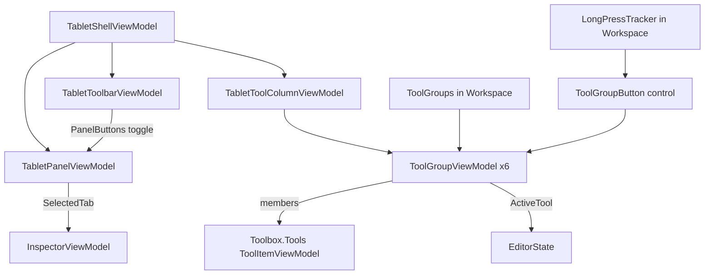

# Design Document

## Overview
Only the tablet shell changes. Three things happen:

1. **Bottom bar removed.** `TabletContextBarViewModel`/`TabletContextBarView` are deleted. Duplicate and Delete become toolbar buttons that use the shell's existing `DuplicateCommand` and `DeleteCommand`.
2. **One tool column with groups.** The tablet gets its own tool column (`TabletToolColumnView`) built from pure group data. The shared `ToolboxView` stays for the desktop, one column as before.
3. **Floating panel.** `TabletPanelViewModel` becomes "which tab is open, if any". Three toolbar toggle buttons open it. The panel is drawn over the canvas (same grid cell, right aligned) instead of in its own column, so the canvas never resizes.

## Steering Document Alignment
### Technical Standards (tech.md)
- Pure logic in `Workspace`, view models without Avalonia types, compiled bindings, `LocalizedViewModel`, all colors and sizes in `Theme.axaml`, no new packages.
- Decision 13 (own gesture logic, pure and tested) is followed again for the long press: a small state machine with explicit timestamps, so tests need no real time.

### Project Structure (structure.md)
- New files go in `Workspace/`, `ViewModels/Tablet/`, `Views/Tablet/` and `Controls/`. Nothing in `Core`, `Desktop` or `Android`.
- Steering text that describes the tablet layout (`product.md` line 26, `structure.md`, `tech.md`) is updated in the last task through the approval flow.

## Code Reuse Analysis
### Existing Components to Leverage
- **`EditorShellViewModel`**: `State`, `Toolbox`, `Inspector`, `DuplicateCommand`, `DeleteCommand`. Unchanged.
- **`ToolboxViewModel` / `ToolItemViewModel`**: `Toolbox.Tools` holds one `ToolItemViewModel` per tool (name, icon, `IsActive`, `SelectCommand`). The group flyout shows these same objects, so there is no second copy of tool state. `SelectToolCommand`, the swatch commands and shortcuts stay as they are.
- **`InspectorViewModel.SelectedTab`**: stays the one place that says which tab is shown. The panel shows `Properties`, `Layers` or `History` content from it.
- **`ToolDefinitions`**: names and icons. Groups refer to tools by `Tool`.
- **`TouchSizes`, `Controls.axaml` `.touch` rules, `FlyoutMaxHeight`, `MessageDialogHost`, `KeyboardInset`**: reused.
- **`NumberFieldBehavior`, `NumberFieldViewModel.Commit()`**: used to apply a field that is still being edited when the panel closes.
- **`TouchGestureTracker` pattern**: pure state machine fed with events and timestamps.

### Integration Points
- `TabletShellView.axaml(.cs)`: new grid, canvas tunnel handler, Back order.
- `ViewLocator`: shows the panel content (Properties, Layers, History view models) through `ContentControl`, as the existing inspector does.

## Architecture


### Tool groups
- `Workspace/ToolGroupDefinition` (record: `IReadOnlyList<Tool> Tools`, first is the default) and static `Workspace/ToolGroups.All` (six entries in the order of R2.1; Text and Eyedropper are one-tool groups) with `ToolGroups.Of(Tool)`. A one-tool group is not marked and has no flyout. Pure, no Avalonia.
- `ToolGroupViewModel` (`ViewModels/Tablet`, `LocalizedViewModel`): `Members` (the `ToolItemViewModel`s), `Current` (starts as the first member), `Icon`, `Name` (of `Current`, translated, also the accessible name), `ToolTip`, `IsGroup`, `IsActive`, `IsFlyoutOpen`. Commands: `SelectCurrent` (tap), `OpenFlyout`, `SelectMember(ToolItemViewModel)` (sets the active tool and closes the flyout). It listens to `EditorState.ActiveTool`: when the new tool is a member, `Current` becomes it and `IsActive` is true, otherwise `IsActive` is false and `Current` stays (R2.8, R2.9). The active tool in `EditorState` remains the only truth.
- `TabletToolColumnViewModel`: `Groups`, `Swatches` (the shared `ToolboxViewModel`, for the swap and reset commands), `HasOpenFlyout`, `CloseFlyouts()`. Opening one flyout closes another.

### Long press
- `Workspace/LongPressTracker` (pure): `Press(x, y, timestamp)`, `Move(x, y)`, `Release()`, `Cancel()`, `Tick(timestamp)` returns whether the long press fires now. It fires once, only while the finger has not moved more than a small distance (slop) and the delay (500 ms) has passed. `ConsumeFired()` tells the control to swallow the click that follows the release, so a long press never also selects a tool (Reliability).
- `Controls/ToolGroupButton` (a `ToggleButton`, view-only): feeds the tracker from pointer events with `Environment.TickCount64`-style timestamps and a `DispatcherTimer` that calls `Tick` while pressed, raises `LongPressed`, and overrides `OnClick` to do nothing after a fired press. Slop and delay are constants of the control (not colors or sizes). The view model has no knowledge of it: the XAML calls `OpenFlyoutCommand` on `LongPressed`.
- The flyout is a `Popup` (`IsOpen` two-way bound to `IsFlyoutOpen`, `IsLightDismissEnabled`, placed to the right of the button). A touch outside closes it and does nothing else (R2.7). Because the open state lives in the view model, Back and tests can close it.

### Panel
- `TabletPanelViewModel(InspectorViewModel inspector)`: `IsOpen`, `OpenTab` (`InspectorTab?`), `Toggle(InspectorTab)`, `Close()`, `Content` (the Properties, Layers or History view model of the inspector, by tab), `Title` (translated). `Toggle` of the open tab closes, of another tab switches; it sets `Inspector.SelectedTab` so the desktop-free state stays consistent. Assets is never offered; `Toggle(Assets)` is ignored.
- `Close()` first applies a field that is being edited: `PropertiesViewModel.CommitPendingEdits()` (new, small: commits each of its `NumberFieldViewModel`s whose `IsEditing` is true). Without it, the typed value could be lost because a field that is hidden does not reliably raise LostFocus (R4.5).
- `TabletPanelView`: a header with the title, then a scrolling `ContentControl` bound to `Content`. `IsVisible` is bound to `IsOpen` (the content stays in the tree, so scroll positions and state survive). Fixed width from the theme key `TabletPanelWidth` (340), right aligned, full height of its cell.
- `TabletShellView.axaml` puts canvas and panel in the same grid cell. A tunnel `PointerPressed` handler on the canvas view calls `Panel.Close()` and does not set `Handled`, so the touch also reaches the canvas (R4.3). Tool column and toolbar touches do not go through that handler (R4.4). A tool flyout opened while a panel is open is above it (popups are on the overlay layer).

### Toolbar
- `TabletToolbarViewModel` gets `DuplicateButton`, `DeleteButton` (`ToolbarButtonViewModel` as for undo and redo) and `PanelButtons` (three `PanelButtonViewModel`s: tab, translated name, icon, `IsActive`, `ToggleCommand`). Order: name, undo, redo, duplicate, delete, panel icons, zoom, overflow.
- Layout columns: name `*` (MinWidth 0, trimmed with an ellipsis) so it gives way first (R5.4); everything else `Auto`.
- Panel icons: Properties `TuneVariant`, Layers `LayersOutline`, History `History` (as the old tabs). Duplicate `ContentCopy`, Delete `TrashCanOutline`.

### Back
`TabletShellView.OnBackRequested` order (R6): (1) a toolbar menu (overflow or zoom flyout) is open → close it (the view tracks `Opened`/`Closed` of its two `MenuFlyout`s, a view-only concern) and stop; else (2) `TabletShellViewModel.RequestBackAsync()` which does: dialog open → dismiss; else tool flyout open → close; else panel open → close; else the existing leave logic (`RequestLeaveAsync`). `RequestLeaveAsync` stays public for the existing tests. This also fixes observation 2 of the device report.

### Sizes and theme
`Theme.axaml` new keys: `TabletPanelWidth` (340), `ToolGroupMarkSize` (7) and the flyout entry height (`ToolFlyoutItemHeight`, 48 in `TouchSizes`). The key `ToolColumns` and its `TouchSizes` entry are removed (the tablet column no longer uses a UniformGrid). The group mark is a small triangle `Path` in `TextSecondaryBrush` at the bottom right of the button.

### Shared swatches
The swatch block of `ToolboxView` is moved into `Views/Editor/SwatchesView` (data context `ToolboxViewModel`) and used by `ToolboxView` and `TabletToolColumnView`. The desktop look does not change. It is declared directly in XAML (not through `ViewLocator`).

## Components and Interfaces
| Component | Purpose | Reuses |
|---|---|---|
| `Workspace/ToolGroupDefinition`, `ToolGroups` | The six groups as data | `Tool`, `ToolDefinitions` |
| `Workspace/LongPressTracker` | Pure press and hold detection | pattern of `TouchGestureTracker` |
| `ViewModels/Tablet/ToolGroupViewModel` | One icon of the column | `ToolItemViewModel`, `EditorState` |
| `ViewModels/Tablet/TabletToolColumnViewModel` | The column | `ToolboxViewModel` |
| `ViewModels/Tablet/PanelButtonViewModel` | A toolbar toggle that opens a panel | `ToolbarButtonViewModel` style |
| `ViewModels/Tablet/TabletPanelViewModel` (changed) | Open tab, toggle, close | `InspectorViewModel` |
| `ViewModels/Tablet/TabletToolbarViewModel` (changed) | Adds Duplicate, Delete, panel buttons | shell commands |
| `ViewModels/Tablet/TabletShellViewModel` (changed) | No context bar, `Column`, `RequestBackAsync` | |
| `Controls/ToolGroupButton` | Long press and swallowed click | `LongPressTracker` |
| `Views/Tablet/TabletToolColumnView`, `TabletPanelView` (changed), `TabletToolbarView` (changed), `TabletShellView` (changed) | | |
| `Views/Editor/SwatchesView` | Shared swatch block | moved from `ToolboxView` |
| `PropertiesViewModel.CommitPendingEdits()` | Apply fields still being edited | `NumberFieldViewModel.Commit` |

Removed: `TabletContextBarViewModel`, `TabletContextBarView` and their tests (the behaviour they tested now lives in the Properties panel, already covered).

## Data Models
```
ToolGroupDefinition { IReadOnlyList<Tool> Tools }          // Tools[0] is the default
ToolGroups.All  = [ [Select, DirectSelect], [Pen, Node], [Text],
                    [Rectangle, Ellipse, Star, Spiral], [Eyedropper], [Hand, Zoom] ]
```
Nothing is stored. The current tool of a group is lost when the app ends (non-goal).

## Error Handling
1. **Press moves before the delay** (a drag over the button): `LongPressTracker` is cancelled, no flyout. The click rules of `ToggleButton` apply.
2. **Document replaced while a panel or flyout is open**: panel content is bound to the inspector view models, which already follow the document, so nothing breaks. Tests cover New while the Layers panel is open.
3. **Flyout open and the layout loses the pointer (window deactivated)**: light dismiss closes it, `IsFlyoutOpen` follows through the two-way binding.
4. **Panel toggle for Assets**: ignored, nothing opens.

## Testing Strategy
### Unit Testing (xUnit, no UI)
- `ToolGroups`: six groups in order, every tool in exactly one group, `Of` for every tool.
- `LongPressTracker`: fires at the delay, not before, not after movement beyond slop, not after release, once only, `ConsumeFired`.
- `ToolGroupViewModel`: starts with the first tool, tap selects the current tool, `SelectMember` selects and closes, an outside change of the active tool updates `Current` and `IsActive` (R2.8, R2.9), the accessible name follows `Current`, a one-tool group has `IsGroup` false.
- `TabletToolColumnViewModel`: one flyout open at a time, `CloseFlyouts`.
- `TabletPanelViewModel`: toggle opens, same icon closes, other icon switches, Assets ignored, `Close` commits an edited field.
- `TabletToolbarViewModel`: Duplicate and Delete enabled only with a selection and act as in the shell; panel button `IsActive` follows the panel.
- `TabletShellViewModel`: `RequestBackAsync` order dialog, flyout, panel, leave.
- Translations: `TranslationConsistencyTests` (the obsolete "… tab" entries are removed from `de.po` if no view uses them any more).

### Integration Testing (Avalonia.Headless, one collection)
- Tablet shell: no bottom bar, no panel at start, canvas width equals the layout width with and without an open panel (R1.3, R4.2).
- Toolbar fits at 1280 and 900 dp, name trimmed first (R5.4).
- A pointer press on the canvas closes the open panel and still reaches the canvas (tool acts) (R4.3).
- `ToolGroupButton`: a short tap selects, a fired long press opens the flyout and swallows the click (driven through the tracker, no real time).
- Touch sizes: every tablet control is at least 48 × 48 dp (extend the existing size test over the new controls).
- Desktop shell unchanged (existing tests plus a check that `ToolboxView` still shows 12 tools in one column).

### Device checks (owner's tablet, `adb`)
Layout, one-finger tap on groups, long press via `adb shell input swipe x y x y 700`, flyout choice, panel open/switch/close, tap on canvas closing the panel, Back order, keyboard with a panel field open. Not possible with `adb` and left to the owner: how the long press and sizes feel, stylus.

## Alternatives considered
- **Avalonia `Holding` event for the long press.** Less code, but its behaviour differs between touch, pen and mouse, and it does not tell us to swallow the click. The own tracker is testable and consistent with decision 13. Recommended: own tracker.
- **Panel docked in a column (push).** Rejected by the owner (floating chosen).
- **Reusing `ToolboxView` for the tablet with a group template.** It would put group logic into a shared view the desktop also uses. A separate tablet column keeps the desktop untouched. Recommended: separate column, shared swatches.

## Assumptions / Open questions
1. The long press delay is a fixed 500 ms and the move tolerance a fixed small distance (about 10 dp), not read from the system.
2. Panel width is fixed at 340 dp (inside the 260 to 360 dp of R4.1). On a window narrower than about 500 dp the panel would cover most of the canvas. The tablet layout is made for 900 dp and wider.
3. The panel has a title row (translated "Properties", "Layers" or "History", existing texts) so the user sees what is open. This is not in the requirements. Say so at approval if it is not wanted.
