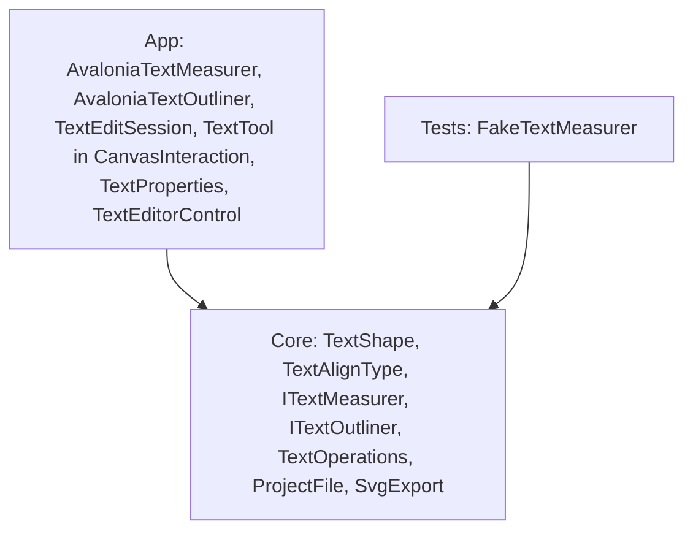

# Design Document

## Overview
Text is a new shape type, `TextShape`, in `Core`. It keeps the content, the type (point or area), the formatting and the usual box, rotation, appearance and flags. `Core` cannot measure text (no Avalonia), so measuring, wrapping and glyph outlines sit behind two small interfaces defined in `Core` and implemented in `App` with Avalonia's text engine. Tests use a fake. On the canvas the text is drawn from its layout; while editing, a borderless `TextBox` is placed over it.

## Steering Document Alignment

### Technical Standards (tech.md)
- Immutable `record` shapes changed with `with`, validated in `init` (same as `Shape`).
- No new NuGet package. Avalonia's own text APIs are used.
- Gettext for all new texts, colors and sizes in `Theme.axaml`.

### Project Structure (structure.md)
- Model, file I/O and SVG in `Core`. Tool logic in `App/Workspace` (pure, testable). Views stay thin; the overlay editor is a control in `App/Controls`.
- Dependencies stay one way: `App -> Core`.

## Code Reuse Analysis

### Existing Components to Leverage
- `Shape` (box, rotation, `Appearance`, flags, `Contains`): `TextShape` derives from it, so move, rotate, group, arrange, lock, hide, duplicate, copy and snapping work through the box without changes.
- `ShapeConversion`, `PathShapeOperations.ConvertToPaths`, `PathShape.Create(subPaths, FillRule)`: Convert to Outlines follows the same pattern.
- `CurveFitting` (`Core/PathOperations`): fallback to turn flattened glyph outlines into curves.
- `ProjectFile`/`ProjectFileDtos`/`ProjectFile.Path.cs`: new `text` shape type next to `rectangle`, `ellipse`, `path`.
- `SvgExport`: new `case TextShape`.
- `Tool.Text` ('T', tablet tool group) and `PropertiesSections.For(Tool.Text)` already exist (UI only); the Text menu entries exist as placeholders.
- `CanvasInteraction` (rectangle drag with `SnapPreferences`), `DoubleTapDetector`, `KeyboardInset` (soft keyboard gap on Android), `EditorState.DefaultAppearance`, `HistoryStepNames`, `NumberFieldViewModel`, `PropertiesViewModel` partials.

### Integration Points
- `SelectionTransforms.ScaleAbout`: a text needs its own rule on resize (below).
- `CanvasScene.ToScreen` / `ScreenShape`: new `ScreenShapeType.Text` and a `ScreenText` payload.
- `DocumentCanvasControl`: draws `ScreenText`.
- `PathShapeOperations.Boolean`/the Path Operations UI: disabled while a text is selected.

## Architecture

Data flow for typing: `TextEditorControl` (TextBox) -> `TextEditSession` (draft content, no history) -> on commit, `TextOperations.SetText` through `DocumentSession` -> one history step -> `CanvasScene` rebuilds with `ITextMeasurer`.

## Components and Interfaces

### Core: `TextShape` (`Core/Shapes/TextShape.cs`)
- **Purpose:** the model.
- **Properties (all validated in `init`):** `Text` (not null, may hold `\n`, at most 100 000 chars), `IsArea` (bool), `FontFamily` (not empty, at most 200 chars), `FontSize` (1 to 2000), `IsBold`, `IsItalic`, `Alignment` (`TextAlignType`: Left, Center, Right), `LineSpacing` (multiplier of the font's line height, 0.5 to 5, default 1), `LetterSpacing` (document units, -50 to 500, default 0).
- **Box:** point text: X, Y is the top left, Width and Height are the measured extent, written by the app after each measure (so selection, snapping, smart guides and hit tests work unchanged). Area text: Width and Height are the box the user dragged; the text wraps at Width and is not clipped.
- `ContainsLocal`: the box. (Hit testing on glyphs is not used; a simple box is what R3.5 needs for both types.)
- **Reuses:** `Shape`, `Guard`.

### Core: `ITextMeasurer` (`Core/Shapes/ITextMeasurer.cs`)
- `TextLayoutResult Layout(TextShape text)`; result: `Lines` (each `LaidOutLine(string Text, double X, double Baseline)` relative to the box top left), `Width`, `Height`.
- Point text: no wrapping. Area text: wrap at `Width`.
- Implemented by `AvaloniaTextMeasurer` (App, wraps `TextLayout`) and `FakeTextMeasurer` (tests, fixed glyph width and line height).

### Core: `ITextOutliner` (`Core/Shapes/ITextOutliner.cs`)
- `IReadOnlyList<SubPath>? Outline(TextShape text)`: closed glyph contours in document coordinates, `null` when the font gives no outlines.
- Implemented by `AvaloniaTextOutliner`. It builds the geometry with Avalonia (`FormattedText.BuildGeometry`) and reads the figures. If the geometry type does not expose curve segments, it flattens it and uses `CurveFitting` to rebuild curves. This is the one technical unknown, so the first implementation task is a spike with a test on a bundled font (Inter, already a dependency).

### Core: `TextOperations` (`Core/Documents/TextOperations.cs`)
- `Document Create(Document, TextShape, layerIndex)`, `SetText`, `SetFormat(ids, TextFormatChange)` (nullable fields, applies only the ones set), `Resize` rule helpers, `ConvertibleTextIds`, `ConvertToOutlines(document, ids, outliner)`.
- `ConvertToOutlines` replaces each text in place (same id position, z-order, appearance, flags) with one compound `PathShape` (even-odd, so counters are holes). Empty text, `null` outline or more than `PathShape.MaxSubPaths` contours: the text is skipped and not listed as convertible.
- All results are new `Document` values, like the other operation classes.

### Core: file and SVG
- `ProjectFile`: shape type `"text"`; DTO fields `Text`, `IsArea`, `FontFamily`, `FontSize`, `Bold`, `Italic`, `Align` (`"left"|"center"|"right"`), `LineSpacing`, `LetterSpacing`. Missing numeric fields on a text use the defaults; unknown alignment or out-of-range values give `ProjectFileError.InvalidValue`. Files without text load as before. An older app reading a file with text reports its existing unknown-type error.
- `SvgExport.ToUtf8(document, ITextMeasurer measurer)`: a text becomes `<text>` with one `<tspan x=... y=...>` per measured line, `font-family`, `font-size`, `font-weight`, `font-style`, `text-anchor` (the line x follows the alignment), `letter-spacing`, fill, stroke, opacity and `transform="rotate(...)"` like the other shapes. Content and font name are XML-escaped; spaces are kept with `xml:space="preserve"`. Hidden shapes are skipped as today. The measurer parameter is required (the one caller in `App` passes the Avalonia one). Wrapped lines are written as measured on this machine, so another viewer shows the same breaks.

### App: tool and interaction (`Workspace`)
- `TextTool` logic as `CanvasInteraction.Text.cs` (partial, like `.Pen`, `.Nodes`): press on empty canvas starts a click-or-drag; below a small drag threshold it is a point text, above it an area text (box snapped like the rectangle). Press on a text with the Text tool or double-click/double-tap with Select enters editing of that text. A locked or hidden text is not edited.
- `TextEditSession` (pure): holds the edited id, the draft content and the "created by this session" flag. `Commit()` returns the final content or "remove" (empty and created in this session, or empty at commit time per R1.3); `Cancel`/Escape commits, it does not discard.
- Resize rule (`SelectionTransforms`): a point text scales its `FontSize` and `LetterSpacing` by the height ratio of the resize, then is re-measured; an area text only changes its box. Groups scaled with texts inside apply the same rule per text.
- Format changes and "last used text values" live in `EditorState` (`TextDefaults`), so the next new text and the Text-tool properties use them (R4.2).
- Boolean operations: the enabled check for the Path Operations section also returns false when any selected leaf is a `TextShape`.

### App: drawing and editing (`Controls`, `Workspace`)
- `CanvasScene` builds a `ScreenText` (lines with screen positions, font, size and spacing in screen pixels, alignment) from `ITextMeasurer`, and a `ScreenShapeType.Text` shape. `DocumentCanvasControl` draws it with `FormattedText`/`TextLayout`, fill and stroke (stroke via the text geometry).
- `TextEditorControl`: a borderless, transparent `TextBox` in the canvas overlay layer, positioned at the text's screen box, with `RenderTransform` for zoom and rotation, and `FontFamily`, `FontSize`, `FontWeight`, `FontStyle`, `TextAlignment`, `LineHeight`, `LetterSpacing` set from the model. While it is shown the canvas does not draw that text (no double image). It supplies caret, selection, clipboard, IME and the Android soft keyboard; `KeyboardInset` already keeps the layout above the keyboard (R8.3). It takes keyboard focus, so tool and delete shortcuts do not fire (R2.6).
- Point text grows as the user types: after each change the control asks `ITextMeasurer` for the size and resizes itself.

### App: properties and menus
- `PropertiesSections`: `Tool.Text` and a selected text show a new `PropertiesSection.Text` (font family drop-down, size, bold and italic toggles, alignment, line spacing, letter spacing) together with Appearance. `PropertiesViewModel.Text.cs` (partial) uses `NumberFieldViewModel` for the numbers, shows "mixed" for differing values and applies a change to all selected texts as one history step (R4.3 to R4.5).
- Font list: `FontManager.Current.SystemFonts` through a small `IFontCatalog` so the view model is testable. A saved font that is not in the list is shown as "Name (not installed)" (R5).
- The Text menu items (placeholders today) call the same commands; "Convert Text to Path" calls `TextOperations.ConvertToOutlines`.
- `HistoryStepNames`: "Create Text", "Edit Text", "Format Text", "Convert Text to Path".

## Data Models

```
TextShape : Shape
- Text: string
- IsArea: bool
- FontFamily: string
- FontSize: double            // 1..2000
- IsBold, IsItalic: bool
- Alignment: TextAlignType    // Left | Center | Right
- LineSpacing: double         // 0.5..5, multiplier
- LetterSpacing: double       // -50..500

TextLine(Text: string, X: double, Baseline: double)
TextLayoutResult(Lines, Width, Height)
TextFormatChange(FontFamily?, FontSize?, IsBold?, IsItalic?, Alignment?, LineSpacing?, LetterSpacing?)
ScreenText(Lines, FontFamily, FontSize, IsBold, IsItalic, Alignment, LetterSpacing)   // App
```

## Alternatives and Decisions
- **Measuring in Core vs. behind an interface (chosen):** an interface keeps `Core` UI-free and tests deterministic (R: reliability). Cost: callers pass a measurer (`SvgExport`, scene).
- **Edit surface (decided by the owner):** overlay `TextBox` over a custom caret. Risk: small differences in line breaks between the TextBox and the canvas drawing. Mitigation: the same font settings and the same width are used, and after commit the canvas layout is the truth.
- **Convert to Outlines output:** one compound even-odd path per text, not one path per glyph, so Unite/Subtract treat it as a single object. Not asked, because it follows the existing compound-path model; tell me if you prefer per-glyph paths.
- **Hit testing:** box only, not glyph shapes.

## Error Handling
1. **Font not installed:** the name is kept; Avalonia falls back for drawing; the font control marks it (R5).
2. **Measurer cannot lay out (exception from the text engine):** the scene draws the text with the stored box and no lines; the error is not shown to the user, the document is not changed.
3. **Invalid number in a field:** the field shows an error, the document is unchanged (existing `NumberFieldViewModel` behavior).
4. **Invalid text data in a file:** `ProjectFileError.InvalidValue`, shown by the existing open error dialog.
5. **No outlines / too many contours:** Convert to Path is disabled for that text.
6. **Content too long (more than 100 000 chars) on paste:** the paste is cut at the limit.

## Testing Strategy

### Unit Testing (`Core.Tests`)
- `TextShape` validation and `with`; `ContainsLocal` with rotation; `TextOperations` (create, set text, format change on several shapes, convert with a fake outliner, skipped cases); `ProjectFile` round trip, defaults, invalid values, file without text; `SvgExport` with `FakeTextMeasurer` (lines, anchor, escaping, hidden, rotation).

### Unit Testing (`App.Tests`)
- `TextEditSession`; `CanvasInteraction` text tool (click, drag threshold, snapping, re-enter, empty removal, locked); resize rule; `PropertiesSections` (the existing every-tool test); properties view model (mixed values, invalid input, one history step, missing font); `CanvasScene` text mapping; boolean disabled with text; `de.po` entries (`TranslationConsistencyTests`).

### Integration / headless
- `AvaloniaTextOutliner` and `AvaloniaTextMeasurer` with the bundled Inter font (outline of "O" has two contours; "A" is one plus a hole). Headless test of `TextEditorControl` focus and commit. Every class has `[Collection(HeadlessUi.CollectionName)]`.

### Device check (tablet)
- Run on the owner's tablet over `adb`: create, type with the soft keyboard, the keyboard does not cover the text, leave editing hides the keyboard. Report in `.spec-workflow/specs/text-tool/device-report.md`. A pen or finger tap cannot be fully scripted over `adb`, so parts are checked by the owner.

## Out of Scope
See the non-goals in `requirements.md`.
