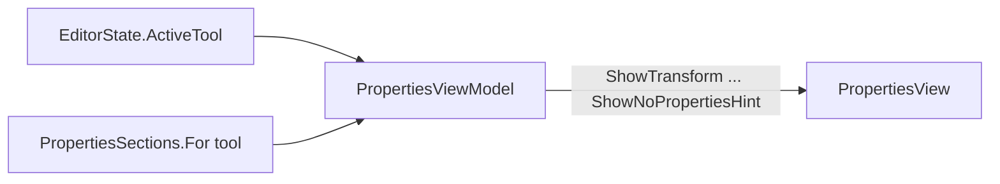

# Design Document

## Overview
The Properties tab shows the sections that belong to the active tool (R1) and a hint when there are none. A pure rule maps a `Tool` to a set of sections. `PropertiesViewModel` exposes one visibility flag per section, refreshed when `EditorState.ActiveTool` changes. The view binds `IsVisible` on each section.

## Steering Document Alignment

### Technical Standards (tech.md)
Compiled bindings, CommunityToolkit.Mvvm, `ILocalizer` and no new packages, as in the rest of the app.

### Project Structure (structure.md)
- Pure logic without Avalonia goes in `Workspace/`.
- View model in `ViewModels/Editor/`, view in `Views/Editor/`. Both are reusable by the later tablet layout.

## Code Reuse Analysis

### Existing Components to Leverage
- **`Tool` (`Workspace/Tool.cs`)** and **`EditorState.ActiveTool`**: the input of the rule and the change notification.
- **`PropertiesViewModel.OnStateChanged`**: already reacts to `EditorState` changes, so one more `case` handles `ActiveTool`.
- **`PropertiesView.axaml`**: the five `CollapsibleSection` elements stay as they are. Each gets an `IsVisible` binding.
- **`Localizer.N` / `{loc:T}`**: the hint text.
- **`CanvasAreaViewModel` / `SelectionOverlay`** already take the active tool from `EditorState`: same pattern, no new service.

### Integration Points
- `EditorState.ActiveTool` (read only). No change to document, history or commands.

## Architecture



### Alternatives
- **A (chosen): flags in the existing `PropertiesViewModel`.** Smallest change. The expanded state of each section (`IsTransformExpanded` ...) already lives there, so it survives hiding (R2.2).
- **B: one view model per section.** Cleaner in the long run but a large refactor of fields, tests and code-behind, and not needed here.
- **C: swap whole templates per tool.** Loses the expanded state and duplicates XAML.

## Components and Interfaces

### `PropertiesSection` (new, `Workspace/PropertiesSection.cs`)
- **Purpose:** `[Flags] enum` with `None`, `Transform`, `Appearance`, `Path`, `Align`, `QuickActions`.

### `PropertiesSections` (new, `Workspace/PropertiesSections.cs`)
- **Purpose:** the mapping of R1.
- **Interface:** `static PropertiesSection For(Tool tool)`.
- **Mapping:**
  - `Select`, `DirectSelect`: Transform | Appearance | Align | QuickActions
  - `Rectangle`, `Ellipse`, `Star`, `Spiral`, `Text`: Appearance
  - `Pen`, `Node`: Appearance | Path
  - `Eyedropper`, `Hand`, `Zoom`: None
- A `switch` expression without a default arm, so adding a `Tool` value is a compile warning (warnings are errors) until the rule is extended.

### `PropertiesViewModel` (changed)
- **New members:** `ShowTransform`, `ShowAppearance`, `ShowPath`, `ShowAlign`, `ShowQuickActions`, `ShowHeader` (any section visible), `ShowNoPropertiesHint` (none visible). All read-only, computed from `PropertiesSections.For(_state.ActiveTool)`.
- **Change:** `OnStateChanged` raises `PropertyChanged` for these members on `EditorState.ActiveTool`.
- **Not changed:** values, commands, undo steps, expansion flags.
- The existing `ShowNothingSelectedHint` is unused by the view and stays untouched.

### `PropertiesView.axaml` (changed)
- `IsVisible` bound on the header `TextBlock` (`ShowHeader`) and on each of the five sections.
- A new `TextBlock` (class `secondary`, wrapping, margin as the Path placeholder) with `{loc:T 'This tool has no properties.'}`, bound to `ShowNoPropertiesHint`.
- No color or size is added, so `Theme.axaml` is untouched.

### `de.po` (changed)
- New entry "This tool has no properties." with the German text.

## Data Models
```
[Flags] enum PropertiesSection { None = 0, Transform = 1, Appearance = 2, Path = 4, Align = 8, QuickActions = 16 }
```

## Error Handling
- Every `Tool` value is covered by the `switch`, so there is no runtime failure path.
- Hidden sections keep their enabled state and bindings. Nothing is detached, so no stale values after the tool changes back.

## Testing Strategy

### Unit Testing
- `PropertiesSectionsTests` (new): one test per row of the mapping, plus a test that every `Tool` value yields a defined result (`Enum.GetValues<Tool>()`). Covers R1.1 to R1.5.
- `PropertiesViewModelTests` (extended), naming `Method_Scenario_Expected`:
  - Changing `EditorState.ActiveTool` raises `PropertyChanged` for the flags and updates them (R1.6).
  - Hint is visible and header hidden for `Hand`, `Zoom`, `Eyedropper` (R1.5, R2.3).
  - Header stays visible for tools with a section (R2.3).
  - Expansion flags keep their values over a tool switch (R2.2).
  - Values and enabled state of fields are the same before and after a tool switch (R2.1).
- `TranslationConsistencyTests` (existing) covers the new `de.po` entry (R2.4).

### Integration Testing
- The existing `SelectionAndPropertiesIntegrationTests` must keep passing unchanged (R2.1).

### End-to-End Testing
- Manual run of the desktop app: click through all tools and compare with the table in R1. Check light and dark theme and the German language.
- No headless UI test: `IsVisible` bindings are covered by the view model tests.

## Assumptions
The assumptions A1 to A3 of the requirements apply unchanged. No new ones.
