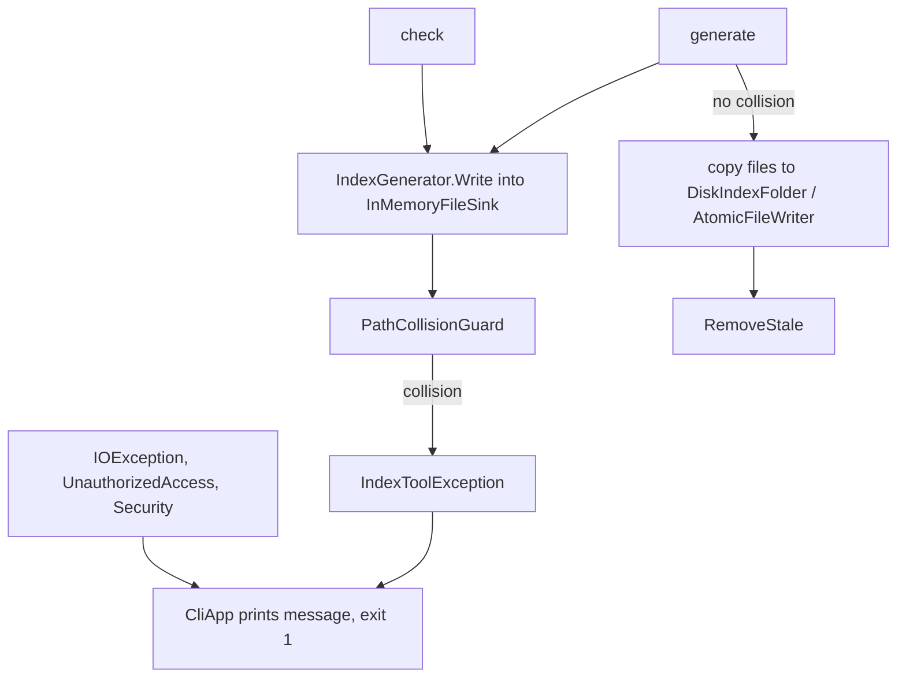

# Design Document

## Overview

Five small, independent fixes in two developer tools (not shipped). The only structural change is in `generate` of the code index: it builds the whole index in memory first, then writes it to disk (R1.3). The other fixes are local.

## Steering Document Alignment

### Technical Standards (tech.md)
No new packages. xUnit tests in the existing tool test projects. File system tests use a unique temporary folder that is deleted afterwards (the pattern of `AtomicFileWriterTests`).

### Project Structure (structure.md)
All changes stay in `tools/PressToShape.CodeIndex`, `tools/PressToShape.CursorImages` and their test projects. No app or `Core` code changes.

## Code Reuse Analysis

### Existing Components to Leverage
- **`InMemoryFileSink`**: already used by `check`. It becomes the single place where a run is collected and checked for collisions, for `generate` and `check` alike.
- **`IndexToolException`**: the existing type for errors the user can fix, printed by `CliApp` without a stack trace.
- **`IndexHints.Regenerate`** and **`PathScrubber.Scrub`**: for the hint text and to keep machine paths out of messages (R5).
- **`AtomicFileWriter.TryDelete`**: already the right pattern for R2. It is copied into `ImageFiles` (the two tools do not share code, and a shared project is not worth it for a 10 line helper).
- **`IndexPath.Normalize`**: the guard compares normalized paths.

### Integration Points
- `IndexGenerator.Write(data, sink)` is unchanged. `CliApp.GenerateAsync` and `CheckAsync` choose the sink.

## Architecture

## Components and Interfaces

### R1 Collision guard (finding 8)
- **`PathCollisionGuard`** (new, `Output/`, `internal sealed`): `Register(string normalizedPath)`. It keeps the paths seen so far in a dictionary with `OrdinalIgnoreCase` keys. A path that is already known (same text or different case) throws an `IndexToolException`: "Two source files produce the same index file: {path} (also {first}). Rename one of the source files and run the command again." The message names the index file paths only; the sink does not know the source files (accepted in the requirements discussion).
- **`InMemoryFileSink.Write`**: normalizes the path, registers it with the guard, then stores the bytes. A second write of the same path no longer overwrites silently.
- **`AtomicFileWriter.Write`**: registers the normalized path with its own guard before it touches the disk, so the rule holds for every `IIndexFileSink` (R1.2). Its `_written` set (exact case, used by `RemoveStale`) is unchanged.
- **`CliApp.GenerateAsync`**: after a successful analysis it runs `IndexGenerator.Write(result.Data, fresh)` into a new `InMemoryFileSink`. Only if that works it copies `fresh.Files` (sorted, so the order is deterministic) to the folder and then calls `RemoveStale`. A collision therefore throws before any file of the existing index is written or deleted (R1.3). `CheckAsync` already builds `fresh` that way. Both share a private helper that builds the in-memory index.
- **Memory:** the index is a few megabytes (11,000 symbols). `check` already holds it in memory, so this is no new limit.
- **R1.5:** the bytes are the same ones as before, so the committed index stays identical. The task `generate` and `check` on the real repository proves it. If an existing writer writes one path twice, the real run fails and shows it, and the task fixes that writer.

### R2 Keep the original error (finding 9)
- **`ImageFiles.WriteAtomic(target, data)`**: the `catch` block deletes the temporary file through a private `TryDelete` that swallows `IOException` and `UnauthorizedAccessException`, then rethrows the original exception with `throw;`.
- **Test seam:** an `internal` overload `WriteAtomic(string target, byte[] data, Action<string> delete)` holds the logic, the public method passes `File.Delete`. A test passes a delete action that throws and makes the move fail by using a target that is a folder.

### R3 Unique temporary names (finding 10)
- **`AtomicFileWriter.Write`**: `temporary = $"{target}.{Guid.NewGuid():N}{TemporarySuffix}"`. The temporary path is never added to `_written`, so `RemoveStale` deletes a leftover from an aborted run (R3.3) and reports it as removed.
- The old fixed `target + ".tmp"` is not used any more, so two writers cannot touch the same temporary file (R3.2).

### R4 Dispose the bitmap on failure (finding 13)
- **`CursorRenderer.Render(icon, size)`**: creates the bitmap, then draws inside `try`. On any exception it disposes the bitmap and rethrows (`throw;`). On success the caller owns the bitmap as before.
- **Test seam:** an `internal` overload `Render(SKPath icon, int size, Action<SKBitmap>? onCreated)` calls `onCreated` right after the bitmap was created (inside the `try`). A test records the bitmap and throws from the hook, then checks that the exception arrives and the bitmap is disposed (`Handle == IntPtr.Zero`). The public method passes `null`.
- **`ImageFiles.Decode`** (the other place that creates a bitmap and can throw before returning it): the `GetPixels` call is also covered, so the bitmap is disposed on an exception and not only on a failed result code (R4.3).

### R5 Friendly file errors (finding 14)
- **`CliApp.RunAsync`**: after `catch (IndexToolException)`, a second catch handles `IOException`, `UnauthorizedAccessException` and `SecurityException` (filter with `when`). It writes `"A file problem stopped the command: {scrubbed message}\n"` to the error writer and returns `Failure`. The message is scrubbed with `PathScrubber.Scrub(message, repoRoot)`; the repository root is the one found by `ResolvePaths`, or the start directory if the failure happens before that.
- `OperationCanceledException` is not caught here (it still reaches `Program.cs`, which prints "Cancelled."). Any other exception also still escapes with its stack trace (R5.4).
- `Program.cs` does not change. All commands, including the query commands, run inside the one `try` of `RunAsync`.

## Data Models

No data changes. No index format or schema change. One new internal class (`PathCollisionGuard`).

## Error Handling

1. **Collision (R1):** `IndexToolException` from the sink before any disk change. `CliApp` prints the message and returns 1.
2. **Disk error while copying the in-memory index to disk (R5):** a partial write is possible (for example the disk is full). It is reported as a file problem. The next `generate` repairs the folder, because it rewrites every file and removes stale ones. This is the same as before for disk errors.
3. **Cleanup failure (R2, R3):** swallowed, the original exception is reported.
4. **Render failure (R4):** the bitmap is freed, the original exception goes on.

## Testing Strategy

Failing test first for each.

### Unit Testing
- **R1** (`tests/PressToShape.CodeIndex.Tests`, new `PathCollisionGuardTests.cs`): different paths pass; the same path twice and a path that differs only in case throw with a message that contains the path; `InMemoryFileSink` and `AtomicFileWriter` (temporary folder) throw on a second write of the same or a case-different path and keep the first content.
- **R1.3** (`CliAppTests`): a harness with two namespaces that differ only in case (`Foo` and `foo`, which both give `symbols/Core/<name>.json`) makes `generate` return 1, print the message, write nothing to the fake folder, call `RemoveStale` zero times and keep the old files. A harness without a collision is unchanged. `check` also reports the collision.
- **R2** (`tests/PressToShape.CursorImages.Tests`): with a failing move and a failing delete the thrown exception is the move exception; with a failing move and a working delete the temporary file is gone; a normal write leaves no temporary file.
- **R3** (`AtomicFileWriterTests`): a file `target.tmp` that exists before the write is neither changed nor removed by the write (the old fixed name would have been replaced); a leftover `target.<guid>.tmp` is deleted by `RemoveStale` and reported as removed; no temporary file remains after a normal write.
- **R4** (`CursorRendererTests`): the hook test above; a normal render still returns a usable bitmap.
- **R5** (`CliAppTests`): a folder whose `Read` or `ListFiles` throws `UnauthorizedAccessException` in `show`, `find` and `check`; an `IOException` from `Write` during `generate`; a `SecurityException`. Each gives exit code 1, a one-line message that starts with "A file problem stopped the command", no stack trace text, and no repository path in the message. `OperationCanceledException` and an `InvalidOperationException` still escape.

### Integration Testing
- On the real repository: `dotnet run --project tools/PressToShape.CodeIndex -- generate` leaves `git status` clean for `docs/index`, and `check` says it is up to date (R1.5).

### End-to-End Testing
- No manual UI test. The nightly and CI are not affected (the index check is not part of CI).
