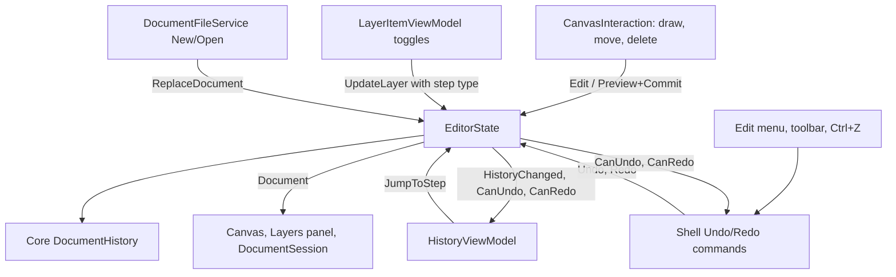

# Design Document

## Overview
Core gets `DocumentHistory`: a list of document snapshots with a current position, plus the type of each step. `EditorState` owns one history and becomes the only place that changes the document: `Edit` records a step, `Preview` and `Commit` let a drag change the document live and record it as one step, `ReplaceDocument` (New and Open) resets the history. Undo, redo and jump set the document from the history. The shell exposes Undo and Redo commands for the menu, the toolbar and the keyboard. A new `HistoryViewModel` replaces the History placeholder and lists the steps. Because documents are immutable and share unchanged layers, a snapshot costs little, and the unsaved-state rule (same instance as the saved one) keeps working without a change.

## Steering Document Alignment

### Technical Standards (tech.md)
- Decides the open item "undo/redo mechanism" in favor of snapshots (owner's choice). History logic lives in Core, UI-free. "All document changes go through commands" becomes "all document changes go through `EditorState.Edit` or the drag pair `Preview`/`Commit`", enforced by an architecture test.
- No new package.

### Project Structure (structure.md)
- Core: `History/` (`PressToShape.Core.History`). App: `Workspace/` (state), `ViewModels/Editor/` (History panel), `ViewModels/Desktop/` (commands, menu, toolbar), `Views/Editor/` (History view). One type per file, `internal` in App.

## Code Reuse Analysis

### Existing Components to Leverage
- **`Document` (Core)**: immutable with structural sharing, so snapshots are cheap and `ReferenceEquals` tells whether anything changed.
- **`EditorState.OnDocumentChanged`**: already repairs the selection and the active layer, so undo and redo need no extra code for R3.3.
- **`DocumentSession`**: compares the editor's document with the saved instance, so undoing back to the saved instance is clean without a change (R4).
- **`CanvasInteraction`**: already has begin and end of a drag in one place (`BeginDrag`, `EndDrag`, `Cancel`).
- **`LayersViewModel`**: the selected-row pattern with a guard flag, reused for the History list.
- **`LocalizedViewModel`, `Localizer.N`, `FakeLocalizer`**: translated step names that follow the language.
- **`ToolbarButtonViewModel`, `MenuItemViewModel`**: get a command-aware enabled state.
- **`DesktopShellViewModel` and its `KeyBindings`**: where the other window-level commands live.

### Integration Points
- **`DocumentFileService`**: New and Open call `ReplaceDocument` instead of setting `Document` (R5).
- **`LayerItemViewModel`**: the toggles pass the step type to `UpdateLayer`.
- **`InspectorViewModel`**: `History` becomes a `HistoryViewModel`.

## Architecture



### Data flow
1. **Draw, delete, toggle:** `State.Edit(type, change)` computes the new document. If it is a different instance, `State.Document` becomes it and `History.Record(type, it)` adds a step. The same instance gives no step (R2.8).
2. **Move drag:** every pointer move calls `State.Preview(document)`, which sets `Document` without a step. When the drag ends (release, capture loss, tool change), `State.Commit(MoveShape)` records the current document against the history. If the document never changed, `Record` sees the same instance as the history's current one and adds nothing (R2.3).
3. **Undo and redo:** `State.Undo()` takes the previous snapshot from the history and sets `State.Document` to it. The state's existing repair keeps or clears the selection and the active layer. `CanUndo`, `CanRedo` and `HistoryChanged` are raised.
4. **Jump:** `State.JumpToStep(index)` moves the history to that index and sets the document (R6.3).
5. **New and Open:** `State.ReplaceDocument(document)` sets the document and resets the history to that single snapshot (R5.1). A failed open never reaches it (R5.2).
6. **While a drag runs:** `CanvasInteraction` sets `State.IsDragInProgress`. `CanUndo` and `CanRedo` are false then, and `Undo`, `Redo` and `JumpToStep` do nothing (R3.5, R6.7).

### Decisions to confirm at review
- **Live drag changes the document without a step.** During a move the document changes on every pointer move (as today), and only the end of the drag records the step. The alternative, a separate draft position for moves like the draft shape for drawing, is a larger change to the canvas and the selection outline for no visible gain.
- **A cancelled move still counts as one step**, because the shape visibly moved (R2.4). A cancelled draw changes nothing and records nothing.
- **Shortcut place:** the new Ctrl+Z, Ctrl+Shift+Z and Ctrl+Y key bindings sit on `DesktopShellView` next to the file shortcuts. They fire only while focus is inside the shell, like the existing shortcuts.

### Modular Design Principles
- Core knows documents and step types, not names or UI. App turns step types into translated names in one table.
- `EditorState` is the only writer of `Document` in production code.

## Components and Interfaces

### Core: `HistoryStepType` (`Core/History/`) — R2
- `enum HistoryStepType { DrawRectangle, DrawEllipse, MoveShape, DeleteShape, HideLayer, ShowLayer, LockLayer, UnlockLayer }`.

### Core: `DocumentHistory` (`Core/History/`) — R1
- `DocumentHistory(Document start, int maxSteps = 100)` (`maxSteps` at least 1).
- `Document Current`, `int CurrentIndex` (0 is the start state, k is the state after the k-th kept step), `IReadOnlyList<HistoryStepType> Steps` (oldest first), `bool CanUndo`, `bool CanRedo`, `int MaxSteps`.
- `bool Record(HistoryStepType type, Document after)`: returns `false` and does nothing if `after` is the current instance. Otherwise drops the redo steps, appends, makes it current, and drops the oldest steps while there are more than `MaxSteps`.
- `Document? Undo()`, `Document? Redo()`: the new current document, or `null` if there was nothing to do.
- `Document? JumpTo(int index)`: the new current document, or `null` if the index is out of range or already current.
- `void Reset(Document start)`: one snapshot, no steps.
- Storage: a list of snapshots (`start` plus one per step) and a list of step types. At most `MaxSteps + 1` documents are kept.

### App: `EditorState` (changed) — R1 to R6
- `DocumentHistory History` (read-only property).
- `void Edit(HistoryStepType type, Func<Document, Document> change)`: sets the document and records the step.
- `void Preview(Document document)`: sets the document without a step. `void Commit(HistoryStepType type)`: `History.Record(type, Document)`.
- `void ReplaceDocument(Document document)`: sets the document and resets the history.
- `void UpdateLayer(Guid, Func<Layer, Layer>, HistoryStepType type)`: calls `Edit` (the existing two-argument form is removed).
- `bool CanUndo`, `bool CanRedo` (history and not `IsDragInProgress`), `void Undo()`, `void Redo()`, `void JumpToStep(int index)`.
- `bool IsDragInProgress` (observable, set by `CanvasInteraction`).
- `event EventHandler? HistoryChanged`, raised after every change of the history. `CanUndo` and `CanRedo` raise `PropertyChanged` when they may have changed (after history changes and when `IsDragInProgress` changes).
- The `Document` setter stays public for tests, but production code outside `EditorState` does not call it (architecture test).

### App: `CanvasInteraction` (changed) — R2, R3.5
- Draw end: `Edit(DrawRectangle or DrawEllipse, d => d.AddShape(...))`, then select as today.
- `DeleteSelection`: `Edit(DeleteShape, d => d.RemoveShape(id))`.
- Move: `Preview` on every move; at the end of the move drag `Commit(MoveShape)`. The final move of a release is applied before the commit.
- `BeginDrag` and `EndDrag` set `State.IsDragInProgress`.

### App: `LayerItemViewModel` (changed) — R2.6
- Toggles call `UpdateLayer` with `HideLayer` or `ShowLayer` (chosen by the current `IsVisible`), `LockLayer` or `UnlockLayer`.

### App: `HistoryStepNames` (`Workspace/`, new) — R2.9
- `static string MessageId(HistoryStepType type)` returns the English text marked with `N(...)`: "Draw rectangle", "Draw ellipse", "Move shape", "Delete shape", "Hide layer", "Show layer", "Lock layer", "Unlock layer". The start row uses "Start".

### App: `HistoryViewModel` and `HistoryItemViewModel` (`ViewModels/Editor/`, new) — R6
- `HistoryViewModel(EditorState, ILocalizer)`: `Items` (start row plus one row per step, oldest first), `SelectedItem` (the current row, two-way with the list; a guard flag as in `LayersViewModel`). Setting `SelectedItem` calls `State.JumpToStep(item.Index)`. After a refused jump (drag in progress) the selection is set back to the current row.
- It rebuilds the items when the sequence of step types changed, otherwise updates `IsCurrent` and `IsRedoable` in place. It listens to `State.HistoryChanged`.
- `HistoryItemViewModel : LocalizedViewModel`: `Index`, `Name` (translated, follows the language), `IsCurrent`, `IsRedoable` (index above the current one).
- Replaces `PlaceholderPanelViewModel` for History in `InspectorViewModel`. The text "No history yet" and its `de.po` entry are removed.

### App: `HistoryView` (`Views/Editor/`, new) — R6
- A `ListBox` bound to `Items` and `SelectedItem`, with an item template: icon (a small dot or arrow in the theme color), name, `AutomationProperties.Name`. Rows with `IsRedoable` get a dimmed look through a style class. Code-behind only scrolls the selected row into view. `ViewLocator` maps `HistoryViewModel` to `HistoryView` by name and folder.

### App: shell, menu, toolbar, keyboard — R3
- `DesktopShellViewModel`: `UndoCommand` and `RedoCommand` (`[RelayCommand(CanExecute = ...)]`) call `State.Undo` and `State.Redo`, and notify `CanExecuteChanged` when `State.CanUndo` or `CanRedo` change. The commands are given to the menu bar and the toolbar.
- `MenuItemViewModel` and `ToolbarButtonViewModel`: `IsEnabled` also follows `Command.CanExecute` and updates on `CanExecuteChanged`.
- `MenuBarViewModel` and `ToolbarViewModel` take the undo and redo commands (a small record like `FileMenuCommands` is not needed: two extra parameters).
- `DesktopShellView.axaml`: key bindings Ctrl+Z, Ctrl+Shift+Z, Ctrl+Y.

## Data Models

```
DocumentHistory (Core)
- snapshots: List<Document>        // [start, after step 1, ..., after step n], at most MaxSteps + 1
- steps: List<HistoryStepType>     // n entries, steps[i] led from snapshots[i] to snapshots[i + 1]
- CurrentIndex: 0..n

HistoryItemViewModel: Index, Name, IsCurrent, IsRedoable
```

## Error Handling
1. **Undo, redo or jump with nothing to do:** return `null` / do nothing, no exception (R1.3).
2. **Invalid jump index (stale row):** ignored, the panel resyncs.
3. **Drag in progress:** undo, redo and jump are refused and shown as disabled (R3.5).
4. **Edit that changes nothing:** no step (R2.8).
5. **Failed open or save:** never touch the history (R4.3, R5.2, R3.6).

## Testing Strategy

### Unit Testing
- **Core `DocumentHistoryTests`:** start state, record, same instance not recorded, undo and redo walk, redo returns the same instance, new edit drops the redo steps, limit (record 150 steps with limit 100: 100 undos possible, 101st does nothing, oldest dropped, memory bound), `JumpTo` forward, back, current, out of range, `Reset`, argument checks, many random sequences of calls never throw and always keep `Current` one of the recorded documents.
- **App `EditorStateTests`:** `Edit` records and sets the document, `Edit` with the same instance records nothing, `Preview` then `Commit` records one step, `Commit` without change records nothing, `Undo`, `Redo`, `JumpToStep` set the document, selection kept when the shape exists and cleared when not, active layer repaired, `CanUndo` and `CanRedo` change with the drag flag, `ReplaceDocument` resets the history, `HistoryChanged` raised, undo while a drag runs does nothing.
- **App `CanvasInteractionTests` (extended):** draw is one step named by tool, a move drag of many moves is one step, a click on a shape without movement and a press on empty space are no steps, cancel and tool change after movement give one step, delete is one step, too-small draw is no step, the drag flag is set and cleared.
- **App `LayersViewModelTests`:** toggles create the four step types.
- **`DocumentSessionTests` (extended):** undo back to the saved instance is clean, redo makes it dirty again, save then undo is dirty.
- **`DocumentFileServiceTests`:** New and Open reset the history, failed and cancelled open keep it, Save and Export keep it.
- **`HistoryViewModelTests`:** rows, names (English and German, follows the language switch), current and redoable flags, select a row jumps, selecting the current row changes nothing, refused jump while dragging resyncs, rebuild when an edit drops redo steps, in-place update on undo.
- **`MenuBarViewModelTests`, `ToolbarViewModelTests`, `DesktopShellViewModelTests`:** Undo and Redo items and buttons enabled and disabled with the history, commands call the state, shortcut commands exist.
- **`AppArchitectureTests`:** no production file other than `EditorState.cs` assigns `.Document =` on an editor state (scans the source text).
- **`TranslationConsistencyTests`** cover the new texts.

### Integration Testing
- A shell-level test draws two shapes through the canvas pointer API, undoes twice, redoes once, jumps to the start, and checks document, layers panel, history rows and the window title's dirty marker.

### End-to-End Testing
- Manual run with screenshots and `xdotool` (as before): draw, move, delete, toggle a layer, Ctrl+Z, Ctrl+Shift+Z and Ctrl+Y, the History tab (current row, dimmed rows, click to jump), Undo and Redo menu and toolbar enabling, undo back to the saved state (title without asterisk), New and Open clearing the history, a long drag as one step.
