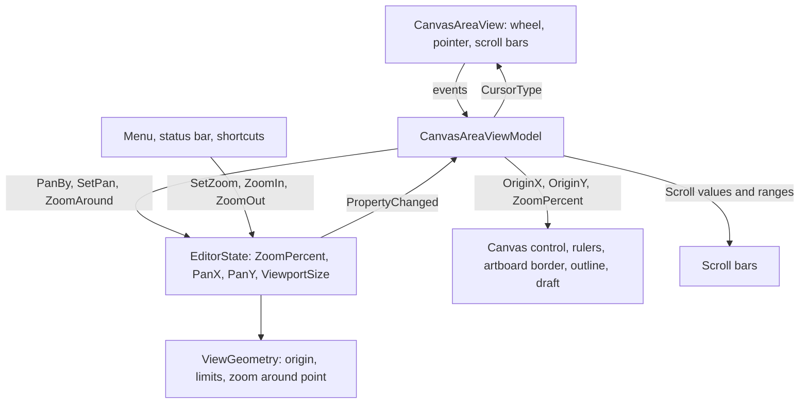

# Design Document

## Overview
The view over the drawing gets two more values in `EditorState`: a pan offset and the size of the canvas area. A pure class, `ViewGeometry`, holds all the math (artboard origin from the offset, the limits of the offset, zoom around a point, the ranges for the scroll bars). Every zoom route goes through one method of `EditorState` that keeps a chosen screen point fixed: the pointer for the wheel and the Zoom tool, the middle of the canvas for the menu, the status bar and the shortcuts. `CanvasAreaViewModel` turns wheel, pan and Zoom tool input into calls on the state, exposes the scroll bar values and the cursor type, and the view only forwards events. Nothing here touches the document or the history.

## Steering Document Alignment

### Technical Standards (tech.md)
- Same stack, no new package. UI logic stays in plain classes so it is unit-tested without Avalonia.

### Project Structure (structure.md)
- `Workspace/` for `ViewGeometry` and the state, `ViewModels/Editor/` for the canvas view model, `Views/Editor/` for the events, scroll bars and cursors. One type per file, `internal` types.

## Code Reuse Analysis

### Existing Components to Leverage
- **`EditorState`**: already owns the zoom and the `IsDragInProgress` flag (which also blocks undo and the History tab, so pan drags get R4.7 for free) and `ZoomToFit`.
- **`ZoomLevels`**: range (10 to 6400), presets for the Zoom tool (`NextIn`, `NextOut`), `Clamp`, `FitToViewport`.
- **`CanvasAreaViewModel`**: already converts screen to document positions with the origin, so drawing, picking and moving follow any offset without change (R1.5). It already owns the viewport size reported by the view.
- **`CanvasMapping`**: the same mapping for drawing and picking.
- **`RulerControl`, `DocumentCanvasControl`, artboard border**: all bind to `OriginX` and `OriginY`, so they move with the view without change.
- **`CanvasAreaView` code-behind**: already forwards pointer, capture and key events.
- **`DesktopShellViewModel.FitToWindow` and the initial fit**: unchanged signature.

### Integration Points
- **`StatusBarViewModel`, menu, shortcuts, zoom drop-down**: call `State.SetZoom/ZoomIn/ZoomOut/ZoomToActualSize`, which become "zoom around the canvas center".
- **`DocumentFileService`** (New, Open): already calls fit, which resets the offset.

## Architecture



### Data flow
1. **Origin:** `OriginX = (ViewportWidth - ArtboardScreenWidth) / 2 + PanX`, the same for Y. This replaces `Math.Max(0, ...)`, so a large artboard is centered with overflow on both sides (R1.3).
2. **Zoom around a point:** `State.ZoomAround(percent, anchorX, anchorY)`. It computes the document point under the anchor, sets the new zoom, computes the offset that keeps that point under the anchor, and limits the offset (R5). `SetZoom`, `ZoomIn`, `ZoomOut` and `ZoomToActualSize` call it with the middle of the canvas area. `ZoomToFit` sets the zoom and the offset to zero.
3. **Wheel:** the view sends delta, modifiers and position to `CanvasAreaViewModel.Wheel`. With Ctrl: zoom factor `1.1^deltaY` around the pointer. Otherwise: offset change of `48 * delta` per axis, Shift moving the vertical delta to the horizontal axis (R3).
4. **Pan drag:** Hand tool with the primary button or the middle button with any tool: `PanBegin`, `PanMove`, `PanEnd`. The pointer position at the start and the offset at the start give the new offset: offset = start offset + (pointer - start pointer), limited. `State.IsDragInProgress` is true during the drag.
5. **Scroll bars:** the view model exposes minimum, maximum and value for each axis. The value is the negated offset, the range is the allowed offset range (R5), and the thumb size comes from the viewport size. Setting the value sets the offset.
6. **Resize:** the viewport size changes `State.SetViewport`, which limits the offset again.

### Decisions to confirm at review
- **Pointer shapes need custom cursors.** Avalonia has no standard open hand, closed hand or magnifier cursor, but R4.5 and R6.3 ask for them. Proposal: render small cursors at startup from the Material icons the tool column already uses (hand, filled hand for "grabbing", magnifier plus), through a `CanvasCursors` class with a fallback to the standard `Hand`, `SizeAll` and `Cross` cursors if a bitmap cannot be created. It is the one part that tests cannot check, only the final run. Alternative: use the standard cursors only, and R4.5 and R6.3 are changed to "pointing hand, move cross and crosshair".
- **The canvas size moves into `EditorState`.** The zoom routes in the menu and the status bar have no access to the canvas size today. `EditorState` gets `ViewportWidth` and `ViewportHeight` (set by the canvas view model), so every zoom route can keep the center fixed in one place.
- **Wheel delta direction follows Avalonia's `ScrollViewer`:** a positive delta (wheel up, or two-finger scroll up) moves the view toward the top or left, as agreed in the requirements. The same code serves mouse wheels and touchpads.
- **Visible change:** a zoomed-in artboard is now centered with overflow on both sides instead of being aligned to the top-left corner. Fit and a smaller artboard look as before.

### Modular Design Principles
- `ViewGeometry` is a static class of pure functions on plain numbers. It has no state and no Avalonia types.
- Events are translated once, in the view model. The view forwards positions, deltas and modifiers.

## Components and Interfaces

### `ViewGeometry` (`Workspace/`, new) — R1, R2, R5, R7
- `const double MinimumVisible = 100`, `const double WheelStep = 48`, `const double WheelZoomFactor = 1.1`.
- `double Origin(double viewport, double artboardScreen, double pan)` = `(viewport - artboardScreen) / 2 + pan`.
- `double PanLimit(double viewport, double artboardScreen)` = `max(0, (viewport + artboardScreen) / 2 - min(MinimumVisible, artboardScreen))`. The offset may be anywhere in `[-limit, limit]`; with an unknown viewport (zero or less) there is no limit and the method returns `double.PositiveInfinity`.
- `double ClampPan(double pan, double viewport, double artboardScreen)`; non-finite input gives the old value (the caller passes it) or zero.
- `double PanAfterZoom(double pan, double viewport, double oldZoom, double newZoom, double artboardDocumentSize, double anchor)`: the new offset that keeps the document point under `anchor` (screen position in the canvas area) at the same place, before clamping.
- `double WheelZoom(double zoomPercent, double deltaY)` = clamped `zoomPercent * 1.1^deltaY`. Ignores non-finite input.

### `EditorState` (changed) — R1, R2, R4, R5
- Observable `double PanX`, `PanY` (screen pixels, default 0), `double ViewportWidth`, `ViewportHeight`.
- `void SetViewport(double width, double height)`: stores the size and limits the offset.
- `void SetPan(double x, double y)`: stores the limited offset. Non-finite values are ignored.
- `void PanBy(double dx, double dy)`.
- `void ZoomAround(double percent, double anchorX, double anchorY)`: clamps the zoom, keeps the anchor fixed, limits the offset. Does nothing if the zoom does not change.
- `SetZoom`, `ZoomIn`, `ZoomOut`, `ZoomToActualSize` and the `ZoomPercent` setter call `ZoomAround` with the center of the canvas area. `ZoomToFit` sets zoom and offset zero.
- None of this raises `HistoryChanged` or changes `Document`.

### `CanvasAreaViewModel` (changed) — R1 to R8
- `OriginX`, `OriginY` from `ViewGeometry.Origin` with the state's offset. `ViewportWidth` and `ViewportHeight` forward to `State.SetViewport`.
- `bool Wheel(double deltaX, double deltaY, bool control, bool shift, double screenX, double screenY)`: returns whether the event had an effect (R3.7). Ignores non-finite values and ignores the event while `State.IsDragInProgress`.
- `PointerPressed(screenX, screenY, bool alt)` (the existing parameters plus Alt): Hand tool starts a pan, Zoom tool zooms one preset in (or out with Alt) around the point, other tools as before. `void MiddlePressed(screenX, screenY)` starts a pan with any tool unless a drag is in progress. `PointerMoved` and `PointerReleased` continue or end the pan. `Cancel` ends it.
- `HorizontalScrollMinimum/Maximum/Value/ViewportSize`, `VerticalScroll...`, `CanScrollHorizontally`, `CanScrollVertically`. Setting a value sets the offset.
- `CanvasCursorType CursorType` replaces `UseCrosshair`: `Arrow`, `Crosshair`, `OpenHand`, `ClosedHand`, `Magnifier`. `ClosedHand` while a pan runs, otherwise by tool.
- Notifications for origin, overlays and scroll values when offset, zoom, viewport or artboard change.

### `CanvasCursorType` (`Workspace/`, new)
- The enum above, with no Avalonia type.

### `CanvasCursors` (`Views/Editor/`, new) — R4.5, R6.3, R8.1
- `static Cursor For(CanvasCursorType type)`: creates and caches the cursors. Renders the Material icon paths (`HandBackLeftOutline`, filled hand, `MagnifyPlusOutline`) to a 32 by 32 bitmap with a light fill and a dark outline so they show on both themes; falls back to `StandardCursorType.Hand`, `SizeAll`, `Cross`. No theme brush is used, since cursors are bitmaps.

### `CanvasAreaView` (changed) — R3, R4, R7, R8
- `PointerWheelChanged` forwards to `Wheel` and marks the event handled if it had an effect.
- `PointerPressed`: left button as before (with the Alt state), middle button calls `MiddlePressed` and captures the pointer. `PointerReleased` accepts left and middle.
- The cursor of the viewport follows `CursorType` through `CanvasCursors` (set from code-behind when the property changes).
- Layout: the grid gets a third row and column. The vertical scroll bar sits at the right of the viewport, the horizontal one below it, a corner in the cell between them. The rulers stay in the viewport's column and row, so their zero stays aligned. Scroll bars bind two-way to the value properties, with `ViewportSize`, `Minimum`, `Maximum`, `IsEnabled`, and translated `AutomationProperties.Name` texts ("Horizontal scroll bar", "Vertical scroll bar"). Scroll bar colors come from the Fluent theme, which follows the app theme variant.

## Data Models

```
EditorState (new members): PanX, PanY, ViewportWidth, ViewportHeight   // not part of the document
CanvasCursorType: Arrow | Crosshair | OpenHand | ClosedHand | Magnifier
```

## Error Handling
1. **Non-finite wheel or pan values (devices):** ignored, nothing changes.
2. **Viewport size zero (not laid out yet):** no limit on the offset, no crash; the first real size limits it.
3. **Pointer capture lost or tool change during a pan:** `Cancel` ends the pan and clears `IsDragInProgress`.
4. **Cursor bitmap cannot be created:** fallback to a standard cursor.
5. **Zoom at its limit:** the wheel or the Zoom tool changes nothing.

## Testing Strategy

### Unit Testing
- **`ViewGeometryTests`:** origin for artboards smaller and larger than the viewport, limit values, small viewports and small artboards (the artboard smaller than 100 px), unknown viewport, zoom around a point keeps the document point (tables over zoom pairs, anchors and offsets), wheel zoom factor, non-finite input, and a seeded random sequence of zoom, pan and resize steps that always keeps R5 true and all values finite.
- **`EditorStateTests` (extended):** `ZoomAround` keeps the anchor within a pixel, center-anchored routes keep the center, limits at the zoom range, offset clamped after `SetPan`, `PanBy`, resize, fit resets the offset, none of it changes the document, the history or the dirty state, notifications.
- **`CanvasAreaViewModelTests` (extended):** origin with offsets, wheel with and without Ctrl and Shift, wheel ignored during a drag, ignored for non-finite values, return value, Hand tool pan (follows 1:1, ends on release and cancel, no shape created), middle pan with any tool, middle press ignored during a drag, Zoom tool click in and out around the point and at the limit, pan blocks undo, scroll bar values, ranges and setting a value, cursor type for every tool and during a pan, drawing and selecting at a non-zero offset and zoom.
- **`DesktopShellViewModelTests`:** menu, status bar and shortcut zoom keep the canvas center, fit resets the offset, New and Open reset it.
- **`TranslationConsistencyTests`** cover the new texts.

### Integration Testing
- A shell-level test pans, zooms with the wheel, draws a shape and checks that it lands under the pointer in document coordinates, then fits and checks the offset.

### End-to-End Testing
- Manual run on the right screen (see the working notes: move the window first): Ctrl+wheel around a point, wheel and Shift+wheel, middle button drag, Hand tool drag, Zoom tool clicks and Alt+click, scroll bars (drag thumb, arrows, track), limits at the edges, resize, rulers aligned, the pointer shapes, a document with 1000 shapes panning smoothly. Wheel events are produced with `xdotool click 4/5`. Two-finger scrolling cannot be tested and is covered by unit tests only.
