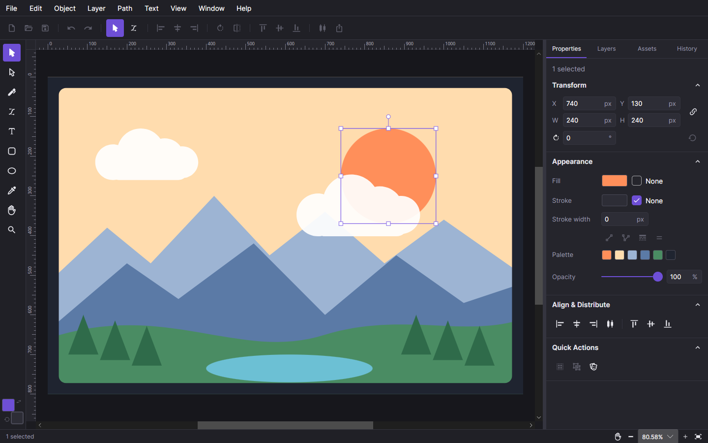
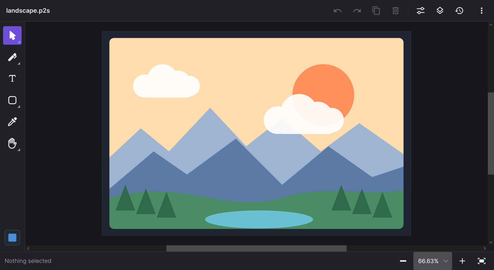
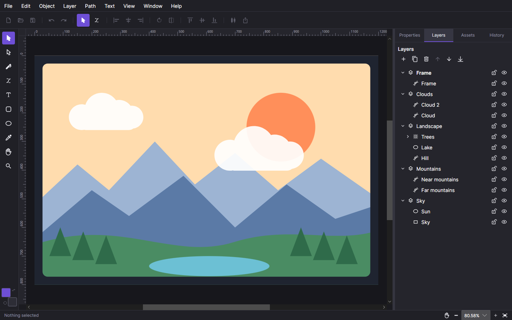
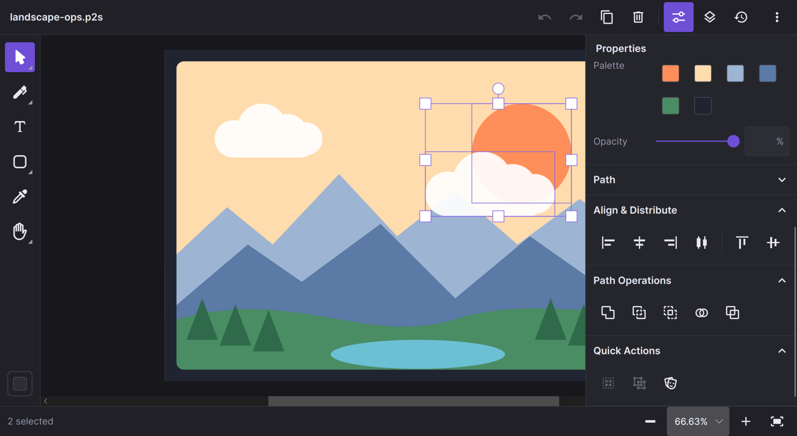

# PressToShape

A vector drawing program for hobbyists, in the spirit of Inkscape and Illustrator. Built with C#, .NET 10 and Avalonia UI 12. Targets Linux, Windows and Android (touch and stylus).

The project is in development. See the [feature gap](docs/feature-gap.md) for what works today and what is still missing.

## Screenshots

The sample drawing was built with the PressToShape document model and opened in the app. The clouds are unions of circles and the frame is a difference of two rectangles, made with the path operations. You can open it yourself: [`docs/screenshots/landscape.p2s`](docs/screenshots/landscape.p2s) (File > Open).



| Desktop | Tablet |
|---|---|
|  |  |
|  |  |

## Structure

| Project | Role |
|---|---|
| `src/PressToShape.Core` | UI-independent document model and logic |
| `src/PressToShape.App` | Shared Avalonia UI (view models, views) |
| `src/PressToShape.Desktop` | Linux and Windows head |
| `src/PressToShape.Android` | Android head |
| `tests/PressToShape.*.Tests` | xUnit tests |
| `tests/PressToShape.Benchmarks` | BenchmarkDotNet performance benchmarks (not run by `dotnet test`) |
| `tools/PressToShape.CodeIndex` | Developer tool: builds the searchable code index in `docs/index/` (not part of the app) |

Dependencies point one way: `Desktop/Android -> App -> Core`. A GUI mockup is in `docs/mockup/`.

## Prerequisites

- .NET 10 SDK
- The GNU gettext tools (`msgfmt`), which the build uses to compile the translations. On Debian and Ubuntu: `sudo apt install gettext`. On Windows, install the gettext tools (for example the builds listed at https://mlocati.github.io/articles/gettext-iconv-windows.html) and make sure `msgfmt` is on `PATH`. The build fails with a clear message if it is missing. This applies to every project that builds `PressToShape.App`, including the Android project.
- For the Android project only: the Android workload (`sudo dotnet workload install android`), JDK 21 (newer JDKs are rejected), and an Android SDK. If your default JDK is not 21, pass it on the command line: `dotnet build -p:JavaSdkDirectory=<path to JDK 21>`.

Without the Android prerequisites, build the other projects individually (see below).

## Build, run, test

```bash
dotnet build src/PressToShape.Desktop          # desktop app and its dependencies
dotnet run --project src/PressToShape.Desktop  # run on Linux or Windows
dotnet test tests/PressToShape.Core.Tests      # tests, or `dotnet test` for the whole solution
dotnet build                                   # everything, including Android
dotnet format --verify-no-changes              # formatting check
```

The Android app is not run on an emulator. The tablet version is tested on a real device over `adb`: a Lenovo Idea Tab (model TB336FU) (Android 16, 2560x1600 px, 320 dpi) with a stylus. Behavior on other tablets has not been checked.

## Performance benchmarks

`tests/PressToShape.Benchmarks` measures the shape operations on a drawing with 1,000 and 10,000 shapes (add 50,000 with `PTS_BENCH_LARGE=1`), all selected:
select all, marquee, overlay, handle drag, group move, nudge, duplicate, cut, paste, and saving and exporting. Run it in Release mode:

```bash
dotnet run -c Release --project tests/PressToShape.Benchmarks -- --filter "*"                      # full run (several minutes)
dotnet run -c Release --project tests/PressToShape.Benchmarks -- --filter "*" --job short          # quick pass
dotnet run -c Release --project tests/PressToShape.Benchmarks -- --filter "*Handle*" --job short   # one benchmark
```

The benchmark processes are limited to 1.5 GB of heap (`DOTNET_GCHeapHardLimit`, set in `Program.cs`), so a runaway benchmark fails instead of filling the computer's memory; set the variable yourself to change it.

Results are written to `BenchmarkDotNet.Artifacts/` (not committed). The times should grow roughly in proportion to the shape
count: if 10,000 shapes take far more than 10 times as long as 1,000, a step has become quadratic. Compare runs on the same machine.

## Translations

The app is available in English (default) and German. Texts in the code are written in English, and the English text is the message id. German lives in `src/PressToShape.App/Translations/de.po`, which the build compiles to `.mo` with `msgfmt` and embeds in the app.

- **Language choice:** the saved choice, otherwise German on a German system, otherwise English. Change it in the app with View > Language. The choice is saved in `settings.json` in the application-data folder (`~/.config/PressToShape/` on Linux, `%APPDATA%\PressToShape\` on Windows), for example `{ "Language": "de" }`.
- **Add or change a text:** write `T("English")` or, in data tables, `N("English")` in C#, or `{loc:T 'English'}` in XAML. Add `msgid` and `msgstr` to `de.po`. `dotnet test` fails until every text has a German translation and until `de.po` has no unused entries. Keep Alt-key mnemonics (an underscore before a letter in menu texts) unique within a menu.
- **Add a language:** copy `de.po` to `<code>.po` (for example `fr.po`) and set `Language:` in its header, translate the entries, add one `LanguageInfo` entry for it in `SupportedLanguages.cs`, and add its test case to the consistency tests. Rebuild.

## Code index for coding agents

`tools/PressToShape.CodeIndex` analyses the solution with Roslyn and writes a searchable index of the C# source (types, members, signatures, doc comments, inheritance, constructor injection, references and calls) and of the Avalonia XAML (views, bindings resolved to view model properties and commands, resources, styles, templates, converters, event handlers, and the View to ViewModel links) to `docs/index/`. The index is committed. Relationships the compiler cannot prove are marked `inferred`. It uses its own packages and is not referenced by the app. Run `dotnet restore` first.

```bash
dotnet run --project tools/PressToShape.CodeIndex -- generate          # write docs/index/
dotnet run --project tools/PressToShape.CodeIndex -- check             # exit 1 if docs/index/ is out of date
dotnet run --project tools/PressToShape.CodeIndex -- find Localizer    # search by name
dotnet run --project tools/PressToShape.CodeIndex -- show ILocalizer   # signature, docs, relationships
dotnet run --project tools/PressToShape.CodeIndex -- chain ShellView    # MVVM chain of a view, view model or command
dotnet run --project tools/PressToShape.CodeIndex -- --help            # impls, derived, refs, deps, --json
```

`chain <view|view model|command> [--depth 1-5] [--json]` prints one tree: the view and its XAML file, the view model with the evidence and `verified` or `inferred` for each link, the bindings with the handler method of each command (or "not statically known"), services with implementations and where they are created, models, child views, resources, converters, styles, templates and the tests that use them. `generate` also writes six pages to `docs/index/markdown/avalonia/`: `views.md`, `controls.md`, `converters.md`, `styles-and-resources.md`, `services.md` and `application.md`. The rule `.claude/rules/code-index.md` tells coding agents how to use all of this.

A view class shows its XAML file with `show`, and `refs` of a view model property, command, converter or resource key lists the XAML places that use it. A View to ViewModel link made by the `ViewLocator` name convention is marked `inferred` with the reason. Regenerate and commit the index after changing code or XAML. `docs/index/markdown/README.md` is the human-readable entry point, `names.tsv` is a flat list for `grep`. The query commands read only the index files and do not compile anything.

## Spec workflow

Features are specified with the [spec-workflow MCP](https://github.com/Pimzino/spec-workflow-mcp) (configured in `.mcp.json`). Specs and steering documents live in `.spec-workflow/`. Start the approval dashboard with:

```bash
scripts/spec-dashboard.sh        # http://localhost:5000
```

Rules for working with Claude Code are in `.claude/rules/`.

## License

PressToShape is free software, licensed under the GNU General Public License v3.0. See [LICENSE](LICENSE).
Third-party components and their licenses are listed in [THIRD-PARTY-NOTICES.md](THIRD-PARTY-NOTICES.md).
